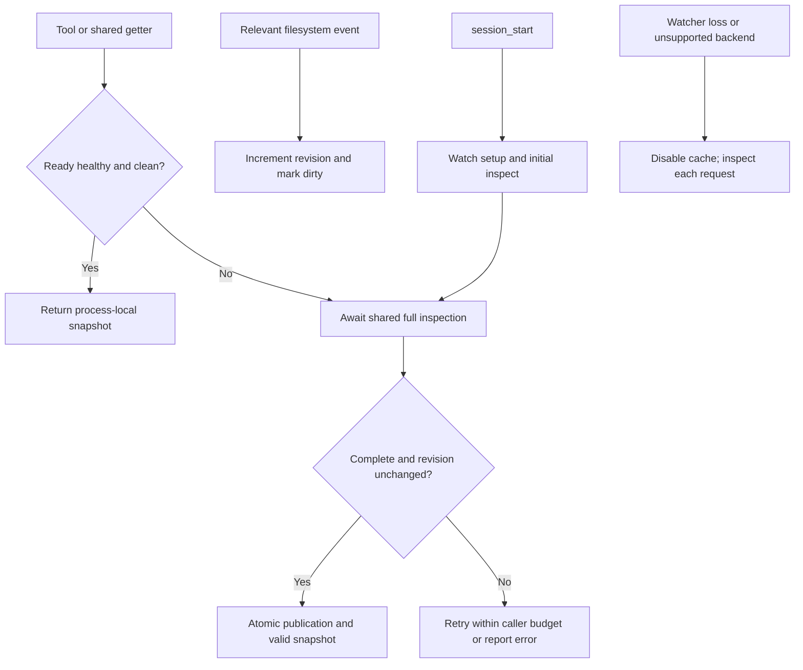

# justomp Watcher-Assisted Project Inspection - Plan

## Goal Capsule

- **Objective:** Kullanıcı ve araçlar, seçili klasördeki projeleri ve aralarındaki açık ilişkileri watcher tarafından izlenen ve gerektiğinde yeniden keşfedilen bilgiyle görebilsin.
- **Means:** Ortak `getPackagingStructure()` akışı, `project_inspect` custom tool'u ve `session_start` bağlantısı; KTD1–KTD3.
- **Target:** `justomp`. Hedef dizin yalnız planı içeriyor; uygulama kodu, paket tanımı veya Git repository'si henüz yok. Bu plandaki yollar hedef dizine göredir.
- **Authority:** Kullanıcının aşağıda korunan kapsam kararları → Product Contract → uygulama kararları. Eski kapsamlı template planı kullanılmayacak.
- **Execution:** Bu belge yalnız planlama içindir. Uygulama ayrıca başlatılır; mevcut Python template değişmez. Yayın, Git remote, PR ve release bu kapsamda yoktur.

---

## Product Contract

### Summary

Seçilen root ve alt klasörlerdeki Python, JS/TS ve Go projeleri incelenir.
Workspace üyeliği ile yerel paket bağımlılığı ayrı gösterilir.
Başlangıçta keşif yapılır; ilgili filesystem olayları bellekteki raporu geçersiz kılar.
`getPackagingStructure()` geçerli raporu döndürür veya gerekli keşfi tamamlayıp `.justomp/packaging_structure.json` kaydını yeniler.

### Problem Frame

Bir repo tek proje, birden fazla bağımsız proje veya birden fazla workspace barındırabilir.
Diğer araçların eski bir dosyayı okuyarak yanlış hedef seçmesini önlemek için keşif tek ortak giriş noktasından yapılmalıdır.
Değişmemiş yapıyı her çağrıda yeniden taramak yerine filesystem bildirimleri izlenecek; yenileme ihtiyaç anında yapılacaktır.

### Key Decisions

- **Watcher ile geçersiz kılma, ihtiyaç anında yenileme.** (session-settled: user-directed — chosen over her çağrıda tam tarama: kullanıcı performans karşılaştırmasından sonra watcher yaklaşımını seçti.) Governs R1, R8–R9.
- **Opsiyonel include/exclude config.** (session-settled: user-directed — chosen over sabit ve programatik dışlama listesi: kullanıcı varsayılanları `.justomp/config.json` içinden değiştirmek istiyor.) Governs R12–R13.
- **Bağımlılık dizinlerini baştan dışlama.** (session-settled: user-directed — chosen over dependency ağacını izleyip olayları sonradan filtrelemek: kullanıcı her derinlikte ayrıntılı dışlama istedi.) Governs R12.
- **Ortak fonksiyon, tool ve hook.** (session-settled: user-approved — chosen over keşfi yalnız custom tool içine yazmak: aynı davranış tüm çağıranlar tarafından kullanılacak.) Governs R1, R7.
- **Tek çıktı dosyası.** (session-settled: user-approved — chosen over araçların kayıt dosyasını doğrudan okuması: ortak fonksiyon güncel sonucu kaydedip döndürecek.) Governs R6, R8.

### Requirements

**Kesif ve iliskiler**

- R1. `getPackagingStructure()` yalnız sağlıklı ve hazır watcher ile geçerli sayılan süreç-içi raporu yeniden kullanmalı. İlk çağrı, ilgili değişiklik veya açık zorunlu yenileme isteğinde tarama tamamlanmadan başarı dönmemeli.
- R2. Root tek proje, kapsayıcı root, root ve nested projeler, aynı/farklı diller, aynı klasörde birden fazla manifest ve boş klasör desteklenmeli.
- R3. Bulunan dosyanın içeriği değerlendirilmeli; klasör adı, dosya uzantısı veya tek manifest varlığıyla paket yöneticisi/uygulama türü kesinleştirilmemeli.
- R4. Workspace üyeliği ile açık yerel bağımlılıklar ayrı ilişkiler olarak dönmeli; aynı workspace üyeliği bağımlılık sayılmamalı.
- R5. Her tespit kaynak dosyası/alanıyla açıklanmalı; belirsiz, çelişen, bozuk veya desteklenmeyen tanım açık tanı üretmeli.

**Guncellik ve kullanim**

- R6. Tamamlanan sonuç `.justomp/packaging_structure.json` içine yarım JSON görünmeyecek biçimde yazılmalı; mevcut manifest ve uygulama dosyaları değişmemeli.
- R7. `project_inspect` ve `session_start` aynı fonksiyonu kullanmalı; gelecekteki araçlar da bu ortak girişten yararlanabilmeli.
- R8. Başarısız veya eksik keşif eski kayıtla başarılıymış gibi tamamlanmamalı. Önceki dosya kalabilir, fakat fonksiyon onu fallback olarak döndürmemeli.
- R9. Güncellik ilk tarama ve işlenmiş filesystem olaylarına dayanır; gecikmiş/kaçmış olaylar nedeniyle anlık disk eşitliği garanti edilmez. Bilinen watcher hatası veya izleme kaybı cache kullanımını kapatmalı; çağrılar tam taramaya düşmeli. Çıktı atomik filesystem snapshot veya mutasyon yetkisi değildir.
- R10. Keşif proje kodunu, config script'lerini veya paket yöneticisini çalıştırmamalı; paket kurmamalı ve ağa çıkmamalı.
- R11. Büyük repo maliyeti ölçülebilir olmalı; optimizasyonlar yeni/nested projeleri sessizce atlamamalı.
- R12. Ortak dışlama politikası ilk keşif ve watcher kurulumunda aynı olmalı. Etkin kuralların hariç tuttuğu ağaçlara inilmemeli, altlarına ayrı izleme aboneliği açılmamalı ve iç olayları raporu geçersiz kılmamalı. Varsayılan kurallar her derinlikte noktayla başlayan dosya/dizinleri ve tanımlı noktasız dependency dizinlerini dışlar.

- R13. `.justomp/config.json` içindeki bütün alanlar opsiyoneldir. Plugin her `session_start` sırasında yalnız eksik alanları kod içindeki varsayılanlarla tamamlayıp dosyaya yazmalı; dosya yoksa bütün varsayılanlarla oluşturmalı. Mevcut alanların değerleri korunmalı ve o alan için varsayılanlar ne eklenmeli ne kullanılmalı. Kullanıcının kural değişikliği sonraki getter çağrısında etkinleşmeli.

### Scope Boundaries

Bu teslim: opsiyonel config ve eksik alanları tamamlama, keşif çekirdeği, dosyaya kayıt, ortak fonksiyon, tek custom tool, oturum başlangıcı bağlantısı, testler ve yerel performans ölçümü.
Paket yönetimi, proje oluşturma, template aktarımı, guard/policy sistemi, Git/release, CLI ürünü ve ek custom tool'lar kapsam dışıdır.
Watcher ve süreç-içi rapor bu teslimdedir. Debounce, periyodik polling, TTL, disk JSON'undan cache yükleme ve kalıcı proje indeksi eklenmez.
Daemon ve kalıcı BUSY/lock protokolü eklenmez; kayıt dosyasının görevini R8–R9 sınırlar.
İlerideki mutasyon araçlarının işlem öncesi hedef doğrulaması ayrı çalışmadır; bu keşif çıktısı işlem sırasında dosyaların değişmeyeceğini kanıtlamaz.

---

## Planning Contract

### Key Technical Decisions

- KTD1. **İki işlev ayrılır.** `inspectProject()` yalnız okuyup yapılandırılmış rapor üretir. `getPackagingStructure()` keşif ve kayıt akışını yönetir; R1, R6–R8. OMP tipleri keşif çekirdeğine taşınmaz.
- KTD2. **Root açık ve sabittir.** Ortak fonksiyon seçili root'u alır. Tool ve session hook varsayılan olarak OMP oturumunun çalışma klasörünü kullanır; üst Git root'una kendiliğinden çıkmaz. Git olmayan klasör geçerlidir. Dış workspace referansları raporlanır, root otomatik genişletilmez.
- KTD3. **Root başına tek izleyici ve yenileme.** Aynı süreç/root için tek watcher, olay revizyonu ve değiştirilemeyen rapor tutulur. Eşzamanlı getter çağrıları gereken tek yenilemeyi bekleyebilir; dönüşten önce revizyon/sağlık yeniden kontrol edilir. Bir çağıranın iptali diğerlerinin beklediği ortak işi iptal etmez. Tüm bekleyenler ayrıldığında veya host kapandığında iş durdurulur.
- KTD4. **Native tanımlar okunur.** JSON/TOML/YAML ve Go manifest sözdizimi parser'larla değerlendirilir; executable config import edilmez. Basit regex ile Go dosyasının tamamını parse etmek gibi eksik yaklaşımlar kullanılmaz. Desteklenmeyen ifade çözülmüş gibi gösterilmez.
- KTD5. **Kayıt türetilmiş çıktıdır.** Her tarama benzersiz kimlik ve başlangıç/bitiş zamanları taşır. Aynı dizindeki benzersiz geçici dosya tamamlanıp kapandıktan sonra hedef dosyayla değiştirilir. `.justomp` veya çıktı yolu symlink ise dışarı yazmak yerine hata verilir. Yalnız bu çağrının geçici dosyası temizlenir.
- KTD6. **Native bildirim ve erken eleme.** Watcher adaptörü OS filesystem bildirimlerini kullanır; syscall tracing yapılmaz. Chokidar adaydır; public `ignored` ve directory-watch davranışı pinned Bun/OMP üzerinde test edilir. Per-directory native backend, dışlanan ağaçlara abonelik kurulmaması için tercih edilir. Ortam değişkeni veya backend seçimiyle sessiz polling açılmaz. Asenkron tarama ve sınırlı I/O korunur.

- KTD7. **Config watcher'dan bağımsız okunur.** `getPackagingStructure()` cache kararından önce config içeriğini yeniden okur ve etkin kuralları karşılaştırır. Değişiklik watcher kapsamını geçersiz kılar; yeni kurallarla watcher kurulup inspect tamamlanmadan sonuç dönmez. Config için gizli dosya izleme istisnası yoktur.

### Discovery Rules

| Kanit | Cikarilacak bilgi |
|---|---|
| `pyproject.toml` | Python proje metadata'sı, yalnız tooling config olma durumu, uv workspace/source tanımları |
| `package.json` | JS/TS paket adı, declared manager/runtime, dependency alanları, varsa workspace tanımı |
| `go.mod` | Modül kimliği, Go sürümü, require ve yerel replace tanımları |
| `pnpm-workspace.yaml` | Üyelik desenleri/exclusions ve ilişki çözümünü etkileyen deklarasyonlar |
| `go.work` | Açık workspace üyeleri ve yerel yönlendirmeler |
| Tanınan lock dosyalarının varlığı | Manager tespitini destekleyen veya onunla çelişen kanıt; dependency grafiği için tüm lock içeriği okunmaz |

İlk workspace çözücüleri uv, pnpm ve Go'dur. Diğer JS/Python manager'larına ait tanımlar tespit edilir; desteklenmeyen ilişki `unresolved` olarak belirtilir, bağımsız proje olduğu varsayılmaz.
uv üye/exclude kuralları, pnpm paket glob'ları ve Go `use` listesi ayrı çözücülere aittir.
Workspace dışındaki iç projeler de taranır; yalnız workspace listesine bakmak yeterli değildir.

Yerel bağımlılık kenarı manifestteki açık yerel referans ve çözülen hedefle desteklenmelidir.
JS `workspace:`/yerel path, uv workspace/path source ve Go require ile eşleşen yerel replace ayrı yorumlanır.
Tek başına kullanılmayan Go replace kaydı dependency kenarı üretmez; yönlendirme kanıtı olarak tutulur.
Sadece isim benzerliği veya semver eşleşmesi kenar üretmez. Belirsiz hedef/alias/catalog çözümü `unresolved` tanısı alır.
Framework tespiti varsa declared dependency'den gelen ipucu olarak sunulur; kaynak kod çalıştırılarak doğrulanmaz.

Tarama root'ta proje bulunca durmaz. Aşağıdaki Configuration and Inspection Rules hem traversal hem watcher için bağlayıcıdır.
Git metadata'sı okunmaz ve `.git` varlığına göre nested repo sınırı uygulanmaz. Seçili root altındaki projeler etkin include/exclude kurallarına göre bulunur. Symlink'ler izlenmeden raporlanır; symlink manifest normal manifest gibi açılmaz.
`examples`, `tests/fixtures`, Git tarafından izlenmeyen veya `.gitignore` içindeki klasörler sırf bu nedenle gizlenmez.
Açık workspace tanımı dışlanan veya sınır dışındaki bir üyeye işaret ederse kayıp üyelik gizlenmez; neden tanı olarak döner.
Başlangıçta derinlik sınırıyla sessiz kesme yapılmaz; iptal veya erişim hatası R8 kapsamında eksik sonuçtur.

### Result Contract

| Alan | Anlam |
|---|---|
| `schemaVersion` | JSON sözleşmesinin sürümü; ilk sürüm 1 |
| `scanId`, `startedAt`, `completedAt` | Raporu üreten taramanın kimliği/zamanları; cache hit yeni tarama zamanı uydurmaz |
| `root` | Canonical tarama sınırı; diğer proje yolları buna göre relative |
| `projects` | Path+ecosystem kimliği, manifest, varsa ad/runtime/manager, kanıtlar ve tespit durumu |
| `workspaces` | Workspace kimliği, türü, declaration path ve çözülen üye kimlikleri |
| `localDependencies` | Kaynak/hedef proje kimliği, deklarasyon türü ve kanıt |
| `diagnostics`, `excluded` | Belirsizlikler, bozuk tanımlar, çözülmeyen/dış referanslar, tarama sınırları |
| `complete`, `metrics` | Kapsamın tamamlanması; süre, directory entry, okunan manifest ve byte sayıları |

Proje listesi ve ilişkiler deterministik sırada döner; zaman/scan kimliği karşılaştırmalarda ayrıdır.
Geçerli boş klasör `projects: []` ile tamamlanır. Bozuk manifest veya okunamayan gerekli dizin `complete: false` üretir; bulunan diğer projeler hata raporunda görülebilir.
Desteklenmeyen manager veya dış sınır, `complete: true` ile birlikte açık bir unresolved/excluded kaydı taşıyabilir; complete tüm capability'lerin desteklendiği anlamına gelmez.
Kayıt yalnız tam taramada yayımlanır. Kayıt başarısızlığı çağrı hatasıdır; eldeki rapor tanı amaçlı taşınabilir ama kaydedilmiş başarı sayılmaz.

Birden fazla OMP süreci aynı dosyaya yazarsa her yayın tek tam JSON'dur; dosya en son tamamlanan yayını içerir.
Başlangıcı eski bir taramanın geç bitmesi mümkündür. Bu yüzden tüketiciler dosyayı yeniden okumaz, kendi çağrılarının döndürdüğü raporu kullanır; disk kaydı global en-yeni-snapshot iddiası taşımaz.
Tarama/publish sırasında ilgili olay revizyonu değişirse rapor geçerli ilan edilmez; çağrı bütçesi içinde yeniden taranır, bütçe biterse `structure-unstable` hatası döner.
Genel filesystem snapshot izolasyonu iddia edilmez; gerçek watcher testleri olay teslimini gözleyerek bekler. Zorunlu yenileme bilinen cache'i atlar.

### High-Level Technical Design



### Configuration and Inspection Rules

Config konumu yönetilen projenin `.justomp/config.json` dosyasıdır. Planlama veya geliştirme sırasında bu dosya önceden oluşturulmaz. Varsayılanlar plugin kodunda `src/config/defaults.ts` içinde tutulur; plugin her `session_start` sırasında alan bazında eksikleri tamamlar. Dosya yoksa aşağıdaki nesneyi yazar; dosya varsa yalnız eksik alanları ekler ve mevcut değerleri korur:

```json
{
  "inspection_rules": {
    "include": [
      "**/*"
    ],
    "exclude": [
      "**/.*",
      "**/node_modules",
      "**/venv",
      "**/bower_components",
      "**/__pycache__",
      "**/__pypackages__"
    ]
  }
}
```

**Opsiyonellik ve alan bazinda flush:**

- `{}`, `{"inspection_rules": {}}` ve yalnız bir kural alanı içeren dosyalar geçerlidir. `session_start` eksik `inspection_rules` nesnesini ve içindeki eksik alanları varsayılanlarıyla dosyaya ekler. Örneğin yalnız `exclude` varsa sadece `include` yazılır; kullanıcının `exclude` listesi aynen kullanılır.
- Alanın varlığı kontrol edilir; boş/falsy değer eksik sayılmaz. Mevcut dizi varsayılan diziyle birleştirilmez. `exclude: []` varsayılan dışlamaları kaldırır ve boş kalır; `include: []` boş kapsam olarak korunur.
- `null`, yanlış tip, geçersiz JSON veya desteklenmeyen pattern açık config hatasıdır. Opsiyonellik hatalı değeri geçerli yapmaz; dosya silinmez veya varsayılanla ezilmez.
- Bilinmeyen alanlar korunur; bu sürüm yalnız tanıdığı alanları kullanır. Flush yalnız eksik alan varsa yazım yapar; ikinci startup ek değişiklik üretmez. Plugin sürümü yeni bir varsayılan alan eklediğinde yalnız o eksik alan tamamlanır, mevcut dizilere yeni varsayılan elemanlar eklenmez.
- Session sırasında kaldırılmış alan getter tarafından yalnız bellekte varsayılanıyla değerlendirilir; getter flush yapmaz, dosyaya tamamlama sonraki `session_start`'a aittir.
- Config sonraki kullanımda silinmişse eksik dosya olarak varsayılan kurallar uygulanır. Sonraki `session_start` dosyayı yeniden oluşturur; getter eksik config için kendiliğinden dosya yazmaz.
- Config tamamı doğrulanmadan eksik alan flush edilmez; hatalı JSON/tip/pattern dosyayı değiştirmeden hata üretir. Yazım tam JSON olarak yayımlanır; eşzamanlı session/kullanıcı değişikliği ezilmemelidir. Config symlink ise dış hedefe yazılmaz; açık hata döner.

**Pattern sözleşmesi:**

- Pattern'ler seçili root'a göre relative glob'lardır; ayracı `/` olur. Matcher gizli adları değerlendirebilir, gizleme açık `**/.*` kuralından gelir.
- `include` uygun yolları belirler; `exclude` çakışmada önceliklidir. Bir directory eşleşmesi alt ağacına uygulanır. Include hedefine ulaşmak için gereken ancestor dizinleri dolaşılabilir; exclude edilmiş ancestor aşılamaz.
- `**/.*`, her derinlikte noktayla başlayan dosya veya dizini eşler. `**/node_modules`, root ve nested dependency dizinini eşler; `my_node_modules_notes` eşleşmez.
- İlk pattern desteği literal path, `*` ve `**` ile sınırlıdır; mutlak yol, root dışına çıkan `..` ve `!` ile negation desteklenmez. Daha geniş sözdizimi sessizce tahmin edilmez.
- Kullanıcı gizli proje eklemek isterse ilgili exclude kuralını değiştirmelidir; include tek başına exclude'u aşmaz.
- Varsayılanlarda `env`, `build`, `dist`, `vendor` gibi genel adlar kör dışlanmaz. Kullanıcı bunları exclude'a ekleyebilir.
- Aynı etkin matcher ilk scan, full refresh ve watcher kurulumunda kullanılır. Kurallar dosya içeriği okunmadan ve alt abonelik açılmadan uygulanır.
- `.git` veya `.yarn` için özel metadata istisnası yoktur. Workspace açıkça dışlanan bir üye gösterirse `excluded-member` tanısı döner; kural otomatik aşılmaz.

Config, snapshot ve bu servisin geçici dosyaları proje manifesti veya yapı-değişikliği tetikleyicisi sayılmaz; kullanıcı bütün gizli alanları include etse de kendi kayıt yazımı inspect döngüsü oluşturmaz.
Bu iç dosyalar için source watcher kurulmaz; config getter tarafından doğrudan okunur. `.justomp` altında kullanıcı tarafından açıkça dahil edilmiş başka dosyalar normal kurallara tabidir.
Dışlanan dizinin parent entry'sini görmek veya parent bildirimi almak normaldir; içeride traversal/alt abonelik kurulmaz.
Recursive OS backend kök akışında dışlanan alanın olayını yine iletebilir; olay en erken aşamada elenir. OS'nin hiç bildirim üretmeyeceği iddia edilmez.

### Watcher Lifecycle and Freshness

1. `session_start` config'i doğrular, yalnız eksik alanları varsayılanlarla tamamlayıp flush eder; dosya yoksa bütün varsayılanları oluşturur. Mevcut alan değerleri aynen kullanılır. Handler'lar watcher başlamadan bağlanır. Initial discovery/ready tamamlanmadan süreç-içi rapor geçerli sayılmaz.
2. İlk tam inspect watcher hazırken yapılır; tarama sırasında gelen ilgili olaylar revizyonu artırır.
3. Clean rapor yalnız başarılı inspect+publish ve değişmemiş olay revizyonu ile kurulur. Dönüş öncesi sağlık/revizyon tekrar kontrol edilir.
4. İlgili manifest, workspace, manager tespit metadata'sı değişiklikleri dirty yapar. Yeni/silinen/taşınan kapsam içi dizinler de dirty yapar; içine önceden dosya konmuş taşınmış proje sonraki tam taramada bulunur.
5. Sıradan kaynak dosyasının içerik değişikliği, keşif girdisi değilse dirty yapmaz. Getter önce KTD7 uyarınca config okur; etkin kural değişikliği root watcher ve raporunu yeniden oluşturur. Config okunamıyorsa eski kapsamla cache hit dönmez.
6. Watcher olay geldiğinde inspect veya JSON yazımı başlatmaz. Sonraki getter dirty raporu yeniler; debounce/timer tabanlı tarama yoktur.
7. Yenileme sırasında tekrar değişiklik gelirse eski revizyon geçerli olarak dönmez. Aynı getter bütçesi içinde tekrar deneme yapılır; sürekli değişimde açık hata vardır.
8. Watcher error/close, erişim kaybı veya adaptörün bildirdiği overflow/coverage kaybı cache'i kapatır. Olay kaybı her backend'de görünür olmayabilir; bu R9 sınırıdır. Fallback'te her istek fresh inspect yapar. Yeni watcher ancak hazır ve yeniden taranmış baseline ile cache kullanımını açabilir.
9. `project_inspect` açık `refresh` seçeneğiyle cache'i atlayabilir. Bu seçenek aynı servisi kullanır; ayrı keşif motoru oluşturmaz. Süreç restart'ında disk JSON'u cache olarak yüklenmez.
10. Shutdown/root reset watcher ve bekleyen işleri kapatır. Kayıt son başarılı inspect'in raporudur; watcher olayları arasında diskteki JSON'un anında değişmesi vaat edilmez.

### Performance and Limits

İlk kurulum hem watcher kapsamını hem proje yapısını keşfeder; başlangıç maliyeti çağrı başına taramadan daha yüksek olabilir.
Clean getter küçük config dosyasını okuduktan sonra süreç-içi raporu yeniden kullanır; tam disk taraması ve aynı snapshot JSON'unun tekrar yazımı yapılmaz. Büyük raporun döndürülmesi/serileştirilmesi yine maliyet taşır.
Dirty getter tam inspect yapar; bu ilk sürüm incremental dependency graph motoru içermez.
İlgili değişiklik yokken N çağrı N tarama oluşturmaz; ilgili değişiklik her çağrı arasında varsa kazanç azalır.

Watcher kaynak tüketimi platforma bağlıdır. Linux inotify instance file descriptor, ayrı watch kayıtları ve olay kuyruğu kullanır; watch sayısı file descriptor sayısıyla aynı değildir.
macOS ve Windows backend'leri farklı kaynak modellerine sahiptir. Limitler otomatik yükseltilmez; hata görünür olur ve cache kapanır.
Ağ/virtual filesystem üzerinde güvenilir native watch kanıtlanmadıysa cache desteği iddia edilmez; açık full-inspect fallback kullanılır.
Polling kullanarak bu sınırı sessizce değiştirmek kapsam dışıdır.

Erken dışlama, asenkron directory iteration ve sınırlı I/O hem initial hem refresh taramasında korunur.
Watcher'ın yeni nested projeleri bulması için kapsam içi dizinleri izlemesi gerekir; yalnız bugün bulunan manifestlere abone olmak yeterli değildir.
OS olay teslim gecikmesi ile gerçek filesystem snapshot garantisi karıştırılmaz; gelecekteki mutasyon araçlarının hedef girdilerini doğrulaması ayrı gerekliliktir.

### OMP Integration

Tek extension entry'si tool ve `session_start` handler'ını kaydeder.
Tool açıklaması proje/config metadata'sı okuduğunu, türetilmiş JSON yazdığını açıkça belirtir; dosya yazma yan etkisi read-only diye gizlenmez.
Uygulamada pinned OMP public tipleriyle doğru approval sınıfı doğrulanır; ihtiyaç duyulan izin alınamazsa dosya yazılmaz.
Session başlangıcındaki tarama hatası OMP'yi kullanılamaz hale getirmez; hata UI/log'da görünür, sonraki tool çağrısı yeni tarama deneyebilir.
Hook içinden model tool çağrısı üretilmez; ortak fonksiyon doğrudan kullanılır.
Watcher'lar `session_shutdown` sırasında kapatılır; root değişimi/reset eski scope kaynaklarını bırakır. Automatic model-context injection ve sürekli bildirim bu teslimde yoktur.
OMP handler çalışma bütçesine uyan iptal/timeout uygulanır; bütçe aşımında arka planda unutulmuş tarama veya geç yayın kalmaz.

---

## Implementation Units

### U1. Discovery and relationships

**Goal:** Root ve nested proje/workspace yapısını değişiklik yapmadan çıkarmak. **Requirements:** R2–R5, R9–R13. **Dependencies:** Yok.

**Files:** `package.json`, `tsconfig.json`, `src/inspect/model.ts`, `scan.ts`, `readers/`, `relationships.ts`, `src/inspect/exclusions.ts`, `src/config/defaults.ts`, `src/config/load.ts`, `tests/config/rules.test.ts`, `tests/inspect/discovery.test.ts`, `relationships.test.ts`, `exclusions.test.ts`, `tests/fixtures/`.

**Approach:** Minimal TypeScript/OMP geliştirme paketi ve kalite komutlarını kur; KTD2, KTD4, KTD6–KTD7'yi uygula. Ortak varsayılan/config matcher davranışını Configuration and Inspection Rules sözleşmesine göre kur. JSON/TOML/YAML/Go parser seçimini desteklenen sözdizimi fixture'larıyla doğrula. Uygulama başlarken OMP/Bun ve parser sürümlerini manifest/lock'ta sabitle.

**Test scenarios:**

1. Root-only, container-root, root+nested, same-language, mixed, same-directory multi-manifest ve empty fixture'ları doğru liste verir.
2. uv/pnpm/Go workspace üyeliği ile yerel dependency ayrı döner; aynı workspace'teki ilgisiz iki paket arasında kenar yoktur.
3. Duplicate name, malformed manifest, tooling-only pyproject ve manager conflict yanlış kesin tespit üretmez.
4. Gizli dosya/dizinler her derinlikte varsayılan olarak dışlanır; noktasız nested repo içindeki projeler `.git` okunmadan bulunur. Symlink sınırları raporlanır.
5. Eksik/boş/kısmi config, boş diziler, include/exclude çakışması, ancestor pruning ve geçersiz tip/pattern için sözleşmedeki sonuç alınır. Yalnız exclude bulunan dosyaya include varsayılanı eklenir; exclude aynen kalır. Tersi durumda yalnız exclude eklenir. Boş diziler/unknown alanlar korunur, ikinci flush yazım yapmaz, geçersiz config kısmen değiştirilmez.
6. Keşif öncesi/sonrası kaynak hash'leri aynıdır; executable config, network ve package manager çalışmaz.

**Verification:** Geçerli fixture'larda beklenen proje ve ilişki kümeleri eşleşir; bozuk/eksik girdiler açık tanı üretir.

### U2. Watcher lifecycle and snapshot publication

**Goal:** Watcher destekli ortak getter ve tutarlı kayıt. **Requirements:** R1, R6, R8–R9, R12–R13. **Dependencies:** U1.

**Files:** `src/packaging/get-structure.ts`, `snapshot.ts`, `watcher.ts`, `tests/packaging/freshness.test.ts`, `snapshot.test.ts`, `concurrency.test.ts`, `watcher.test.ts`.

**Approach:** KTD1, KTD3, KTD5, KTD7 ve Result Contract uygulanır. Fonksiyon disk kaydını giriş verisi olarak kullanmaz. Üretilen snapshot'ın Git dışında tutulması belgelenir; inspect kullanıcının `.gitignore` dosyasını kendiliğinden değiştirmez.

**Test scenarios:**

1. İlk çağrı inspect yapar; clean tekrar çağrı yeni scanId/tarama/JSON yazımı üretmez. İlgili olaydan sonraki çağrı yeni rapor döndürür.
2. Manifest add/edit/delete, workspace değişikliği, yeni/taşınan nested proje ve açık refresh ayrı fixture'larda doğru yenileme üretir; source-only edit dirty yapmaz.
3. Başlangıç/ready ve tarama/publish sırasında gelen olaylar eski revizyonu clean yapamaz. Sürekli değişim bütçe sonunda hata verir.
4. Eski/bozuk disk JSON'u cache olarak yüklenmez; malformed manifest sonrası eski rapor başarıya dönüşmez.
5. Aynı root çağrıları ortak refresh'i bekler; tek bekleyenin iptali diğerini bozmaz; shutdown sonrası geç yayın olmaz.
6. Error/close/overflow/unsupported backend cache'i kapatır; sonraki çağrılar gerçek tam tarama yapar, hata gizlenmez.
7. Snapshot publication tam JSON bırakır; publish failure, output symlink ve izin hatası kullanıcı dosyalarını bozmaz.
8. İki süreç kendi watcher/raporunu kullanır; diskten birbirinin cache'ini yüklemez. Global yayın sırası garantisi verilmez.
9. Dışlanan ağaçlarda başlangıç/sonradan ekleme/iç değişiklik için traversal ve alt subscription yoktur; dirty oluşmaz. Config kuralı değişimi sonraki getter'da watcher kapsamını yeniden kurar; config için source watcher veya gizli metadata istisnası yoktur.
10. Config dosyası aynı uzunluk/mtime korunarak düzenlense de getter yeni içeriği görür. Hatalı config eski kapsamla başarı dönmez; snapshot/config yazımları self-trigger döngüsü oluşturmaz.

**Verification:** Sağlıklı clean durumda cache hit, dirty durumda beklenen yenileme, watcher kaybında tam tarama doğrulanır; disk JSON'u hiçbir başarı yolunu beslemez.

### U3. OMP tool and session entry

**Goal:** Aynı özelliği agent isteğinden ve oturum başlangıcından kullanmak. **Requirements:** R6–R8, R10, R13. **Dependencies:** U2.

**Files:** `src/index.ts`, `src/omp/extension.ts`, `tests/omp/extension.test.ts`, `tests/omp/installed-smoke.test.ts`, `README.md`.

**Approach:** `project_inspect`, `session_start` ve watcher temizliği için `session_shutdown` kayıtlarını yap. Tool kısa özet ile typed raporu birlikte döndürür; çağrı detaylarında cache hit/refresh/fallback ayrımı görünür, raporun tarama zamanı değiştirilmez. Pinned host'ta gerçek load/approval/timeout davranışını erken doğrula; varsayımsal API'ye göre ilerleme.

**Test scenarios:**

1. Temiz OMP oturumunda hook config'in eksik alanlarını tamamlayıp watcher+ilk kaydı hazırlar; değişiklik yokken tool aynı raporu, ilgili olaydan sonra yenilenmiş raporu döndürür.
2. TUI olmayan modda UI çağrısı zorunlu değildir; tool hatası yapılandırılmıştır.
3. Kaydedilen JSON yan etkisi host izin sözleşmesinde doğru gösterilir; ret halinde yazı oluşmaz.
4. Timeout/iptal sonrası geç publish olmaz; başlangıç hatası sonraki isteğin çalışmasını engellemez.
5. İki eşzamanlı session config oluşturur/tamamlarken mevcut kullanıcı ayarlarını ezmez. Yeni sürümde eklenen varsayılan alan startup'ta yazılır; mevcut exclude listesi genişletilmez.
6. Extension kurulu paketinden, source checkout'a bağlı olmadan yüklenir; shutdown/root reset watcher kaynaklarını kapatır.

**Verification:** Public OMP tipleriyle derleme ve gerçek kurulu extension smoke başarılıdır; discovery dışı tool/policy yoktur.

### U4. Performance characterization and documentation

**Goal:** Büyük repo maliyetini ölçmek ve doğruluğu bozmayan optimizasyonları doğrulamak. **Requirements:** R1, R11–R12. **Dependencies:** U1–U3.

**Files:** `tests/performance/inspect.bench.ts`, `tests/performance/io-bounds.test.ts`, `tests/fixtures/generate-large-tree.ts`, `docs/inspection.md`.

**Approach:** İlk kurulum, cache hit, dirty refresh, watcher fallback, parse, relationship, publish ve bekleme sürelerini ayrı ölç; watcher abonelik/handle sayısını ve idle kaynak kullanımını raporla. Araç dışındaki benchmark ölçümlerini runtime telemetry sistemine çevirmeden raporla. Aşağıdaki Verification Contract uygulanır.

**Test scenarios:**

1. Dışlanan dependency ağacını büyütmek içeride traversal/subscription oluşturmaz; root ve nested node_modules/venv/.venv fixture'ları aynı politikayı kanıtlar.
2. Kaynak içerikleri okunmaz; dosya sayısı arttığında eşzamanlı I/O yapılandırılmış sınırı aşmaz.
3. Yeni nested proje olayı yenileme gerektirir; cache hit testinde tam tarama yapılmaz, dirty refresh yeni projeyi bulur.
4. Büyük fixture sırasında iptal ve shutdown tamamlanır; watcher handle'ları/queue işi birikmez; gerçek macOS/Linux smoke çalışır. Ağ diski ayrıca ölçülmediyse destek iddia edilmez.

**Verification:** Ölçüm raporu fixture boyutu, donanım, filesystem ve runtime sürümüyle tekrar üretilebilir. Varsayımsal milisaniye iddiası yayımlanmaz.

---

## Verification Contract

Henüz kod veya test altyapısı yoktur; bu plan sırasında uygulama testi/benchmark çalıştırılmamıştır.
U1, `check`, `test:integration` ve `bench:inspect` paket script'lerini tanımlar; bunlar önerilen gelecek arayüzlerdir.
`check` strict typecheck, lint/format kontrolü ve unit testleri kapsar. Filesystem/publication/process/host davranışları integration testlerinde doğrulanır.
Test fixture'ları kaynak repo veya kullanıcının gerçek projelerini değiştirmez.

Performans fixture matrisi: 1 proje/~100 entry; 50 proje/~10.000 entry; 500 proje/~100.000 entry; ayrıca 1.000.000 entry içeren dışlanmış dependency ağacı.
Entry, içerik boyutundan farklı ölçülür; directory dağılımı, manifest sayısı ve toplam manifest byte'ları kaydedilir.
Her fixture için initial watch+inspect, en az 20 clean getter, dirty refresh ve fallback full scan ayrı ölçülür. p50/p95/max süreleri, peak bellek, I/O, idle CPU ve watcher abonelik/handle sayıları raporlanır.
İlk çağrı otomatik olarak cold-cache sayılmaz; OS cache temizliği yapılmadıysa cold-cache sonucu iddia edilmez.
Watcher kapalı full-inspect yolu karşılaştırma baseline'ı olur. Optimizasyon karşılaştırmaları aynı fixture ve ortamda yapılır; deterministik I/O sınırları CI'de, oynak wall-clock sonuçları benchmark raporunda tutulur.
Bu teslimin performans şartı belirli bir uydurma latency değil, ölçüm ve bounded kaynak kullanımıdır. Gerçek süreler kullanıcıya sunulur; kabul edilemezse hız/güncellik değiş tokuşu ayrıca kararlaştırılır.
Ağ diski performansı ölçülmediyse açıkça ölçülmedi yazılır; local disk sonucundan genellenmez.

---

## Definition of Done

- R1–R13 ilgili test kanıtıyla karşılanır; bütün desteklenen topolojiler listelenir.
- Sağlıklı watcher cache kullanımı, dirty yenileme ve hata halinde tam tarama kanıtlıdır; kayıt dosyası giriş kaynağı değildir.
- Tool ve session hook aynı servisi kullanır; hatalar veya eksik sonuçlar başarı sayılmaz.
- Yalnız session başlangıcında config'in eksik alanları tamamlanır ve snapshot yazılır; mevcut config değerleri ve uygulama dosyaları korunur. Install, network veya executable config yoktur.
- Opsiyonel config, kullanıcı değerlerinin korunması ve sonraki getter'da yeni kuralların etkinleşmesi doğrulanır.
- Büyük repo ölçümleri ve bilinen eşzamanlı değişiklik sınırı belgelenmiştir.
- Dışlanan ağaçlara traversal/alt abonelik yoktur; watcher başlangıç/hata/kapanış testleri geçer. Debounce, polling, mutasyon araçları veya eski template kapsamı eklenmemiştir.
- Deneme kodları ve kullanılmayan bağımlılıklar temizlenmiş, gerçek OMP smoke doğrulanmıştır.

---

## Sources

- [OMP extension authoring](https://omp.sh/docs/extension-authoring): tek extension içinde tool/event kaydı ve public tipler; KTD1/U3.
- [OMP hooks](https://omp.sh/docs/hooks): session_start, lifecycle, handler süreleri ve hata davranışı; U3.
- [uv workspaces](https://docs.astral.sh/uv/concepts/projects/workspaces/): native üyelik ve source ayrımı; U1.
- [pnpm workspace settings](https://pnpm.io/settings#packages): paket seçimleri ve exclusions; U1.
- [Go module reference](https://go.dev/ref/mod): module/workspace/use/require/replace ayrımı; U1.
- [Linux inotify](https://man7.org/linux/man-pages/man7/inotify.7.html): instance/watch/queue limitleri ve recursive izleme sınırı; KTD6/U2.
- [Chokidar](https://github.com/paulmillr/chokidar): ignored pruning, backend seçimi, ready/error/close ve runtime uyumluluğu; U2/U4.
- [Filesystem API](https://nodejs.org/api/fs.html#fspromisesopendirpath-options): asenkron directory iteration ve dosya operasyonları; KTD5–KTD6. Bun uyumluluğu gerçek testte doğrulanır.

Kaynaklar 2026-10-28 tarihinde incelendi. Exact dependency/host sürümleri uygulama başlangıcında sabitlenir.
