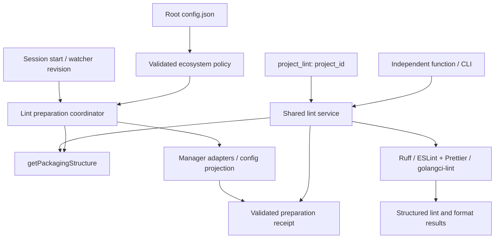

# justomp Ortak Lint Yönetimi - Plan

## Goal Capsule

- **Objective:** Kullanıcı, tek veya çok projeli bir repository'deki Python, JavaScript/TypeScript ve Go projelerini ortak kurallarla hazırlayıp doğru proje üzerinde lint ve format kontrolü çalıştırabilsin.
- **Means:** Inspection ile proje seçimi, ortak lint servisi, ekosistem adaptörleri ve `project_lint` custom tool'u (KTD1–KTD8).
- **Başlangıç:** Mevcut inspection ve dependency araçları; referans commit `a665659`.
- **Authority:** Kullanıcının Requirements ve etiketli kararlarda korunan seçimleri → Planning Contract → Implementation Units. Uygulama ayrıntısı ürün kararını değiştiremez.
- **Execution:** Bu belge yalnız plandır. Uygulama ayrıca başlatılır; commit, push, PR ve release ayrı yetki gerektirir.
- **Stop conditions:** Seçilen native araç bir sözleşmeyi sağlayamıyorsa kuralı kapatmak veya runtime değiştirmek yerine uyumsuzluğu bildir. Destek testlerle kanıtlanmadan ekosistemi destekleniyor diye sunma.

## Product Contract

### Summary

`project_lint`, `project_id` ile seçilen projenin lint ve format kontrolünü yapar. Extension gerekli lint araçlarını hazırlar ve repository kökündeki `.justomp/config.json` politikasını native araç ayarlarına dağıtır. Yeni keşfedilen projeler de aynı hazırlıktan geçer.

Python için Ruff, JS/TS için ESLint + typescript-eslint ve Prettier, Go için golangci-lint ve onun gofumpt/goimports kontrolleri kullanılır. Servis OMP'den bağımsız çağrılabilir; ileride Git hook'u aynı servise bağlanabilir.

### Problem Frame

Manifestler farklı klasörlerde bulunabilir ve birden fazla proje aynı lock dosyasını veya ortamı paylaşabilir. Sadece root'ta bir lint komutu çalıştırmak doğru kapsamı belirlemez. Proje ayarları ayrı ayrı yönetildiğinde ortak politikanın projeler arasında farklılaşması da mümkündür.

Araç kurulumu, konfigürasyon dağıtımı ve kaynak kontrolü farklı yan etkilere sahiptir. Bu aşamalar ayrılmazsa bir kontrol çağrısı beklenmedik sürüm yükseltmeleri yapabilir veya tamamlanmamış hazırlığı başarılı lint sonucu gibi gösterebilir.

### Requirements

#### Hedef ve çalıştırma

- R1. `project_lint` zorunlu `project_id` alır; ekosistem, manager, cwd, shell komutu veya kural listesi agent'tan alınmaz.
- R2. Hedef güncel `getPackagingStructure()` sonucundan çözülür. Root ve iç içe projeler desteklenir; parent projenin kontrolü bağımsız child projeyi ikinci kez taramaz.
- R3. Başarı için lint ve format kontrollerinin ikisi de tamamlanıp geçmelidir; `fix`/otomatik kaynak düzenleme bu araçta bulunmaz.
- R4. Her sonuç kontrol aşamalarını, çalıştırılan araç sürümlerini, göreli dosya yollarını, tanıları ve tamamlanamayan aşamaları bildirir. Boş kapsam, hazırlık hatası ve kontrol hatası birbirinden ayrılır.

#### Ortak ayar

- R5. Root `.justomp/config.json` tek politika kaynağıdır; ekosistem başına ortak ayar bütün ilgili projelere uygulanır. Proje bazlı politika override'ı yoktur.
- R6. Eksik config alanları default değerleriyle alan bazında tamamlanır. Var olan değerler, boş diziler dahil, korunur; dizi birleştirilmez. Geçersiz türler sessizce default'a çevrilmez.
- R7. Native dosyalara yalnız lint politikasının sahibi olduğu alanlar yazılır; diğer proje ayarları ve bağımlılıklar korunur. Bağımlılık değişikliklerini native manager yapar.
- R8. Ortak politika değişikliği bütün ilgili projeleri yeniden hazırlama ihtiyacı doğurur. Yeni config ile eski native ayarlardan başarı üretilemez.

#### Kurulum ve sürümler

- R9. İlk session başlangıcında mevcut projeler, daha sonra gerçek manifesti keşfedilen yeni projeler hazırlanır. Sadece klasör oluşturulması kurulum başlatmaz.
- R10. İlk Python hazırlığında ve yeni Python projesi keşfinde en güncel kararlı Ruff bir kez çözülür; mevcut ve yeni bütün Python projelerinde aynı somut sürüm kullanılır. Eski projeler de gerekiyorsa güncellenir.
- R11. Başarılı hazırlık bilgisi yeniden açılışta korunur. Olağan lint çağrısı veya proje kümesi değişmeyen session başlangıcı kendiliğinden yeni sürüm aramaz.
- R12. Python/JS lint bağımlılıkları dev grubunda native manager ile manifest, lock ve ortam birlikte güncellenerek kurulur. Eksik manager/runtime otomatik kurulmaz veya değiştirilmez.
- R13. Kısmi kurulum başarısızlığı tamamlanan değişiklikleri raporlar; ek rollback yapılmaz. Bütün projeler doğrulanmadan sürüm eşitleme tamamlandı sayılmaz.

#### Ekosistemler ve entegrasyon

- R14. Python default politikası bu belgede KTD3 altında kaydedilen template Ruff politikasını kullanır; `ruff check` ve `ruff format --check` çalışır.
- R15. JS/TS lint ESLint flat config ve typescript-eslint, format kontrolü Prettier kullanır. React/Next kuralları yalnız ilgili framework projelerine uygulanır.
- R16. Go lint golangci-lint ile, format kontrolü etkin gofumpt ve goimports ile yapılır; lint aracı uygulamanın Go bağımlılığına dönüştürülmez.
- R17. Ortak fonksiyonlar OMP host'u olmadan kullanılabilir. OMP tool sonucu agent'ın okuyabildiği `content` içinde bulunur; yalnız `details` alanına saklanmaz.
- R18. Inspection getter'ı paket kurmaz. Kurulum, ortak kaynaklara yazan dependency işlemleriyle koordineli yürür; iptal edilen süreç bitmeden yazma alanı serbest bırakılmaz.

### Key Decisions

- **Ortak otorite ve alan bazlı defaults.** Governs R5–R8. (session-settled: user-directed — chosen over proje bazlı override ve default dizilerini birleştirme: kullanıcı tek ekosistem politikasının bütün projelerde kullanılmasını istedi.)
- **Yeni Python projesinde bütün Ruff sürümlerini eşitleme.** Governs R9–R11. (session-settled: user-approved — chosen over yalnız yeni projeyi kurma: yeni proje de ilk hazırlıktır ve eski projeler aynı sürüme güncellenir.)
- **Kontrol ve format kontrolü birlikte.** Governs R3, R14. (session-settled: user-approved — chosen over yalnız lint: format uyumsuzluğu da kontrol sonucu olmalıdır.)
- **Üç ekosistemin lint araçları.** Governs R14–R16. (session-settled: user-approved — chosen over stock hafif kurallar: Python'daki sıkılığa karşılık açık JS/TS ve Go politikaları kullanılacaktır.)

### Acceptance Examples

- AE1. Config'te Python `ignore: []` varsa boş kalır; eksik `line-length` 120 ile tamamlanır. Bilinmeyen üst alanlar korunur. Covers R5–R6.
- AE2. `apps/api` ve `workers/jobs` Python projeleri hazırken `services/payments/pyproject.toml` eklenir. Yeni Ruff sürümü bir kez çözülür ve üç proje doğrulanır; boş `services/draft/` klasörü bunu tetiklemez. Covers R9–R11.
- AE3. AE2'nin ikinci projesinde kurulum başarısız olur. İlk projenin gerçek değişikliği bildirilir; tekrar deneme aynı çözülmüş Ruff hedefiyle devam eder. Covers R10, R13.
- AE4. `apps/web` lint edilirken kardeş `packages/ui` bağımsız lint hedefi olarak çalıştırılmaz; TypeScript'in web'i analiz etmek için okuduğu importlar sonuç kapsamından ayrı açıklanır. Covers R2, R4.
- AE5. Ruff lint geçer, format kontrolü kalır. Genel sonuç başarısızdır ve hiçbir kaynak dosyası değişmez. Covers R3.
- AE6. TS sürümü seçilen parser'ın destek aralığı dışındadır. Hiçbir typed kural kapatılmaz ve TS düşürülmez; uyumsuzluk bildirilir. Covers R12, R15.
- AE7. Aynı lock alanında dependency güncellemesi sürerken lint hazırlığı istenir. İşlemler sırayla yürür; iptal edilen subprocess kapanmadan sonraki yazıcı başlamaz. Covers R18.
- AE8. OMP kapalıyken aynı ortak API veya CLI kontrolü çalıştırılır. Eksik hazırlık açık hata olur; kontrol modu kurulum başlatmaz. Covers R3, R17.

### Scope Boundaries

Bu teslim lint altyapısını, varsayılan politikaları, araç hazırlığını, native config dağıtımını, OMP tool'unu ve bağımsız çağrı yolunu kapsar. Mevcut uv/npm/pnpm/Yarn Classic/Yarn modern/Bun hedefleri ile Go modüllerinin lint entegrasyonu test edilir.

#### Deferred to Follow-Up Work

- `project_typecheck`, `project_test`, `project_integration_test`; test klasörü standardı ve LSP entegrasyonu.
- Git hook kurulumu ve commit'in staged içeriğinin doğrulanması. Bu plan ortak kontrol girişini hazırlar; hook dosyalarını veya `core.hooksPath` ayarını değiştirmez. Kısmi staging, mevcut hook yöneticileri ve `.justomp` config'inin Git'te taşınması o adımın kararlarıdır.
- justomp'ın kendi Biome kontrolünden bu araçlara geçişi. Kendi TS 7.0.2 sürümü için uyumluluk ayrıca çözülmelidir.
- Format/fix aracı ve kullanıcı tarafından başlatılan toplu lint araç sürümü yükseltme komutu.

#### Değerlendirilen ve eklenmeyen mekanizmalar

- Yeni dosya koruma guard'ı veya kalıcı `BUSY` kilidi: bu özellik kontrol ve kurulum yapar; geçmiş guard sistemini yeniden üretmek kapsam değildir.
- Arka planda periyodik latest sorgusu: R11 için gerekmez ve tekrar üretilebilirliği bozar.
- Bütün araçları aynı anda çalıştıran genel kalite gate'i: ayrı kontrol araçları kararı korunur.
- Bütün ekosistemlere zorla aynı kural veya aynı araç sürümü uygulama: native anlam ve framework uyumluluğu farklıdır.

## Planning Contract

### KTD1. Ortak servis ve çağrı yüzeyleri

`src/lint/` altında model, hedef çözümleme, hazırlık, config projection ve kontrol servisi ayrılır. `project_lint` ince bir OMP adaptörüdür; `list_projects` mevcut kalır. Public lint export'u hazırlığı ve salt kontrolü ayrı işlemler olarak sunar (R1–R4, R17).

Tool, ihtiyaç varsa hazırlığı bekler veya tekrar dener; ardından seçilen projenin kontrollerini çalıştırır. Sonuçta hazırlık yan etkileri ve kontrol çıktıları ayrı alanlardadır. Sadece kontrol isteyen bağımsız giriş hazır olmayan hedefte hata verir. OMP kaydı native kod çalıştırdığı ve hazırlık yapabildiği için `approval: "exec"` kullanır.

### KTD2. Config şeması ve dağıtım

Namespace'ler `lint.python`, `lint.javascript`, `lint.go` olur. Tool seçimi ürün kodunda sabittir; config serbest executable veya shell komutu kabul etmez. Önerilen veri şekli aşağıdadır; ilk flush bütün tanımlı eksik alanları doldurur:

```json
{
  "inspection_rules": { "include": ["**/*"], "exclude": ["**/.*", "**/node_modules", "**/venv", "**/bower_components", "**/__pycache__", "**/__pypackages__"] },
  "lint": {
    "python": { "ruff": { "line-length": 120, "lint": { "select": [], "ignore": [] }, "format": {} } },
    "javascript": { "eslint": { "rules": {}, "test_rules": {}, "react_rules": {}, "next_rules": {} }, "prettier": {} },
    "go": { "golangci": { "linters": {}, "formatters": {} } }
  }
}
```

Bu örnek şemayı gösterir; boş `select` gerçek default değildir. Gerçek değerler KTD3–KTD5'teki politika tablolarından oluşturulur. Uygulamada belgeye tam default örneği konur.

Şema tarafından tanımlanmış nesne alanları recursive tamamlanır. `rules` gibi kullanıcı anahtarlı haritalar bir ayar değeri olarak ele alınır: harita mevcutsa gizlice yeni rule anahtarı eklenmez; `{}` bilinçli boş politikadır. Bir native rule'un seçenek dizisi bütünüyle korunur. Bilinmeyen alanlar mevcut loader gibi korunur, bilinen yanlış türler reddedilir (R6).

`src/config/load.ts` içindeki no-follow, dosya kimliği denetimi, conflict kontrolü ve atomik publish davranışı kullanılır. Inspection fingerprint'i lint değişti diye değişmez; lint için ayrı normalize edilmiş policy hash üretilir. `.justomp/` içindeki config/state/generated çıktılar discovery'ye girmez.

Python'da mevcut `[tool.ruff]` alanları ortak politikayla uzlaştırılır. JS/Go için proje dizininde justomp'a ait açık isimli native config oluşturulur ve araçlara explicit config yolu verilir. Önerilen isimler `eslint.justomp.config.mjs`, `prettier.justomp.json`, `golangci.justomp.yml` olur. Yabancı dosya aynı adı kullanıyorsa üzerine yazılmaz; conflict sonucu verilir. Diğer mevcut native config dosyaları silinmez veya sessizce merge edilmez. Editor'ların otomatik config keşfiyle bu explicit yolun farklı olabileceği belgelenir.

### KTD3. Python default policy

Kaynak `../python-dev-template/pyproject.toml` içindeki `[tool.ruff]` ayarlarıdır. Aşağıdaki kayıt taşımanın sabit referansıdır; template'in gelecekteki değişikliği kendiliğinden yeni default'a dönüşmez (R14).

| Alan | Default |
|---|---|
| `line-length` | `120` |
| `extend-exclude` | `[".private"]` |
| `lint.select` | `F, E, W, B, BLE, RET, PLC, PLE, PLW, UP, I, SIM, C4, C90, PTH, RUF, S, ASYNC, ARG, DTZ, T20, LOG, G, PT, TID, TC, PERF, FBT, N, ANN, T10, SLF, TRY, PIE, ERA, A, PGH, RSE, FURB, INP, EXE, D` |
| `lint.ignore` | `E501, COM812, ISC001, TRY003, EM101, EM102, TID252, S603, S607` |
| `lint.per-file-ignores["tests/*"]` | `S101, SLF001, ARG, T201, PT011, ANN, INP001, D` |
| `lint.per-file-ignores["scripts/*"]` | `INP001, T201, FBT001, FBT002` |
| `lint.isort.combine-as-imports` | `true` |
| `lint.pydocstyle.convention` | `google` |
| `format.quote-style` | `double` |
| `format.indent-style` | `space` |
| `format.skip-magic-trailing-comma` | `false` |
| `format.line-ending` | `auto` |

Kaynakta bulunan `src=["scripts"]` repository'ye özgüdür. Hedef projelerde aynı yol zorlanmaz; Ruff'ın proje-relative kaynak keşfi kullanılır ve flat/src-layout import fixture'larıyla doğrulanır. Python hedef sürümü mevcut proje metadata'sından çözülür; runtime constraint değişmez. Ek Python kural ailesi eklenmez. Native per-file glob anlamı korunur; test istisnaları bütün kaynak ağacına genişletilmez.

Ruff her Python projesinin açık `dev` grubunda exact sürümle yer alır. Workspace ortak environment'ı varsa gerçek executable ve lock çözümü de aynı sürüm için doğrulanır; sadece manifest yazılmış olması yeterli değildir. Native config yolu explicit verilerek dışarıdaki `ruff.toml` politikasının ortak ayarı gölgelemesi önlenir. [Ruff configuration](https://docs.astral.sh/ruff/configuration/)

### KTD4. JS/TS default policy ve sürüm seçimi

Politika, seçilen uyumlu araç setinin ESLint recommended ve typescript-eslint `strictTypeChecked` kurallarından çıkarılmış açık rule haritasıdır. Dinamik preset tek başına politika kaynağı olmaz: upstream strict preset minor sürümde değişebildiği için çözülmüş rule/options listesi default JSON'a ve fixture'a kaydedilir. Prettier ile çakışan format kuralları bu haritaya girmez. [typescript-eslint configs](https://typescript-eslint.io/users/configs/)

| Bölüm | Başlangıç politikası |
|---|---|
| Genel hata kuralları | Recommended correctness, `no-debugger`, `eqeqeq: always`, `curly: all`, unused import/variable kontrolü |
| Console | `no-console`, yalnız `warn`/`error` izinli; ortak config'ten değiştirilebilir |
| Karmaşıklık | `complexity` üst sınır `10` |
| Typed TS | `no-floating-promises`, `no-misused-promises`, `await-thenable`, unsafe assignment/call/member-access/return/argument, `no-explicit-any`, `no-unnecessary-type-assertion`, `no-non-null-assertion` |
| Import | Tek unused kontrolü, type-only import tutarlılığı, yinelenen import yasağı ve deterministik import sırası |
| React | `rules-of-hooks`, `exhaustive-deps`, JSX accessibility strict kuralları; JSX/TSX kapsamı açık |
| Next | Projenin Next major'ıyla uyumlu Next core-web-vitals kuralları; React/typed kurallarla çakışma temizlenir |
| Test | `**/*.{test,spec}.{js,jsx,ts,tsx}` ve `**/__tests__/**`; başlangıçta yalnız `no-console` gevşer, unsafe/any kuralları açık kalır |
| Prettier | `printWidth:120`, `tabWidth:2`, `useTabs:false`, `semi:true`, `singleQuote:false`, `trailingComma:"all"`, `endOfLine:"lf"` |

Bunlar JS/TS için plan varsayılanlarıdır; Python kararlarının kullanıcı tarafından tek tek onaylanmış eşdeğeri gibi etiketlenmez. Rule haritası `{}` ile değiştirilebilir (KTD2). Test pattern'leri lint istisnalarını belirler, gelecekteki test klasörü standardını belirlemez.

Paketler: ESLint, `@eslint/js`, typescript-eslint, Prettier, uyumlu import sıralama desteği; React için hooks/a11y, Next için uyumlu framework config'i. Kullanılmayan plugin kurulmaz. Core set için en yeni **uyumlu** kararlı sürümler tek hazırlık dalgasında çözülüp exact olarak kaydedilir. Framework plugin sürümü projeye göre farklı olabilir; bütün Next major'larını aynı plugin sürümüne zorlamayız. Bu sürüm politikası Python'un R10 kararından türetilmiş bir kullanıcı zorunluluğu değildir.

Typed lint mevcut TSConfig/project service üzerinden çalışır. JS-only hedeflere TS kurmak veya tsconfig üretmek zorunlu tutulmaz; yalnız uygun JS kuralları uygulanır. TS kaynakları projeye dahil değilse açıklayıcı config hatası verilir. TSConfig dışı JS araç/config dosyaları syntax-only grupta açık kapsamla yer alır; TS kaynakları sessizce bu gruba düşürülmez.

29 Ekim 2026 araştırmasında typescript-eslint destek aralığı TS `>=4.8.4 <6.1.0` olarak belgelenmiştir. justomp'ın kendi TS `7.0.2` sürümü bu aralığın dışındadır. Uygulama seçilen sürümün gerçek uyumluluğunu tekrar doğrular; desteklenmeyen hedefte native değişiklikten önce hata verir. [Supported versions](https://typescript-eslint.io/users/dependency-versions/), [typed linting](https://typescript-eslint.io/getting-started/typed-linting/)

### KTD5. Go default policy ve araç kurulumu

golangci-lint v2 config'inde `linters.default: none` ve açık enable listesi kullanılır:

`govet, staticcheck, unused, errcheck, errorlint, gosec, bodyclose, contextcheck, exhaustive, revive, gocritic, cyclop`.

`errcheck` type assertion ve blank assignment hatalarını kontrol eder. `cyclop.max-complexity: 10` kullanılır. `exhaustive` switch ve map kapsamını kontrol eder. `revive` seçili sürümün default kural kümesi ve `gocritic` default check kümesiyle başlar; bütün deneysel/opinionated kurallar açılmaz. Native varsayılan exclusion preset'leri açıkça kapatılır; generated dosyalar hariç tutulur ve testler lint kapsamındadır. Ek istisnalar ortak config'te görünür olmalıdır.

`formatters.enable: [gofumpt, goimports]` kullanılır. `golangci-lint run` bu formatters'ı da kontrol eder; `--fix` veya dosya yazan `fmt` çağrısı yapılmaz. Tanılar linter adına göre lint/format olarak ayrılır; tek subprocess'in başarısı iki kategori için değerlendirilebilir. [CLI](https://golangci-lint.run/docs/configuration/cli/), [formatters](https://golangci-lint.run/docs/formatters/)

Araç, resmi release binary'sinden OS/arch ve SHA-256 doğrulanarak repository-local `.justomp/tools/` altında exact sürümle hazırlanır. `go.mod` içine lint aracı eklenmez. Archive extraction root dışına çıkamaz; yarım dosya executable olarak yayımlanmaz. Go runtime veya toolchain yükseltilmez. Seçilen binary'nin build Go sürümü ve projenin Go sürümü uyumlu olmalıdır. [Installation](https://golangci-lint.run/docs/welcome/install/local/), [Go compatibility](https://golangci-lint.run/docs/welcome/faq/)

### KTD6. Hazırlık koordinatörü ve kalıcı durum

Session başlangıcı önce mevcut config/inspection akışını tamamlar, sonra ayrı takip edilen hazırlık işini başlatır. Inspection'ın mevcut 24 saniyelik OMP bütçesi kurulum süresi değildir. Watcher'a revision değişimini bildiren abonelik eklenir; koordinatör güncel inspection sonucundaki proje kimliklerini karşılaştırır. Config her tool çağrısında okunur; oturum içi dağıtım için ayrıca yalnız exact `.justomp/config.json` dosyası izlenir. Bu özel izleyici genel hidden-directory exclusion'ını kaldırmaz (R8–R11, R18).

Kısa süre eşiğine dayalı debounce zorunlu değildir. Aynı root için tek çalışan uzlaştırma ve değişiklik varsa bir sonraki tur yeterlidir. Native config/lock yazılarının oluşturduğu watcher olayları yeniden latest sorgulamaz; proje kümesi ve policy hash değişmemişse hazırlık idempotent biter. Watcher kullanılamıyorsa otomatik arka plan keşfi garanti edilmez; sonraki getter/tool çağrısı yeniliği yakalar.

`.justomp/lint_state.json` schema sürümü, root-relative proje kimlikleri, policy hash, araç seti sürümleri ve doğrulama receipt'lerini tutar. Aktif dalganın çözülmüş sürümleri retry için kaydedilir. Bu dosya kilit veya yetki kaynağı değildir; PID/kalıcı busy alanı bulunmaz. Hazırlık doğrulaması manifest, lock, executable ve native config ile yapılır. Eski receipt tek başına başarı sağlamaz.

| Durum | Anlam | Sonraki işlem |
|---|---|---|
| `unprepared` | Proje için doğrulanmış hazırlık yok | Uygun hazırlık dalgasına katılır |
| `preparing` | Bellekte çalışan iş var | Aynı process'teki istek işe katılır |
| `ready` | Araç ve config postcondition'ları doğru | Kontroller çalışabilir |
| `outdated` | Policy, native çıktı veya araç durumu değişti | Mevcut sürüm hedefiyle onarılır |
| `failed` | Hazırlık tamamlanmadı | Hata/etkiler görünür; sonraki açık çağrı retry yapabilir |

Proje taşınması yeni `project_id` olduğundan R10'u tetikler. Silinen proje için sonradan dosya üretilmez. Bozuk state geçerli config'i bozmaz; metadata yeniden doğrulanır. Cancel/root-change/shutdown çalışan process'leri kapatıp memory queue'yu serbest bırakır. Durum dosyasından kalıcı bekleme üretilmez.

### KTD7. Yazma alanı, conflict ve kısmi sonuçlar

Mevcut dependency queue non-reentrant'tır. Lint hazırlığı public dependency servisini aynı domain lock'unun içinden tekrar çağırmaz. Ortak bir operation context altında tek lease sahibi olacak şekilde dependency servisin gerekli iç operasyon sınırı çıkarılır; bağımsız bir dependency solver yazılmaz.

Hedefler lease alındıktan sonra yeniden çözülür. Aynı ortak environment/lock alanı bir kez sahiplenilir; exact sürüm kurulumları native adaptörlerden geçer. Projection yazıları da bu lease'in içindedir.

uv workspace üyeleri aynı eski Ruff sürümünü exact sabitlediyse sırayla normal add/update yapıp her üyede re-lock etmek yeni/eski pin çakışması üretir. Bu nedenle lint hazırlığı workspace başına native bir toplu işlem kullanır: bütün ilgili üyelerin dev Ruff tanımı `uv add --frozen` ile çözülmüş exact hedefe geçirilir, ardından ortak lock bir kez çözülür ve gerekli ortamlar sync edilir. Ara aşamalar başarı sayılmaz; hata halinde değişen tanımlar partial effects içinde kalır ve retry aynı hedefe devam eder. Bağımsız projeler normal native add/update yolunu kullanabilir. Bu lint iç operasyonu genel dependency tool'larının sözleşmesini değiştirmez. [uv workspaces](https://docs.astral.sh/uv/concepts/projects/workspaces/), [uv add --frozen](https://docs.astral.sh/uv/reference/cli/#uv-add)

Kontrol subprocess'leri de kullandıkları environment/manager domain'inin lease'ini alır ve hazır olma durumunu lease altında tekrar doğrular. Böylece aynı process'teki dependency mutasyonu kontrol sırasında executable veya ortamı değiştiremez. Hazırlığı bekleme işlemi lease alınmadan önce biter; kontrol, lock altından hazırlığı yeniden çağırmaz. TOML düzenlemesi unrelated alanları, yorumları ve biçimi koruyan dar edit kullanır; bütün pyproject'ı parse/stringify ile yeniden yazmaz. Araç durumu doğrulanmadan receipt yayınlanmaz. Proje receipt'i ile tüm Python sürüm eşitleme dalgasının tamamlanması ayrı kaydedilir; gerekli dalga eksikken seçilen projenin kontrolleri tanı üretse bile genel tool sonucu başarılı sayılmaz.

Süreçler arası mutlak izolasyon iddia edilmez: mevcut queue process-local'dır. Config/state/native metadata değişiklikleri okuma-yazma çevresinde kontrol edilir; başka yazıcı nedeniyle değişen başlangıç durumu conflict olarak bildirilir. Kullanıcı veya başka process'in değişikliği geri yazılarak silinmez. Bu sınır mevcut dependency sözleşmesiyle aynıdır; yeni daemon veya disk lock eklenmez.

`golangci-lint` kendi native runner kilidine sahiptir. Aynı process'teki Go çağrıları ortak native domain ile sıralanır; dış process kilit hatası açık hata olarak korunur. Native kilit dosyaları silinerek aşılmaz.

### KTD8. Proje kapsamı ve sonuç sözleşmesi

Inspection kuralları proje keşfini yönetir; kaynak dosyası lint kapsamının yerine kullanılamaz. Lint dosyaları hedef proje root'undan native uzantı/pattern'lerle belirlenir. Bağımlılık/generated dizinleri, justomp çıktıları ve ayrı keşfedilen child projeler doğrudan hedef kapsamından çıkarılır. Tool, kullanıcı kaynaklarını genel `**/.*` keşif kuralı nedeniyle sessizce atlamaz.

JS type analysis ve Go package loader proje dışı importları okuyabilir; bu, kardeş projeye ayrıca lint çalıştırmak anlamına gelmez. Go modülü ve workspace üyeliği manager scope'tan alınır. Root'un dışına çıkan kaynak/config referansları mevcut dependency path politikasıyla değerlendirilir.

Native araçlar local executable, explicit cwd/config ve shell olmayan argv ile çağrılır. Download fallback yapan `npx`/`bunx` veya lock'u güncelleyen normal `uv run` kontrol komutu olarak kullanılmaz. Go kontrolünde otomatik toolchain indirme kapalı, module metadata yazımı readonly olur. Eksik dependency/environment kontrol sırasında kurulmaz. Native cache yazımı kaynak/config mutasyonu değildir.

| Sonuç alanı | İçerik |
|---|---|
| Hedef | `project_id`, `relative_path`, ekosistem, policy hash |
| Hazırlık | Yapıldı/bekledi/zaten hazır, araç sürümleri, etkilenen projeler ve gerçek metadata değişiklikleri |
| Kontroller | Lint/format için geçer, kalır, çalışamadı, kaynak yok; native exit ve süre |
| Tanılar | Projeye/root'a göre yol, satır/sütun, rule, severity, mesaj, lint/format türü |
| Tamlık | Truncation bilgisi, iptal veya partial-change, tamamlanmayan aşama ve somut düzeltme yönü |

Lint ihlali format kontrolünün çalışmasını engellemez. Setup/config/process hatası nedeniyle çalıştırılamayan aşama geçti sayılmaz. Default kurallar error severity kullanır; kullanıcı warn seçerse native severity anlamı korunur, gizli `max-warnings:0` eklenmez. Çıktı kırpılması tanı tamlığını azaltır; native başarısızlığı başarıya çeviremez.

### High-Level Technical Design



```mermaid
sequenceDiagram
    participant W as Watcher
    participant C as Coordinator
    participant I as Inspection
    participant M as Native manager
    participant T as project_lint
    W->>C: Packaging revision changed
    C->>I: Read current structure
    I-->>C: New Python project ID
    C->>C: Resolve one Ruff version; acquire domains
    C->>M: Align Python projects and validate
    T->>C: Await required preparation
    M-->>C: Effects and postconditions
    C-->>T: Ready or explicit failure
    T->>T: Check selected project's lint and format
```

Durum geçişleri KTD6 tablosunda, public API davranışları KTD1/KTD8'de tanımlıdır. Inspection snapshot'ı sonuç için kaynak olur; lint state packaging JSON'un içine eklenmez.

### System-Wide Impact ve sınırlar

R10 ilk kurulum ve yeni Python keşfinde birden çok projeyi değiştirebilir; OMP ilerleme bildirimi hangi projelerin hazırlanacağını önceden gösterir. Bu bildirim tamamlanma veya onay yerine geçmez. Hazırlık sonuçları UI olmayan host'ta da görünür olmalıdır.

`.justomp/` şu anda gitignored'dır. Bu plan bu tercihi değiştirmez; common config'in başka makineye/CI'ya kendiliğinden taşındığını iddia etmez. Native çıktıların tek başına farklı makinedeki default flush'ı engellemeyeceği dokümante edilir. Paylaşılan repository politikası/CI taşıma biçimi hook/dağıtım çalışmasında ele alınır.

Typed JS lint ve Go analizleri kaynak sayısıyla maliyetlenir. Her çağrı tek projeyi kontrol eder; monorepo genelinde latest çözümü yalnız hazırlık tetiklerinde yapılır. Aynı process aynı hazırlık işine katılır. İlk sürümde native incremental cache'in correctness sözleşmesi kurulmadan başarılı eski lint sonucuna dayalı skip eklenmez.

## Implementation Units

### U1. Config ve ortak lint modelleri

**Goal:** Ortak politikanın default/override davranışı ve public sonuç şekli tanımlansın.

**Requirements:** R4–R8, R14–R17; KTD1–KTD5, KTD8. **Dependencies:** Yok.

**Files:** `src/config/load.ts`, yeni `src/lint/model.ts`, `src/lint/config.ts`, `src/lint/defaults/{python,javascript,go}.ts`, `tests/integration/config.test.ts`, yeni `tests/unit/lint/config.test.ts`.

**Approach:** Loader'a ayrı lint hash'i ekle. JSON şeması, native policy mapping ve result enum'larını tek sahipli tanımla. Default Python tablosunu literal fixture ile kaydet; JS explicit rule haritasını uyumlu sürüm setinden çıkar.

**Test scenarios:**

- AE1: eksik leaf tamamlanır; boş array/map korunur; yanlış tür overwrite edilmez.
- Kullanıcı `inspection_rules.exclude` değiştirmişse lint flush bunu değiştirmez.
- Lint config değişikliği inspection hash'ini değiştirmez; lint hash'i değişir.
- Config symlink/conflict vakalarında mevcut loader güvenliği korunur.

**Verification:** Tekrar flush dosyayı değiştirmez; default kurallar kaynak kayıtla karşılaştırılabilir.

### U2. Hedef kapsamı ve native config projection

**Goal:** Her proje doğru kapsamı ve ortak native ayarı alsın.

**Requirements:** R1–R2, R5, R7–R8; KTD2–KTD5, KTD8. **Dependencies:** U1.

**Files:** Yeni `src/lint/{targets,scope,projection}.ts`, `src/lint/adapters/{python,javascript,go}.ts`, `src/inspect/exclusions.ts`, `tests/unit/lint/scope.test.ts`, `tests/integration/lint/projection.test.ts`.

**Approach:** Inspection project/manager scope'u yeniden kullan. TOML managed alanlarını dar edit ile güncelle; JS/Go generated dosyalarının sahipliğini doğrula. Eski native config'leri execution yoluna dahil etmeden explicit config yolu kullan. Generated JS içine config string'lerini kod olarak interpolate etme.

**Test scenarios:**

- Root + nested proje ve aynı klasörde iki ekosistem doğru dosyalara ayrılır.
- Python pyproject dependency/yorum/build metadata'sı byte olarak korunur.
- Yabancı generated-file adı conflict olur; dosya silinmez.
- Native managed ayarı elle değiştirilirse yeniden uzlaştırılır; root policy değişmez.
- Default include/exclude ve explicit boş exclude, justomp'ın kendi çıktılarını keşfe sokmaz.

**Verification:** Native config semantic çıktısı root politikayla eşleşir; ikinci projection değişiklik üretmez.

### U3. Hazırlık, watcher bağlantısı ve sürüm eşitleme

**Goal:** İlk ve yeni projeler eksiksiz hazırlanırken inspection ve dependency akışı korunur.

**Requirements:** R8–R13, R18; KTD6–KTD7. **Dependencies:** U1, U2.

**Files:** Yeni `src/lint/{prepare,coordinator,state,versions}.ts`, `src/packaging/{watcher,get-structure}.ts`, `src/dependencies/{service,queue}.ts`, `src/omp/extension.ts`, `tests/integration/lint/{lifecycle,provisioning,concurrency}.test.ts`.

**Approach:** Tek lease sahipli operation sınırını çıkar; watcher subscription ve root lifecycle'a koordinatörü ekle. Latest çözümünü dalga başına yap, resolved hedefi receipt'ten ayrı sakla. Native postcondition'ları tamamlanmadan ready yazma.

**Test scenarios:**

- AE2/AE3: yeni Python projede tüm sürümler eşitlenir; kısmi hata aynı hedefle retry olur.
- Aynı session'da self-write olayları tekrar latest döngüsü oluşturmaz.
- Restart, taşıma, silinme, bozuk state ve config değişikliği doğru hazırlık geçişini üretir.
- AE7: ortak lock kuyruğu deadlock oluşturmaz; cancel gerçek process'i sonlandırır.
- Lint kontrolü çalışırken aynı environment'a dependency yazımı bekler; kontrol lease altında stale receipt ile başlamaz.
- Root değişimi eski root'ta yeni iş başlatmaz; inspection getter'ı tek başına native manager çağırmaz.
- Watcher fallback'te sonraki tool çağrısı yeni projeyi bulur.

**Verification:** R10 postcondition'ları her hedefte kanıtlanır; hiçbir hata kalıcı busy kaydı bırakmaz.

### U4. Python Ruff adaptörü

**Goal:** Python hazırlığı ve iki kontrol gerçek uv/Ruff davranışıyla çalışsın.

**Requirements:** R3, R10, R12–R14; KTD3, KTD7–KTD8. **Dependencies:** U2, U3.

**Files:** `src/lint/adapters/python.ts`, `src/dependencies/adapters/uv.ts`, yeni `tests/integration/lint/python.test.ts`, `tests/fixtures/lint/python/`.

**Approach:** KTD7'deki workspace batch yolunu uv adaptörünün native işlem üretimine ekle; bağımsız projelerde dev add/exact update yolunu kullan. Kurulu executable ve lock sürümünü doğrula. Kontrol aşamasında kurulum veya lock güncellemesi yapmayan yerel executable yolunu çalıştır.

**Test scenarios:**

- AE5 lint temiz/format bozuk; diğer fixture lint bozuk/format temiz; sonuç iki aşamayı gösterir.
- Bağımsız proje ve ortak uv workspace aynı exact Ruff sürümüne ulaşır.
- İki workspace üyesi aynı eski exact Ruff pinindeyken yeni hedefe toplu geçiş tamamlanır; ilk declaration sonrası hata partial olur ve retry ortak lock'u doğru tamamlar.
- Ruff runtime veya farklı source grubunda varsa conflict açıkça bildirilir; declaration sessizce taşınmaz.
- Eksik uv, uyumsuz Python, offline latest ve bozulan environment başarı vermez.
- Source/lock/config hash'leri kontrol öncesi ve sonrasında değişmez.

**Verification:** Kaynak policy ailelerinin temsilci ihlalleri native Ruff ile yakalanır; format-only hata kaçmaz.

### U5. JavaScript/TypeScript adaptörü

**Goal:** Paket yöneticisi ve framework farkları ortak politikayla çalışsın.

**Requirements:** R2–R4, R12–R13, R15; KTD4, KTD7–KTD8. **Dependencies:** U2, U3.

**Files:** `src/lint/adapters/javascript.ts`, yeni `src/lint/javascript/{compatibility,policy}.ts`, `tests/integration/lint/javascript.test.ts`, `tests/fixtures/lint/javascript/`.

**Approach:** Core/plugin cohort'un peer ve runtime uyumunu preflight et. Mevcut manager ile dev kurulum ve lock/environment güncellemesini yap. Local binary resolution npm/pnpm/Yarn Classic/Yarn PnP/Bun scope'una uysun. Typed kaynaklara project service, JS config dosyalarına açık syntax-only scope üret.

**Test scenarios:**

- Floating promise, unsafe any, kullanılmayan import, hook ve accessibility ihlalleri yakalanır.
- JS-only, TS, React, Next projeleri kendilerine uygun pluginleri alır.
- AE6: TS7 ve diğer destek dışı sürümler preflight'ta görünür hata verir.
- pnpm workspace, npm workspace, Yarn Classic, modern Yarn PnP ve Bun gerçek local resolution ile çalışır.
- AE4: iç içe projeler ikinci kez lint edilmez; import analizi doğru workspace kaynağını bulur.
- ESLint kalırken Prettier sonucu da üretilir; hiçbir kaynak veya lock değişmez.

**Verification:** Destek matrisi gerçek native fixture sonuçlarıyla belgelenir; çalışmayan kombinasyon sessiz fallback yapmaz.

### U6. Go adaptörü ve izole araç hazırlığı

**Goal:** Go lint/format ve binary kurulumu proje bağımlılıklarını değiştirmeden çalışsın.

**Requirements:** R3–R4, R13, R16; KTD5, KTD7–KTD8. **Dependencies:** U2, U3.

**Files:** `src/lint/adapters/go.ts`, yeni `src/lint/go/install.ts`, `tests/integration/lint/go.test.ts`, `tests/fixtures/lint/go/`.

**Approach:** Resmi artifact/checksum akışını doğrulanmış archive extraction ile uygula. Native golangci config şemasını doğrula. Tek run'daki format tanılarını ayrı kategoriye map et.

**Test scenarios:**

- Ignored error, unsafe kod, complexity ve format-only ihlalleri doğru sınıflanır.
- Tek modül, go.work ve nested modüller doğru cwd/scope ile çalışır.
- Hatalı checksum/OS-arch/Go sürümü, yarım indirme ve native lock contention açık hatadır.
- Kontrol sırasında go.mod/go.sum/go.work ve kaynak dosyalar değişmez; eksik modül indirme yerine readiness hatası olur.

**Verification:** İhlal olmayan ve yalnız format ihlali olan fixture'lar native exit semantiğini kanıtlar.

### U7. Ortak servis, OMP tool ve bağımsız giriş

**Goal:** İnsan, OMP agent'ı ve gelecekteki hook aynı kontrol davranışını kullanabilsin.

**Requirements:** R1–R4, R9, R17–R18; KTD1, KTD6, KTD8. **Dependencies:** U4–U6.

**Files:** Yeni `src/lint/{service,index,cli}.ts`, `src/omp/lint-tools.ts`, `src/omp/extension.ts`, `src/index.ts`, `package.json`, `tests/integration/omp/lint.test.ts`, `tests/integration/lint/cli.test.ts`.

**Approach:** Public export ve paketlenmiş CLI girişini ekle. Tool yalnız project_id kabul etsin; internal API hazırlık ve check-only akışlarını ayırsın. Başlangıç ilerlemesi, iptal, hata ve partial effects OMP content ve CLI JSON'a aynı result modelinden yazılsın. CLI root'u explicit alır, OMP root'u ctx.cwd'den gelir.

**Test scenarios:**

- Bilinmeyen/taşınmış project_id native process başlatmaz.
- AE8: OMP olmadan check-only çalışır; unprepared durum dosya yazmadan açıklanır.
- Tool, API ve CLI aynı native sonuç için aynı pass/fail ve diagnostic kimliklerini verir.
- Uzun çıktı kırpıldığında tamlık bayrağı görünür; root kapanması bütün child process'leri kapatır.
- Paket allowlist/export smoke testi kullanıcı kurulumunda lint dosyalarını bulur.

**Verification:** Tool hazırlığın yan etkilerini doğru anlatır ve `content` sonuçları model tarafından okunabilir.

### U8. Uçtan uca kabul ve dokümantasyon

**Goal:** Üç ekosistem aynı repository'de birlikte kullanılabilsin ve destek sınırları anlaşılır olsun.

**Requirements:** R1–R18; AE1–AE8. **Dependencies:** U7.

**Files:** Yeni `tests/integration/lint/mixed-repository.test.ts`, `docs/lint.md`; `README.md`, `docs/inspection.md`, `docs/dependencies.md`, `package.json`.

**Approach:** Root Python + apps/web TS + services/api Go fixture'ında ilk hazırlık, yeni proje, config değişimi ve failure/retry yolunu birleştir. Kullanıcıya hangi dosyaların ne zaman değiştiğini ve native config sahipliğini anlat. Hook bağlantısının gelecekte bağımsız check girişinden yapılacağını, henüz kurulu olmadığını açık yaz.

**Test scenarios:**

- Karışık repository'de seçilen proje sonucu ve setup'ın diğer projelere etkileri ayrıdır.
- Bir ekosistemin uyumsuzluğu diğerinin hazır kontrolünü engellemez; ilgili ekosistemin eksik hazırlığı gizlenmez.
- Hiç proje olmayan root, yalnız boş klasör ve desteklenmeyen manager net sonuç verir.
- Büyük fixture'da tekrarlanan check hazırlık/latest sorgusu yapmaz; hedef dışı kaynaklar ikinci kez taranmaz.

**Verification:** Doküman örnekleri gerçek fixture sonuçlarıyla tutarlıdır; tüm kabul örnekleri testlere bağlıdır.

## Verification Contract

- Mevcut justomp gate'i `bun run check`; native ve OMP entegrasyonları `bun run test:integration` içindedir. Bunlar uygulama sırasında çalıştırılır; plan hazırlanırken test çalıştırılmaz.
- Lint odaklı entegrasyon seçimi için mevcut script düzenine uygun `test:lint` hedefi eklenir. Unit testler config/hash/scope/result normalizasyonunu, integration testler gerçek dosya/native manager/OMP ilişkilerini kapsar.
- Latest çözümü deterministik registry fixture'larıyla test edilir. Native smoke testler kayıtlı exact araç setleriyle çalışır; test her gün değişen latest'e bağımlı olmaz.
- Native matrix uv, npm, pnpm, Yarn Classic, modern Yarn PnP, Bun ve Go için gerekli başarı/failure fixture'larını içerir. Paket manager kurulumunu test harness sağlar; ürün sessiz manager bootstrap yapmaz.
- Kaynak değiştirmeme kanıtı, check-only öncesi/sonrası kaynak, manifest, lock ve native config hash'lerini karşılaştırır. Native cache dizinleri bu iddiaya dahil değildir.
- Yeni bağımlılık, package export veya runner değişikliği mevcut inspection/dependency regresyonlarını da geçmelidir. Sadece mocked argv testi native destek kanıtı sayılmaz.

## Definition of Done

- R1–R18 davranışları ve AE1–AE8 test karşılıkları tamamlanmıştır; desteklenen kombinasyonların native testleri geçer.
- Üç ekosistemin policy'si root config'ten türetilir ve config flush ikinci çalışmada değişiklik üretmez.
- İlk/yeni Python projesinde R10 doğrulanır; partial failure veya cancel başarı diye raporlanmaz.
- Lint ve format sonuçları ayrı görünür; kontrol kaynakları değiştirmez.
- Inspection getter'ına kurulum yan etkisi eklenmemiştir; mevcut dependency manager davranışları korunmuştur.
- Dokümantasyon TS/Go uyumluluk sınırlarını, local config taşınabilirliğini ve henüz kurulmamış hook kapsamını açık anlatır.
- Deneme kodu, kullanılmayan adaptör/config ve geçici dosyalar teslim diff'inde kalmaz.
- Kullanıcı uygulamayı başlatsa bile yayınlama mevcut repo politikasına göre ayrıca ele alınır.

## Appendix

### Kod ve resmi kaynaklar

- `src/config/load.ts`: alan bazlı defaults, güvenli publish ve inspection hash.
- `src/packaging/get-structure.ts`, `src/packaging/watcher.ts`: invalidation, freshness, retention; mevcut watcher subscriber yayınlamaz.
- `src/dependencies/service.ts`, `queue.ts`, `executable.ts`, `runner.ts`: scope, non-reentrant lease, local executable ve subprocess lifecycle.
- `src/omp/extension.ts`, `dependency-tools.ts`: session root, 24 saniyelik inspection bütçesi ve agent-readable tool sonuçları.
- [ESLint flat configuration](https://eslint.org/docs/latest/use/configure/configuration-files), [Prettier CLI](https://prettier.io/docs/cli).
- [Next ESLint configuration](https://nextjs.org/docs/app/api-reference/config/eslint), [React Hooks plugin](https://react.dev/reference/eslint-plugin-react-hooks), [JSX accessibility](https://github.com/jsx-eslint/eslint-plugin-jsx-a11y).
- [golangci-lint linter settings](https://golangci-lint.run/docs/linters/configuration/), [configuration file](https://golangci-lint.run/docs/configuration/file/).
- [Git hooks](https://git-scm.com/docs/githooks): ilerideki commit entegrasyonu gerçek Git hook'u gerektirir; OMP session event'i commit olayı değildir.
