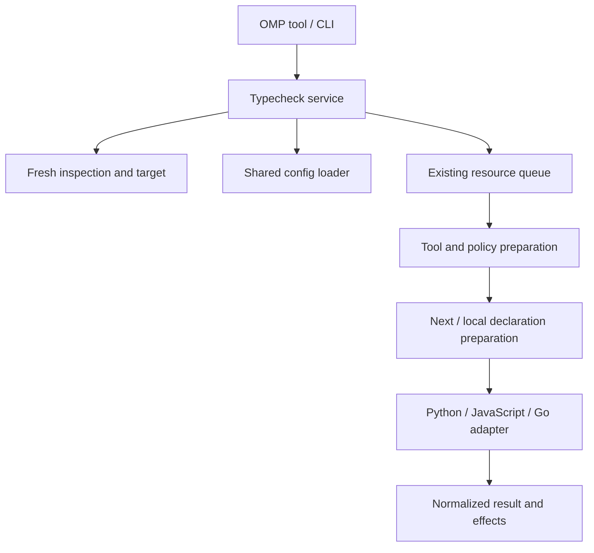
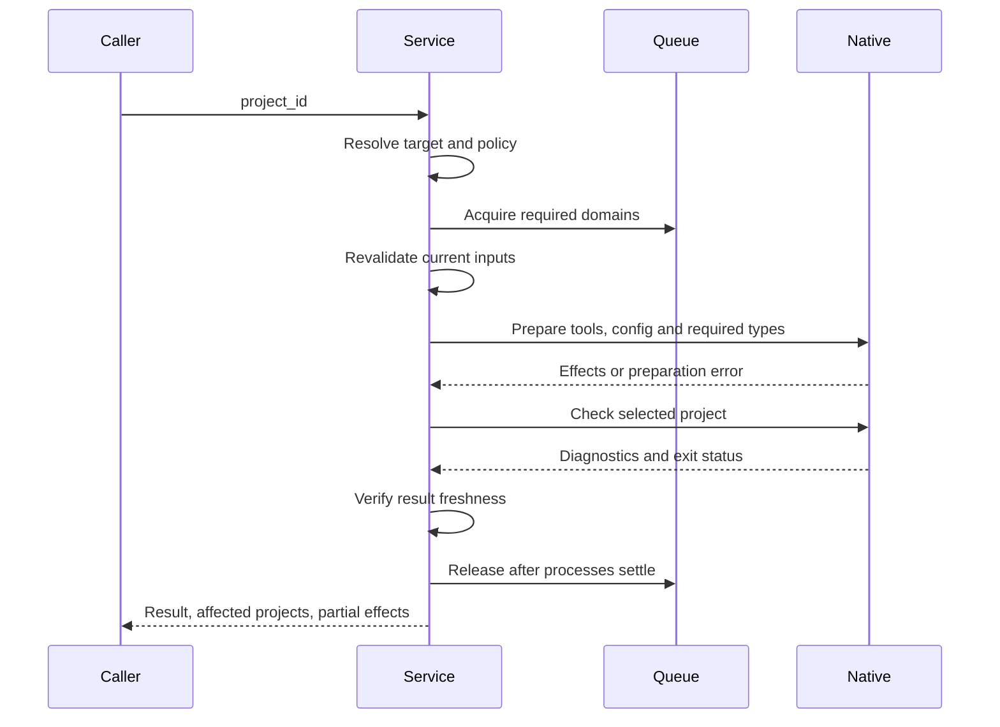
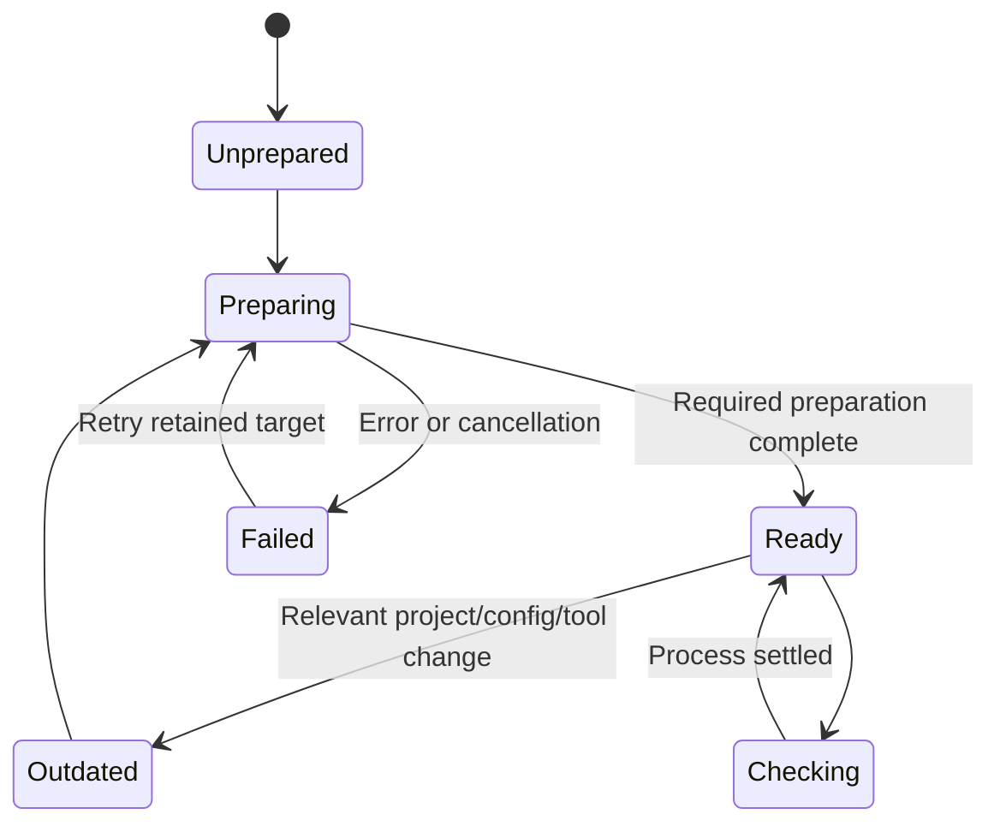

# justomp Project Typecheck - Plan

## Goal Capsule

- **Objective:** Kullanıcı, tek veya çok projeli bir repository'de seçtiği Python, JavaScript/TypeScript veya Go projesinin tip hatalarını, gerekli araç ve tip dosyalarını elle hazırlamadan görebilsin.
- **Means:** Inspection tabanlı hedef seçimi, ortak typecheck politikası, native araç hazırlığı ve `project_typecheck` custom tool'u; KTD1–KTD9.
- **Authority:** Product Contract ve kullanıcı kararları → Planning Contract → Implementation Units. Uygulama ayrıntıları ürün kapsamını daraltamaz.
- **Execution:** Bu belge yalnız geliştirme planıdır. Uygulama başlangıcı ayrıca seçilir; commit, push, PR ve release bu belgeyle yetkilendirilmez.
- **Baseline:** Inspection/dependency altyapısı ile mevcut çalışma ağacındaki lint ve merkezi config düzeni esas alınır. Henüz commit edilmemiş lint değişiklikleri korunur.
- **Stop conditions:** Bir araç veya framework uyumsuzluğu başarı olarak sunulamaz. Ortak güncel sürüm kararı sessiz downgrade, devre dışı tip kontrolü veya LSP sonucuyla ikame edilemez.

---

## Product Contract

### Summary

`project_typecheck`, yalnız `project_id` alarak projenin tamamında native tip kontrolü çalıştırır. Extension gerekli typechecker'ı kurar, ortak kuralları projeye uygular ve gereken framework/yerel bağımlılık tiplerini hazırlar. Sonuç, tip hatalarının yanında hazırlığın gerçek etkilerini ve tamamlanamayan aşamaları gösterir.

### Problem Frame

Bir repository'deki projeler farklı klasörlerde, farklı paket yöneticileriyle ve ortak lock dosyalarıyla bulunabilir. Root'ta çalıştırılan tek komut her projenin ortamını veya testlerini kapsamaz. Eksik araç, güncel olmayan declaration dosyası ve gerçek tip hatası birbirinden ayrılmadığında agent yanlış bir başarı sonucuna dayanabilir.

### Requirements

**Selection and results**

- R1. Public tool tek zorunlu `project_id` kabul eder; ecosystem, manager, cwd, command, kural veya dosya listesi kabul etmez.
- R2. Proje, güncel ve tamamlanmış packaging structure üzerinden çözülür; bilinmeyen ID herhangi bir kurulumu başlatmadan reddedilir.
- R3. Seçilen projenin kaynak ve test dosyaları kapsam içindedir; bağımsız child projeler otomatik olarak parent'ın doğrudan kaynak listesine eklenmez.
- R4. Analiz için gereken yerel bağımlılıklar okunur ve gerekli tip çıktıları hazırlanır; bağımsız ve ilgisiz projelerin tamamı her çağrıda typecheck edilmez.
- R5. Sonuç; hedef, kullanılan sürümler, politika kimliği, tanılar, kontrol durumu, hazırlanan projeler, değişen dosyalar, iptal ve eksik aşamaları içerir.
- R6. Eksik araç/ortam, başarısız hazırlık, tanı içeren kontrol, boş kaynak kapsamı ve temiz tamamlanmış kontrol ayrı sonuçlardır; çalışmamış kontrol başarılı sayılmaz.

**Policy and installation**

- R7. Repository root `.justomp/config.json` içindeki `typecheck.python`, `typecheck.javascript`, `typecheck.go` ortak politika kaynağıdır; ekosistem başına tek politika bütün ilgili projelere uygulanır.
- R8. Tüm config alanları opsiyoneldir. Eksik alanlar başlangıçta ve explicit hazırlıkta default değerleriyle tamamlanır; mevcut değerler, boş listeler/map'ler ve bilinmeyen alanlar korunur.
- R9. Config ile mevcut native ayarlar arasında typecheck politikasına ait alanlarda ortak config geçerlidir; import alias'ları, framework bağları ve diğer proje metadata'sı korunur.
- R10. Eksik Pyright/TypeScript otomatik kurulur; kurulu eski sürümler de araç başına ortak güncel kararlı sürüme yükseltilir.
- R11. İlk hazırlık ve ilgili ekosistemde yeni proje keşfi sürüm eşitlemesini tetikler; sonradan oluşturulan gerçek bir proje de ilk kurulumdan geçer.
- R12. Aynı proje kümesiyle olağan kontrol veya oturum açılışı yeniden latest araması yapmaz; yarım kalan eşitleme belirlenmiş aynı hedef sürümle devam eder.
- R13. Paket yöneticisi manifest, lock ve ortamı birlikte günceller; tamamlanan kısmi değişiklikler raporlanır, otomatik rollback yapılmaz.
- R14. İlgili ekosistemde ortak sürüm eşitlemesi tamamlanmadan o ekosistemin kontrolü başarılı sayılamaz; başka ekosistemdeki bağımsız hata hazır hedefin kontrolünü engellemez.

**Language behavior**

- R15. Python için Pyright `strict` kullanılır; test dosyalarına daha gevşek profil uygulanmaz ve eksik üçüncü taraf tip tanımları hata sayılır.
- R16. Python'da `reportImplicitOverride` ve `reportUnnecessaryTypeIgnoreComment` hata seviyesindedir; diğer strict kontrolleri default olarak korunur.
- R17. JS/TS için TypeScript compiler, `strict`, `allowJs`, `checkJs`, `noUncheckedIndexedAccess`, `exactOptionalPropertyTypes`, `noImplicitOverride` etkin kullanılır; JavaScript'i TypeScript'e dönüştürmek gerekmez.
- R18. JS/TS kontrol aşaması uygulama JavaScript'i veya bundle üretmez; onaylanan hazırlık aşaması declaration/cache dosyaları üretebilir.
- R19. Next.js'in destekleyen sürümlerinde kontrol öncesinde native `next typegen` çalışır; route tipleri ve `next-env.d.ts` güncel hazırlanır.
- R20. Gereken yerel projelerin declaration çıktıları bağımlılık sırasıyla otomatik hazırlanır; etkilenen projeler ve dosyalar sonuçta gösterilir.
- R21. Go projenin gerektirdiği kurulu toolchain ile kaynak ve `_test.go` dosyalarını derler; test binary'si, test gövdeleri, `TestMain` ve uygulama initialization kodu çalıştırılmaz.

**Lifecycle and boundaries**

- R22. OMP başlangıcı ve yeni manifest keşfi hazırlığı tetikler; salt inspection getter'ı bağımlılık kurmaz ve boş klasör oluşturmak kurulum sebebi değildir.
- R23. OMP tool'u gerekli hazırlığı bekler/yapar, ardından kontrol eder; ortak servis OMP dışında da kullanılabilir.
- R24. Dependency, lint ve typecheck aynı manifest/lock/ortama yazarken mevcut koordinasyonu paylaşır; iptal edilen süreç bitmeden sahip olduğu kaynaklar serbest bırakılmaz.
- R25. Native tool konfigürasyonu ve paket kurulumu hazırlık aşamasına aittir; kontrol aşaması kaynak, manifest ve lock dosyalarını değiştirmez.
- R26. OMP'nin LSP kurulumu veya yönetimi bu araç tarafından değiştirilmez; eksik typechecker kurulumu R10 kapsamındadır.

### Key Decisions

- **Native project check.** Governs R1–R6, R23, R26. (session-settled: user-approved — chosen over OMP LSP sonucuna dayanma: seçilen projenin tamamı aynı servisle denetlenir.)
- **Python strict and additional rules.** Governs R15–R16. (session-settled: user-approved — chosen over standard mod, test istisnaları ve eksik stub kontrolünü kapatma: kaynak ve testler aynı sıkı politikayı kullanır.)
- **JavaScript coverage and strict additions.** Governs R17–R18. (session-settled: user-approved — chosen over yalnız TypeScript ve yalnız strict varsayılanları: JavaScript de denetlenir ve üç ek kontrol açıktır.)
- **Common latest tool versions.** Governs R10–R14. (session-settled: user-directed — chosen over kurulu sürümleri koruma: Pyright ve TypeScript ilgili bütün projelerde ortak güncel sürüme hizalanır.)
- **Automatic generated types.** Governs R19–R20. (session-settled: user-approved — chosen over eksik hazırlığı kullanıcıya bırakma: Next ve gereken yerel proje tipleri otomatik üretilir.)
- **Compile Go tests without execution.** Governs R21. (session-settled: user-approved — chosen over test kaynaklarını dışlama: testlerdeki tip hataları da yakalanır.)
- **Shared attribute-based policy.** Governs R7–R9. (session-settled: user-directed — chosen over projeye göre ayrılan policy ve default değerleri mevcut değerlerle birleştirme: mevcut inspection/lint config yaklaşımı sürdürülür.)

### Acceptance Examples

- AE1. Covers R10–R14, R22. Bir Python projesine ikinci manifest eklendiğinde eksik Pyright kurulur ve her iki proje aynı seçilmiş sürüme gelir; tekrar çağrı yeni latest sorgusu başlatmaz.
- AE2. Covers R15–R16. Üretim kodu temizken test fixture'ındaki belirsiz parametre tipi veya gereksiz ignore kontrolü başarısız yapar.
- AE3. Covers R17. JS-only projede JSDoc ile string bekleyen fonksiyona sayı verilmesi tanı üretir; proje TS dosyasına dönüştürülmez.
- AE4. Covers R19–R20. Temiz checkout'taki Next uygulaması bir yerel paketin tiplerine bağlıysa önce gerekli çıktılar üretilir, sonra uygulama denetlenir; iki aşamanın etkileri ayrı görünür.
- AE5. Covers R21. Go test dosyasındaki tip uyuşmazlığı başarısızlık üretir; dosyaya yazan `init`, `TestMain` ve test gövdesinin hiçbiri çalışmaz.
- AE6. Covers R5–R6, R13. Eşitleme ikinci projede başarısız olduğunda birinci projedeki gerçek değişiklikler raporlanır; bütün işlem tamamlanmış gibi gösterilmez.

### Scope Boundaries

- İlk sürüm Python/uv; JS için npm, pnpm, Yarn Classic, modern Yarn ve Bun; Go module/workspace kapsamını içerir.
- Git hook kurulumu, `project_test`, `project_integration_test`, formatter/fix tool'ları ve genel kalite gate'i ayrı çalışmadır.
- Keyfi build script'i veya agent tarafından verilen shell komutu çalıştırılmaz. Prisma/OpenAPI/GraphQL gibi genel codegen desteği bu planın kapsamı değildir; gerekli fakat desteklenmeyen hazırlık açıkça raporlanır.
- Runtime/paket yöneticisi kurulumu, framework major yükseltmesi ve LSP yönetimi yapılmaz. Python wrapper'ının Node ihtiyacı KTD4'te açık preflight koşuludur.
- Yeni disk tabanlı BUSY lock'u, guard veya bağımsız rollback sistemi kurulmaz; mevcut işlem koordinasyonu kullanılır.
- Bütün işletim sistemi, mimari ve build-tag kombinasyonları kendiliğinden taranmaz; seçilen Go bağlamı raporlanır.

---

## Planning Contract

### Existing Evidence

- `src/omp/lint-tools.ts`, inspected ID doğrulaması, hazırlık bekleme ve okunabilir tool sonucu için mevcut örnektir.
- `src/config/load.ts` ile `src/config/lint/resolve.ts`, eksik alanları tamamlama ve kullanıcı değerlerini koruma modelini uygular.
- `src/lint/coordinator.ts`, `src/lint/prepare.ts`, `src/lint/state.ts` ve `src/dependencies/queue.ts`, oturum ömrü ve paylaşılan kaynak sahipliğinin başlangıç noktalarıdır.
- `docs/lint.md`, TypeScript 7.0.2 için kaydedilmiş bir typed-lint uyumsuzluğunu belirtir; bu kayıt güncel bütün upstream sürümlerinin uyumsuz olduğunu kanıtlamaz.
- Mevcut `src/lint/javascript/native.ts` içindeki executable seçimi paket adı ile binary adını aynı varsaymaktadır; `typescript` paketindeki `tsc` için bu ayrım gereklidir.
- Lint hazırlığının mevcut retained-version kontrolü JS araç sürümü değişimini reddeder; typecheck eşitlemesi bu davranışı kopyalayamaz.

### Key Technical Decisions

- KTD1. **Separate service, thin host adapter.** R1–R6, R23 için `src/typecheck/` hazırlık ve kontrol servisini barındırır; `src/omp/typecheck-tools.ts` yalnız OMP bağını kurar. Public prepare/check ayrımı ile tam orkestrasyon aynı sonuç modelini paylaşır; OMP LSP iç API'leri kullanılmaz.
- KTD2. **Central configuration.** R7–R9 için default/model/validation kodu `src/config/typecheck/` altında ekosistem klasörlerine ayrılır. `src/config/load.ts` tek dosya IO sahibi kalır; mevcut lint/inspection alanları değiştirilmez.
- KTD3. **Exact version waves.** R10–R14 için ilk hazırlık/yeni ID kümesi bir ekosistem dalgası oluşturur. Registry'den en güncel kararlı, geri çekilmemiş sürüm bir kez çözülür ve somut hedef saklanır; prerelease seçilmez. Uyumsuz runtime/peer veya source override varsa sessiz eski sürüm seçimi yerine gerekçe raporlanır. Sadece eksik kurulum/native dosya tamiri aynı hedefi yeniden uygular.
- KTD4. **Python execution environment.** R15–R16 için PyPI `pyright` wrapper'ı uv üzerinden dev bağımlılığı olur; gerçek checker sürümü ayrıca doğrulanır. Wrapper'ın Node/runtime veya npm indirmesi hazırlık sırasında tamamlanır; kontrol aşamasında indirme gerekirse işlem hazırlığı eksik sayar. Kurulu Node bulunmadan wrapper'ın otomatik runtime indirmesine düşülmez. Projenin/uv workspace'in Python interpreter'ı explicit seçilir; `--outputjson` ile tanılar alınır. Kaynak: [Pyright CLI](https://github.com/microsoft/pyright/blob/main/docs/command-line.md), [Python wrapper](https://github.com/RobertCraigie/pyright-python).
- KTD5. **TypeScript compiler and project context.** R17–R18 için exact `typescript` dev bağımlılığı native manager üzerinden kurulur; executable adı `tsc` olarak bağımsız çözülür. npm için npx'in eksik aracı kendiliğinden indirmesi kullanılmaz. Yarn PnP ve workspace executable çözümlemesi ilgili manager bağlamını korur. Native config'in module/JSX/paths/references bağlamı korunur; noEmit yalnız kontrolün efektif config/çağrısına uygulanır, projenin üretim build'i kapatılmaz.
- KTD6. **Framework and reference preparation.** R19–R20 için public orkestrasyon her kontrolden önce Next typegen ve gereken declaration DAG hazırlığını çalıştırır; native incremental mekanizmalar işi azaltabilir. TypeScript reference kenarları JSONC/extends çözümlemesiyle, yerel package bağımlılıkları inspection ve manifest metadata'sıyla bulunur; klasör adına bakarak ilişki uydurulmaz. Declaration üretimi `emitDeclarationOnly` kullanır; uygulama JS/bundle üretmez. Kaynak: [project references](https://www.typescriptlang.org/docs/handbook/project-references.html), [declaration-only output](https://www.typescriptlang.org/tsconfig/emitDeclarationOnly.html), [Next typegen](https://nextjs.org/docs/app/api-reference/cli/next#next-typegen-options).
- KTD7. **Go compilation without running binaries.** R21 için native paket keşfi ve paket başına `go test -c` derlemesi kullanılır; her paketin çıktısı ayrı geçici konuma yönlenir. Aynı basename'e sahip paketler çakışmaz. `go test -run` ile test atlama kullanılmaz; bu yaklaşım initialization kodunu çalıştırabilir. Go workspace için mevcut geçici workspace/readonly metadata yaklaşımı korunur. Kaynak: [Go test command](https://pkg.go.dev/cmd/go#hdr-Test_packages).
- KTD8. **Shared leases and freshness.** R22–R25 için tüm ilgili manager/domain lease'leri mevcut kuyrukta deterministik alınır. Native işlem çalışırken nested public dependency tool çağrısı yapılmaz; hazırlık ve kontrol aynı kaynak sahipliğini koruyan iç fonksiyonlarla ilerler. Native tip üretimi tamamlandıktan sonra, kontrol başlamadan önce exact araç sürümü ve efektif policy yeniden doğrulanır. Next metadata veya bağımlılık değiştirmişse etkiler kaydedilir; ortak hedef bozulmuşsa ilgili readiness geçersiz kılınır ve kontrol not-run olur. Sonraki hazırlık aynı belirlenmiş hedefi uzlaştırır; generator sürüm otoritesi olamaz. İşlem sonunda gerçek kullanılan policy hash ve sürüm kaydedilir; kontrol sırasında saptanan ilgili değişiklik sonucu güncelliğini yitirmiş sayar.
- KTD9. **Visible outcomes without false completion.** R5–R6 için lint sonucundaki status, diagnostics, preparation changes, remediation ve complete/cancelled kavramları kullanılır. Type diagnostics `failed`; araç başlatılamaması veya config/bağımlılık hazırlığının eksikliği `not-run`; kaynak yokluğu `no-sources` olur. `success` yalnız temiz, tamamlanmış ve güncel analizde true olur. Warning'ler korunur; default başarı eşiği error seviyesidir. Yerel bağımlılığın declaration üretimi tip hatası verirse hazırlık aşaması failed olur ve tanılar asıl proje kimliğiyle döner; seçilen uygulamanın başlamayan kontrolü not-run kalır.

### Configuration and Native Ownership

| Area | Default / ownership |
|---|---|
| Python policy | `typeCheckingMode: strict`, iki ek hata kuralı ve `reportMissingTypeStubs: error`; hiçbir test gevşetmesi yok |
| JS/TS policy | R17 seçenekleri; testlerde ayrı gevşetme yok; declaration doğruluğunu korumak için `skipLibCheck: false` varsayımı |
| Go context | Projenin mevcut Go sürümü; mevcut platform/mimari; ortak opsiyonel build-tag listesi default boş |
| Source scope | Bağımsız child projeler, dependency/cache/build çıktıları ayrılır; first-party testler dahil edilir |
| Generated types | Normal discovery'nin dot-directory exclusion'ından bağımsız, native checker'ın ihtiyaç duyduğu `.next`/declaration dosyaları okunabilir |
| User config | Eksik structural alanlar tamamlanır; listeler ve diagnostic map'leri bütün olarak kullanıcıya aittir; invalid bilinen değer hata üretir |
| Native metadata | Python/TS import bağlamı ve framework ayarları korunur; policy'nin sahibi olduğu kontroller ortak ayardan projekte edilir |

Strict ailesindeki alt seçenekler ve diagnostic seviyeleri de policy-owned kabul edilir: native config'teki noImplicitAny/strictNullChecks gibi bireysel opt-out'lar, kök ortak config açıkça istemedikçe strict'i gevşetemez. Kök config'te kullanıcı tarafından açıkça verilen alt seçenekler korunur. Python execution-environment override'ları da aynı kurala tabidir. Efektif native config doğrulanmadan yalnız strict anahtarının varlığı yeterli sayılmaz.

`inspection_rules` proje keşfini yönetir; typechecker kaynak kapsamı onunla aynı şey değildir. R3'ün sağlanması için kontrol kapsamına alınmamış first-party dosyalar tespit edilir. Root solution-style TSConfig, ayrı app/test TSConfig'leri ve JSConfig içindeki alias'lar hesaba katılır. Yeni oluşturulan check config'leri build config'lerinin çıktı davranışını değiştirmeden eksik kaynakları kapsar. Python'da mevcut `pyrightconfig.json` önceliği ve execution-environment rule override'ları çözülür; yalnız `pyproject.toml` yazılarak politikanın etkili olduğu varsayılmaz.

### Preparation and Freshness

Hazırlığın iki ayrı çıktısı vardır: araç/politika hazırlığı ve çağrıya özgü üretilen tiplerin hazırlığı. İlkinde proje kümesi, somut araç sürümü, manifest/lock/config girdileri kullanılır; ikincisinde ilgili source/reference/Next config girdileri de izlenir. Oturum yeniden açılınca source kontrol sonucu cache'ten başarı olarak döndürülmez.

Check-only API paket kurmaz, config flush etmez veya tip üretmez. Gerekli hazırlık receipt'i yoksa ya da girdiler değişmişse `not-run` ve remediation döndürür. OMP tool'u ve varsayılan CLI tam prepare-then-check yolunu kullanır. Next route ve declaration hazırlığının yan etkileri sonuçta preparation altında görünür.

Yarım kalmış sürüm dalgasına yeni proje gelirse mevcut dalganın exact hedefi değiştirilmez; yeni ID'ler bekleyen keşif olarak kaydedilir. Mevcut dalga kalan üyeler için tamamlanınca bütün güncel üyeleri kapsayan tek yeni keşif dalgası latest'i yeniden çözer; bu bekleyen eşitleme bitmeden R14 uyarınca başarı verilmez. Silinen üyeler mevcut dalgadan çıkarılır; yalnız silinme registry sorgusu tetiklemez. Retry ve pending-discovery bilgileri oturumlar arasında korunur.

State, `src/lint/state.ts` ile aynı güvenli IO yaklaşımıyla `.justomp/` altında ayrı typecheck state dosyasında saklanır. Başarılı lint receipt'i TypeScript değiştiğinde invalid hale gelir. Bu değişiklik lint'i otomatik çalıştırmaz; sonraki lint hazırlığı uyumluluğu yeniden değerlendirir. State bir dosya kilidi değildir.

### High-Level Technical Design







### Output Structure

Proposed paths are repo-relative. Existing config organization is retained.

```text
src/config/typecheck/
  model.ts
  resolve.ts
  python/defaults.ts
  javascript/defaults.ts
  go/defaults.ts
src/typecheck/
  index.ts
  model.ts
  targets.ts
  scope.ts
  versions.ts
  state.ts
  prepare.ts
  coordinator.ts
  service.ts
  cli.ts
  adapters/{types,python,javascript,go}.ts
  projections/{python,javascript}.ts
  javascript/{config-graph,prepare-types}.ts
src/omp/typecheck-tools.ts
tests/unit/config/typecheck.test.ts
tests/unit/typecheck/
tests/integration/typecheck/
tests/integration/omp/typecheck.test.ts
docs/typecheck.md
docs/typecheck-defaults.json
```

### Assumptions and Compatibility

- Ortak config davranışı lint'ten taşınır; sürüm hedefleri kullanıcı policy'si içine zorunlu alan olarak yazılmaz, preparation state'te tutulur.
- Latest stable kararı mevcut framework/tool uyumsuzluğunda eski sürüme düşülerek değiştirilmez; uyuşmazlık ve tamamlanmış etkiler raporlanır.
- `next typegen` desteklemeyen sürümde otomatik `next build` veya `next dev` fallback'i yoktur. Gereken tip hazırlığı sağlanamıyorsa açık uyumsuzluk sonucu üretilir.
- Source-symlink veya repo dışı reference mevcut path sınırı doğrulamasından geçmek zorundadır; mevcut dependency path sözleşmesi genişletilmez.
- CLI, package export ve config örnekleri yeni eklenecektir; mevcut public API gibi sunulmaz.
- İlk destek matrisi mevcut manager adaptörleri ve test edilebilen runtime/platform kombinasyonlarıdır; Go cross-platform/CGo ve framework sürüm iddiaları native test kanıtıyla sınırlandırılır.

---

## Implementation Units

### U1. Shared Typecheck Policy and Result Contract

**Goal:** Ortak config ile sonuç sözlüğünü tanımlamak.

**Requirements:** R1, R5–R9, R15–R17; KTD1–KTD2, KTD9.

**Dependencies:** Mevcut merkezi config düzeni.

**Files:** `src/config/load.ts`; yeni `src/config/typecheck/model.ts`, `resolve.ts`, üç ekosistem `defaults.ts`; `src/typecheck/model.ts`; `tests/unit/config/typecheck.test.ts`; `tests/integration/config.test.ts`.

**Approach:** Lint resolver'ının missing-attribute modelini takip et; policy ve runtime sonuç tiplerini farklı modüllerde tut. Native kontrol çıkışlarını karşılayacak result alanlarını tanımla.

**Test scenarios:**

1. Config yokken üç ekosistem default'u flush edilir; ikinci yükleme byte değişikliği yapmaz.
2. Kısmi config tamamlanır; mevcut false/boş liste/map ve bilinmeyen alanlar korunur.
3. Hatalı bilinen alan fail eder; lint/inspection policy'si değişmez.
4. Default Python test gevşetmesi içermez; JS seçenekleri R17 ile eşleşir.

**Verification:** JSON round-trip, etkin default'lar ve sonuç durumları açıkça kanıtlanır.

### U2. Target Resolution, Version Waves and Lifecycle

**Goal:** Doğru projeyi, ortak sürümü ve kaynak sahipliğini kurmak.

**Requirements:** R2–R4, R10–R14, R22, R24; KTD3, KTD8.

**Dependencies:** U1.

**Files:** Yeni `src/typecheck/targets.ts`, `scope.ts`, `versions.ts`, `state.ts`, `prepare.ts`, `coordinator.ts`; gereken ortak yardımcılar için `src/dependencies/queue.ts`, `src/lint/state.ts`; `tests/unit/typecheck/scope.test.ts`; `tests/integration/typecheck/provisioning.test.ts`, `concurrency.test.ts`, `lifecycle.test.ts`.

**Approach:** Mevcut inspection ve manager scope çözümünü kullan. Lint coordinator'ın sahiplik/teardown modelini takip et; sadece iki özellik için gerekli shared yardımcıları çıkar, lint'i yeniden yazma. Mevcut retained JS tool sürümü kısıtını typecheck'e kopyalama.

**Test scenarios:**

1. Covers AE1. İlk/yeni proje dalgasında ortak exact hedef seçilir; aynı kümede tekrar registry sorgusu yapılmaz.
2. Covers AE6. İkinci proje başarısızken kısmi state korunur; retry aynı sürümü kullanır.
3. Unknown/moved ID ve incomplete inspection mutation öncesi reddedilir.
4. İki session aynı hazırlığı paylaşır; bir waiter's cancellation diğerini öldürmez; son release süreçleri bekler.
5. Dependency/lint/typecheck aynı lock üzerinde çakışmaz; farklı bağımsız domain ilerleyebilir.
6. TypeScript değişimi lint hazırlık receipt'ini geçersiz yapar; başka ekosistemde hata hazır hedefi durdurmaz.
7. Başarısız dalga sırasında yeni proje eklenince retry eski hedefi korur ve ardından tek bekleyen keşif dalgasını işler; başarısız üyenin silinmesi dalgayı sonsuza kadar açık tutmaz.

**Verification:** Eski disk-lock sorunu yeniden yaratılmadan lifecycle ve değişiklik raporlaması çalışır.

### U3. Python Preparation and Pyright Check

**Goal:** Python/uv projelerinde ortamla uyumlu Pyright kurulumu ve tam kaynak kontrolü.

**Requirements:** R3, R9–R16, R25; KTD4.

**Dependencies:** U1, U2.

**Files:** Yeni `src/typecheck/adapters/python.ts`, `adapters/types.ts`, `projections/python.ts`; mevcut `src/dependencies/adapters/uv.ts` ve `src/lint/adapters/python.ts` içinden gereken ortak native hazırlık yardımcıları; `tests/fixtures/typecheck/python/fixture.ts`; `tests/integration/typecheck/python.test.ts`.

**Approach:** uv workspace'te member declarations sonrası tek shared lock/sync düzenini koru. Mevcut Pyright config önceliğini çöz; owned diagnostic alanlarını ortak policy ile eşitle. Wrapper kurulumunu ve gerçek checker/runtime hazırlığını kontrol çağrısından önce bitir.

**Test scenarios:**

1. Eksik/eski Pyright kurulur/yükseltilir; uv workspace üyeleri exact sürüme gelir.
2. Covers AE2. Kaynak ve test hataları, eksik stub, override ve gereksiz ignore beklenen diagnostics üretir.
3. `pyrightconfig.json`, TOML ve execution environments bulunan projede import bağlamı korunurken policy bypass edilemez.
4. İki farklı Python ortamında aynı import farklı çözülür; seçilen interpreter doğrulanır.
5. Eksik Node, registry hatası ve wrapper bootstrap ihtiyacı hazırlık hatası olur; kontrol aşaması gizli indirme yapmaz.
6. Check sonrası kaynak/manifest/lock byte'ları değişmez; bozuk JSON veya tool crash başarıya çevrilmez.

**Verification:** Native Pyright ile pozitif/negatif fixture'lar ve uv workspace kurulum etkileri doğrulanır.

### U4. JavaScript and TypeScript Policy and Check

**Goal:** JS-only, TS ve karma projeleri kendi manager/config bağlamında kontrol etmek.

**Requirements:** R3, R9–R14, R17–R18, R25; KTD5.

**Dependencies:** U1, U2.

**Files:** Yeni `src/typecheck/adapters/javascript.ts`, `projections/javascript.ts`, `javascript/config-graph.ts`; `src/lint/javascript/native.ts` içinde package/binary ayrımı için gereken küçük ortak değişiklik; `tests/fixtures/typecheck/javascript/fixture.ts`; `tests/integration/typecheck/javascript.test.ts`; `tests/unit/typecheck/config-graph.test.ts`.

**Approach:** Native manager seçeneklerini koru. JSONC/extends/reference çözümünü compiler sürümüyle uyumlu CLI metadata ve uygun JSONC parser üzerinden kur; TypeScript'in JS compiler API'sinin bütün sürümlerde var olduğunu varsayma. Üretim emit config'ini koruyan ayrı check projection'ı kullan.

**Test scenarios:**

1. npm, pnpm, Yarn Classic, modern Yarn/PnP ve Bun ile eksik kurulum ve exact yükseltme çalışır.
2. Covers AE3. JS/JSDoc, TS/TSX ve karma kaynaklar hataları yakalar; üç ek option native testlerle kanıtlanır.
3. Config'siz JS, jsconfig alias'ı, JSONC/extends, solution config ve ayrı test config kapsamı doğru çözülür.
4. Parent scope child projesini doğrudan taramaz; import gerektiren dış dosya tanısının gerçek yolu korunur.
5. Compiler/binary eksikliği veya uyumsuzluğu ayrı hata olur; mevcut app build emit ayarları korunur.
6. Kontrol uygulama `.js`/bundle üretmez; output parsing multiline ve boş stderr crash senaryosunu ayırt eder.
7. Inherited noImplicitAny:false ve strictNullChecks:false kök policy'yi geçersiz kılamaz; aynı seçenek kök config'te açıkça belirtilmişse korunur.

**Verification:** Bütün beş manager'da native kurulum ve kontrol kanıtı; mevcut lint regressions geçer.

### U5. Next and Local Declaration Preparation

**Goal:** Seçilen projenin ihtiyaç duyduğu güncel tip çıktılarının otomatik hazırlanması.

**Requirements:** R4–R6, R18–R20, R24–R25; KTD6, KTD8.

**Dependencies:** U2, U4.

**Files:** Yeni `src/typecheck/javascript/prepare-types.ts`; `javascript/config-graph.ts`, `prepare.ts`, `state.ts`; `tests/integration/typecheck/next.test.ts`, `references.test.ts`.

**Approach:** Gereken reference closure'ını topolojik sırada hazırla. Declaration-only projection'ı mevcut package `types`/exports ve reference beklentileriyle eşleştir; çakışan output/rootDir/extends ilişkisini sessiz değiştirme. Girdileri ve üretilen yolları receipt'e bağla. Next'in native config veya dependency düzeltmeleri gerekiyorsa bunlar da preparation etkisi olarak raporlanır.

**Test scenarios:**

1. Covers AE4. Temiz checkout Next uygulamasında typegen sonrası route hatası yakalanır.
2. Next config için eksik env değişkeni hazırlığı durdurur; tam build fallback'i çalışmaz.
3. `apps/web -> packages/ui -> packages/core` zincirinde yalnız gerekli closure hazırlanır; ikinci çağrı güncel native çıktıları kullanır.
4. Kaynak/route/reference değişince eski declaration başarı üretmez; missing output ve stale receipt check-only'da açık sonuç verir.
5. Döngü, aynı isimli workspace, custom tsconfig path, custom distDir ve repo dışı reference deterministik ele alınır.
6. Ortada başarısız declaration üretimi bağımlı uygulamayı kontrol etmiş gibi göstermez; kaynak ve uygulama JS çıktıları yazılmaz. Tanı bağımlılık projesine, not-run durumu seçilen uygulamaya aittir.
7. Next hazırlığı compiler/config metadata'sını değiştirirse ortak sürüm ve efektif policy kontrol öncesi tekrar doğrulanır; hedef dışı sürümle başarı üretilemez.

**Verification:** Source değişikliğiyle bozulan gerçek monorepo ve Next fixture'ı, önce hata sonra düzeltmeyle başarı verir.

### U6. Go Module and Workspace Compilation

**Goal:** Go kaynak ve test tiplerini test executable'ı çalıştırmadan denetlemek.

**Requirements:** R3–R6, R21, R24–R25; KTD7.

**Dependencies:** U1, U2.

**Files:** Yeni `src/typecheck/adapters/go.ts`; gerekli kullanım için `src/lint/go/environment.ts` ortak çevre yardımcıları; `tests/fixtures/typecheck/go/fixture.ts`; `tests/integration/typecheck/go.test.ts`.

**Approach:** Kurulu toolchain ve module/workspace bağlamını doğrula. Seçilen module paketlerini native keşfet; test binary çıktısını paket kimliğine göre geçici konumda üret, process kapanınca temizle. Mevcut readonly module ve geçici workspace metadata davranışını takip et.

**Test scenarios:**

1. Covers AE5. Kaynak, internal/external test package tip hataları yakalanır; init/TestMain/test sentinel'leri oluşmaz.
2. Testi olmayan paket, main package, aynı basename taşıyan iki paket ve çok modüllü go.work çalışır.
3. Build-tag ve platforma bağlı kapsam raporlanır; boş kaynak kapsamı başarı sayılmaz.
4. Eksik module/Go toolchain, CGo derleyici hatası ve iptal tanı/eksik aşama olarak ayrılır.
5. Orijinal go.mod/go.sum/go.work/go.work.sum değişmez; geçici binary'ler temizlenir.

**Verification:** Native Go ile test kodunun çalışmadığı ve workspace metadata'sının korunduğu kanıtlanır.

### U7. OMP, Public API and CLI Integration

**Goal:** Aynı typecheck yeteneğini OMP ve terminalden erişilebilir yapmak.

**Requirements:** R1–R6, R22–R26; KTD1, KTD8–KTD9.

**Dependencies:** U3–U6.

**Files:** Yeni `src/typecheck/index.ts`, `service.ts`, `cli.ts`, `src/omp/typecheck-tools.ts`; `src/omp/extension.ts`, `src/index.ts`, `package.json`; `tests/integration/omp/typecheck.test.ts`; `tests/integration/typecheck/service.test.ts`, `cli.test.ts`.

**Approach:** OMP tool'unu mevcut exec approval ve progress/result sözleşmesine bağla. Session startup'ta uzun native hazırlığı inspection deadline'ından ayrı tut. Public prepare, check-only ve tam orkestrasyon servislerini ayır; CLI root/project-id seçimiyle tam akış sunar, check-only seçeneği mutation yapmadan eksik hazırlığı bildirir.

**Test scenarios:**

1. Gerçek kayıtlı tool yalnız project_id kabul eder; fazla input ve unknown ID kurulum başlatmaz.
2. Hazır projede API/CLI/OMP aynı tanıları verir; tool content ve details birbirini tutar.
3. Yeni manifest oturum içinde hazırlığı başlatır; boş klasör başlamaz; config değişimi ilgili policy'yi günceller.
4. Check-only stale generated-types durumunda not-run verir; tam akış hazırlayıp tekrar kontrol eder.
5. Kısmi etkiler, cancellation, root switch ve final shutdown agent'a görünür; başka session'ın işi yanlışlıkla sonlandırılmaz.

**Verification:** Installed OMP host smoke ve CLI exit-code senaryoları geçer; LSP ayarları değişmez.

### U8. Documentation and Cross-Feature Validation

**Goal:** Davranışı belgelemek ve inspection/dependency/lint ile birlikte doğrulamak.

**Requirements:** R1–R26.

**Dependencies:** U7.

**Files:** `README.md`, `docs/inspection.md`, `docs/lint.md`; yeni `docs/typecheck.md`, `docs/typecheck-defaults.json`; `tests/unit/config/documentation.test.ts`; `tests/integration/typecheck/mixed-repository.test.ts`; `package.json` test ve package export metadata'sı.

**Approach:** Config örneğini runtime default'larından doğrula. Kurulum ile check-only ayrımını, generated dosyaları, supported manager/framework sürümlerini ve latest eşitleme tetiklerini belgeleyerek kullanıcıya görünür yap. Mevcut lint uyumsuzluk kaydını ancak yeni native kanıt varsa değiştir.

**Test scenarios:**

1. Aynı repo'da Python/JS/Go projeleri hazırlanır ve yalnız seçilen hedef kontrol edilir.
2. Typecheck'in TypeScript yükseltmesinden sonra lint uyumluluğu tekrar değerlendirilir; eski receipt ile başarı verilmez.
3. Config örnekleri default'larla eşleşir; package export/bin kurulu paketten kullanılabilir.
4. Native kurulumu veya check'i bozulan ekosistem için destek iddiası yapılmaz; unrelated ecosystem kontrolü sürer.

**Verification:** Doküman, gerçek davranış ve destek matrisi tutarlıdır; daha önceki staged işler korunur.

---

## Verification Contract

| Gate | Evidence |
|---|---|
| Focused unit tests | Config tamamlama, kapsam, config/reference graph ve diagnostics normalizasyonu |
| Native Python integration | Gerçek uv/Pyright kurulumu, strict kaynak/test hataları, doğru interpreter |
| Native JS integrations | Beş manager, JS/TS/Next, declaration graph, upgrades ve lint invalidation |
| Native Go integration | Module/workspace, test kaynakları, yürütülmeyen sentinel kodu ve temizlenen geçici çıktılar |
| OMP/API/CLI parity | Aynı hedef/policy için aynı sonuç; etkiler, errors ve cancellation görünür |
| Repository check | Mevcut `bun run check` ile typing, Biome ve unit testleri |
| Full integration | Mevcut `bun run test:integration`; yeni typecheck suite'i buna dahil |

Geliştirme sırasında ilgili fixture/senaryolar odaklı çalıştırılır; final gate aynı değişiklik için gereksiz tekrar edilmez. Registry dalga testleri kontrollü fixture kullanabilir, fakat araç kurulum ve native checker başarısı yalnız mock ile kanıtlanamaz. Paket yöneticisi/Go/Node gereksinimleri test fixture'larında açıkça yazılır.

Plan yazılırken üretim kodu değiştirilmez ve uygulama testleri çalıştırılmaz. Native sürüm davranışları implementation sırasında doğrulanır; test edilmemiş platform veya framework sürümü desteklenmiş gibi raporlanmaz.

---

## Definition of Done

- U1–U8 davranışları ve ilgili native test kanıtları tamamlanmıştır.
- R1–R26 ve AE1–AE6 izlenebilir doğrulamayla karşılanır; çalışmamış veya eksik kapsam başarı sayılmaz.
- Eksik araç kurulumu, ortak latest sürüm eşitlemesi ve yeni proje hazırlığı elle müdahale gerektirmeden çalışır; gerçek uyumsuzluk açık hata verir.
- Config kullanıcı değerlerini korur; ortak politika native kontrole gerçekten uygulanır.
- Next ve reference hazırlığının etkileri görünür; Go hiçbir test executable'ı çalıştırmaz.
- Mevcut dependency/lint/inspection akışları korunur; TypeScript değişimi lint'e stale başarı bırakmaz.
- Dokümanlar, package exports ve CLI gerçek davranışla tutarlıdır.
- Deneme amaçlı kod, geçici fixture çıktıları ve kullanılmayan yardımcılar final değişiklikten çıkarılmıştır.
- Çözülemeyen uyumluluk sınırları dürüstçe belirtilir; commit/push/PR/release ayrıca yetkilendirilir.

---

## Sources and Research

- Önceki mimari: `.compound-engineering/artifacts/plans/2026-10-29-0259-feat-shared-project-lint-plan.md`; `docs/lint.md`; `docs/dependencies.md`; `docs/inspection.md`.
- Pyright strict ve config önceliği: [configuration](https://github.com/microsoft/pyright/blob/main/docs/configuration.md). R15–R16 ve Python projection tasarımını belirler.
- TypeScript: [strict](https://www.typescriptlang.org/tsconfig/strict.html), [checkJs](https://www.typescriptlang.org/tsconfig/checkJs.html), [noUncheckedIndexedAccess](https://www.typescriptlang.org/tsconfig/noUncheckedIndexedAccess.html), [exactOptionalPropertyTypes](https://www.typescriptlang.org/tsconfig/exactOptionalPropertyTypes.html), [noImplicitOverride](https://www.typescriptlang.org/tsconfig/noImplicitOverride.html). R17 default'larını belirler.
- Next [CLI](https://nextjs.org/docs/app/api-reference/cli/next#next-typegen-options) ve [TypeScript config](https://nextjs.org/docs/app/api-reference/config/typescript), generated tiplerin ve config yüklemesinin hazırlık aşamasına ait olmasını gerektirir.
- OMP [LSP tool](https://github.com/can1357/oh-my-pi/blob/main/docs/tools/lsp.md): workspace diagnostics native CLI çalıştırır; bu planın backend'i OMP iç LSP API'sine bağlanmaz.
