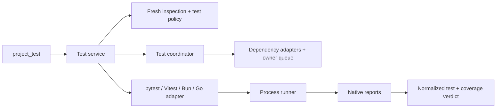

# Proje Bazlı Unit Test Çalıştırma - Plan

## Goal Capsule

Justomp'a `project_test` eklenir. Araç, `project_id` ile seçilen projenin unit testlerini kendi ortamında çalıştırır; runner hazırlığını, dosya seçimini, coverage kontrolünü ve sonucu ortak bir servis yönetir. Python için pytest, Node.js için Vitest, Bun projeleri için `bun test`, Go için `go test` kullanılır.

Bu belge implementasyon öncesi kullanıcı incelemesi içindir. Bu plan hazırlanırken uygulama kodu değiştirilmedi ve test çalıştırılmadı. Kararlar konuşmadan taşındı; kullanıcı tarafından seçilmemiş teknik ayrıntılar aşağıda plan önerisi olarak belirtilir.

## Product Contract

### Summary and Problem Frame

Bir repository birden fazla dilde bağımsız proje ve workspace üyesi içerebilir. Agent'ın doğru klasörü, runner'ı ve paket yöneticisini yeniden tahmin etmesi gerekmez. `list_projects` ile aldığı kimliği `project_test` aracına verir; Justomp güncel inspection sonucundan proje sınırını çözer.

Test klasörleri, coverage ve runner hazırlığı `.justomp/config.json` üzerinden ortak yönetilir. Mevcut proje yapısını taşıyarak veya mevcut test altyapısını sessizce değiştirerek geçiş yapılmaz.

### Requirements

| ID | Gereksinim |
| --- | --- |
| R1 | Tek araç `project_test` olur. Zorunlu `project_id`, isteğe bağlı `test_files` ve `timeout_seconds` kabul eder; ecosystem, runner, cwd, shell veya serbest flag kabul etmez. |
| R2 | `test_files` yoksa seçilen projenin bütün unit testleri çalışır. Varsa yalnızca belirtilen proje-relative dosyalardaki testler seçilir; kapsam başka projeye, integration testlerine veya tüm Go paket testlerine genişletilmez. |
| R3 | Python pytest, Node JS/TS Vitest, Bun-runtime JS/TS `bun test`, Go `go test` kullanır. Paket yöneticisi ile runtime ayrı kavramlardır. Desteklenmeyen mevcut unit runner `unsupported-runner` üretir; otomatik migration yapılmaz. |
| R4 | Varsayılan Python dizilimi `tests/unit/**/test_*.py`, JS/TS dizilimi `tests/unit/**/*.test.{js,jsx,ts,tsx}` olur. Go testleri kaynakla aynı pakette `**/*_test.go` olarak kalır. `tests/integration/**` unit kapsamından çıkarılır. Config desenleri değiştirebilir; dosyalar taşınmaz. |
| R5 | Config'in hiçbir alanı zorunlu değildir. Eksik attribute varsayılandan tamamlanıp flush edilir; mevcut geçerli değerler korunur. Kullanıcı dizileri varsayılan dizilerin yerine geçer. |
| R6 | İlk hazırlıkta eksik pytest/Vitest araçları dev bağımlılığı olarak kurulur; farklı sürümler ortak latest hedefe yükseltilir. Yeni aynı-runner proje keşfi mevcut üyeleri de yeni ortak latest'a eşitler. Sıradan session start sürüm yükseltmez. |
| R7 | Manifest ve lock değişikliklerini mevcut dependency katmanı yapar. Bun ve Go runner'ları runtime ile gelir; bunlar paket bağımlılığı gibi kurulmaz veya otomatik yükseltilmez. |
| R8 | Coverage varsayılan açık ve minimum %70 olur. Tam koşuda proje toplamına uygulanır; dosya seçilmiş koşuda proje geneli coverage eşiği uygulanmaz ve bu sonuçta belirtilir. |
| R9 | Coverage paydası testlerin hiç kullanmadığı dosyalar dahil projenin kapsama alınan bütün kaynaklarını içerir. Testler, fixture'lar, generated dosyalar, bağımlılıklar ve ayrı projeler dışarıda kalır. Python/JS/TS için line, Go için native statement metriği kullanılır. |
| R10 | Bun'da R9, tam coverage koşusunda kapsamdaki kaynakları dinamik import ederek sağlanır. Ek Istanbul altyapısı kurulmaz. Import yan etkileri ve import sırasında çalışmış satırların coverage'a katkısı belgelenir; yükleme hataları gizlenmez. |
| R11 | Test bulunamazsa `no-tests` ve `success:false` döner. Coverage için kullanılan yardımcı mekanizma gerçek test sayılmaz. Eksik, bozuk veya başka koşudan kalma rapor başarılı sonuç üretemez. |
| R12 | Normal test başarısızlığında kalan seçili testler çalışmaya devam eder. Otomatik test retry ve fail-fast kullanılmaz; timeout/iptal işlemi durdurur. |
| R13 | `timeout_seconds` pozitif tam sayı, varsayılan 300'dür; config alanı değildir. Runner kurulumundan sonra başlayan tek execution bütçesi collection, coverage importları ve tüm test alt komutlarını kapsar. |
| R14 | Sonuç test başarısızlığını, hazırlık hatasını, coverage ihlalini, timeout'u ve iptali ayırır. Bilinmeyen sayılar sıfır uydurularak doldurulmaz; gözlenen kısmi sonuçlar korunur. |
| R15 | Session start/yeni proje keşfi hazırlığı tetikleyebilir; testler yalnız araç çağrısıyla çalışır. Mevcut shared coordinator, sahiplik ve teardown davranışı korunur. |
| R16 | Yeni feature'ın testleri Justomp'ın kararlarını ve entegrasyon akışlarını kanıtlar. Upstream runner/coverage kurallarını yeniden sınayan matrisler kurulmaz; mevcut test maliyet bütçesi korunur. |

### Key Decisions

- **D1 — Proje kimliği ve dosya seçimi** (session-settled: user-approved — serbest komut yerine inspection kimliği; tüm-suite zorunluluğu yerine dosya seçimi). Governs R1–R2.
- **D2 — Dört runner ve mevcut altyapıya saygı** (session-settled: user-approved — tek runner'a migration yerine ecosystem/runtime seçimi ve unsupported sonucu). Governs R3.
- **D3 — Klasör varsayılanları, Go colocated** (session-settled: user-approved — bütün dillerde ayrı test paketi yerine Go private erişimini koruyan dizilim). Governs R4.
- **D4 — Attribute bazlı config flush** (session-settled: user-directed — zorunlu config ve varsayılanlarla birleştirilen kullanıcı dizileri yerine eksik alan tamamlama). Governs R5.
- **D5 — Yeni üyede ortak latest dalgası** (session-settled: user-approved — her session upgrade veya eski üyeleri farklı sürümde bırakmak yerine ilk hazırlık/yeni proje tetiklemesi). Governs R6–R7.
- **D6 — Coverage kapsamı ve eşiği** (session-settled: user-directed — yalnız yüklenen kaynaklar veya hedefli koşuya toplam eşik yerine R8–R9). Governs R8–R9, R11.
- **D7 — Bun kaynaklarını dinamik import etme** (session-settled: user-directed — ek Istanbul bağımlılıkları yerine kullanıcının paylaştığı reusable import utility yaklaşımı). Governs R10. Kullanıcı import yan etkisini içeren örneği görerek bu yöntemi tercih etti.
- **D8 — Çalıştırma kontrolü** (session-settled: user-approved — fail-fast/retry yerine kalan testleri çalıştırma; config timeout'u yerine çağrı inputu). Governs R12–R13.
- **D9 — Test sorumluluğu ve maliyeti** (session-settled: user-directed — upstream davranış matrisleri yerine kendi kararlarımızın unit testleri ve küçük gerçek akışlar). Governs R16.

### Tool Contract

```json
{
  "project_id": "python:apps/api/pyproject.toml",
  "test_files": ["tests/unit/test_orders.py"],
  "timeout_seconds": 120
}
```

`test_files` verilirse boş olmayan bir dizi olmalıdır. Dosyalar glob veya pytest node-id değildir. Yinelenen dosyalar tekilleştirilir; mutlak yol, kök dışına kaçış, başka proje, integration dosyası ve bulunamayan dosya `invalid-selection` olur. `timeout_seconds` verilmezse R13 uygulanır. Test adı/regex inputu bu sürümde eklenmez.

Go'da dosya seçimi o dosyalardaki runnable testleri seçer. Paketin derlenmesi, `init` ve `TestMain` normal çalışır; seçilmemiş dosyanın derleme hatası koşuyu engelleyebilir. Bu, dosyayı izole bir program olarak çalıştırma sözü değildir.

### Acceptance Examples

| ID | Örnek | Beklenen sonuç |
| --- | --- | --- |
| AE1 | `apps/api` ve `apps/web` mevcut; api kimliği çağrılır | Yalnız api unit kapsamı çalışır; hazırlığın diğer projelere etkisi ayrıca raporlanır. |
| AE2 | Config yalnız `test.python.coverage.enabled:false` içerir | Değer false kalır; minimum ve diğer eksik alanlar doldurulur. |
| AE3 | Hazır iki Python projeye üçüncüsü eklenir | Bir latest hedef dalgası belirlenir; üç proje aynı pytest araç setine gider. Sonraki session registry refresh yapmaz. |
| AE4 | Tam koşuda testler geçer, toplam coverage %69'dur | Testler passed, coverage below-threshold, genel success false olur. |
| AE5 | Tek dosya seçilir; toplam coverage %70'in altında kalacak durumdadır | Yalnız dosya çalışır; proje geneli coverage gate uygulanmaz. |
| AE6 | Bun'da bir kaynak hiçbir test tarafından import edilmez | Tam coverage koşusu onu R10 ile yükler; kapsamdan sessizce düşmez. |
| AE7 | Gerçek test yoktur ama Bun coverage yardımcısı vardır | `no-tests`; yardımcı nedeniyle success veya test sayısı oluşmaz. |
| AE8 | Go'da seçili dosyadaki isim, seçilmemiş external test dosyasıyla çakışır | Kapsam genişletilmez; `unsupported-test-selection` ve çakışan dosyalar döner. |
| AE9 | Birinci test fail, ikinci test pass olur | İkisinin sonucu gelir; otomatik yeniden koşma yapılmaz. |
| AE10 | Çok paketli Go koşusu toplam deadline'a ulaşır | Aktif child tree kapatılıp join edilir; sonraki paket başlatılmaz; sonuç timeout ve incomplete olur. |

### Scope Boundaries

Kapsam: ortak config, runner hazırlığı, seçili proje/dosya çalıştırma, coverage, raporlama ve OMP bağlantısı. Mevcut desteklenen dependency manager adaptörleri kullanılır.

Bu çalışmanın dışında: test yazdırma, kaynak düzeltme, runner migration, runtime installer, Git/commit hook'ları, CI kurma, yeni CLI, test adı seçimi, browser/E2E orkestrasyonu, fuzz kampanyaları ve benchmark çalıştırma. Bağımsız uygulama subprocess/worker coverage'ını bütün runtime'larda toplama sözü verilmez.

### Deferred to Follow-Up Work

`project_integration_test` ayrı planlanacak. Bu feature yalnız integration dosyalarının unit koşularına karışmasını engeller. Yeni `list_tests` veya CLI ihtiyacı bu planla yaratılmaz.

## Planning Contract

### Repository Grounding

- `src/config/load.ts` mevcut atomik ve çakışma kontrollü config flush'ını sağlar. `src/config/typecheck/resolve.ts` attribute tamamlama ve bağımsız policy hash örneğidir.
- `src/typecheck/{prepare,state,coordinator}.ts` restart, yeni üye ve yarım kalan ortak sürüm dalgalarını taşır. Aynı modeli runner cohort'larına uygula; eski lint/typecheck davranışını refactor etme.
- `src/typecheck/{targets,scope}.ts` güncel inspection, canonical yollar ve alt proje sınırlarını gösterir. Coverage kaynak kümesini typechecker'ın kaynak kümesi sanma.
- `src/dependencies/queue.ts` süreç içi manager-owner lease sağlar; cross-process lock değildir. `src/dependencies/runner.ts` shell-free argv, sınırlı log ve child-tree iptali sağlar; toplam timeout feature katmanında oluşturulur.
- `src/omp/typecheck-tools.ts` strict schema, `approval:exec`, progress ve content/details eşliğini gösterir. `src/omp/extension.ts` root ownership, startup ve eşzamanlı teardown bağlantısıdır.
- Test yaklaşımı: [test evidence and cost](../../../compound-packs/testing/test-evidence-and-cost.md) (pack: testing, test-evidence-and-cost.md).

### Key Technical Decisions

**KTD1 — Ayrı test servisi, ortak mevcut altyapı.** `src/testing/` altında modeller, seçim, hazırlık, koordinasyon ve dört runner adaptörü bulunur. Policy `src/config/test/` altında kalır. Yeni genel plugin framework veya dependency manager katmanı kurulmaz. R1, R7, R14–R15'i gerçekleştirir.

**KTD2 — Config projection.** Yeni `test` policy'si `loadConfig`/flush akışına `testKey` ile katılır. Tool-owned seçim, coverage, retry/fail-fast, reporter ve çalışma modu invocation config'iyle uygulanır. Kullanıcının alias, plugin, environment, fixtures ve setup ayarları korunur; test script'i shell üzerinden çağrılmaz. Mevcut native ayar güvenle birleştirilemiyorsa açıklayıcı config hatası döner, config dosyası silinmez.

**KTD3 — Runner tespiti.** Projenin doğrudan bağımlılıkları, native runner config'i, açık `test` script komutu ve Bun runtime bildirimi birlikte değerlendirilir. `packageManager:bun` tek başına Bun runtime kanıtı değildir. Açık pytest/Vitest/Bun runner kanıtı önceliklidir; çelişkili kanıtta `ambiguous-runner` döner. Desteklenmeyen aktif unit runner tespitinde mutation yapılmaz. Hiç runner kanıtı olmayan Python pytest, JS/TS Node+Vitest, Go native runner ile hazırlanır; açık Bun runtime kanıtı Bun seçtirir. E2E runner bağımlılığı tek başına unit runner sayılmaz. Script'ler veri olarak okunur; wrapper script çalıştırılarak tespit yapılmaz.

**KTD4 — Kalıcı hazırlık dalgaları** (session-settled: user-approved — her restart registry sorgusu yerine R6). `.justomp/test_state.json` proje/policy/environment receipt'lerini ve pytest/Vitest cohort hedeflerini tutar. Latest bir dalga için bir kez çözülüp mutasyondan önce exact sürüm olarak kaydedilir. Yarım dalga aynı hedefle toparlanır; arada keşfedilen üyeler pending tutulur. Tamamlanmış cohort'a yeni üye gelince aynı-runner mevcut üyeler de yeni dalgaya girer. Hedefle uyumsuz Python/Node veya peer dependency varsa eski sürüme sessiz düşülmez; runtime/compatibility hatası raporlanır. Receipt kaybı yeniden doğrulama gerektirir; kalıcı lock/busy dosyası değildir.

Python araç seti pytest + pytest-cov ve onun uyumlu coverage.py bağımlılığıdır. Vitest için exact Vitest + eşleşen `@vitest/coverage-v8` ve gerekli uyumlu Vite peer kullanılır. Mevcut uygulama Vite sürümü uyumluysa korunur; uyumsuz uygulama Vite sürümü otomatik major yükseltilmez, incompatibility bildirilir. Bu seçimler dev group üzerinden mevcut adaptörlere gider. Bun ve Go için yalnız mevcut runtime kabiliyeti doğrulanır.

**KTD5 — İki ayrı scope.** Test dosyaları ve coverable kaynaklar farklı kümelerdir. Her ikisi project-relative config desenleriyle bulunur, sonra canonical proje sahipliği uygulanır. İç içe bağımsız projeye, dependency/environment/store alanlarına veya kök dışı symlink'e geçilmez. Config exclude dizisi kullanıcıya aittir; canonical sahiplik doğrulaması ise glob override ile kapatılamaz. Type declaration ve native olarak çalıştırılamayan kaynak türleri coverage girdisi değildir. Seçim lease bekleyişinden sonra güncel inspection/config ile tekrar doğrulanır.

**KTD6 — Native rapor, ortak verdict.** pytest JUnit XML + coverage JSON; Vitest JSON + coverage JSON; Bun JUnit XML + native LCOV; Go JSON olayları + native cover profile okunur. Her koşu yeni, yalnız kendine ait rapor dizini kullanır. XML external entity/DTD çözmez. Konsol logu rapor protokolü değildir. Go JSON stream'i log limitinden bağımsız bounded dosyaya/stream parser'a yönlendirmek için mevcut process runner'a geriye uyumlu sink eklenir; bu ihtiyaç dışındaki runner yeniden yazılmaz.

Coverage verdict R8'e göre normalize edilir: `disabled`, `not-enforced-targeted`, `passed`, `below-threshold`, `unavailable`, `not-applicable`. Threshold bütün proje toplamına uygulanır; dosya yüzdeleri ortalanmaz. Ölçülebilir satır/statement sayısı sıfırsa yüzde uydurulmaz; `not-applicable` ve gerekçesi gösterilir. Coverage açıkken bozuk/eksik rapor `unavailable` ve failure'dır. Native per-file/branch/function eşikleri managed koşuya sızmaz. Eşik değerlendirmesi gösterim için yuvarlanmış yüzdeyle yapılmaz.

**KTD7 — Python ve Vitest.** pytest-cov için source'a modül adı yerine sahip olunan dizinler verilir; unexecuted namespace dizinleri dahil edilir. Branch metriği kapalıdır. Pytest tam ve hedefli koşuda doğrulanmış dosya argv'si alır; JUnit reporter plugin gerektirmez. Vitest tek seferlik run modunda seçili projeye root edilir; positional substring filtresi yerine exact escaped `include` kullanılır. Coverage include, yüklenmemiş kaynakları da kapsar; failure sonrası rapor açık olur. Vitest workspace config'inin sibling projeleri kendiliğinden çalıştırması engellenir. Native seçenekler ve sürüm uyumu seçilen güncel metadata ile doğrulanır. [Python source seçimi](https://coverage.readthedocs.io/en/latest/source.html), [pytest-cov config](https://pytest-cov.readthedocs.io/en/latest/config.html), [Vitest coverage](https://vitest.dev/guide/coverage), [Vitest filtering](https://vitest.dev/guide/filtering).

**KTD8 — Bun reusable import utility** (session-settled: user-directed — Istanbul/NYC yerine R10). Kullanıcının [örneği](https://charpeni.com/blog/bun-code-coverage-gap) temel alınır. Utility kendi başına repo globlamaz; KTD5'in onaylı exact source listesini alır. URL'ler platform-safe file URL API'siyle üretilir. JS/JSX/TS/TSX desteklenir; declaration dosyaları, testler, fixtures ve generated kaynaklar listeye girmez. Çağrı başına managed preload, global teardown aşamasında kalan kapsamdaki modülleri import eder; kullanıcının setup ve normal test mock kurulumu öncesine zorunlu import yerleştirilmez. Import concurrency sınırlıdır; başarısız dosyalar toplanır ve coverage tamamlanmış sayılmaz. Aynı execution deadline geçerlidir.

Bun'ın kendi coverage motoru kullanılmaya devam eder; Justomp LCOV içinden proje global line toplamını değerlendirir. Bu yöntem import yan etkileri üretir ve sırf import nedeniyle çalışan satırlar covered sayılır. Testlerin module mock'ları veya runtime'ın bir dosyayı coverage dışı bırakması kaynak tamlığını kanıtlamayı engellerse başarı iddiası yerine açık coverage hatası döner; otomatik exclude eklenmez. Helper kullanıcı test sayısına katılmaz. Native reporter kapanışının global teardown'dan sonra gerçekleştiği küçük gerçek akışta doğrulanır. [Bun coverage sınırı](https://bun.com/docs/test/code-coverage#coverage-not-showing-for-some-files), [global lifecycle hooks](https://bun.com/docs/test/lifecycle).

**KTD9 — Go dosya seçimi.** `go list` active `TestGoFiles`/`XTestGoFiles` envanterini sağlar. Küçük bundled Go helper, stdlib AST ve `go/doc.Examples` ile runnable deklarasyonları dosyaya bağlar; regex ile Go parse edilmez. Her paket için seçilen isimlerden escape edilmiş anchored `-run` üretilir. Seçili/seçili olmayan internal/external dosyalar aynı runnable adı taşıyorsa native filtre bunları ayıramaz: AE8 uygulanır. Helper-only seçim boş filtresiz koşuya dönüşmez. Fuzz seed testleri normal Go koşusuna dahil olabilir; fuzz campaign/benchmark başlatılmaz. `TestMain` test sayılmaz. Native package derlemesi korunur; explicit `_test.go` argv listesiyle sanal paket oluşturulmaz. [Go test flag'leri](https://pkg.go.dev/cmd/go), [test loader](https://go.dev/src/cmd/go/internal/load/test.go), [Examples API](https://pkg.go.dev/go/doc#Examples).

Go full run bütün owned, mevcut platform/tag ortamında buildable paketleri kapsar. Coverage instrument kapsamına testsiz paketler de girer; Go 1.22+ davranışı kabiliyet tabanıdır. Gerçek execution için cached test sonuçları kullanılmaz. Çoklu invocation profile blokları source konumu üzerinden tekilleştirilir; statement paydası bir kez sayılır. Kapsam dışı test dosyaları aynı paketteyse full run da seçilen runnable isimlerini filtreler. Build tags tarafından çıkarılan dosya hedefli seçilmişse açık seçim hatası verir. [Go 1.22 coverage değişikliği](https://go.dev/doc/go1.22), [native coverage](https://go.dev/doc/build-cover).

**KTD10 — Deadline, ownership ve doğruluk.** Hazırlık bekleyen bir çağrının iptali başka session'ın sahiplendiği hazırlığı öldürmez. Test child process'i ise çağrının sorumluluğudur. Domain lease tutulurken execution başlar; child tree kapanıp join edilmeden lease bırakılmaz. Deadline tek AbortController üzerinden bütün execution'a aktarılır; Go paketleri veya Bun importları için sıfırlanmaz. Çağrı bitiminde güncel config/source/project kimliği değişmişse sonuç eski snapshot'a ait olarak işaretlenir ve güncel gate passed sayılmaz; otomatik test retry yapılmaz. Mevcut process-local kilidin cross-process koruma sağladığı iddia edilmez.

### Config Shape and Defaults

Aşağıdaki alan adları plan önerisidir; davranış R4–R5, R8–R10 ile belirlenmiştir. Her ecosystem aynı `include`, `exclude`, `source`, `coverage` şeklini kullanır. `timeout_seconds` burada yoktur.

```json
{
  "test": {
    "python": {
      "include": ["tests/unit/**/test_*.py"],
      "exclude": ["tests/integration/**"],
      "source": {
        "include": ["**/*.py"],
        "exclude": ["tests/**", "**/conftest.py", "**/fixtures/**", "**/generated/**", "**/*_generated.py"]
      },
      "coverage": {"enabled": true, "minimum": 70}
    },
    "javascript": {
      "include": ["tests/unit/**/*.test.{js,jsx,ts,tsx}"],
      "exclude": ["tests/integration/**"],
      "source": {
        "include": ["**/*.{js,jsx,ts,tsx,mjs,cjs,mts,cts}"],
        "exclude": ["tests/**", "**/*.{test,spec}.{js,jsx,ts,tsx,mjs,cjs,mts,cts}", "**/*.d.{ts,mts,cts}", "**/fixtures/**", "**/generated/**", "**/*.generated.*", "**/*.config.{js,jsx,ts,tsx,mjs,cjs,mts,cts}", "dist/**", "build/**", "coverage/**"]
      },
      "coverage": {"enabled": true, "minimum": 70}
    },
    "go": {
      "include": ["**/*_test.go"],
      "exclude": ["tests/integration/**"],
      "source": {
        "include": ["**/*.go"],
        "exclude": ["**/*_test.go", "**/testdata/**", "**/generated/**", "**/*.generated.go", "**/*.pb.go"]
      },
      "coverage": {"enabled": true, "minimum": 70}
    }
  }
}
```

KTD5'in dependency/cache/internal alan filtreleri bu JSON'dan ayrıdır; mevcut inspection sınırları kullanılır. Generated kod için native standart marker'lar da değerlendirilir; belirsiz dosya sessizce generated sayılmaz. Custom test desenleri coverage kaynaklarından ayrıca çıkarılır. `include:[]` geçerli boş kapsamdır; full run R11'e gider. `minimum:0` geçerlidir. Yanlış tür, null, NaN, 0–100 dışı minimum ve geçersiz glob `invalid-config` olur. Eksik structural object tamamlanır; supplied leaf array wholesale korunur. Bilinmeyen mevcut config alanları silinmez.

### High-Level Technical Design

Bu çizimler veri ve sahiplik ilişkilerini gösterir; kesin fonksiyon imzaları değildir.

**Bileşen ilişkileri:**



**Çağrı protokolü:** validate input → fresh target/scope → await shared preparation → acquire domains → revalidate → start execution deadline → collect/run → join children → parse/validate current-run reports → final freshness check → return.

**Hazırlık state machine:**

| State | Olay | Sonraki durum |
| --- | --- | --- |
| Unprepared | İlk uygun proje | Exact hedefi kaydet, Preparing |
| Preparing | Üye başarısız | Incomplete; seçilmiş hedef korunur |
| Incomplete | Yeniden reconcile | Aynı hedefle kalan üyeleri hazırla |
| Ready | Sıradan session / policy-only değişimi | Hedef aynı; gerektiğinde config yeniden yansıtılır |
| Ready | Yeni aynı-runner üyesi | Yeni latest dalgası; tüm mevcut üyeler dahil |
| Preparing | Yeni üye | Pending; mevcut dalgadan sonra yeni dalga |

**Session lifecycle:** session start retain/reconcile eder; discovery reconcile ister; tool execution ilgili root'a bağlanır; shutdown bütün feature owner'larını birlikte release eder ve aktif işleri join eder. Test çalıştırmak startup'ın parçası değildir.

**Seçim karar akışı:** unknown project → error; unsupported/ambiguous runner → error; geçersiz dosya → error; empty runnable scope → no-tests; geçerli full/targeted → ilgili adaptör. Import/collection başarısızlığı normal assertion failure'dan ayrı raporlanır.

**Veri akışı:** config + inspection → canonical test/source sets → native invocation policy → current-run artifact → native totals/events → aggregate result. Önceki koşu raporları bu akışa giremez.

**Mode matrisi:**

| Çağrı | Coverage policy | Test kapsamı | Coverage gate | Bun source import |
| --- | --- | --- | --- | --- |
| Full | enabled | Bütün unit kapsamı | Toplam minimum | Evet |
| Full | disabled | Bütün unit kapsamı | disabled | Hayır |
| Targeted | enabled/disabled | Exact dosyalar | not-enforced-targeted | Hayır |

**Result surface:** `project_id`, `relative_path`, `runner`, `runner_version`, `mode`, `requested_files`, `executed_files`, `complete`, `success`, `duration_ms`, `tests`, `coverage`, `preparation`, `errors`, `logs_truncated`. `tests` native kimlik, passed/failed/skipped ve biliniyorsa toplam taşır. Go sayımı top-level runnable üzerinden yapılır; subtestler ayrı detay olur, toplam iki kez artmaz. Package build hatası sahte failed test değildir. Assertion failure complete olabilir; timeout/iptal/report failure incomplete'dir. Final content ve structured details aynı nesneyi taşır.

### Risks, Assumptions and Considered Alternatives

- Bun import utility R10 gereği test ortamında uygulama kodu çalıştırır. Server/CLI entrypoint gibi kaynaklar gerekirse kullanıcı tarafından source exclude ile seçilir; Justomp hata görünce otomatik hariç tutmaz. Mock'ların import completeness'e etkisi U4'ün gerçek handoff doğrulamasına dahildir.
- Vitest latest'ın Node/Vite gereksinimi değişebilir. Resolver hedef package metadata'sını kontrol eder; bu plan registry sürüm numarası hardcode etmez. [Güncel migration rehberi](https://vitest.dev/guide/migration/).
- Python plugin'leri, native runner config'leri ve Go ortam flag'leri çalışma politikasını etkileyebilir. Managed invocation sahip olduğu retry/bail/selection/report ayarlarını doğrular; bilinmeyen uyumsuz ayarı yok saymaz. Test kodunun bilinçli `.only`, `skip`, `todo` semantiğini değiştiren ayrı linter eklenmez; gözlenen skipped/deselected durumu raporlanır.
- Kaynak kapsamı mevcut build ortamına aittir; bütün platform/tag kombinasyonlarına coverage sözü verilmez. Native motorun ölçülebilir kod tanımı kullanılır, fiziksel satır sayısı hesaplanmaz.
- Shared owner queue mevcut süreç içinde koruma sağlar. Bu feature için yeni kalıcı lock sistemi, watcher veya global daemon eklenmez.
- Istanbul/NYC/Babel pipeline, c8, coverage uğruna kaynak dosyası rewrite etme, Go test dosyalarını overlay ile silme ve matrix testler değerlendirildi; R10, normal package semantiği ve R16 nedeniyle yapılmayacak.

## Implementation Units

### U1 — Policy, input ve result sözleşmeleri

**Goal:** Ortak config ve tool sonucu tek yerde tanımlansın. **Requirements:** R1, R4–R5, R8, R11, R13–R14; AE2, AE4–AE5. **Dependencies:** Yok.

**Files:** Yeni `src/config/test/{model,resolve}.ts`, `src/config/test/{python,javascript,go}/defaults.ts`, `src/testing/{model,request,result}.ts`; güncelle `src/config/load.ts`; testler `tests/unit/testing/{config,request,result}.test.ts`.

**Approach:** KTD1–KTD2 ve KTD6. Mevcut loader'a bağımsız test policy/hash ekle; diğer feature hash'lerini değiştirme. Sonuç truth table'ını önce tanımla. Config örneğinin tek kaynak olan defaults'tan dokümana aktarılmasını hazırla.

**Test scenarios:** Eksik config tamamen dolar; explicit false/0/[] korunur; custom exclude varsayılanla birleşmez. Empty test_files, extra ecosystem/flags, nonpositive timeout reddedilir. 69/70 sınırı, hedefli koşu, missing report ve timeout farklı verdict verir. Native assertion failure complete:true/success:false olabilir.

**Verification:** Saf resolver/request/result unit testleri. Gerçek config publication için mevcut loader integration akışına tek test-policy flush örneği ekle; her alan için disk fixture kurma.

### U2 — Proje, runner ve dosya kapsamı

**Goal:** Çalıştırılacak testler ve ölçülecek kaynaklar kesinleşsin. **Requirements:** R2–R4, R9, R11; AE1, AE7–AE8. **Dependencies:** U1.

**Files:** Yeni `src/testing/{targets,scope,detect,selection}.ts`, `src/testing/go/{inventory.ts,inventory.go}`; `tests/unit/testing/{detect,selection,scope,go-inventory}.test.ts`; `tests/integration/testing/scope.test.ts`.

**Approach:** KTD3, KTD5, KTD9. Mevcut canonical/ownership yardımcılarını kullan. Go helper sadece AST→inventory yapar; kararlar TypeScript katmanında kalır. Unsupported runner kontrolü kurulumdan önce yapılır.

**Test scenarios:** Bun package manager + Vitest script → Vitest; açık bun test → Bun; aktif Jest → unsupported; conflicting evidence → ambiguous. Nested project, literal glob karakterli filename, outside symlink, integration dosyası ve inactive Go build file seçimi reddedilir. Go aynı isim çakışması genişletmeden hata verir; helper-only seçim bütün paketi koşmaz. Test/source setlerinin farklı olması doğrulanır.

**Verification:** Metadata ve AST çıktısıyla karar unit'leri; bir küçük gerçek dosya sistemi akışı canonical containment'ı kanıtlar. Go parser ve package handoff U5'in fixture'ında doğrulanır; burada tool install yok.

### U3 — Runner hazırlığı ve ortak sürüm lifecycle'ı

**Goal:** Hazırlık yeni projeyi karşılasın, restart'ta gereksiz yükseltme yapmasın. **Requirements:** R3, R6–R7, R15; AE3. **Dependencies:** U1–U2.

**Files:** Yeni `src/testing/{versions,state,prepare,coordinator}.ts`; `tests/unit/testing/{versions,preparation,waves}.test.ts`; `tests/integration/testing/lifecycle.test.ts`.

**Approach:** KTD4 ve mevcut typecheck pattern'i. Cohort latest resolution'ını tek dalga başına tut; lower dependency operation katmanını lease içinden reentrant public service çağırmadan kullan. Rapor exact hedefleri, değişen manifest/lock ve etkilenen projeleri taşır. Uyumsuz runtime/peer tespitini mutation öncesine koy.

**Test scenarios:** Fresh discovery install isteği dev group/exact version taşır. Restart registry çağırmaz. New member eski üyeleri kapsar. Partial failure retry aynı hedefi tutar; yeni gelen pending olur. Unsupported proje mutation almaz. Ortak setup bekleyicisinin iptali diğer session'ın hazırlığını durdurmaz. Uyumsuz latest eski sürüme sessiz düşmez.

**Verification:** Registry/process yanıtları verilmiş unit'ler ve gerçek receipt/coordinator lifecycle'ı. Paket yöneticilerinin install/lock garantisi için mevcut dependency integration kanıtını kullan; dört runner × bütün manager matrisini kurma.

### U4 — Python, Vitest ve Bun adaptörleri

**Goal:** Doğru runner'a scope/policy geçilsin ve native rapor dönsün. **Requirements:** R2, R8–R12, R14; AE4–AE7, AE9. **Dependencies:** U1–U3.

**Files:** Yeni `src/testing/python/{adapter,config,reports}.ts`, `src/testing/javascript/{vitest,bun,config,reports,bun-import-all}.ts`; gerekirse packaged preload resource'u aynı modülde. `tests/unit/testing/{python,vitest,bun,bun-import-all,reports}.test.ts`; `tests/integration/testing/{python,vitest,bun}.native.test.ts`.

**Approach:** KTD6–KTD8. İlk küçük Bun witness'ı import helper→native reporter sırasını kanıtlasın; sonra adaptör genişlesin. Helper ayrı fake user test eklemeden managed global teardown'a bağlansın. Coverage-disabled/targeted koşu native config'ten coverage gate miras almasın. Kullanıcının setup/aliases korunurken selection/retry/report kontrolü bizde olsun.

**Test scenarios:** Exact file list ve escaped Vitest include doğru üretilir. Existing native threshold hedefli koşuyu fail ettirmez. Pytest namespace kaynak dizini source kapsamına girer. Bun helper onaylı liste dışında import yapmaz; full/enabled dışındaki modlarda çağrılmaz. Import hatası filename ile döner. JUnit/JSON/LCOV parsing malformed/truncated/foreign-path raporlarını reddeder. Normal assertion failure raporu korunur.

**Verification:** Üç runner için birer küçük native lifecycle: gerçek selected-file handoff, pass/fail raporu ve hiç kullanılmamış kaynak kapsamı. Bun'da import edilen fonksiyon gövdesi çağrılmadan coverage'a giren dosya ve gözlenebilir import side effect sentinel'i kullan; coverage algoritmasını tekrar test etme. Her error branch için tool kurma. Native witness çelişirse sözleşmeyi sessiz gevşetme; bulguyu plana geri taşı.

### U5 — Go adaptörü ve statement coverage

**Goal:** Go normal package semantiğini korurken dosya seçsin. **Requirements:** R2, R4, R8–R9, R11–R14; AE8–AE10. **Dependencies:** U1–U3.

**Files:** Yeni `src/testing/go/{adapter,reports,coverage}.ts`; `tests/unit/testing/{go,go-coverage,go-reports}.test.ts`; `tests/integration/testing/go.native.test.ts`.

**Approach:** KTD9. Her paket exact run filtresiyle çalışır; boş filtre bütün pakete dönüşmez. Owned testsiz paketleri full coverage planına dahil et. Native cover profile mode ve block metadata'sını doğrula. Package invocation'ları tek deadline paylaşır.

**Test scenarios:** İki pakette aynı test adı birbirine kapsam sızdırmaz. Seçili/seçili olmayan internal/external isim çakışması reddedilir. Aynı profile bloğu iki invocation'dan gelirse denominator bir kez sayılır. Package build fail, test fail ve no-tests ayrılır. Parent/subtest sayımı iki kez yapılmaz. İlk paket fail olunca sonraki paket çalışır; abort olunca çalışmaz.

**Verification:** Bir küçük gerçek Go fixture private function + TestMain + başka seçilmemiş test dosyası + testsiz source package ile scope/coverage handoff'unu kanıtlar. AST helper aynı akışta yüklenir. Go dil/assertion/build-tag kombinasyonlarının upstream matrisi yazılmaz.

### U6 — Execution service, rapor yaşamı ve deadline

**Goal:** Native adaptörler tek çağrı lifecycle'ında çalışsın. **Requirements:** R11–R15; AE9–AE10. **Dependencies:** U3–U5.

**Files:** Yeni `src/testing/{service,execution,artifacts,index}.ts`; gerekli dar değişiklik `src/dependencies/runner.ts`; `tests/unit/testing/{execution,service,artifacts}.test.ts`; `tests/integration/testing/service-local.test.ts`; mevcut `tests/integration/dependencies/runner.test.ts`.

**Approach:** KTD6 ve KTD10. Private per-run report path'leri stale dosyayı kabul etmesin. Lease sonrası fresh scope ve final identity doğrulaması yap. Console limitinden bağımsız rapor kanalı için dar runner sink ekle. Deadline testler/collection başlamadan oluşturulur; setup registry bekleme süresi bu bütçeden düşülmez.

**Test scenarios:** Fake clock/process ile bütün aşamaların aynı deadline'ı paylaştığı kanıtlanır. User abort ve timer abort farklı kod döner. Native fail + report parse fail ikisi de korunur. Report başka run'dan gelirse success olmaz. Source/config değişince current gate geçmez. Cleanup başarısızlığı ana test hatasını silmez.

**Verification:** Çoğu senaryo supplied process/report verisiyle unit. Bir kontrollü child process ile gerçek deadline→kill-tree→join→lease-release bağlantısı mevcut process suite'ine eklenir; yavaş native test suite'i oluşturulmaz.

### U7 — OMP, doküman, paket kaynakları ve maliyet doğrulaması

**Goal:** Agent aracı doğru contract ile görsün ve dağıtılan paket bütün helper'ları içersin. **Requirements:** R1, R14–R16; AE1–AE10. **Dependencies:** U1–U6.

**Files:** Yeni `src/omp/test-tools.ts`, `docs/testing.md`, `docs/test-defaults.json`; güncelle `src/omp/extension.ts`, `src/index.ts`/feature export bağlantısı, `README.md`, `package.json`; testler `tests/integration/omp/test.test.ts`, mevcut packaging/resource testleri ve `scripts/test-cost.ts` gerekli inventory bağlantısı.

**Approach:** Strict schema ve exec approval tier. Startup retain/reconcile, late discovery, root switch ve releaseScope join listesine testing coordinator ekle. Tool açıklaması first-preparation etkilerini, full/targeted farkını, Bun import etkisini ve timeout aşamasını açıklar. Yeni CLI oluşturma. Docs defaults tek kod kaynağından üretilip eşliği kontrol edilir.

**Test scenarios:** Unknown ID setup başlatmaz; content/details ve isError eşleşir. İki session'dan biri kapanınca diğerinin shared hazırlığı sürer. Root switch aktif test çağrısını sonlandırır. Packaged Go helper/Bun preload kaynakları bulunur. Agent host testleri gerçek pytest/Vitest kurulumunu tekrarlamaz.

**Verification:** Mevcut OMP local-checker/harness yaklaşımı; aşağıdaki complete gate ve cost receipt. Tam native matrix yalnız tek traversal'da çalışır; feature alias'ları üstüne eklenmez.

## Verification Contract

### Evidence Ownership

| Sorumluluk | Unit kanıtı | Gerekli gerçek sınır |
| --- | --- | --- |
| Config/default/selection/runner kararı | Verilmiş config ve metadata | Tek config publication + scope containment akışı |
| Ortak latest planı ve hatalar | Registry/adapter yanıtları | Küçük receipt/coordinator lifecycle |
| Native command/config ve report normalization | Verilmiş argv/config/report belgeleri | Runner başına bir küçük handoff lifecycle |
| Bun import kapsamı ve full/targeted ayrımı | Import collaborator ve source listesi | Native helper + coverage kapanışı witness'ı |
| Go selected names/profile merge | AST inventory ve profile metni | Bir normal package/TestMain handoff'u |
| Timeout/iptal | Fake clock, AbortSignal, process yanıtı | Mevcut process suite'inde bir child tree bağlantısı |
| Agent registration ve paket kaynakları | Schema/result kontrolleri | OMP local harness + mevcut packaging witness |

Runner'ın assertion, compiler veya coverage hesaplama kuralları bizim test kataloğumuz değildir. Fixture setup'ı pahalı olan her yeni integration testi kendi Justomp akışını ve ölçülen setup maliyetini açıklar. Silinen/daraltılan mevcut test varsa sorumluluğu ve yerine geçen kanıt yazılır. (pack: testing, test-evidence-and-cost.md)

### Required Gates and Cost

- Geliştirmede ilgili unit ve küçük boundary testleri kullanılır. Tam gate: `bun run check` ve bir kez `bun run test:integration`; üst üste feature alias'ları eklenmez.
- Mevcut `bun run test:cost` raporu karşılaştırılabilir toolchain/concurrency ile kullanılır. Cold ve warm cache ayrı raporlanır; fixture setup/cleanup dahildir.
- Pack bütçesi değiştirilmez: warm complete gate ≤300 saniye ve başarılı matching baseline'a göre en az %60 azalma. Yeni feature bu hedefi sessizce yeniden tanımlamaz.
- Önceki kayıt: 698.765 saniye baseline, 269.154 saniye başarılı warm gate; 361 unit +234 integration, sıfır failure/skip. Bunlar önceki çalışmanın ölçümüdür; bu feature'ın sonucu değildir. %60 koşulu aynı baseline'a uygulanırsa tavan 279.506 saniyedir. Yeni native handoff'ların kalan bütçeye sığıp sığmadığı implementasyonda ölçülecek.
- Daha fazla worker, skip, retry, nightly'e taşıma veya owned kanıtı silme ile süre hedefi tutturulmaz. Aşım varsa ölçülen kalan maliyet ve bütçe kararı kullanıcıya sunulur.
- Immutable download cache paylaşılabilir; mutable proje kökü, lock, receipt, rapor ve process state paylaşılmaz. Bu plan sırasında kurulum/benchmark yapılmaz.

### Execution Notes

Önce ucuz unit kanıtları ve mevcut pattern'ler kurulmalı. Native adaptörün gerçek sınırına gelindiğinde en küçük witness erken çalıştırılmalı; özellikle KTD8'in teardown/report sırası ve KTD9'un dosya seçimi büyük implementasyon tamamlanana bırakılmamalı. Native rapor veya runtime kabiliyeti kararla çelişirse daha geniş scope, eski sürüm veya sahte coverage başarısıyla devam edilmemeli.

## Definition of Done

- R1–R16 ve AE1–AE10 karşılıkları uygulanmış, uygun en ucuz kanıtla doğrulanmış.
- Dört runner gerçek handoff ile çalışıyor; integration testi runner kurallarını yeniden sınamıyor.
- Config defaults attribute bazında flush oluyor; kullanıcı değerleri ve unrelated native ayarları korunuyor.
- Yeni proje ortak latest dalgası ve normal restart ayrımı kalıcı state ile doğrulanmış.
- Full/targeted coverage, no-tests, import/collection failure, timeout/iptal ve partial effects agent sonucunda açık.
- Bun'da kullanıcı tarafından seçilen dependency eklemeyen native coverage/import yöntemi kullanılıyor; yan etkileri dokümante.
- Go exact-file seçimi normal package derlemesini koruyor; ayırt edilemeyen seçim sessizce genişletilmiyor.
- Packaged kaynaklar, OMP teardown ve rapor cleanup doğrulanmış; required gate ve maliyet raporu tamamlanmış.
- Implementasyon kullanıcı planı inceledikten sonra başlayacak. Commit/push/PR/release bu planın hazırlanmasının parçası değildir.
