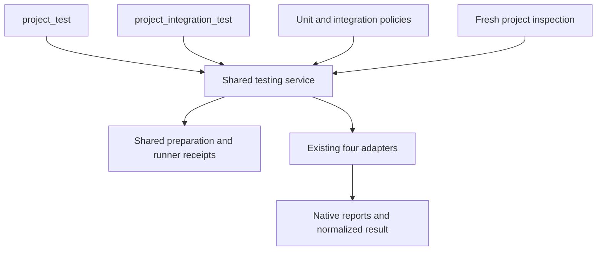
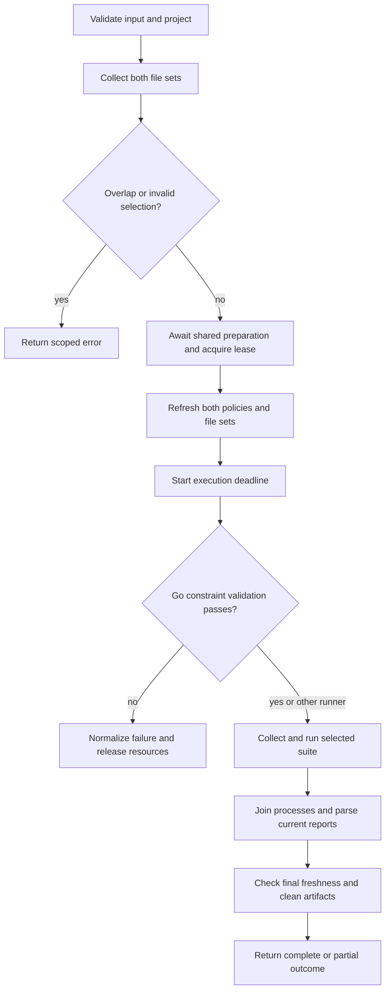
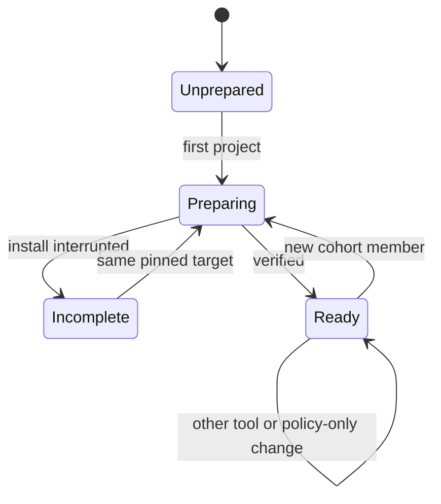

# Project Integration Test - Plan

## Goal Capsule

- **Objective:** Agent, çok projeli bir repository içinde seçtiği projenin entegrasyon testlerini unit testleriyle karıştırmadan çalıştırabilir ve sonucu güvenilir biçimde görebilir.
- **Means:** Mevcut testing servisini iki test grubu için paylaşmak; ayrı araçları aynı hazırlık ve native runner katmanına bağlamak (KTD1–KTD3).
- **Authority:** Product Contract kullanıcı davranışını, Planning Contract bunun mekanizmasını belirler. Uygulama birimleri bu kararları değiştirmez.
- **Execution profile:** Önce dosya seçimi, config ve ortak hazırlık için ucuz regresyon kanıtı; sonra değişen native sınırlar için küçük gerçek akışlar. Test sorumluluğu R15 ile sınırlıdır.
- **Stop conditions:** Kararla çelişen native davranış, kapsamı genişletme ihtiyacı veya karşılanamayan ölçüm bütçesi ortaya çıkarsa bulgu açıkça raporlanır; sessiz fallback yapılmaz.
- **Handoff:** Bu belge implementasyon planıdır. Kod, test çalıştırma, commit, push ve PR bu planı hazırlama işinin parçası değildir.

---

## Product Contract

### Summary

`project_integration_test`, inspection ile bulunan bir projenin entegrasyon testlerini çalıştırır. `project_test` ile runner hazırlığını ve execution altyapısını paylaşır. İki araç ayrı dosya kapsamları kullanır; config çakışmaları ve Go etiket hataları koşudan önce görünür olur.

### Problem Frame

Mevcut araç yalnız unit test kapsamını çalıştırıyor. Entegrasyon testleri için agent’ın klasör, komut ve runner tahmin etmesi yanlış projeyi veya yanlış test grubunu çalıştırabilir. Kullanıcı servis orkestrasyonu istemiyor; mevcut proje test altyapısının çalıştırılmasını istiyor.

### Requirements

**Tool and execution**

- R1. Yeni araç yalnız `project_integration_test` olur; zorunlu `project_id`, isteğe bağlı `test_files` ve `timeout_seconds` kabul eder, serbest komut/flag/runner/ecosystem/cwd almaz.
- R2. `test_files` yoksa seçilen projenin tüm entegrasyon testleri, varsa yalnız doğrulanmış exact proje-relative dosyaları seçilir; boş dizi, glob, test adı, dış yol, başka proje veya diğer test grubuna ait dosya reddedilir.
- R3. Python pytest, Node JS/TS Vitest, Bun runtime `bun test`, Go `go test` kullanır; mevcut desteklenmeyen veya çelişkili runner bildirimi sessizce dönüştürülmez.
- R4. Unit ve entegrasyon araçları ortak runner hazırlığını ve mevcut sürüm dalgalarını paylaşır; yeni aracın eklenmesi veya policy değişimi kendi başına latest yükseltmesi başlatmaz.
- R5. `timeout_seconds` pozitif güvenli tam sayıdır ve varsayılanı 300’dür; runner hazırlığından sonra başlayan tek bütçe collection, testlerin setup/teardown’ı, test execution ve coverage işlerini kapsar.
- R6. Normal test hatasında kalan seçili testler devam eder; otomatik retry/fail-fast eklenmez, iptal veya timeout süreci durdurur ve gözlenen kısmi sonuç korunur.
- R7. Justomp servis, container, migration, seed veya dış kaynağı başlatıp temizlemez; runner’ın mevcut setup/teardown mekanizmaları çalışır ve bunların hataları raporlanır.

**Policy and separation**

- R8. Python varsayılanı `tests/integration/**/test_*.py`, JS/TS varsayılanı `tests/integration/**/*.test.{js,jsx,ts,tsx}`, Go varsayılanı kaynakla aynı pakette `**/*_integration_test.go` olur.
- R9. `.justomp/config.json` içindeki tüm yeni alanlar isteğe bağlıdır; eksik attribute varsayılandan flush edilir, mevcut geçerli değerler ve kullanıcı dizileri aynen korunur.
- R10. İki aracın da koşudan önce aynı projedeki etkili unit ve entegrasyon dosya kümelerinin kesişimini kontrol etmesi gerekir; ortak dosyalar açıklayıcı config hatası üretir ve sessiz öncelik uygulanmaz.
- R11. Go entegrasyon kapsamındaki dosyalarda `integration` build tag’i zorunlu olmalıdır; eksik, bozuk veya unit koşusunu dışlamayan koşul iki araçta da dosya yoluyla hata verir, kaynak dosyası otomatik değiştirilmez.
- R12. Unit koşusunda `integration` tag’i etkin olmaz; entegrasyon koşusunda etkin olur ve yalnız seçilen entegrasyon runnable’ları çalışır, normal Go paket derlemesi ve private erişim korunur.

**Coverage and outcomes**

- R13. Entegrasyon coverage varsayılanı `enabled:false`, `minimum:0` olur; kullanıcı açtığında mevcut native coverage mekanizması uygulanır, minimumu ayrıca yükseltmedikçe düşük oran gate’i oluşmaz.
- R14. Hedefli koşuda proje geneli coverage eşiği uygulanmaz; tam coverage koşusunda iki test grubunun dosyaları kaynak kapsamından çıkarılır ve hiç kullanılmayan sahip olunan uygulama kaynakları mevcut coverage sözleşmesine göre dahil edilir.
- R15. Doğrulama yalnız Justomp’ın kararlarını ve kendi native bağlantılarını sınar; upstream runner/derleyici/coverage davranış matrisi veya gerçek servis kurulum matrisi eklenmez. (pack: testing, test-evidence-and-cost.md)
- R16. Yeni aracın sonuçları test grubu, full/targeted kapsamı, hazırlık etkileri, test sayıları, coverage, hata ve tamamlanma durumunu açıkça taşır; no-tests, bilinmeyen sayılar, rapor hatası ve kesintide mevcut dürüst sonuç semantiği korunur.
- R17. Yeni araç mevcut execution izin seviyesi, ortak session ownership, lease, process-tree sonlandırma, rapor temizliği, hassas veri maskeleme ve son freshness kontrollerini kullanır; session başlangıcı test çalıştırmaz.

### Key Decisions

- D1. **Test altyapısı servisleri yönetir.** (session-settled: user-directed — chosen over Justomp-managed Docker/services: aracın sorumluluğu test çalıştırmak.) Governs R7.
- D2. **Mevcut dört runner ve ortak hazırlık.** (session-settled: user-approved — chosen over ayrı runner/kurulum katmanı: mevcut proje ortamını kullanmak.) Governs R3, R4.
- D3. **Ayrı varsayılan dosya kapsamları ve değiştirilebilir config.** (session-settled: user-approved — chosen over tek test dizini ve zorunlu config: kullanıcı proje yapısını koruyabilir.) Governs R8, R9.
- D4. **Aynı dar input sözleşmesi.** (session-settled: user-approved — chosen over serbest komutlar veya yalnız bütün suite: proje kimliği ve exact dosya seçimi.) Governs R1, R2, R5.
- D5. **Coverage isteğe bağlı ve eşiksiz başlar.** (session-settled: user-approved — chosen over varsayılan %70: sırf oran için entegrasyon testi yazdırmamak.) Governs R13, R14.
- D6. **Go build tag ayrımı doğrulanır.** (session-settled: user-approved — chosen over yalnız dosya adı ayrımı: entegrasyon dosyaları unit derlemesine girmemeli.) Governs R11, R12.
- D7. **Çakışma hata olur.** (session-settled: user-approved — chosen over sessiz öncelik veya çift koşu: kullanıcı hangi dosyanın yanlış sınıflandığını görebilmeli.) Governs R10.

### Acceptance Examples

| ID | Durum | Beklenen sonuç | Covers |
| --- | --- | --- | --- |
| AE1 | `apps/api` kimliği çağrılır; repo başka projeler de içerir | Yalnız API entegrasyon testleri seçilir | R1, R2 |
| AE2 | Tek entegrasyon dosyası seçilir | Diğer dosyaların testleri koşmaz; coverage gate uygulanmaz | R2, R14 |
| AE3 | Unit kapsamı `tests/**`, integration kapsamı `tests/integration/**`, ortak dosya vardır | İki araç da ortak dosyayı göstererek durur | R10 |
| AE4 | Yeni Go config’i ve etiketli `orders_integration_test.go` vardır | Unit koşusu dosyayı derlemez; entegrasyon koşusu seçer | R8, R11, R12 |
| AE5 | Go entegrasyon dosyasında tag yoktur | İki araç da dosyayı gösterir; native test başlamaz | R11 |
| AE6 | Kullanıcı coverage’ı açar, minimumu vermez | Minimum 0 flush edilir; eksiksiz rapor varsa düşük coverage tek başına fail değildir | R9, R13 |
| AE7 | Hazır bir projede ilk entegrasyon çağrısı gelir | Kurulu ortak runner tekrar kullanılır; yeni latest dalgası oluşmaz | R4 |
| AE8 | Testin ihtiyaç duyduğu veritabanı hazır değildir | Native setup/test hatası raporlanır; Justomp servis başlatmaz | R7, R16 |
| AE9 | İlk test fail, sonraki pass olur; daha sonra timeout oluşur | Gözlenen sonuçlar korunur; sonraki paketler başlatılmaz | R5, R6, R16 |
| AE10 | Eski Go config’indeki unit exclude dizisi entegrasyon desenini içermiyordur | Dizi değiştirilmez; gerçek ortak dosya varsa AE3 uygulanır | R9, R10 |
| AE11 | Koşu sırasında diğer suite’in include/exclude ayarı değişir | Eski sınıflandırmayla alınan sonuç güncel başarı sayılmaz | R10, R17 |

### Scope Boundaries

R7 uyarınca servis readiness, Docker Compose, container silme, migration/seed komutları ve servis kurtarma mekanizması eklenmez. Harici servis hatası zaten native test sonucu olarak görünür; ikinci bir operasyon katmanı gerekli değildir.

Test yazdırma, framework migration, browser/E2E runner ekleme, runtime installer, yeni CLI, CI/Git hook kurma, test adı seçimi ve unit+integration coverage raporlarını birleştirme bu çalışmada yoktur. Kaynak rewrite, overlay ile Go test dosyalarını gizleme ve keyfî shell setup komutları da eklenmez.

### Deferred to Follow-Up Work

`project_lint` ve `project_typecheck` için yeni suite/tag seçenekleri bu değişiklikle eklenmez. Go entegrasyon testinin native derlenmesi entegrasyon koşusunda gerçekleşir; bütün checker’ları aynı anda değiştirmek ayrı kapsamdır.

---

## Planning Contract

### Repository Grounding

Başlangıç: `28a932b`, yerel `main`. `project_test` implementasyonu `e125fe7` içindedir. İlgili önceki sözleşme `.compound-engineering/artifacts/plans/2026-10-30-1342-feat-project-test-plan.md` ve kullanıcı dokümanı `docs/testing.md` olur.

- `src/config/load.ts`: atomik, çakışma kontrollü missing-only flush; feature policy ve key ayrımı.
- `src/config/test/resolve.ts`: mevcut leaf array’leri değiştirmeyen resolver ve canonical hash.
- `src/testing/selection.ts`: şu an sabit `tests/integration/` dışlaması var; iki bağımsız kümenin kesişimini bunun arkasına koymak hatayı gizler.
- `src/testing/scope.ts`: canonical proje sahipliği için `collectLintScope` kullanıyor; test/source listeleri ve içerik fingerprint’i aynı snapshot’tan geliyor.
- `src/testing/{service,prepare,coordinator,state}.ts`: execution lease, tek deadline, ortak root owner ve exact sürüm dalgaları.
- `src/testing/detect.ts`: JS tarafında yalnız `test` ve `test:unit` script’lerini okuyor; entegrasyon script kanıtı henüz değerlendirilmez.
- `src/testing/go/{adapter,environment,inventory}.ts` ve `inventory.go`: native collection, GOFLAGS ayrıştırma, AST runnable eşlemesi ve normal paket koşusu.
- `src/omp/test-tools.ts`, `src/omp/extension.ts`: strict schema, exec approval, aynı content/details ve session teardown bağlantısı.

### Key Technical Decisions

- KTD1. **Tek execution çekirdeği, iki ince giriş.** `src/testing/` içinde internal suite kimliği `unit` veya `integration` olur; `testProject` imzası ve `justomp/testing` export yolu korunur, aynı barrel’dan ayrı `integrationTestProject` girişi eklenir. `mode` hâlâ `full|targeted` anlamındadır. Runtime sonuçları `suite` taşır; mevcut public result tipiyle nesne oluşturan tüketicileri gereksiz kırmamak için eski tipte ek alan optional, yeni entegrasyon sonuç tipinde zorunlu olabilir. OMP tool adı suite’i seçer, agent inputu seçmez. R1, R16, R17.

- KTD2. **İki policy, tek config yayını.** JSON’da mevcut `test` unit policy olarak kalır; `integration_test` aynı ecosystem/source/coverage şeklinde eklenir. Yeni defaults `src/config/integration-test/{python,javascript,go}/defaults.ts` altında bulunur. Ortak saf resolver/hash yardımcıları mevcut `src/config/test/` katmanından paylaşılır; bütün config servisleri refactor edilmez. Loader iki ayrı policy key ve testing için birleşik execution/preparation key sağlar. Diğer lint/typecheck/inspection key’leri değişmez. R9.

- KTD3. **Hazırlık state’i korunur.** Aynı root coordinator, `test_state.json`, proje kimliği ve runner cohort’ları kullanılır. Receipt policy hash’i iki suite’in ilgili ecosystem policy’sini kapsar; mevcut `schema:1` ve `waves` verisi korunur. Hash değişimi readiness doğrulamasına yol açabilir fakat `nextWave` yalnız üye değişimini kullandığı için tek başına latest çözmez. Session startup tooling hazırlığı yapmaya devam eder; test düzeni hatasını bulmak için bütün projelerde test çalıştırmaz. Çağrıya ait statik seçim/çakışma kontrolü shared preparation beklemeden önce yapılır; bundan bağımsız startup hazırlığının hiç mutation yapmadığı iddia edilmez. R4, R17.

- KTD4. **Tek taramadan iki bağımsız dosya kümesi.** Sahip olunan candidate dosyalar bir kez bulunur; her suite kendi include/exclude kurallarıyla değerlendirilir. Kesişim, eski hardcoded integration dışlaması veya native Go active-file filtrelemesi uygulanmadan önce hesaplanır. Çakışmada `test-scope-conflict` ve sorted proje-relative dosyalar döner. Sabit klasör kontrolü sınıflandırmayı yöneten üçüncü bir kural olarak kalmaz. Coverage source kümesinden iki test kümesinin birleşimi çıkarılır; canonical child-project, dependency ve symlink sınırları değişmez. R2, R10, R14.

- KTD5. **Mevcut config için sessiz migration yok.** Yeni Go unit defaults exclude listesine `**/*_integration_test.go` eklenir. Önceden flush edilmiş diziler, yeni varsayılanla aynı görünse bile değiştirilmez; kullanıcı tercihi olup olmadığı bilinmiyor. Gerçek çakışma çıktığında hata hangi `test.go.exclude` veya `integration_test.go` seçiminin gözden geçirilmesi gerektiğini gösterir. `include:[]` geçerlidir; boş bir suite diğer suite’in dosyalarını sahiplenmez. R8–R10.

- KTD6. **Go tag’i native sözdizimiyle doğrulanır.** Mevcut bundled helper, header/build-constraint bilgisini de döndürecek şekilde genişletilir; `go/build/constraint` AST’si kullanılır, tag substring regex’i kullanılmaz. İstenen güvence, `integration=false` iken entegrasyon dosyasının koşulunun doğru olamamasıdır. Yalnız legacy `// +build` satırı yeterli değildir; modern directive gerekir. Modern `//go:build integration`, `integration && linux` ve `integration && (linux || darwin)` desteklenir; `integration || linux`, `!integration`, yanlış yerdeki comment, eksik ve bozuk directive reddedilir. Mantıksal garantisi desteklenen AST analizinde kanıtlanamayan karmaşık biçim açıklayıcı `unsupported-integration-constraint` üretir; yanlışlıkla güvenli kabul edilmez. Genel bir SAT/constraint framework kurulmaz. Bu analiz platformdan bağımsız candidate entegrasyon dosyalarında yapılır; mevcut platformda buildable olup olmadığını daha sonra native Go belirler. Go’nun [constraint paketi](https://pkg.go.dev/go/build/constraint) native parser’ı sağlar; mantıksal zorunluluk kontrolü Justomp’ın kendi kuralıdır. R11.

- KTD7. **Go environment ve collection aynı suite’i kullanır.** `GOFLAGS` içindeki desteklenen build tag’leri tek etkili listeye normalize edilir. Unit’te `integration` kaldırılır, entegrasyonda eklenir; diğer tag/build ayarları korunur. Tekrarlanan native `-tags` seçeneklerinin sonuncusu öncekinin yerine geçtiği için etkili değer native önceliğiyle çözülür ve tek bir final tag listesi üretilir. Aynı bağlam `go list` ve `go test` için kullanılır. Header doğrulaması, entegrasyon dosyalarını zaten gizlemiş unit `go list` sonucuna dayandırılmaz. Helper kontrolünden sonra mevcut active-file/runnable envanteri ve exact `-run` seçimi uygulanır. Seçili dosya platform/tag nedeniyle inactive ise mevcut açık seçim hatası korunur. Default vet, TestMain ve init semantiği korunur; entegrasyon koşusunda unit test fonksiyonları seçilmez ama normal paket derlemesi gereği unit dosyaları derlenebilir. [Go build constraints ve test packages](https://pkg.go.dev/cmd/go#hdr-Build_constraints). R2, R11, R12.

- KTD8. **Runner tespiti suite kanıtını görür.** Proje için mevcut tek runtime/runner seçimi korunur; entegrasyon script’i bu seçimle uyumluluk açısından doğrulanır. `test:integration` açık kanıt olarak okunur, wrapper script keşif için çalıştırılmaz. Desteklenmeyen bir komut `unsupported-runner`, ortak runner ile çelişen destekli komut `ambiguous-runner` üretir. Statik literal `--config`/`-c` seçicisi proje sahipliği ve canonical yol kontrolünden sonra ilgili adapter’ın base config’i olur; dinamik seçici, shell zinciri veya güvenle çözülemeyen wrapper açık hata verir. Seçilen config yolu ve içeriği metadata freshness’e dahil edilir. Testlerin native setup/config’i korunur; manifest script’ine gömülü migration veya shell zincirini araç kendiliğinden çalıştırmaz. Bu sınır tool açıklamasında belirtilir. Bu ek script/config doğrulaması entegrasyon çağrısına aittir; entegrasyon script hatası tek başına unit çağrısını engellemez. Tespit invocation öncesidir; ikinci installer cohort yaratılmaz. R3, R4, R7.

- KTD9. **Coverage mevcut adapter politikasının girdisi olur.** Entegrasyon full/disabled ve targeted koşularında native coverage config’ten açık kalmış olsa bile managed invocation bunu kapatır. Full/enabled olduğunda aynı rapor doğrulaması ve source-completeness uygulanır; minimum 0 bozuk veya eksik raporu başarılı yapmaz. Bun kaynak importu yalnız full/enabled koşusunda devreye girer. Python/Vitest/Bun rapor parser’ları veya Go coverage birleştiricisi ikinci kez yazılmaz. R13, R14.

- KTD10. **Freshness iki suite’i kapsar.** Lease sonrası yeniden seçim ve koşu sonu doğrulaması aynı combined policy key’i ve iki grubun dosya üyeliğini görür. Karşı suite’e taşınan dosya veya tag/config değişimi eski sonucu güncel pass yapamaz. Public erken hatalar da suite kimliği ve mevcut maskeleme üzerinden normalize edilir. R10, R16, R17.

### Defaults Projection

Aşağıdaki örnek public config şeklini gösterir; production kodu değildir. `source` varsayılanları ilgili ecosystem’in mevcut `test` defaults’undan aynı değerlerle başlatılır, ardından her policy bağımsız düzenlenebilir. Kullanıcının mevcut unit source tercihleri entegrasyon policy’sine gizlice kopyalanmaz.

```json
{
  "integration_test": {
    "python": {
      "include": ["tests/integration/**/test_*.py"],
      "exclude": ["tests/unit/**"],
      "coverage": {"enabled": false, "minimum": 0}
    },
    "javascript": {
      "include": ["tests/integration/**/*.test.{js,jsx,ts,tsx}"],
      "exclude": ["tests/unit/**"],
      "coverage": {"enabled": false, "minimum": 0}
    },
    "go": {
      "include": ["**/*_integration_test.go"],
      "exclude": [],
      "coverage": {"enabled": false, "minimum": 0}
    }
  }
}
```

`source.include/exclude` dahil tam default belge kodun resolver’ından üretilir. Timeout config’e eklenmez. R9 ve KTD2 uygulanır.

### High-Level Technical Design

Şemalar sorumluluk ve akış sınırlarını gösterir; internal sınıf/fonksiyon düzenini zorunlu kılmaz.

**Component relationships — KTD1–KTD3:**



**Call protocol and gates — R2, R5, R10, R11, R17:**



Pre-lease statik doğrulama native helper çalıştırmaz. Go helper, R5 bütçesi altında fakat proje test binary’si başlamadan çalışır. Lease sonrası statik doğrulama tekrar eder; hatalar KTD10’dan geçer.

**Shared preparation lifecycle — KTD3:**



**Scope data flow — KTD4, KTD10:**

Owned file snapshot → bağımsız unit/integration filtreleri → kesişim doğrulaması → seçilen suite dosyaları + iki suite’ten arındırılmış kaynaklar → native rapor → aynı snapshot/policy ile final freshness.

**Mode matrix — R13–R14:**

| Suite | Selection | Coverage config | Native coverage | Threshold | Bun source imports |
| --- | --- | --- | --- | --- | --- |
| Unit | Full | Existing default true/70 | Açık | Unit minimum | Evet |
| Integration | Full | Default false/0 | Kapalı | Yok | Hayır |
| Integration | Full | Enabled, minimum 0 | Açık | Düşük oran fail değil | Evet |
| Integration | Full | Enabled, minimum >0 | Açık | Config minimum | Evet |
| Either | Targeted | Any | Kapalı | not-enforced-targeted | Hayır |

**API surface — KTD1:**

```json
{
  "project_id": "python:apps/api/pyproject.toml",
  "test_files": ["tests/integration/test_orders.py"],
  "timeout_seconds": 300
}
```

Tool adı `project_integration_test`; sonuçta `suite:integration`, `mode:targeted` bulunur. Kullanıcı veya agent suite alanını inputla değiştiremez.

### Compatibility and Risks

- **Existing config:** KTD5 uygulanır. Yeni Go exclude varsayılanı eski kullanıcı dizisini değiştirmez; belgede bir geçiş örneği ve hata düzeltme yolu bulunur.
- **Existing API/state:** KTD1 ve KTD3 uygulanır. Yeni tool kaydı eski `testProject` çağrılarını veya exact sürüm wave’lerini sıfırlamaz.
- **Native setup:** R7 ve KTD8 uygulanır. Runner içindeki fixture/setup çalışır, shell script wrapper içindeki hazırlık otomatik çağrılmaz. Kullanıcı native runner ortamını hazır tutar.
- **Go helpers:** Entegrasyona özel yardımcı dosyalar ve servis başlatan `init`/TestMain de kullanıcı tarafından doğru build tag sınırına konmalıdır. Justomp, konvansiyon dışında kalan her dosyanın niyetini kodundan tahmin etmez; seçilmemiş test kodunun paket derlemesiyle ilgili native sınır KTD7’de açıklanır.
- **Cancellation:** Mevcut child-tree sonlandırması sürer; sert kesintide kullanıcı teardown’ının tamamlanacağı veya dış servisin silineceği garantisi verilmez (R5, R7, R17).
- **Conservative constraints:** KTD6’daki kanıtlanamayan ifade açık hata verir. Kullanıcı aynı anlamı açık `integration && (...)` koşuluyla ifade edebilir; kaynak otomatik dönüştürülmez.

### Alternatives Considered

Testing modülünü kopyalayıp ayrı hazırlık servisi kurmak R4 ve ortak ownership’i zorlaştırdığı için seçilmedi. Tek araçta agent’ın suite seçmesi R1’deki ayrı tool kararına aykırı. Native script’i doğrudan çalıştırmak serbest shell/setup davranışı yaratacağı için KTD8 yerine kullanılmaz. Mevcut dört adapter’ı suite policy ile kullanmak bu seçenekler arasındaki temel karardır; kalan teknik ayrıntılar için pahalı bir prototip veya yarışan implementasyon gerekmiyor.

### Deferred to Implementation

Tam helper JSON alan isimleri, internal fonksiyon isimleri ve fixture’ların nihai küçük kaynak içerikleri uygulamada belirlenir. Native header/flag bağlantısı mevcut küçük Go witness içinde erken doğrulanır; plan aşamasında runtime deneyi yapılmaz. Bu ayrıntılar R11–R12 davranışını yeniden seçme yetkisi vermez.

---

## Implementation Units

### U1. Dual-suite configuration and contracts

**Goal:** Yeni policy ve suite kimliği mevcut unit API’sini bozmadan tanımlansın.

**Requirements:** R1, R8, R9, R13, R16. **Dependencies:** Yok.

**Files:** `src/config/load.ts`, `src/config/test/{model,resolve}.ts`, `src/config/test/go/defaults.ts`; yeni `src/config/integration-test/resolve.ts` ve `{python,javascript,go}/defaults.ts`; `src/testing/{model,request}.ts`; `tests/unit/testing/contracts.test.ts`, yeni `tests/unit/testing/integration-config.test.ts`; mevcut `tests/integration/config.test.ts`.

**Approach:** KTD1–KTD2 ve KTD5. Ortak resolver’ı iki default setiyle kullan; ayrı key’leri ve combined testing key’ini loader’a ekle. Metadata ve shape değişimini yalnız testing sınırında tut.

**Patterns:** Mevcut `resolveTestConfig` ve atomik `loadConfig` publication.

**Test scenarios:**
1. Empty config iki policy’yi defaultlar; false/0/[] ve bilinmeyen alan korunur.
2. Mevcut Go exclude dizisi aynı kalır; yeni config yeni unit exclude değerini alır.
3. Integration-only policy değişikliği combined key’i değiştirir, unit key ve lint/typecheck key’lerini değiştirmez.
4. Eski public `TestRequest`/`testProject` kullanımı geçerlidir; yeni araç unknown input alanını reddeder.

**Verification:** Saf resolver/contract unit’leri ve mevcut config-publication akışına eklenen tek kontrol. Yeni native kurulum yok.

### U2. Joint scope validation and runner evidence

**Goal:** İki suite’in dosyaları net ayrılsın ve yanlış runner sessizce seçilmesin.

**Requirements:** R2, R3, R8–R10, R14. **Dependencies:** U1.

**Files:** `src/testing/{selection,scope,detect,targets}.ts`, `src/testing/javascript/config.ts`; `tests/unit/testing/selection.test.ts`, yeni `tests/unit/testing/suite-selection.test.ts`, yeni `tests/unit/testing/runner-evidence.test.ts`; mevcut `tests/integration/testing/scope.test.ts`.

**Approach:** KTD4, KTD5, KTD8. Bağımsız kümeleri hardcoded klasör filtresinden önce hesapla; kapsamda test niyetini source okuyarak tahmin etme. İki suite’in birleşimini coverage source seçiminden çıkar.

**Execution note:** Önce eski hardcoded filtre arkasında gizlenen overlap için regresyon kanıtı oluştur.

**Test scenarios:**
1. `tests/**` unit ve `tests/integration/**` integration ortak dosyayı iki çağrıda da hata yapar; targeted çağrı da proje genelindeki çakışmayı atlayamaz.
2. Exclude ortak dosyayı bir kümeden çıkarırsa hata kalkar; boş kümeler ve literal glob karakterli dosya doğru işlenir.
3. Unit veya entegrasyonun custom test yolları coverage source’una girmez.
4. Eski Go config’i + yeni integration dosyası açıklayıcı overlap verir; array mutation olmaz.
5. `test:integration` uyumlu runner ise geçer; Jest/node --test/wrapper veya çelişen runner kanıtı hata verir; script çalıştırılmaz. Statik custom config seçimi doğru dosyayı kullanır, root dışı veya dinamik config reddedilir; aynı hata unit çağrısını tek başına bozmaz.
6. Gerçek filesystem witness başka proje ve dış symlink dosyasını her iki listeden de uzak tutar.

**Verification:** Liste/metadata kararları unit; mevcut scope fixture’ı iki suite sahipliğini kanıtlar. Yeni dependency manager matrisi yok.

### U3. Shared execution and preparation lifecycle

**Goal:** Entegrasyon çağrısı mevcut hazırlık, deadline ve sonuç yolunu kullansın.

**Requirements:** R4–R7, R13–R14, R16–R17. **Dependencies:** U1, U2.

**Files:** `src/testing/{service,adapters,prepare,coordinator,state,result,index}.ts`, `src/testing/python/{adapter,config}.ts`, `src/testing/javascript/{vitest,bun,config}.ts`; `tests/unit/testing/{service,targeted-adapters,waves,native-tools}.test.ts`, yeni `tests/unit/testing/suite-execution.test.ts`; mevcut `tests/integration/testing/{service-local,lifecycle}.test.ts`.

**Approach:** KTD1, KTD3, KTD9, KTD10. Public unit wrapper’ını koru; internal execution ve adapter context’ine suite/policy geçir. Receipt ve watcher key’lerini aynı combined policy’den üret. Native parser’ları kopyalama.

**Test scenarios:**
1. Aynı projede unit ardından integration çağrısı aynı tools/receipt kullanır; resolve/latest/prepare tekrar çağrılmaz.
2. Schema1 completed ve incomplete wave kayıtları korunur; policy değişiminde yeni hedef çözülmez, yeni üye kuralı değişmez.
3. Integration default koşusu native coverage kapalıdır; full/enabled minimum0, missing-report ve targeted durumları ayrı verdict verir.
4. Native setup/test başarısızlığı, kısmi sonuç, timeout ve cleanup hatası supplied boundary sonuçlarıyla korunur; dış servis komutu üretilmez.
5. Karşı suite config’i veya dosya üyeliği koşu sırasında değişirse final freshness fail olur.
6. Gerçek receipt/owner lifecycle’ında iki aracın beklediği hazırlıktan biri vazgeçince diğer owner kalır; last-owner join davranışı korunur.

**Verification:** Gerçek service fonksiyonunu supplied adapter/report/clock ile çağıran unit’ler; mevcut service-local ve lifecycle fixture’larına küçük genişleme. R7 için veritabanı kurarak hata senaryosu üretme.

### U4. Go build-tag boundary

**Goal:** Go entegrasyon dosyaları unit binary’sine girmesin ve entegrasyon çağrısı doğru runnable’ları seçsin.

**Requirements:** R2, R5, R11, R12, R16. **Dependencies:** U2, U3.

**Files:** `src/testing/go/{environment,inventory,adapter}.ts`, `src/testing/go/inventory.go`; gerekirse yeni `src/testing/go/constraints.ts`; `tests/unit/testing/{go,go-adapter}.test.ts`, yeni `tests/unit/testing/go-constraints.test.ts`; mevcut `tests/integration/testing/go.native.test.ts`.

**Approach:** KTD6–KTD7. Header sonucu ve active runnable envanteri ayrı kanıtlardır. Helper’ın başlatılması, collection ve native testler aynı signal/deadline altında kalır. Helper projenin init/TestMain kodunu çalıştırmaz.

**Test scenarios:**
1. Supplied constraint AST/verisi: doğru conjunction geçer, eksik/negatif/bypass eden OR ve parse hatası dosya bilgisiyle reddedilir.
2. Ortamda `integration,custom` varsa unit yalnız integration’ı kaldırır; integration koşusu onu tekilleştirir; collection ve run aynı tag’leri alır.
3. Platformda inactive dosya doğrudan seçilirse açık selection hatası; bütün scope boşsa no-tests.
4. Exact runnable filtresi unit fonksiyonlarını integration çağrısında koşmaz; isim çakışması sessiz kapsam genişletmez.
5. Mevcut native Go fixture’ına bir etiketli entegrasyon dosyası ve gözlenebilir sentinel eklenir: unit invocation bu dosyayı dahil etmez, entegrasyon invocation yalnız ilgili testi çalıştırır. Aynı fixture helper/header bağlantısını da kanıtlar.
6. Mevcut çok paketli supplied adapter kanıtı devam/iptal ve azalan deadline’ı korur; Go compiler ifade kataloğu tekrar sınanmaz.

**Verification:** Justomp sınıflandırma/argv kararları unit; sadece helper→Go collection→test binary bağlantısı mevcut native fixture içinde gerçek çalışır. Setup maliyeti ölçülür. (pack: testing, test-evidence-and-cost.md)

### U5. OMP, API and native handoffs

**Goal:** Agent yeni aracı mevcut session güvenliği ve tutarlı sonuçlarla kullanabilsin.

**Requirements:** R1–R7, R13–R17. **Dependencies:** U3, U4.

**Files:** `src/omp/test-tools.ts`, `src/omp/extension.ts`, `src/testing/index.ts`, `src/index.ts`; `tests/integration/omp/test.test.ts`, `tests/integration/omp/installed-smoke.native.test.ts`, `tests/integration/omp/local-checkers.ts`; `tests/integration/testing/{python,vitest,bun}.native.test.ts`; ilgili `tests/unit/testing/{python,vitest,bun,reports}.test.ts`.

**Approach:** KTD1 ve KTD3. Yeni registration mevcut testing owner’ına bağlanır; yeni retain loop veya watcher açılmaz. Installed-package witness aynı export barrel ve helper resource’larını doğrular.

**Test scenarios:**
1. Strict schema ve exec approval, unknown project, diğer suite dosyası ve deny akışı setup/test çağrısı başlatmaz.
2. Content/details aynı normalized suite sonucunu taşır; isError success ile uyumludur, erken hatalar unit diye etiketlenmez.
3. Root switch veya shutdown integration çağrısını mevcut child-owner akışından abort/join eder.
4. Python/Vitest/Bun küçük native fixture’ları doğru integration dosyası ve native setup/teardown bağlantısını gösterir; aynı kurulum başka hata varyasyonları için tekrarlanmaz.
5. Mevcut unit handoff kanıtı korunur; configuration/selection tekrarları supplied unit’lere taşınırsa hangi gerçek kanıtın kaldığı açıkça kaydedilir.
6. Paketlenmiş `justomp/testing` iki public girişi de yükler; tool listesinde iki test aracı vardır.

**Verification:** Host/API kontrolleri fake native adapter ile; gerçek runner boundary’leri mevcut fixture’larda sınırlı ek invocation. Manager × runner × suite matrisi kurulmaz. (pack: testing, test-evidence-and-cost.md)

### U6. Documentation and complete cost evidence

**Goal:** Kullanıcı kapsamı, geçişi ve hata düzeltmesini anlayabilsin; değişiklik mevcut doğrulama bütçesiyle değerlendirilsin.

**Requirements:** R8–R17. **Dependencies:** U1–U5.

**Files:** `README.md`, `docs/testing.md`, `docs/test-defaults.json`, yeni `docs/integration-test-defaults.json`; `package.json` yalnız yeni dokümanın paket dosyası listesi için; `tests/unit/config/documentation.test.ts`, mevcut packaging smoke; gerekirse `scripts/test-cost.ts` yalnız yeni gerçek dosya inventory’si bağlantısı için.

**Approach:** Default dokümanları resolver’dan üret. Tool inputu, native setup sorumluluğu, Go etiketi/karmaşık ifade hatası, eski config overlap düzeltmesi ve enabled/minimum0 davranışını örnekle. Test-cost eşiklerini değiştirme.

**Test scenarios:** Default JSON ile resolver eşliği, mevcut unit default belgesinin Go exclude değişimi, packaged dokümanın varlığı. Bütün doğrulama akışının tek traversal sonucu ve setup/cleanup süreleri kaydedilir.

**Verification:** Aşağıdaki Verification Contract tamamlanır; geçmiş sonuç yeni feature sonucu gibi sunulmaz.

---

## Verification Contract

### Evidence Ownership

| Sorumluluk | En ucuz yeterli kanıt | Korunacak gerçek sınır |
| --- | --- | --- |
| Config/default ve array koruma | Saf resolver input/output | Mevcut atomik publication fixture |
| Unit/integration overlap | Dosya listeleri ve globlar | Canonical scope/symlink fixture |
| Runner script tespiti | Manifest/config metadata | Mevcut dört executable handoff |
| Ortak latest/state | Supplied adapter + wave verisi | Mevcut receipt/coordinator lifecycle |
| Go tag kabulü ve argv | Supplied AST/header/GOFLAGS | Tek genişletilmiş Go helper/package fixture |
| Coverage ve hata verdict’i | Supplied native raporlar | Mevcut coverage handoff’ları |
| Deadline/iptal | Supplied signal/clock/process | Mevcut process-tree kill/join/lease kanıtı |
| Agent/API/paketleme | Host fake adapter | Mevcut installed-package smoke |

R15 ve `compound-packs/testing/test-evidence-and-cost.md` uygulanır. Geçerli test sınıflandırması gerçek etkileşime göre yapılır; hızlı filesystem/process testi hâlâ integration’dır. Testler eklenmeden önce her davranışın Justomp’a ait olduğu belirtilir. Silinen veya daraltılan owned kanıt için yerine geçen test adı ve korunan gerçek handoff kaydedilir.

### Required Gates and Cost

- Geliştirme ilgili unit ve küçük boundary kontrolleriyle ilerler. Tam doğrulama `bun run check` ile bir kez bütün `bun run test:integration` geçişidir; örtüşen feature alias’ları toplam gate’e eklenmez.
- `bun run test:cost`, check + tek integration traversal ve setup/cleanup dahil karşılaştırılabilir toolchain/concurrency ölçümü verir. Cold ve warm cache sonuçları ayrı raporlanır; yalnız ölçülen cache durumu için iddia kurulur.
- Pack’ın hedefi warm complete gate ≤300 saniye ve başarılı matching 698.765 saniyelik baseline’a göre ≥%60 azalmadır; ikinci koşulun sınırı 279.506 saniyedir.
- Önceki feature’da 401 unit +243 integration, sıfır hata/skip ile 280.115 saniye ölçüldü. Kullanıcı yalnız o ölçümü istisna olarak kabul etti; bu plan için eşik veya baseline değişmedi.
- Yeni native fixture maliyeti implementation sırasında ölçülür. Mutable proje, lock, receipt, environment ve raporlar izole kalır; yalnız immutable download cache paylaşılabilir.
- Skip, daha fazla worker, yeniden koşup iyi zamanı seçme, kontrol zayıflatma veya gece job’una taşıma yapılmaz. Bütçe karşılanmazsa ölçülen kalan maliyet ve gerekli karar kullanıcıya sunulur. (pack: testing, test-evidence-and-cost.md)

### Planning Boundary

Bu plan hazırlanırken production kodu veya test dosyası değiştirilmez, dependency kurulmaz ve test/benchmark çalıştırılmaz. Yukarıdaki önceki ölçüm yeni implementasyonun kanıtı değildir.

---

## Definition of Done

- R1–R17 ve AE1–AE11 karşılıkları uygulanmış ve uygun test katmanında doğrulanmış.
- İki public araç ve API aynı çekirdeği kullanıyor; mevcut unit davranışı yalnız onaylanan ayrım/validation kuralları kadar değişmiş.
- Config attribute bazında tamamlanıyor; eski diziler, runner wave’leri ve kullanıcı kaynakları korunuyor.
- Overlap, Go etiketi ve karşı suite değişimleri hem unit hem integration çağrısında görünür sonuç üretiyor.
- Dört runner’ın dosya/config/report bağlantısı çalışıyor; Justomp servis orkestrasyonu yapmıyor.
- Default coverage kapalı/0; enabled, targeted, no-tests, setup failure, timeout ve partial sonuçlar doğru.
- OMP ownership, packaged exports/resources, native setup/teardown sınırı ve maskeleme doğrulanmış.
- Required correctness gate ve yeni maliyet ölçümü tamamlanmış; bütçe aşımı varsa açık kullanıcı kararı alınmış.
- Terk edilmiş deneme kodu veya gereksiz ikinci servis/kurulum katmanı kalmamış; uygulama dışında kalan değişiklikler eklenmemiş.
