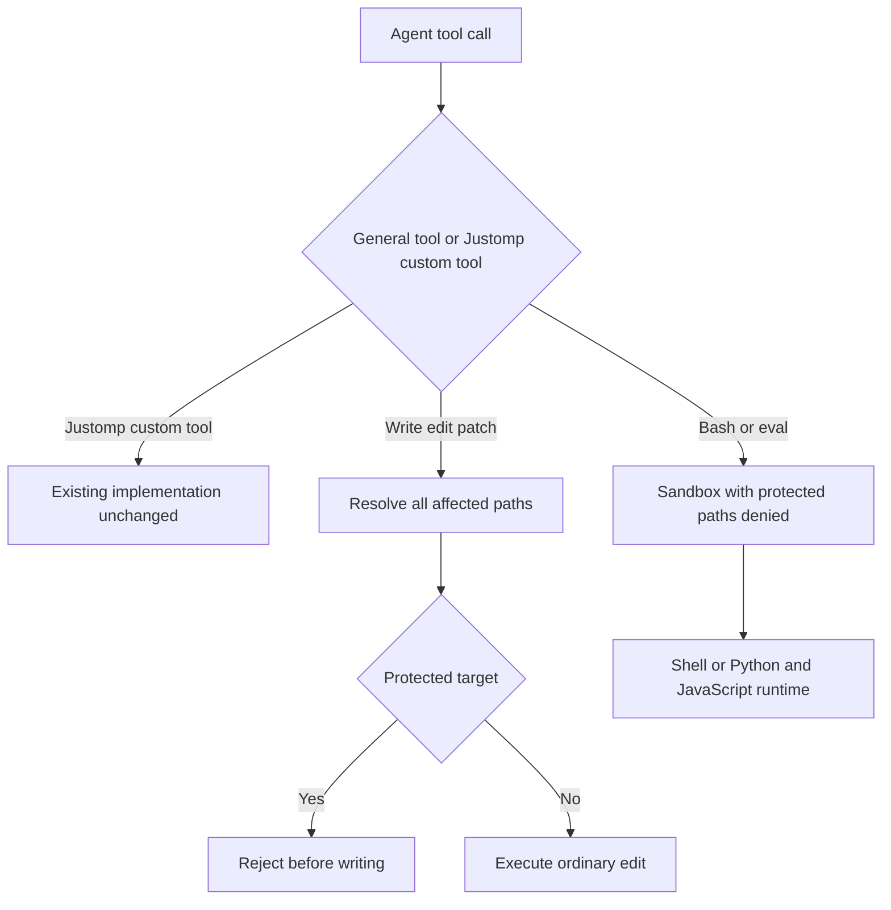

# macOS and Linux File Protection - Plan

## Goal Capsule

- **Objective:** Agent, korumalı proje dosyalarını genel araçlarla değiştiremez; mevcut Justomp custom tool'ları bu dosyalara yazmaya devam eder.
- **Means:** Genel dosya araçlarında hedef reddi; bash/eval gibi serbest kod çalıştıran araçlarda aynı dosyalara yazmayı engelleyen sandbox.
- **Authority:** Kullanıcının son kapsam kararı uygulanır: yalnız engellenmesi gereken yazmalar engellenir; custom tool'lar için yeni allow/capability sistemi kurulmaz.
- **Execution profile:** Mevcut OMP araç girişlerine dar bir koruma katmanı eklenir. Dependency, lint, typecheck ve test servisleri yeniden tasarlanmaz.
- **Stop conditions:** Koruma kurulamazsa ilgili genel çağrı korumasız çalıştırılmaz. Gerçek platform kanıtı alınmadan destek tamamlandı sayılmaz.
- **Handoff:** Bu belge plandır; implementasyon ve yayın henüz başlamamıştır.

---

## Product Contract

### Summary

Justomp korumalı dosyalar için bir deny listesi tutar. Genel write/edit/patch çağrıları bu hedeflere dokunamaz; bash ve eval çağrıları aynı dosyaları yazmaya kapatan sandbox içinde çalışır. Mevcut custom tool uygulamaları bu genel araç sınırının dışında, bugünkü işleyişlerini sürdürür.

### Problem Frame

Agent manifest veya lock dosyasını genel araçlarla değiştirdiğinde Justomp'ın mevcut dependency ve hazırlık iş akışını atlayabiliyor. Çözülmesi gereken sorun bu doğrudan yazma yoludur. Bunun için mevcut custom tool'ların içine ikinci bir yetkilendirme sistemi eklemek gerekmiyor.

### Requirements

**Engellenecek yazmalar**

- R1. macOS ve Linux desteklenir; Windows kapsam dışıdır.
- R2. Genel agent araçları korumalı dosyayı yazamaz, silemez veya başka dosyayla değiştiremez; korumayı bozan rename/move işlemleri de reddedilir.
- R3. Write/edit/patch çağrısının bütün hedefleri işlemden önce kontrol edilir; bir hedef korumalıysa çağrı hiçbir dosyayı değiştirmeden reddedilir.
- R4. Bash, eval Python/JavaScript runtime'ları ve başlattıkları alt programlar aynı deny listesine tabidir; shell redirection, Python/Node script'i veya bash üzerinden çalıştırılan paket yöneticisi korumayı aşamaz.
- R7. Sandbox kurulamadığında ilgili bash/eval çağrısı açıklayıcı hata verir; sandbox'sız fallback ve değişiklik sonrası restore uygulanmaz.

**Mevcut işleyiş**

- R5. Justomp'ın mevcut custom tool'larına yeni allow listesi, işlem profili, capability token veya dosya bazında grant eklenmez; kendi mevcut doğrulamalarını ve yazma davranışlarını korurlar.
- R8. Korunan yollar mevcut inspection sonucundaki kök/alt projeler ve workspace sahiplerinden hesaplanır; ortak lock dosyası unutulmaz.
- R9. Yeni keşfedilen projenin dosyaları sonraki genel araç çağrısının korumasına dahil edilir; mevcut inspection freshness mekanizması kullanılır.
- R11. Bash/eval timeout, iptal, çıktı aktarımı, eval hücreleri arasındaki state ve background/terminal davranışları mümkün olduğu ölçüde mevcut sözleşmesini korur; özellikler topluca kapatılmaz. Korumanın uygulanamadığı somut yol raporlanır.
- R12. Koruma agent'ın genel araç girişlerine uygulanır; kullanıcının harici editör/terminal yazmalarını denetleyen sistem çapında bir servis kurulmaz.

**Configuration ve sonuçlar**

- R13. Koruma config'i gerekirse yalnız deny hedeflerini tanımlar; yeni alanlar optional olur ve mevcut attribute-bazlı default flush kuralını kullanır. Allow/network/işlem yetkisi config'i eklenmez.
- R14. Reddedilen çağrı hedefi ve sebebi gösterir; uygun mevcut custom tool varsa ona yönlendirir.
- R16. Unit testler kendi kararlarımızı, integration testler küçük gerçek OMP/OS bağlantılarını kanıtlar; upstream araçların davranış matrisi tekrar yazılmaz. (pack: testing, test-evidence-and-cost.md)

### Key Decisions

- D1. **Custom tool'ların mevcut yazmaları korunur.** (session-settled: user-directed — chosen over custom tool'lara yeni allow/capability katmanı: yalnız genel araçlardan yasak yazmaları engellemek yeterli.) Governs R2–R5.
- D2. **macOS ve Linux zorunlu.** Windows bu işin kapsamına alınmaz. Governs R1.
- D3. **Bash dosya koruması sandbox ile uygulanır.** (session-settled: user-approved — chosen over shell metnini yorumlama ve yazılanı geri alma: bash alt programları da aynı dosya kısıtını taşımalı.) Governs R4, R7.
- D5. **Serbest kod yürütme de sandbox kapsamındadır.** (session-settled: user-directed — chosen over eval'i kapatma: bash gibi eval de aynı korumalı dosya deny'ı ile çalışacak.) Governs R4, R7, R11.
- D4. **Formatter ayrı çalışmadır.** (session-settled: user-directed — chosen over formatter/LSP özelliklerini topluca kapatma: formatter ileride korumalı dosyaları da formatlayabilir; yöntem ayrıca tasarlanacak.) Governs R5, R11.

### Scope Boundaries

Bu çalışma genel araçlardan gelen dosya yazma isteklerini reddeder ve bash/eval yürütmesini sandbox'a alır. Genel araç dışındaki mevcut custom tool koduna, subprocess runner'ına, package-manager lifecycle script'lerine veya hazırlık servislerine yeni izin mekanizması eklenmez.

Formatter yetkisi ve olası `project_format` custom tool'u ayrı çalışmadır. Bu planda formatter/LSP otomatik özelliklerini kapatma kararı yoktur. Agent'ın açıkça istediği dosya düzenlemesi, hangi genel araçtan gelirse gelsin R2 kapsamındadır; otomatik formatlama için yeni bir güven modeli bu işte tasarlanmaz.

Yapılmayacaklar: genel allow motoru, managed/general execution profile sistemi, işlem başına yetki token'ı, cross-session sahiplik servisi, yeni network politikası, bütün test/lint süreçlerini yeniden sandbox'lama, kalıcı busy/baseline kayıtları, dosya snapshot/restore, Windows backend'i ve OMP özelliklerini topluca kapatma.

### Acceptance Examples

- AE1. Bash kaynak dosyasına yazabilir, korunan `pyproject.toml` dosyasına Python alt süreciyle yazamaz. Covers R2, R4.
- AE2. Kaynak dosyası ve `package.json` içeren karma patch hiçbir değişiklik yapmadan reddedilir. Covers R3.
- AE3. Mevcut `dependency_add` manifest/lock güncellemesini yapabilir; sonraki genel bash çağrısı aynı dosyalara yazamaz. Covers R4, R5.
- AE5. Linux sandbox önkoşulu yoksa istenen bash komutu başlamaz ve neden açıklanır. Covers R1, R7.
- AE6. Kullanıcı yeni proje ekledikten sonra sonraki genel çağrı yeni manifesti de korur. Covers R8, R9.

---

## Planning Contract

### Key Technical Decisions

- KTD1. **Bash ve eval sınırında ortak sandbox backend.** Başlangıç adayı araştırılan `@anthropic-ai/sandbox-runtime@0.0.81` olur. macOS Seatbelt ve Linux bubblewrap desteği küçük bir adapter arkasında kullanılır. Dependency pin'i ve Bun uyumluluğu gerçek sınır testleriyle doğrulanır. R1, R4, R7.
- KTD2. **Bütün servisler yerine yalnız genel araç girişleri değişir.** Koruma `src/omp/` bağlantısında uygulanır. `src/dependencies/runner.ts` ve mevcut custom tool servisleri bu özelliği eklemek için permission-aware hale getirilmez. R5.
- KTD5. **Tam hedef listesi denetlenir.** Write, single/multifile edit, patch add/update/delete/move biçimlerinin tüm gerçek hedefleri çözülür. Tek `input.path` kontrolü yeterli değildir. Parent dizin taşıma ve symlink alias da aynı dosyaya ulaşma yolu olarak değerlendirilir. R2, R3.
- KTD6. **Mevcut inspection kullanılır.** Hedef listesi `getPackagingStructure()` sonucundan türetilir; yeni bir watcher/enrollment servisi kurulmaz. Çalışan sandbox'ın policy'si sonradan değişmez; sonradan keşfedilen hedefler sonraki çağrıda uygulanır. R8, R9.
- KTD7. **Backend'e literal hedefler gönderilir.** Normalize edilmiş ve canonical yollar kullanılır. Linux arbitrary write glob'larını sessizce atlayabildiği için kullanıcının dosya eşleştirme kuralı OS backend'e doğrulanmadan aktarılmaz. Readonly dosya deny'ları, kalan normal bash yazmalarını gereksiz yere kısıtlayan bir proje allow listesine dönüştürülmez. R2, R4.
- KTD8. **Yol korumasının gerçek sınırları test edilir.** Araştırmada mevcut hardlink alias'ından yazma açığı görüldü. Bu durumda ilgili genel çağrı dosya güvenle korunmuş gibi başlatılmaz; otomatik unlink/restore yapılmaz. Yeni hardlink yaratma ve atomic replace yolları da küçük native fixture'da sınanır. R2, R7.
- KTD12. **Sadece bize ait kanıtlar.** Hedef çıkarma ve deny kararları unit'te; OS deny uygulanması ve OMP/custom tool ayrımı integration'da sınanır. Yeni package manager × linter × test runner matrisi oluşturulmaz. R16.

### Protected Paths

İlk hedef kümesi mevcut proje metadata'sından türetilir:

| Kaynak | Korunacak yollar |
|---|---|
| Python projesi/workspace | `pyproject.toml`, `uv.lock` |
| JS/TS projesi/workspace | `package.json`, kullanılan manager lock'u ve workspace manifesti |
| Go projesi/workspace | `go.mod`, `go.sum`, `go.work`, `go.work.sum` |
| Justomp yönetimi | Ortak config ve mevcut araçların yönettiği config dosyaları |

Bu tablo custom tool yazma yetkileri tablosu değildir. Aynı liste genel dosya araçları ile bash/eval deny'ı tarafından kullanılır. Ek kullanıcı hedefleri için config gerekiyorsa `src/config/protection/` altında yalnız deny ayarı tanımlanır; mevcut config alanları ve explicit kullanıcı değerleri korunur.

### High-Level Technical Design

Sandbox wrapper'ın kendisi belirli bir teknik `allowWrite` tabanı gerektirirse bu yalnız backend adapter'ının mevcut bash davranışını koruyan ayrıntısıdır; ürün seviyesinde yeni allow kuralları veya custom tool yetkileri değildir.

### OMP Integration Details

- OMP tool registration/override ve pre-execution event mekanizmaları kullanılır. Custom tool'un kendi iç filesystem yazmaları genel `write` çağrısı gibi ele alınmaz.
- Native bash'in `direnv`/shell hazırlığının wrapper dışında komut çalıştırmaması sağlanır. Salt komut başına prefix koyup bütün sürecin sandbox'a alındığı varsayılmaz.
- Background veya PTY süreç sandbox içinde başlatıldıysa korumayı taşır. Bu yollar için çözüm korumanın process launch'a uygulanmasıdır; varsayılan çözüm özellik kapatmak değildir.
- `eval` kapatılacak bir özellik değil, bash gibi sandbox içinde çalıştırılacak genel execution aracıdır. Python ve JavaScript runtime başlangıcı aynı deny listesine bağlanır; yalnız hücre metnini kontrol etmek yeterli değildir. OMP'nin korumasız Worker fallback'i kullanılmaz. Eval'in normal tool çağrıları mevcut genel araç denetimine ulaşır; Justomp custom tool çağrıları kendi mevcut uygulamalarına gider. Hücreler arası state ve policy değişiminde kernel yenileme gereği açıkça ele alınır; state sessizce kaybedilmez.
- Native write/edit ile eşzamanlı bash arasında hedefin symlink'e çevrilmesi yarışı bırakılmaz. Gerekirse yalnız bu genel çağrılar için validation–write süresini kapsayan in-memory serialization kullanılır; cross-host lease veya kalıcı kilit servisi eklenmez.
- Custom tool tarafından yapılan meşru değişiklikler geri alınmaz. Bu değişiklikten sonra başlayan bash güncel dosya kimlikleriyle yeni sandbox alır.

### Evidence and Remaining Runtime Checks

İncelenen yerel ortam OMP `18.13.3`, Bun `1.4.2` ve SRT `0.0.81` kullanıyor. macOS'ta kaynak yazması/read başarılı; korumalı hedefte shell redirect, interpreter write, symlink write, atomic replacement ve unlink reddedildi. Hardlink alias açığı ayrıca gözlendi. Linux henüz gerçek ortamda çalıştırılmadı.

Bu bulgular implementasyon başlangıcıdır; tam entegrasyon kanıtı değildir. U1 hem platform davranışını hem custom tool yazmasıyla eşzamanlı Linux bind mount davranışını doğrular. Gerekli bir yolu backend karşılamıyorsa somut bulgu kullanıcıya sunulur; çözüm olarak yeni bir izin framework'ü sessizce eklenmez.

Kaynaklar:

- [Sandbox Runtime](https://github.com/anthropics/sandbox-runtime).
- [İncelenen Linux backend](https://github.com/anthropics/sandbox-runtime/blob/98a4016d27609ed34dd1fb43d23ed6efb6eeeb77/src/sandbox/linux-sandbox-utils.ts).
- [İncelenen macOS backend](https://github.com/anthropics/sandbox-runtime/blob/98a4016d27609ed34dd1fb43d23ed6efb6eeeb77/src/sandbox/macos-sandbox-utils.ts).
- Kurulu OMP paketindeki `src/extensibility/tool-event-input.ts`, `src/exec/bash-executor.ts` ve `src/tools/`: gerçek payload ve process launch bağlantıları.
- `src/omp/extension.ts`, `src/packaging/get-structure.ts`, `src/config/load.ts`: kullanılacak mevcut Justomp bağlantıları.

---

## Implementation Units

### U1. Bash and eval sandbox adapter

**Goal:** Genel bash/eval yürütmesinde protected-path deny'ını macOS ve Linux'ta uygulamak.

**Requirements:** R1, R2, R4, R7, R11; AE1, AE5. **Dependencies:** Yok.

**Files:** Yeni `src/protection/sandbox.ts`, `tests/unit/protection/bash-sandbox.test.ts`, `tests/integration/protection/bash-sandbox.native.test.ts`; `package.json`, `bun.lock`.

**Approach:**

1. Pinned backend'i bash ve eval bağlantılarının paylaştığı küçük adapter'a al.
2. Protected literal paths, cwd, environment, timeout ve abort bilgilerini mevcut çağrıdan aktar.
3. Önkoşul/başlatma/cleanup hatalarını açıklayıcı biçimde döndür; original komutu korumasız çalıştırma.
4. Bash'in normal kaynak yazmalarını ve network davranışını koru; yeni network policy ürünü tasarlama.

**Test scenarios:**

1. Source write ve protected read başarılı; protected child-process write reddedilir.
2. Protected hedefte redirect, atomic replace, unlink ve symlink alias etkisiz kalır.
3. Hardlink ve eksik lock hedefleri korumayı sessizce aşamaz; Linux placeholder cleanup kullanıcı dosyası silmez.
4. Sandbox kurulamadığında child hiç başlamaz; hata eşleştirme dalları unit'te sınanır.
5. Background child aynı deny'ı taşır; iptal/timeout mevcut process cleanup sonucunu korur.
6. Custom tool eşzamanlı atomic replacement yapınca mevcut bash'in yeni hedefe yazma imkânı doğup doğmadığı iki OS'ta gerçek fixture ile kontrol edilir.

**Verification:** macOS ve Linux'ta gerçek süreç sonuçları elde edilir; bu sonuçlar olmadan tam destek iddiası yapılmaz.

### U2. Shared deny target resolution

**Goal:** Inspection'dan gelen dosya yollarını bütün genel araçların kullanacağı tek hedef kümesine çevirmek.

**Requirements:** R8, R9, R13; AE6. **Dependencies:** Yok; U1 ile aynı path sözleşmesini paylaşır.

**Files:** Yeni `src/protection/paths.ts`, `tests/unit/protection/paths.test.ts`, `tests/integration/protection/paths.test.ts`; `src/packaging/get-structure.ts` bağlantısı. Kullanıcı deny config'i gerektiğinde `src/config/protection/{defaults,model,resolve}.ts` ve `src/config/load.ts`.

**Approach:** Mevcut project/workspace sahiplik bilgisini yeniden kullan. Parent ilişkisi, canonical path ve eksik hedefi aynı resolver'da ele al. Genel çağrı öncesinde inspection freshness'i doğrula; yeni watcher, persisted inventory veya enrollment coordinator ekleme.

**Test scenarios:**

1. Supplied Python/JS/Go metadata doğru manifest ve shared lock yollarını üretir.
2. Nested proje/owner tekrarları normalize edilir; benzer isimli kaynak yanlışlıkla protected sayılmaz.
3. Gerçek symlink ve parent taşıma protected hedefle ilişkilendirilir.
4. Yeni proje inspection'a girdikten sonra sonraki resolution yeni manifesti içerir.
5. Config eklenirse eksik attribute flush edilir, explicit kullanıcı dizisi ve bilinmeyen mevcut alanlar korunur.

**Verification:** Aynı çözülmüş deny kümesi write/edit ve bash/eval tarafından tüketilir; ayrı kural kopyaları yoktur.

### U4. OMP general tool enforcement

**Goal:** Genel araç çağrılarını deny kontrolüne bağlamak ve mevcut custom tool'ları değiştirmemek.

**Requirements:** R2–R5, R7, R11, R14; AE2, AE3. **Dependencies:** U1, U2.

**Files:** Yeni `src/omp/protection.ts`, `src/omp/protected-targets.ts`, `tests/unit/protection/tool-targets.test.ts`, `tests/integration/omp/protection.test.ts`, yeni `src/omp/protected-eval.ts`, `tests/unit/protection/eval.test.ts`, `tests/integration/protection/eval.native.test.ts`; `src/omp/extension.ts`.

**Approach:**

1. Gerçek OMP payload'larından write/edit/patch bütün hedeflerini çıkar ve execution öncesi reddet.
2. Bash launch ile eval Python/JavaScript runtime başlangıcını U1'e bağla; native preflight veya runtime fallback'i korumasız kod çalıştıramaz.
3. Normal dosya araçlarının validation–write yarışı için yalnız gerekli yerel koordinasyonu uygula.
4. Eval sandbox bağlantısını, hücre state'ini ve tool bridge'ini koruyarak tamamla; sandbox entegrasyonu yerine eval'i kapatmak tamamlanma sayılmaz.
5. Mevcut custom tool kayıtları, servisleri ve process runner'ı için yeni permission API ekleme.

**Test scenarios:**

1. Single/multifile edit ve patch add/update/delete/move hedefleri unit'te doğru çıkarılır.
2. Karma patch gerçek OMP wrapper'da hiçbir dosyayı değiştirmeden reddedilir; normal source edit çalışır.
3. Gerçek bash çağrısı sandbox'a ulaşır; normal ve background/terminal launch'larında protected deny korunur.
4. Validation sırasında eşzamanlı symlink swap protected host write'a yol açmaz.
5. Mevcut bir custom tool manifesti günceller; bundan önceki/sonraki genel çağrılar korumayı aşamaz. Yeni package manager matrisi kurulmaz.
6. Python ve JavaScript eval gerçek runtime'larında source write başarılı, protected write reddedilir; sonraki hücre önceki hücrenin değişkenini kullanabilir.
7. Eval tool bridge genel write denetimini atlayamaz; aynı bridge üzerinden mevcut Justomp custom tool işleyişi korunur.
8. Runtime başlangıç hatası korumasız Worker fallback'i çalıştırmaz; policy değişiminin mevcut kernel'e etkisi açık sonuç verir. Hata/karar dalları supplied sonuçlarla unit'te sınanır.

**Verification:** Genel çağrılar engellenir, mevcut custom tool input/uygulamaları aynı kalır; formatter için kapatma veya yeni yetki davranışı eklenmez.

### U7. Documentation and verification

**Goal:** Dar kapsamı ve iki platformun doğrulama sonucunu belgelemek.

**Requirements:** R1, R5, R11, R14, R16. **Dependencies:** U1, U2, U4.

**Files:** `README.md`, yeni `docs/protection.md`, gerekiyorsa package file listesi; mevcut installed-package testi.

**Approach:** Protected targets, reddedilen genel çağrı örnekleri, custom tool ayrımı, platform önkoşulları ve mevcut runtime sınırlamalarını yaz. Formatter/network/capability tasarımı ekleme. Yeni testleri mevcut gate'e dahil et.

**Test scenarios:**

1. Kurulu package adapter ve doküman dosyalarını içerir.
2. Deny testleri iki OS'ta gerçek süreçle geçer; setup failure başarı/skip olarak gösterilmez.
3. Mevcut custom tool akışı ve complete test maliyeti korunur.

**Verification:** Aşağıdaki gate'ler geçer; destek iddiası ölçülmüş platform kanıtıyla eşleşir.

---

## Verification Contract

- `bun run check`: mevcut type/lint/unit gate'i zayıflatılmadan geçer.
- `bun run test:integration`: mevcut suite ve yeni küçük OS/OMP sınır örnekleri tek traversal ile geçer.
- `bun run test:cost`: mevcut warm complete gate hedefi korunur; en fazla 300 saniye ve eşleşen baseline'a göre en az %60 azalma. Karşılanmazsa maliyet açıkça raporlanır.
- Pure path/deny kararları ve hata permutations unit'te kalır. OS policy, symlink, process ve OMP handoff integration'da sınanır. (pack: testing, test-evidence-and-cost.md)
- Mevcut manager/runner testleri her yeni deny senaryosu için tekrar kurulmaz; küçük temporary dosya ve child-process fixture'ları kullanılır.

---

## Definition of Done

- Genel write/edit/patch korumalı dosyalara değişiklik uygulamaz; normal kaynak düzenlemeleri çalışır.
- Bash, eval Python/JavaScript runtime'ları ve alt programları macOS/Linux üzerinde aynı deny'ı taşır; korumasız fallback yoktur.
- Mevcut Justomp custom tool'ları yeni allow/grant sistemi olmadan yazmaya devam eder.
- Formatter/LSP kapatma, network policy, cross-session servis veya custom tool yeniden tasarımı eklenmemiştir.
- Yeni keşfedilen proje sonraki genel çağrıda korunur; mevcut süreçlere ilişkin doğrulanmamış garanti verilmez.
- Bilinen hardlink ve concurrent replacement sınırları gerçek testlerle çözülmüş veya tamamlanmayı engelleyen somut bulgu olarak raporlanmıştır.
- Verification Contract geçmiştir; yalnız gereken kaynak/test/doküman değişiklikleri kalmıştır.
- Push/PR/yayın ayrı kullanıcı yetkisine bağlıdır.
