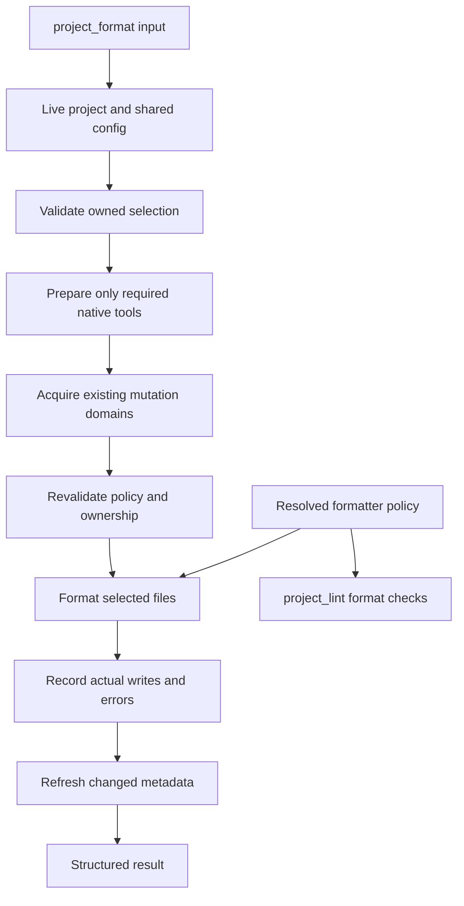

# Project Format - Plan

## Goal Capsule

- **Objective:** Agent, seçtiği projenin tamamını veya belirttiği dosyalarını tek çağrıyla formatlayabilir ve hangi dosyaların değiştiğini görebilir.
- **Means:** `project_format`, mevcut proje keşfi ve işlem koordinasyonunu kullanarak KTD1'deki formatterları çalıştırır.
- **Authority:** Kullanıcının kararları ve Product Contract davranışı belirler; Planning Contract uygulama yöntemini belirler. Uygulama birimleri bu sözleşmeleri değiştirmez.
- **Execution profile:** Mevcut Justomp deposunda özellik geliştirmesi. macOS ve Linux hedeflenir. Bu belge planı tanımlar; uygulamaya başlamak ayrı kullanıcı kararıdır.
- **Stop conditions:** Seçili proje dışına format yazılması, ortak ayarların gizlice geçersiz kılınması veya koruma sisteminin değiştirilmesi gerekiyorsa kapsamı büyütmeden durulur ve somut engel bildirilir.
- **Delivery:** Uygulayıcı kodu, ilgili dokümanı ve doğrulamayı tamamlar. Commit/push/PR/merge bu planın verdiği yayın yetkisi değildir.

---

## Product Contract

### Summary

`project_format`, `list_projects` sonucundaki `project_id` ile çalışır. Dosya listesi verilmezse seçilen projenin desteklenen dosyalarını, verilirse yalnız seçilen dosyaları formatlayıp kaydeder. Ortak ayarlar `.justomp/config.json` üzerinden yönetilir. Sonuç, format değişikliklerini hazırlık sırasında yapılan değişikliklerden ayırır.

### Problem Frame

Justomp şu anda format bozukluklarını `project_lint` içinde denetliyor; bunları düzelten bir proje tool'u yok. Genel edit/write araçları korunan manifestleri değiştiremediğinden, agentın bu dosyaları da formatlayabilen güvenilir bir işleme ihtiyacı var. Ayrı formatter sürümleri veya ayarları kullanılması, format sonrası aynı dosyanın yeniden hatalı sayılmasına yol açabilir.

### Key Decisions

- D1. **Projenin tamamı ve isteğe bağlı dosya seçimi.** Governs R1–R3. (session-settled: user-approved — chosen over yalnız tüm proje: belirli dosyalara da aynı işlem uygulanabilmeli.)
- D2. **Format doğrudan yazar.** Governs R4, R10. (session-settled: user-approved — chosen over yalnız format hatası bildirmek: kullanıcının istediği işlem biçimi düzeltip kaydetmek.)
- D3. **Tek ortak ayar kaynağı.** Governs R7–R9. (session-settled: user-directed — chosen over her proje için bağımsız ayar: mevcut değerler korunur, eksik alanların defaultları flush edilir.)

### Requirements

**Seçim ve sahiplik**

- R1. Tool girdisi zorunlu `project_id` ve opsiyonel, boş olmayan `files: string[]` alanlarından oluşur; ecosystem, paket yöneticisi, komut veya çalışma dizini agenttan alınmaz.
- R2. `files` verilmezse o anki inspection sonucuna göre seçilen projenin sahip olduğu, desteklenen ve kapsam dışı bırakılmamış dosyalar işlenir.
- R3. `files` girdileri tam proje-relative dosya yollarıdır; başka projeye ait, olmayan, kapsam dışı, desteklenmeyen veya güvenle seçilemeyen bir giriş varsa format yazıları başlamadan hata verilir.

**Format davranışı**

- R4. Başarılı format sonucu dosyaya kaydedilir; değişmemiş dosya ve boş otomatik keşif başarılı sonuçlardır.
- R5. Python kaynakları Ruff, Go kaynakları gofumpt + goimports, JS/TS ve desteklenen ortak dosyalar Prettier, TOML ise Prettier TOML eklentisi ile işlenir.
- R6. Desteklenen korunan manifest ve ayar dosyaları custom tool tarafından formatlanabilir; dependency değerleri ve ayarların anlamı bu işlemle değiştirilmez.
- R7. Aynı dosyayı kapsayan `project_lint` format kontrolü ve `project_format` aynı motor sürümünü ve etkin ayarları kullanır; gerçek lint hatalarının ayrıca kalması mümkündür.

**Ayarlar ve hazırlık**

- R8. Config içinde hiçbir yeni alan zorunlu değildir; eksik alanlar kaynak defaultlarından tamamlanıp mevcut flush yaşam döngüsünde yazılır, açıkça yazılan değerler korunur.
- R9. Format çağrısı güncel ortak ayarları kullanır; sıradan session start kaynak dosyalarını formatlamaz ve araç sürümlerini gereksiz yere yeniden latest'a yükseltmez.
- R10. Gerekli native araçların hazırlığı mevcut yaşam döngüsünü kullanır; ortak hazırlığın seçili dosyalar dışındaki etkileri sonuçta ayrıca görünür.

**Sonuç ve hata**

- R11. Sonuç değişen, değişmeyen, başarısız ve henüz işlenmeyen dosyaları, kullanılan motorları ve hazırlık etkilerini ayırt eder.
- R12. İptal veya hata önceki başarılı yazıları geri almaz; işlem sonraki dosyalara yazmayı durdurur ve kısmi sonucu doğru bildirir.
- R13. Dosya biçimlendirmesi proje sınırlarını aşmaz, gözlenen eşzamanlı kullanıcı değişikliğini ezmez ve manifest değiştiğinde inspection sonucunun yenilenmesini sağlar.

### Acceptance Examples

- AE1. **Covers R1–R4:** `apps/api` için dosya listesi verilmezse API'nin Python kaynakları, `pyproject.toml` ve desteklenen belgeleri işlenir; `apps/web` ve API altındaki ayrı keşfedilmiş projeler değişmez.
- AE2. **Covers R1, R3:** `files: ["src/main.py", "pyproject.toml"]` yalnız bu iki dosyayı seçer. Aynı listede `../web/package.json` bulunması tüm seçimi reddeder.
- AE3. **Covers R4, R7:** Bir kez formatlanan dosyalar aynı ayarlarla ikinci çağrıda değişmez; ardından lint'in format aşaması aynı dosyalar için başka bir stil istemez.
- AE4. **Covers R6, R13:** `pyproject.toml` biçimi değişir, bağımlılıklar ve mevcut ayar değerleri aynı kalır; sonraki hazırlık eski metni geri yazmaz.
- AE5. **Covers R8:** Kullanıcının `singleQuote: true` tercihi korunur; yazılmamış `printWidth` defaulttan tamamlanır.
- AE6. **Covers R11, R12:** İlk dosya değiştikten sonra ikinci dosya parse edilemezse ilk dosya `changed`, ikinci `failed`, kalanlar `not-run` olarak döner; sonuç başarılı gösterilmez.
- AE7. **Covers R5, R10:** Python projesindeki yalnız `README.md` ve `pyproject.toml` seçimi, hedefe Node manifesti veya Prettier bağımlılığı eklemeden çalışır.

### Scope Boundaries

Bu iş OMP tool'u, onun çağırdığı servis, ortak config, ilgili lint uyumu ve formatın etkilediği readiness davranışını kapsar.

- Ayrı `project_format_check`, CLI, Git hook'u, CI kurulumu ve session-start otomatik formatı bu işte yoktur.
- ESLint `--fix`, Ruff lint fix/isort ve genel kod refactor'u yoktur; Go import düzenlemesi R5'in açıkça kabul edilmiş parçasıdır.
- Lock dosyaları, `go.mod`, `go.sum`, `go.work`, `go.work.sum`, binary dosyalar, bağımlılık/cache/build çıktıları ve `.justomp` iç verileri format hedefi değildir. Bir dosyanın korunan olması formatter desteği bulunduğu anlamına gelmez.
- Yeni allow/unlock sistemi, OMP patch'i, sandbox tasarımı veya eval/LSP politikası yoktur. Mevcut güvenilir custom tool sınırı yeterlidir.
- Genel backup/undo, repo çapında transaction, kalıcı busy dosyası ve otomatik retry mekanizması kurulmaz; R11–R13'ün görünür kısmi sonuç ve mevcut yazma kontrolleri bu iş için yeterlidir.
- Kullanıcı tanımlı executable/plugin yükleme ve formatter plugin pazaryeri yoktur; böyle bir ihtiyaç ayrı kapsam gerektirir.

---

## Planning Contract

### Key Technical Decisions

- KTD1. **Mevcut native araçlar, extension'a ait Prettier.** R5'i Ruff'ın mevcut uv ortamındaki sürümüyle, Go'yu hazırlanmış golangci-lint'in `fmt` komutundaki gofumpt + goimports ile uygula. Böylece ayrı gofumpt kurulum/sürüm takibi gerekmez. Prettier ve TOML eklentisini Justomp runtime dependencies olarak exact pinle ve Bun içinden açık API çağrılarıyla kullan. (session-settled: user-approved — chosen over her şeyi tek Prettier motoruna vermek veya Python/Go projelerine Prettier kurmak: kaynak dillere uygun motorlar ve extension içinde ortak dosya desteği.) Go ikilisi de session-settled: user-approved — chosen over yalnız gofumpt: mevcut import format kontrolüyle uyum korunur. [Prettier API](https://prettier.io/docs/api), [Go formatter desteği](https://golangci-lint.run/docs/formatters/).

- KTD2. **Ayar başına tek sahip.** R7–R9 için Ruff ayarları `lint.python.ruff`, Go ayarları `lint.go.golangci.formatters` altında kalır. Ortak Prettier seçeneklerinin yeni sahibi `format.prettier` olur. Mevcut `lint.javascript.prettier` değerlerini uyumluluk girdisi olarak oku: her alan için yeni alan varsa onu, yoksa eski alan varsa onu, o da yoksa kaynak defaultunu kullan. Flush etkin değerleri yeni ağaca yazar, kullanıcıya ait eski ağacı silmez; iki yerde değer varsa yeni alanın üstünlüğü dokümante edilir. Lint tüketicileri ve `prettier.justomp.json` yalnız çözülmüş ortak değeri kullanır. Varsayılanlar mevcut `printWidth:120`, `tabWidth:2`, `useTabs:false`, `semi:true`, `singleQuote:false`, `trailingComma:"all"`, `endOfLine:"lf"` değerlerini korur. Diğer desteklenen seçenekler, TOML seçenekleri dahil, kullanıcı değerleri olarak taşınır; tool girdisinden parser/plugin enjekte edilemez.

- KTD3. **Formatter hedefleri inspection'dan ayrı seçilir.** Projeyi `getPackagingStructure()` ile bul; `src/lint/scope.ts` sahiplik ve dependency-root yürüyüşünü dar bir ortak yardımcıya çıkar, mevcut lint kapsamını değiştirme. Format için desteklenen uzantı/basename eşlemesi ve `format.include`/`format.exclude` ekle. Default include `['**/*']`; default exclude mevcut bağımlılık/build/cache listesine, lock dosyalarına, generated type/output yollarına ve `.justomp/**` kapsamına dayanır. Array'ler attribute bazında bütünüyle değiştirilir, defaultlarla birleştirilmez. Proje dışı/alt proje/symlink/özel dosya korumaları config ile kapatılamaz. Noktayla başlayan bütün yolları körlemesine eleme: `.github/*.yml` gibi proje dosyaları formatlanabilir; `.git` ve iç state dizinleri yazma kapsamı dışındadır.

- KTD4. **Sabit dosya yönlendirme.** Python projesindeki `.py`/`.pyi` Ruff'a, Go projesindeki `.go` Go formatterlarına gider. JS/TS kaynakları ve ortak dosyalar bundled Prettier'a gider. İlk kapsam: `.js/.jsx/.mjs/.cjs/.ts/.tsx/.mts/.cts`, `.json/.jsonc`, `.yaml/.yml`, `.md/.mdx`, `.html`, `.css/.scss/.less`, `.toml`. Bilinen JSONC ayar basenames'leri parser tablosunda açıkça tanımlanır; `tsconfig*.json` yorumları desteklenir. `.ipynb` bu sürümün source format kapsamına alınmaz; mevcut lint desteği korunur. Gerçek bir bağımsız Python/Go projesi keşfedilmeden yabancı dil motoru kurulmaz. Default keşif desteklenmeyenleri atlar, explicit seçim açıklayıcı hata döner. Dosya türü ve destek ayrı birim-test edilebilir politika olarak tutulur.

- KTD5. **Yerel Prettier'dan ortak motora lint geçişi.** JS lint'in format kısmını bundled Prettier check API'sine geçir; ESLint'in proje ortamı aynı kalır. `requiredJavascriptTools`, retained-version resolver, native verify ve receipt normalizasyonunu birlikte güncelle. Eski receipt içindeki Prettier kaydı artık hedefte kurulum/upgrade şartı oluşturmaz. Kullanıcının package.json'daki Prettier bağımlılığını otomatik kaldırma. Justomp sürümüyle gelen motor sürümünü format sonucunda bildir. Bu geçiş format sürümü uyuşmazlığını çözer; lint'in mevcut dosya kapsamını ortak belge dosyalarını da zorunlu kılacak şekilde genişletmez.

- KTD6. **Biçim değişikliği ayar drift'i değildir.** Yapılandırılmış dosyalarda yalnız metin eşitliğine dayanan readiness yerine policy-owned değerleri ve gerekli sahiplik işaretlerini doğrula. Python Ruff ve Pyright alanlarını, JSON/JSONC typecheck ayarlarını ve YAML lint ayarlarını ilgili parserlarla karşılaştır; bilinmeyen/yerel alanlarla ilgili mevcut çatışma kuralları korunur. Üretilen JS config'i çalıştırarak doğrulama: mevcut ve beklenen metni aynı bundled formatter ile normalize edip karşılaştır. Anlamı aynı olan dosyayı hazırlık yeniden yazmamalı; policy değişikliği yine algılanmalı. Formatı mevcut `withReadyLintTarget` callback'ine doğrudan koyma: onun yazısız işlem postcondition'ı korunmalı. Kaynak: `src/lint/projection.ts`, `src/lint/projections/python.ts`, `src/typecheck/projections/`.

- KTD7. **Tek yürütme ve yazma akışı.** Önce girdiyi ve güncel sahipliği doğrula, yalnız seçimin gerektirdiği native önkoşulları hazırla, ardından mevcut native mutation domain'lerini al. Bekleme sonrası proje/config/seçimi tekrar çöz; sahiplik değişmişse yazmadan hata ver. Hazırlığı lease içinden tekrar çağırma. Prettier'ın döndürdüğü metni mevcut snapshot/conflict/mode-preservation/atomic-publish yardımcısının genelleştirilmiş haliyle kaydet. Native formatterları explicit dosya argv'siyle, shell interpolation olmadan ve belirtilen proje cwd/config ile çalıştır. Native yazılar için çağrı öncesi/sonrası gözlenen içerikleri karşılaştır; araç stdout'undan değişen dosya tahmini yapma. Native süreçler için harici editörlerle OS düzeyinde izolasyon garantisi verilmez.

- KTD8. **Sıralı çalışma ve gözlenen kısmi sonuç.** R11–R13 için ilk sürüm deterministik dosya sırası kullanır. Her format/yazma öncesi abort kontrolü yap; native child sonlanıp temizlenmeden domain'i bırakma. Hata veya iptal sonrasında son dosya durumlarını topla, sonraki yazıları durdur. Manifest/workspace metadata yazıldıysa başarıdan bağımsız olarak inspection refresh dene; refresh hatasını ek hata olarak raporla, yapılan yazıları gizleme. Mevcut typecheck/test içerik fingerprintleri sonraki çağrıda doğal olarak yeniden doğrulansın; bütün state'i silme veya güncelmiş gibi sahte receipt yazma.

- KTD9. **Kontrollü parser/plugin yükleme.** Prettier config/editorconfig/plugin auto-discovery kullanma; etkin seçenekleri ve paket içinden import edilmiş TOML plugin nesnesini açıkça geçir. TOML plugin sürümünü `2.0.6` olarak sabitle; Prettier 3 uyumluluğu yayımlanmış pakette tanımlıdır. Bu sürüm embedded `@taplo/lib` ile yalnız verilen seçenekleri kullanır ve ayrı Taplo executable gerektirmez. Lockfile, araştırılan `@taplo/lib@0.5.0` çözümünü korumalıdır. Güncel 4.1.0 sürümündeki ambient Tombi config/override keşfi ortak otoriteyi bozabildiğinden otomatik yükseltme yapılmaz. [2.0.6 release source](https://github.com/un-ts/prettier/blob/7a4346d5dbf6b63987c0f81228fc46bb12f8692f/packages/toml/src/index.ts), [Taplo library source](https://github.com/tamasfe/taplo/blob/48e4c083e6a98891e3d6b2b65450970a3779e8cb/js/lib/src/index.ts), [4.1.0 config precedence](https://github.com/un-ts/prettier/blob/c382200f479ac6a26000928d8ae519d198e6e4a9/packages/toml/README.md).. Bun ve dağıtılmış paket içindeki bağımlılık çözümlemesi uygulamanın ilk smoke kontrolüdür; çalışma doğrulanmış gibi sunulmaz.

- KTD10. **Kanıt sınırı Justomp kodudur.** Saf seçim, config, çağrı argümanları, hata eşleme ve kısmi sonuçlar unit testlerle kanıtlanır. Gerçek entegrasyon yalnız motor/API bağlantısı, dosya yazımı, paket kaynaklarının yüklenmesi ve mevcut koordinasyonla birleşen akış içindir. Upstream formatter kural katalogları ve paket yöneticisi × formatter matrisleri eklenmez. (pack: testing, test-evidence-and-cost.md)

### High-Level Technical Design



### Tool and Result Contract

Örnek çağrılar:

```json
{ "project_id": "project-id-from-list-projects" }
```

```json
{ "project_id": "project-id-from-list-projects", "files": ["src/main.py", "pyproject.toml"] }
```

Strict schema bilinmeyen alanları reddeder. `files: []`, absolute path, traversal, glob ve directory girişi geçersizdir. Tekrarlanan dosyalar normalize edilip tekilleştirilir. Gerçek `realpath` ve entry türü seçilen projenin sınırına göre kontrol edilir; repo içine bakan symlink bile takip edilmez.

Result model mevcut tool envelope'u korur: JSON text + eşdeğer `details`, başarısız sonuçta `isError: true`. Alanlar:

| Alan | Anlam |
|---|---|
| `success`, `complete`, `cancelled` | Başarı, seçimin tamamının sonuçlanması ve iptal durumu; ilk hata/iptalde `complete:false` |
| `project_id`, `relative_path` | Güncel inspection ile çözülmüş proje |
| `selection`, `requested_files` | Tüm proje veya explicit seçim |
| `files` | Proje-relative path, motor, `changed/unchanged/failed/not-run`, gerektiğinde hata |
| `formatters` | Gerçekte kullanılan motorlar ve sürümleri |
| `preparation_changes`, `affected_projects` | Hazırlığın format hedeflerinden ayrı etkileri |
| `errors`, `duration_ms` | Kodlu/açıklanabilir hata ve süre |

Geçersiz tüm seçim `files` altında başarı taklidi yapmaz. Boş otomatik kapsam `success:true`, `complete:true` ve açık `no-files` özeti döner. İlerleme yalnız aşama, tamamlanan/toplam sayı ve mevcut yol içerir; kaynak içerikleri loglanmaz. Paylaşılan hazırlık için iptal sadece bu çağrının beklemesini sonlandırmışsa sonuç bunu belirtir.

### Config Layout and Compatibility

Kaynak düzeni `src/config/format/{model,defaults,resolve}.ts` olur; motor seçenekleri büyürse `src/config/format/prettier/` altına taşınabilir. Runtime dosyaları `src/format/` altında kalır. Global loader yeni typed policy/key/missing/flush alanlarını birlikte taşır. Getter okuması dosya yazmaz; mevcut startup/explicit hazırlık akışı attribute bazında flush eder.

`format.prettier` geçişi KTD2'ye göre yeni config'in defaultlarını ve eski kullanıcı tercihlerini birleştirir. Eski ağacın artık yalnız fallback olduğuna README ve format dokümanında yer verilir. Bir config içindeki explicit boş diziler/maps mevcut config sözleşmesindeki replacement davranışını korur. Bilinmeyen alanlar korunur; malformed bilinen alanlar sessizce defaulta çevrilmez.

### System-Wide Impact

- JS lint hazırlığı, sonuç raporu ve eski receipt'ler KTD5'ten etkilenir; target dependency silme bu geçişin parçası değildir.
- Lint/typecheck projeksiyonlarının readiness kontrolleri KTD6'dan etkilenir. Her consumer incelenmeli; yalnız format tool'unda yapılan bir düzeltme döngüyü çözmez.
- `src/omp/extension.ts` yeni kayıt ekler ve mevcut session/root cancellation akışını korur. Tool genel write/edit yasaklarını değiştirmez.
- `src/lint/scope.ts` extraction'ı mevcut lint kapsamını korumalıdır. Format include/exclude seçenekleri inspection görünürlüğünü veya test seçimini değiştirmez.
- Typecheck generated type cache'i format nedeniyle yeniden hazırlanabilir; bu doğru içerik invalidation'ıdır. Biçim değişikliği araçların latest sürümünü yeniden seçmek için sebep değildir.

### Risks and Deferred Implementation Details

- **Paket uyumluluğu:** KTD9'daki exact sürüm çiftinin Bun içinde yüklenmesi uygulamada doğrulanır. Başarısızlıkta upstream patch veya ayrı kurulum servisi eklemeden somut bulgu getirilir.
- **Go CLI ayrıntısı:** Kullanılan golangci-lint sürümünde `fmt --config ... -- <explicit files>` ve dosya-sınırlı çalışma ilk native witness ile doğrulanır. Format için `run --fix` kullanılmaz; bu lint düzeltmelerini de açar. [Komut referansı](https://golangci-lint.run/docs/configuration/cli/).
- **JSONC ve TOML anlamı:** Metadata karşılaştırması sayısal tipleri/tarihleri/yorumlu yapılandırmaları doğru ele almalıdır; mevcut parser kullanılabiliyorsa yeni parser eklenmez. Yorumları kaldıran parse→serialize kestirmesi kullanılmaz.
- **Eşzamanlı düzenleme:** Var olan process-local queue başka editörleri veya Justomp processlerini kilitlemez. Snapshot kontrolü gözlenen conflict'i reddeder; tüm filesystem için transaction iddiası yoktur.
- **Uygulama ayrıntıları:** Ortak yardımcıların kesin adları ve yeni klasördeki küçük dosya ayrımı uygulayıcının kararıdır. Kararlar yalnız bu sözleşmeyi koruyan refactor seviyesindedir.

---

## Implementation Units

### U1. Ortak format config ve uyumluluk

**Goal:** R7–R9 için tek çözümlenmiş format policy'si oluşturmak.

**Requirements:** R7–R9; KTD2, KTD3, KTD9.

**Dependencies:** Yok.

**Files:** `src/config/load.ts`, `src/config/lint/model.ts`, `src/config/lint/resolve.ts`, yeni `src/config/format/model.ts`, `defaults.ts`, `resolve.ts`; `tests/unit/config/format.test.ts`, mevcut `tests/integration/config.test.ts`.

**Approach:**

1. Format policy/key/missing alanlarını loader'a bağla; mevcut yazma ve attribute flush yolunu kullan.
2. Yeni/legacy/default Prettier önceliğini tek resolver'da uygula; lint için aynı etkin nesneyi ver.
3. Scope defaultlarını mevcut exclusion kaynaklarından üret; yeni bağımsız default listesi kopyaları oluşturma.

**Patterns:** `src/config/lint/resolve.ts`, `src/config/load.ts`.

**Test scenarios:**

- Unit: yalnız legacy `singleQuote:true` verilince etkin yeni config bu değeri korur.
- Unit: yeni ve legacy aynı alanı farklı verince yeni değer kazanır; eksik alan defaulttan gelir.
- Unit: explicit boş include/exclude korunur, bilinmeyen alan kaybolmaz, hatalı bilinen tip reddedilir.
- Mevcut config integration fixture'ına ekle: ilk flush eksik format alanlarını yazar, ikinci flush değişiklik yapmaz.

**Verification:** Aynı çözülmüş ayarlar hem format hem lint tüketicisine ulaşır; config okumaları yazı üretmez.

### U2. Dosya sahipliği ve selection servisi

**Goal:** R1–R3 için proje sınırlarını koruyan ortak dosya seçimini kurmak.

**Requirements:** R1–R3, R13; KTD3, KTD4.

**Dependencies:** U1.

**Files:** `src/lint/scope.ts`, yeni ortak scope yardımcıları, `src/format/scope.ts`, `src/format/selection.ts`, `src/format/model.ts`; `tests/unit/format/selection.test.ts`, `tests/integration/format/scope.test.ts`.

**Approach:**

1. Mevcut sahiplik/dependency-root yürüyüşünü seçenekli dosya filtresinden ayır; mevcut lint davranışını koru.
2. Formatter dispatch tablosunu dosya metadata'sı üzerinde saf fonksiyon yap.
3. Explicit seçim listesini tamamen doğrula; sonra çalışma listesini deterministik sıraya koy.

**Test scenarios:**

- Unit: root proje altında ayrı keşfedilmiş child ve sibling dosyaları seçim dışında kalır.
- Unit: eksik/boş/directory/glob/traversal/unsupported girişler doğru seçim hatası verir; duplicate tekilleşir.
- Unit: `.github/workflows/check.yml` desteklenir, lock/generated/state yolları seçilmez.
- Gerçek filesystem: symlink ve custom dependency-root fixture'ı dış dosyaya dokunulmadığını kanıtlar; dil matrisi kurulmaz.

**Verification:** AE1 ve AE2 sağlanır; eski lint scope testlerinde davranış değişikliği yoktur.

### U3. Formatter motorları ve lint sürüm birliği

**Goal:** R5 ve R7 için aynı motorları check/write yollarında kullanmak.

**Requirements:** R5, R7, R10; KTD1, KTD5, KTD9.

**Dependencies:** U1, U2.

**Files:** `package.json`, `bun.lock`, yeni `src/format/engines/{prettier,python,go}.ts`, `src/lint/javascript/tools.ts`, `resolve.ts`, `src/lint/adapters/{javascript,python,go}.ts`, gerekli `src/lint/state.ts` uyumluluğu; `tests/unit/format/engines.test.ts`, `tests/unit/lint/` ilgili resolver testleri, `tests/integration/format/engines.native.test.ts`.

**Approach:**

1. Exact bundled dependencies'yi ekle; doğrudan API/plugin yükleme için kısa smoke ile başla.
2. Native tool discovery/install/version parçalarını mevcut adapterlardan tekrar kullanılabilir hale getir; ikinci kurulum sistemi yazma.
3. JS format-check tüketicisini ortak Prettier runtime'a geçir; retained receipt ve verify yolundaki eski tool kayıtlarını normalize et.
4. Seçimde yalnız ortak dosyalar varsa native lint/toolchain hazırlığını atla.

**Test scenarios:**

- Unit: python/go argümanları yalnız seçilen dosyaları, doğru config'i ve cwd'yi içerir; lint fix çalıştırılmaz.
- Unit: eski receipt'teki target Prettier hazırlık gereksinimi olmaz; kullanıcı dependency manifesti silinmez.
- Unit: timeout/abort/nonzero/truncated sınır sonuçları doğru hata olarak taşınır.
- Native: her gerçek motor sınırı için tek küçük format→check witness; upstream kural listesi test edilmez.
- Paket fixture'ı: bundled Prettier/TOML, target Node bağımlılığı bulunmayan bir projede yüklenir.

**Verification:** AE3 ve AE7'nin motor/parite kısmı sağlanır; mevcut JS lint native bağımlılıkları ve ESLint davranışı korunur.

### U4. Managed config readiness ile biçimin uzlaşması

**Goal:** R6–R7 için formatlanan metadata'nın hazırlık tarafından geri çevrilmesini önlemek.

**Requirements:** R6–R9; KTD6.

**Dependencies:** U1, U3.

**Files:** `src/lint/projection.ts`, `src/lint/projections/{python,javascript,go}.ts`, `src/typecheck/projections/{python,javascript}.ts`, gerekli readiness callsite'ları; `tests/unit/format/readiness.test.ts`, mevcut `tests/integration/lint/projection.test.ts` ve ilgili typecheck projection testleri.

**Approach:**

1. Readiness callsite'larını izle; policy equality ile yazılacak metin üretimini ayır.
2. KTD6'nın yapılandırılmış değer karşılaştırmasını ve JS normalizasyonunu uygula.
3. Semantik politika değişiklikleri, marker kaybı ve projection conflict davranışını koru.

**Test scenarios:**

- Unit: whitespace/quote biçimi değişse de etkin policy aynıysa current olur; tek kural değeri değişince stale olur.
- Unit: ownership marker kaybı veya user-owned filename çakışması reddedilmeye devam eder.
- Mevcut projection fixture'ında format→reconcile→format sırası byte churn üretmez; unrelated metadata değerleri ve yorumları korunur.

**Verification:** AE4 sağlanır; semantic drift algılama zayıflamaz ve hazırlık formatting-only değişiklik için sürüm yükseltmez.

### U5. Yazma servisi ve OMP tool bağlantısı

**Goal:** Kullanıcının çağrısını gerçek workspace yazıları ve doğru sonuçlarla tamamlamak.

**Requirements:** R1, R4, R6, R10–R13; KTD7, KTD8.

**Dependencies:** U2–U4.

**Files:** Yeni `src/format/{service,result,index}.ts`, `src/omp/format-tools.ts`, `src/omp/extension.ts`, ortaklaştırılması gereken `src/lint/files.ts` ve koordinasyon yardımcıları; `tests/unit/format/service.test.ts`, `tests/integration/format/service.test.ts`, `tests/integration/omp/format.test.ts`.

**Approach:**

1. `WithSessionRoot`, mevcut progress ve abort bağlantılarını kullan; tool'u exec tier'da kaydet.
2. KTD7 sırasını uygulayan servis oluştur, motor sonuçlarıyla gerçek dosya etkilerini ayrı topla.
3. Format metadata değişikliklerinden sonra inspection'ı yenile; partial failure sonucunu kaybetme.
4. General edit/write policy'sine muafiyet veya unlock ayarı ekleme.

**Test scenarios:**

- Unit: no-files, unchanged ve değişiklik sonuçları doğru success/complete değerlerini verir.
- Unit: ikinci dosya hatası ve publish öncesi abort, önceki değişiklikleri ve kalan not-run listesini korur.
- Unit: shared prep etkileri format effect'leriyle karışmaz; refresh failure önceki sonucu silmez.
- Gerçek filesystem: snapshot sonrası değişen dosyayı programmatic publisher ezmez; mode korunur.
- Mevcut OMP harness: kayıt/input/JSON-details eşitliği, trusted manifest formatı ve session root cancellation akışı kanıtlanır. Native kurulum bu testte tekrarlanmaz.
- Mevcut queue harness: dependency mutation ile aynı domain'e giren format sıralanır ve scope bekleme sonrası yeniden çözülür.

**Verification:** AE5–AE6 dahil tool sonucu gerçek etkileri anlatır; bekleyen iş veya detached formatter yazısı session root kapanışından kaçmaz.

### U6. Dokümantasyon ve sınırlı tam doğrulama

**Goal:** Özelliğin kullanımını, sınırlarını ve mevcut davranışlarla uyumunu teslim etmek.

**Requirements:** R1–R13; KTD10.

**Dependencies:** U1–U5.

**Files:** `README.md`, yeni `docs/format.md`, gerektiği kadar `docs/protection.md`, mevcut test cost raporlama girişleri.

**Approach:**

1. Tool örneklerini, desteklenen dosyaları, legacy config geçişini, hazırlık etkilerini ve kısmi sonucu anlat.
2. Her yeni integration case için gerçek sınırı ve setup maliyetini kaydet; benzer unit kanıtını tekrarlayan case ekleme.
3. Mevcut tam gate'i bir kez başarılı koş; yalnız yeni hata veya değişiklik tekrar gerektirirse yeniden çalıştır.

**Test expectation:** Doküman metni için ayrı test yok; kullanım sözleşmesi U1–U5 kanıtlarından gelir.

**Verification:** Kullanıcı başka doküman okumadan full/targeted format çağrısı yapabilir ve hangi değişiklikleri bekleyeceğini anlayabilir.

---

## Verification Contract

Geliştirme sırasında değişen birimlere odaklı testler çalıştırılır. Tam gate `bun run check` ve `bun run test:integration` komutlarının tek geçişidir; overlapping feature alias'ları tam koşu diye birleştirilmez. Süre kanıtında mevcut `bun run test:cost` harness'inin eşdeğer tam geçişi kullanılır; zaten başarılı olan gate sebepsiz tekrar edilmez.

Yeni testler için sorumluluk sınırı KTD10'dur. Saf karar ve hata kombinasyonları mock boundary sonuçlarıyla unit'te kalır. Gerçek formatter testi “bizim seçtiğimiz dosya, bizim verdiğimiz ayarlarla çağrılıp yazıldı mı?” sorusunu kanıtlar. Formatterın bütün quote/import/grammar kurallarını doğru uyguladığını kanıtlama görevi upstream'indir.

| Kanıt | Sınır | Maliyet yaklaşımı |
|---|---|---|
| Config/selection/dispatch/result | Pure unit | Native süreç veya paket indirme yok |
| Config flush ve scope | Gerçek filesystem | Mevcut fixture'a küçük ek |
| Prettier + TOML paket yükleme | Dağıtılmış dependency/API | Tek küçük ortak fixture |
| Ruff yazma bağlantısı | Gerçek native process | Mevcut immutable araç cache'i |
| Go fmt bağlantısı | Gerçek native process | Aynı golangci cache'i, manager matrisi yok |
| Managed metadata → reconcile | Gerçek config publication | Mevcut projection fixture'ı |
| OMP/session/queue | Mevcut harness | Motorlar mock; kurulum tekrarı yok |

Warm tam gate en fazla 300 saniye ve eşleşen tarihsel baseline'a göre en az %60 azalma şartını korur. Son bilinen 269,70 saniyelik ölçüm yaklaşık 30 saniye alan bırakır; bu plan yeni ölçüm yapıldığını iddia etmez. Setup/cleanup süreye dahildir. Süreyi tutturmak için skip, ek worker, farklı baseline, daha zayıf kontrol veya production davranışını test için değiştirme kullanılmaz. Maliyet aşılırsa eklenen akışları ve tekrarları düzelt; upstream testi ekleme. (pack: testing, test-evidence-and-cost.md)

macOS ve Linux için native tool bağlantıları mevcut platform test mekanizmasında doğrulanır. Yalnız erişilebilen host'ta koşulan kanıt diğer platformda koşulmuş sayılmaz; eksik platform kanıtı teslimde açıkça belirtilir.

---

## Definition of Done

- R1–R13 uygulanmış, U1–U6 doğrulama sonuçları kaydedilmiş olmalı.
- Full ve explicit seçim, gerçek korunan manifest yazısı, kısmi hata ve iptal yolları Justomp sınırlarında kanıtlanmalı.
- Aynı formatter/policy ile format→check uyumu sağlanmalı; format sonrası hazırlık dosyayı tekrar tekrar yeniden yazmamalı.
- Kullanıcının mevcut config tercihleri ve target bağımlılıkları korunmalı; olağan çağrılar sürüm yenileme dalgası başlatmamalı.
- Tam doğrulama ve süre sözleşmesi sağlanmalı; koşulmayan platform veya bilinen sınırlama açıkça bildirilmeli.
- Deneme amaçlı kod, terk edilmiş helper ve gereksiz test fixture'ları kaldırılmış olmalı.
- Bu planla ilgisiz dosya koruması, CLI, hook, CI ve yayın değişiklikleri diff'e girmemeli.
