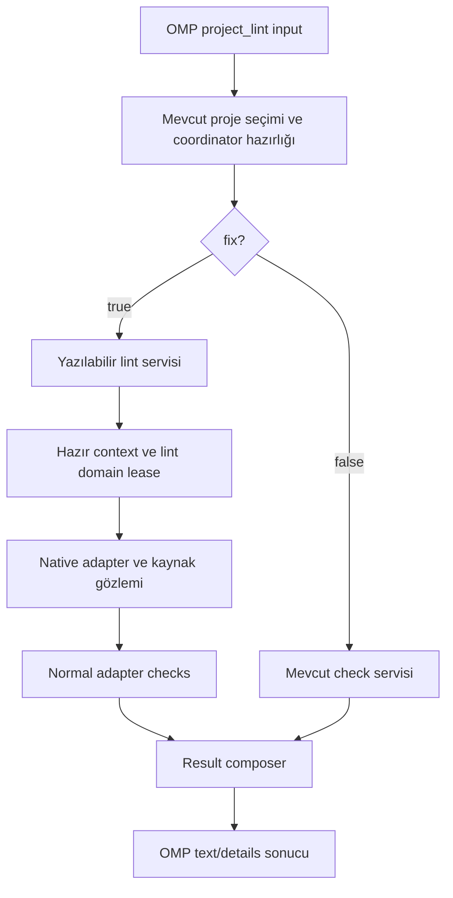
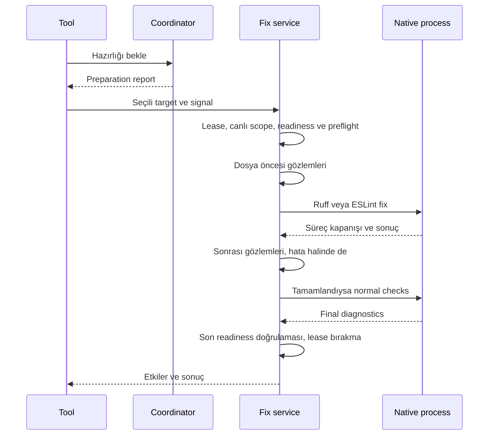
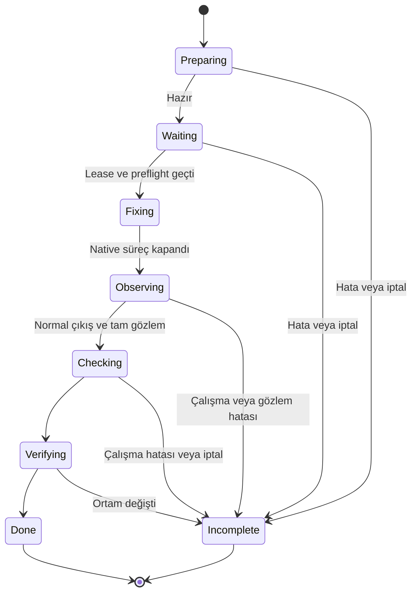

# Project Lint Fix - Plan

## Goal Capsule

- **Objective:** Agent, seçtiği projedeki desteklenen lint sorunlarını tek çağrıyla düzeltebilir; değişen dosyaları ve kalan sorunları görebilir.
- **Means:** Mevcut `project_lint` girdisine opsiyonel `fix` eklenir; KTD1–KTD4 mevcut hazırlık, native araç ve işlem koordinasyonunu kullanır.
- **Authority:** Kullanıcının kararları ve Product Contract davranışı; Planning Contract uygulama yöntemini belirler. Birimler bu sözleşmeleri değiştirmez.
- **Execution profile:** macOS ve Linux üzerinde mevcut Justomp geliştirmesi. Bu belge uygulama planıdır; implementasyon ayrı kullanıcı kararıdır.
- **Stop conditions:** Safe-only Ruff sınırı korunamıyorsa kaynak yazısı başlamaz. Yeni bir koruma sistemi, dependency veya formatter yazısı gerektiren yaklaşım kapsamı büyütmeden yeniden değerlendirilir.
- **Delivery:** Uygulayıcı kodu, dokümanı ve doğrulamayı tamamlar. Commit, push, PR ve merge bu planla yetkilendirilmez.

---

## Product Contract

### Summary

`project_lint({project_id, fix: true})`, seçilen projede desteklenen lint düzeltmelerini kaydeder ve ardından lint ile format kontrollerini çalıştırır.
Sonuç, kaynak değişikliklerini hazırlık değişikliklerinden ayırır.
`fix` verilmezse mevcut kontrol davranışı korunur.

### Problem Frame

Lint aracı sorunları buluyor; agentın desteklenen otomatik düzeltmeler için aynı proje, kurallar ve kurulu araçlarla çalışan bir çağrıya ihtiyacı var.
Ayrı bir tool, aynı proje seçimini ve hazırlık akışını tekrar eder.

### Key Decisions

- D1. **Aynı tool, açık düzeltme isteği.** Governs R1, R2. (session-settled: user-directed — chosen over ayrı `project_lint_fix`: aynı işlemin kontrol ve düzeltme davranışı bir parametreyle seçilsin.)
- D2. **Ruff safe-only.** Governs R3. (session-settled: user-approved — chosen over unsafe düzeltmeler: Python'da yalnız native safe düzeltmeler uygulanacak.)
- D3. **ESLint standart autofix.** Governs R4. (session-settled: user-approved — chosen over özel kural allowlist'i: standart autofix kullanılacak; elle seçilen suggestions uygulanmayacak ve pluginler için mutlak davranış koruma garantisi verilmeyecek.)
- D4. **Go kontrolü devam eder.** Governs R5. (session-settled: user-approved — chosen over Go autofix: ilk sürümde Go için düzeltme uygulanmadığı açıkça söylenecek.)
- D5. **Format ayrı işlem.** Governs R6. (session-settled: user-approved — chosen over lint düzeltmesine formatter eklemek: format yazısı `project_format` sorumluluğunda kalacak.)

### Requirements

**Girdi ve davranış**

- R1. Girdi zorunlu `project_id` ve opsiyonel boolean `fix` alanlarıdır; default `false`, bilinmeyen alanlar ve boolean olmayan değerler reddedilir.
- R2. `fix:false` veya eksik `fix`, mevcut hazırlık ve lint/format kontrol davranışını korur; `checkProjectLint`, lint CLI ve başlangıç hazırlığı kaynak düzeltmesi yapmaz.
- R3. Python düzeltmesi Ruff'ın native safe sınıfıyla sınırlıdır; unsafe düzeltmeleri safe sayan politika bu sınırı aşamaz.
- R4. JS/TS düzeltmesi ESLint'in standart autofix davranışıdır; `suggestions` elle uygulanmaz ve özel kural allowlist'i eklenmez.
- R5. Go'da `fix:true`, normal kontrolleri çalıştırır ve autofix desteklenmediğini bildirir; bu destek eksikliği tek başına sonucu başarısız yapmaz.
- R6. Düzeltme isteği formatter yazısı başlatmaz; düzeltmelerden sonra format kontrolü yine yapılır.

**Kapsam ve sonuç**

- R7. Kaynak düzeltmesi yalnız seçilen projenin mevcut lint kapsamına uygulanır; child projeler, dependency dizinleri, internal dosyalar ve symlinkler kapsam dışıdır.
- R8. Çağrı kurulu ve hazırlanmış proje araçlarını, ortak lint politikasını ve mevcut manager çözümlemesini kullanır; fix isteği kendi başına sürüm yükseltmez veya yeni ayar defaultu üretmez.
- R9. Sonuç, düzeltme durumunu ve gözlenen değişen kaynak yollarını ayrı raporlar; nihai lint/format diagnostics düzeltme sonrası kontrolü temsil eder.
- R10. Kalan lint veya format ihlali başarısız sonuçtur; tamamlanmış bir kontrolün ihlal bulması işlemin yarıda kaldığı anlamına gelmez.
- R11. İptal, native çalışma hatası veya son doğrulama hatasında bilinen kaynak değişiklikleri korunur ve sonuçta görünür; otomatik rollback yapılmaz.
- R12. Düzeltmenin güvenli biçimde başlatılamadığı veya değişikliklerin tam gözlenemediği durumda araç tamamlandı/başarılı iddiasında bulunmaz; neden ve eksik aşamalar belirtilir.
- R13. OMP'nin mevcut exec onayı, root seçimi, iptal ve shutdown bekleme davranışı düzeltme çağrısını da kapsar.

### Acceptance Examples

| ID | Durum | Beklenen sonuç | Covers |
|---|---|---|---|
| AE1 | `fix` eksik veya false | Kaynak değişmez; mevcut kontrol sonucu korunur | R1, R2 |
| AE2 | Python'da düzeltilebilir sorun | Ruff fix çalışır; değişen dosya listelenir; ardından normal kontroller yapılır | R3, R9 |
| AE3 | JS autofix sonrası format veya lint sorunu kalır | Kaynak değişiklikleri görünür, `complete:true`, `success:false` | R4, R6, R10 |
| AE4 | Go'da `fix:true`, kontroller geçer | Fix `unsupported`, boş değişiklik listesi, `success:true` | R5 |
| AE5 | Native düzeltme bazı dosyaları yazdıktan sonra iptal olur | Yazılmış içerik korunur, bilinen yollar raporlanır, sonuç incomplete/cancelled olur | R11, R12 |
| AE6 | Kaynak kapsamı boş | Native fixer boş argümanlarla çalıştırılmaz; mevcut `no-sources` sonucu korunur | R2, R7 |
| AE7 | Ortak Ruff config unsafe düzeltmeyi safe olarak yükseltir | Kaynak yazısı başlamaz; safe-only sınırıyla uyuşmazlık açık hata olur; config değiştirilmez | R3, R12 |
| AE8 | Son readiness doğrulaması düzeltme sonrasında başarısız olur | Fix ve tamamlanan kontrol kanıtları kaybolmaz; toplam sonuç incomplete olur | R9, R11 |

### Scope Boundaries

Bu iş yeni tool, `files` girdisi, CLI fix bayrağı, session-start autofix, Git hook'u veya config alanı eklemez.
Go autofix, özel ESLint güvenlik kataloğu ve koruma/sandbox değişikliği kapsam dışıdır.

---

## Planning Contract

### Current Behavior

`src/omp/lint-tools.ts`, input ve projeyi doğrulayıp coordinator hazırlığını bekler; ardından `checkLintTarget` çağırır.
`src/lint/coordinator.ts` içindeki `withReadyLintTarget`, dependency domainlerini kilitler ve işlem öncesi/sonrası receipt, politika, projection ve araç ortamını doğrular.
Bu helper kaynak dosyalarını hash'leyerek değişmezlik sağlamaz; check-only davranışı adapterların `--no-fix` ve formatter check seçeneklerinden gelir.

`src/format/service.ts`, native yazıların etkisini `finally` içinde dosya içeriğini karşılaştırarak raporlar.
`src/format/files.ts` güvenli dosya okuma davranışı sağlar; generic batch observer değildir.
Native yazılar `publishFormatFile` üzerinden geçmez; o publisher bellekte üretilen Prettier çıktısı içindir.

### Key Technical Decisions

- KTD1. **Ayrı yazılabilir servis, aynı OMP tool.** R1, R2, R13 için internal `fixLintTarget` eklenir; OMP hazırlık raporunu bu servise geçirir. Yeni public paket exportu eklenmez. `checkProjectLint` ve CLI imzası değiştirilmez. (session-settled: user-directed — chosen over ayrı agent tool'u: D1 aynı tool üzerinde açık parametreyi seçti.)
- KTD2. **Native yerinde düzeltme ve gözlem.** R7, R9, R11 için Ruff/ESLint mevcut executable ve explicit dosya seçimleriyle çalışır. Önce kapsamın bütün dosyaları okunur; süreç kapandıktan sonra her dosya bağımsız gözlenir. `project_format` örüntüsü kullanılır; yeni transaction/publish framework'ü kurulmaz. Bu seçim notebook ve ESLint PnP desteğini mevcut native yoldan korur.
- KTD3. **Tek lease altında fix ve recheck.** R7, R8, R13 için hazırlık lease öncesinde kalır. Mevcut readiness işlemlerinin ortak kısmı, check ve fix girişlerinin kullanacağı dar bir helper'a çıkarılır. Fix içinden lease alan `checkProjectLint` tekrar çağrılmaz; aynı hazır context ile adapter check çalışır. Kaynak etkileri ve tamamlanan checks, callback dışındaki accumulator'da tutulur.
- KTD4. **Araçlara göre açık çalışma seçenekleri.** R3–R6 için Ruff `check --fix --no-fix-only --no-unsafe-fixes`, ESLint `--fix` kullanır. Mevcut explicit config, cwd, environment, `--force-exclude` ve uygun dosya argümanları korunur. ESLint'e `--fix-type` güvenlik filtresi eklenmez: `suggestion` rule kategorisi, manuel suggestions ile aynı şey değildir. Go fixer çağrısı yoktur. (session-settled: user-approved — chosen over unsafe Ruff, ESLint allowlist ve Go autofix: D2–D5'in onaylanan araç sınırları.)
- KTD5. **Ruff safety preflight.** R3, R12 için aktif Ruff politikasında nonempty `lint.extend-safe-fixes`, legacy top-level `extend-safe-fixes` veya dış config mirası sağlayan `extend` varsa fix başlamadan `unsupported-safe-fix-config` döner. Malformed safety alanı da reddedilir. Boş promotion listeleri kabul edilir; `extend-unsafe-fixes`, `fixable` ve `unfixable` kısıtları korunur. `--config 'lint.extend-safe-fixes=[]'` miras alınan promotionları temizlemez; onu çözüm sayma. Normal check çağrısı bu yeni fix-only kısıtından etkilenmez. Config mirası çözümleyicisi veya kullanıcının config'ini yeniden yazma bu iş için eklenmez.
- KTD6. **Son kontroller tek diagnostic kaynağı.** R9, R10 için fix sürecinin normal 0/1 çıkışı recheck'e geçer; çıkış 1 kalan ihlal olabilir. `assertFormatProcess` yeniden kullanılmaz, çünkü yalnız 0 kabul eder. Abort, truncation, launch hatası veya diğer native exit kodları incomplete sonuç üretir. Fix stdout'u kaynak veya ikinci public diagnostic akışı olarak taşınmaz; stderr hata metni mevcut redaction'dan geçer.
- KTD7. **Gözlem başarısızlığı kaybolmaz.** R11, R12 için sonrası okuma iptal edilmiş operasyon signal'ıyla kesilmez; süreç kapanışından sonra kısa dosya gözlemi tamamlanır. Silinen, unreadable veya symlink olmuş bir dosya değişmedi sayılmaz. Bilinen değişiklikler ve path bazlı gözlem hataları birlikte döner. Bilinmeyen durumlar varken observation incomplete olur ve final check başlatılmaz.

### Fix Result

`LintResult` içine yalnız `fix:true` çağrısında `fix` alanı eklenir; check-only sonuç şekli korunur.
Alan şu bilgileri taşır: `requested:true`, `supported`, `status`, `changed_files`, `observation_complete`, `errors` ve gerektiğinde `reason`.
Native deneme yapıldıysa tool/version, exit code, duration, truncated/cancelled kanıtı da bu alandadır.
`changed_files`, repository-relative, sıralı ve tekrarsız yollardır; kaynak içeriği dönmez.
Hazırlık değişiklikleri mevcut `preparation.changes` içinde kalır.

| Durum | Fix status | Sonraki kontroller | Toplam sonuç |
|---|---|---|---|
| Python/JS, normal 0/1, gözlem tamam | `completed` | Normal lint + format check | Checks belirler |
| Dosya var fakat değişiklik yok | `completed` | Normal lint + format check | Boş changed_files başarılı düzeltme garantisi değildir |
| Go | `unsupported` | Normal lint + format check | Destek eksikliği tek başına başarısızlık değildir |
| Boş Python/JS kapsamı | `not-run`, reason `no-sources` | Mevcut no-sources checks | Mevcut complete true / success false korunur |
| Hazırlık/readiness/safety preflight hatası | `not-run`, açıklayıcı error | Başlatılmaz | Incomplete |
| Native çalışma hatası/truncation | `failed` | Başlatılmaz | Incomplete; gözlenen etkiler korunur |
| İptal | `cancelled` | Başlatılmaz | Cancelled/incomplete; süreç kapanışı ve gözlem beklenir |
| Native tamam, gözlem eksik | `completed`, observation incomplete | Başlatılmaz | Incomplete; bilinen değişiklikler ve gözlem hataları görünür |
| Recheck veya son doğrulama hatası | Önceki fix status korunur | Tamamlanan checks korunur | Incomplete |

`partial_change`, mevcut hazırlık hesabına ek olarak incomplete çağrıdaki gözlenen kaynak değişikliklerini kapsar.
İhlal bulan tamamlanmış checks, tek başına `partial_change` değildir.
Gözlem eksikliği ayrı alanla ifade edilir; bilinen değişiklik yokken `partial_change:false`, kaynakların kesin değişmediği iddiası değildir.
`incomplete_stages` gerektiğinde `fix`, `observation`, `lint`, `format` veya `verification` içerir.
Fix başlamadan hata veren OMP hazırlık yollarında da fix isteği ve not-run/cancelled durumu kaybolmaz.

### High-Level Technical Design

Şemalar sorumlulukları gösterir; dosya/yardımcı isimleri dışında uygulama kodu dayatmaz.

**Bileşenler ve veri akışı:**

**İşlem sırası ve sahiplik:**

**İşlem yaşam döngüsü:**

Go ve boş kapsamda native fix aşaması atlanır; durum tablosu bu dalların sonuç sözleşmesidir.

### Risks and Deliberate Limits

Lease yalnız Justomp işlemlerini koordine eder; aynı anda editör veya başka bir süreç kaynakları değiştirebilir.
Before/after farkı gözlenen değişikliktir, exclusive yazarlık kanıtı değildir.
Bu iş yeni OS izolasyonu veya dış yazıcı rollback'i kurmaz; mevcut native format modeli kullanılır.

ESLint plugin autofix davranışına ilişkin mutlak güvenlik garantisi verilmez; D3 kabul edilen sınırdır.
Python için KTD5, unsafe promotion veya çözülmemiş config mirası bulunan politikada açıkça durur; varsayılan politika bu sınıra takılmaz.

### Research Sources

- `src/omp/lint-tools.ts`, `src/lint/service.ts`, `src/lint/coordinator.ts`: hazırlık, check-only API ve lease/son doğrulama akışı.
- `src/lint/adapters/python.ts`, `src/lint/adapters/javascript.ts`, `src/lint/javascript/native.ts`: kurulu binary, explicit config ve PnP çalıştırma yolu.
- `src/lint/scope.ts`, `src/packaging/file-scope.ts`: mevcut sahiplik; Python notebook kapsamı formatter kapsamından daha geniştir.
- `src/format/service.ts`, `src/format/files.ts`: native yazı sonrası gözlem örüntüsü.
- [Ruff fix safety](https://docs.astral.sh/ruff/linter/#fix-safety), [Ruff configuration](https://docs.astral.sh/ruff/configuration/), [Ruff settings](https://docs.astral.sh/ruff/settings/), [Ruff 0.17.3 config merge](https://github.com/astral-sh/ruff/blob/0.17.3/crates/ruff_workspace/src/configuration.rs#L1179), [dedicated boolean overrides](https://github.com/astral-sh/ruff/blob/0.17.3/crates/ruff/src/args.rs#L1368): KTD4–KTD5. CLI promotion-list override sınırı bu sürümün kaynak kodundan doğrulandı.
- [ESLint CLI](https://eslint.org/docs/latest/use/command-line-interface), [ESLint applying fixes](https://eslint.org/docs/latest/extend/custom-rules#applying-fixes), [ESLint suggestions](https://eslint.org/docs/latest/extend/custom-rules#providing-suggestions): KTD4 ve KTD6.

---

## Implementation Units

### U1. Fix sonucu ve saf kararlar

- **Goal:** Yazı etkilerini kaybetmeden fix ve final check sonucunu ifade etmek.
- **Requirements:** R1, R5, R9–R12; AE3–AE8; KTD6–KTD7.
- **Files:** `src/lint/model.ts`, `src/lint/result.ts`, `src/lint/adapters/types.ts`; `tests/unit/lint/result.test.ts`, `tests/unit/checks/lint-outcomes.test.ts`.
- **Approach:** Fix Result tablosunu tipler ve composer'a taşı. Adapter fix kabiliyetini check'ten ayrı tut; Go için mutating method zorunlu kılma. Önce adapter stub ve result composer kullanımlarını ara. Check-only response uyumluluğunu koru.
- **Test scenarios:** 0/1 sonrası kalan diagnostics; Go unsupported ile geçen/kalan checks; kaynak yazısından sonra operational failure; observation unknown; final verification hatası; no-sources; false çağrıda fix alanı yok.
- **Verification:** Yeni saf unit testleri supplied process/state verileriyle çalışır; native tool veya gerçek repo kurmaz.

### U2. Lease ve kaynak etkisi gözlemi

- **Goal:** Fix ve final check'i aynı seçili proje ve hazır ortam üzerinde yürütmek.
- **Requirements:** R2, R7–R13; AE5, AE6, AE8; KTD1–KTD3, KTD7.
- **Depends on:** U1.
- **Files:** `src/lint/service.ts`, `src/lint/coordinator.ts`, yeni `src/lint/fix.ts` ve gerekirse dar `src/lint/source-effects.ts`; ortak okuma için `src/format/files.ts` ve `src/lint/files.ts`; ilgili unit dosyaları ve `tests/integration/lint/concurrency.test.ts`.
- **Approach:** Hazır-context doğrulamasını tek yerde tut; check-only giriş açık kalsın. Fix accumulator lease callback dışında yaşasın. Kapsamı kilit alındıktan sonra yenile; tüm before okumaları başarılı olmadan native mutasyon başlatma. Snapshot okuma reuse için FormatError sızdırma; geniş format refactor'ı yapma. Native süreç kapanmadan lease bırakma veya after okuma başlatma.
- **Test scenarios:** Beklerken proje/scope değişikliği; hazırlık çağrısının fix başlatmaması; nested lease edinilmemesi; fake adapter kısmi yazı raporu ve post-verification throw; sonraki dosya okunamasa da diğer etkilerin korunması. Gerçek filesystem/process sınırı yalnız küçük mevcut fixture ile doğrulanır.
- **Verification:** Saf sequencing unit; gerçek dosya containment ve süreç cleanup için mevcut integration harness. `readFormatFile` eksik dosyayı exception ile ifade ettiği için gözlem incomplete yolunu özellikle kapsa.

### U3. Native Ruff ve ESLint düzeltmeleri

- **Goal:** Onaylanan native fix sınırlarını hazırlanmış proje araçlarına aktarmak.
- **Requirements:** R3–R8, R10–R12; AE2–AE7; KTD2, KTD4–KTD7.
- **Depends on:** U1, U2.
- **Files:** `src/lint/adapters/python.ts`, `src/lint/adapters/javascript.ts`, yeni `src/lint/fix-policy.ts` veya aynı sorumluluktaki küçük helper; `src/lint/javascript/native.ts` yalnız mevcut çağrı yolu gerekiyorsa; `tests/unit/checks/lint-outcomes.test.ts`, yeni focused unit dosyaları; mevcut Python/JS native integration dosyaları.
- **Approach:** Native fix komutları mevcut scope ve installed executable çözümlemesini kullanır. Python `.ipynb` dahil mevcut lint uzantılarını koru; format scope'u yeniden kullanma. Ruff safety preflight'i parsed politika verisinden uygula. ESLint'in kendi çok geçişli autofix'ini kullan; ek fix retry loop'u yazma. Fix stdout'una ihtiyaç yoksa JSON'u ikinci kez diagnostic olarak parse etme.
- **Test scenarios:** Exact argv/cwd/config ve manager dispatch; unsafe=false yanında policy promotion/extend reddi; legacy key; fixable/unfixable korunması; ESLint standart --fix ve manuel suggestion uygulamama; Go native write yok; boş scope native süreç yok; normal exit1 recheck; exit2/truncation/abort incomplete.
- **Verification:** Bu kararlar unit verisiyle kanıtlanır. `tests/integration/lint/python.native.test.ts` mevcut hazırlanmış lifecycle'a tek fix→observed-change→recheck tanığı ekler. `tests/integration/lint/javascript.native.test.ts` mevcut npm/PnP lifecycle'larını kullanır; resolver değişmiyorsa tek gerçek fix tanığı yeterlidir. Yeni manager × rule matrisi kurulmaz.

### U4. OMP bağlantısı

- **Goal:** Agentın açık fix isteğini mevcut onay ve session yaşam döngüsüyle çalıştırmak.
- **Requirements:** R1, R2, R5, R9, R11–R13; AE1, AE4, AE5; KTD1, KTD3.
- **Depends on:** U1–U3.
- **Files:** `src/omp/lint-tools.ts`; `tests/integration/omp/lint.test.ts`. Mevcut public exportlar değişmez.
- **Approach:** Strict şemaya opsiyonel boolean ekle; true yolunu `fixLintTarget`, false yolunu mevcut check servisine yönlendir. Hazırlık sırasında iptal/hata da fix request durumunu korusun. Tool açıklaması Python/JS/Go sınırlarını ve format ayrımını anlatsın. `track/withRoot` zinciri içinde kal; outer `lintFailure` yazı sonrası zengin sonucu silmesin.
- **Test scenarios:** Eksik/false/true; string/null/unknown field reddi; denied approval kaynak veya hazırlık yazısı başlatmaz; JSON text ile details eşit; isError final success üzerinden; shutdown native cleanup ve effect collection bitene kadar bekler.
- **Verification:** Host wiring mevcut fake adapter/host fixture ile kanıtlanır; yeni native kurulumu veya public export smoke testi gerekmez.

### U5. Kullanım dokümanı ve tam doğrulama

- **Goal:** Yeni davranışı anlaşılır örneklerle sunmak ve mevcut akışları bozmadan doğrulamak.
- **Requirements:** R1–R13; Verification Contract.
- **Depends on:** U1–U4.
- **Files:** `README.md`, `docs/lint.md`; gerekiyorsa mevcut test-cost ölçüm açıklamaları. Yeni test politikası veya default config dosyası yok.
- **Approach:** Check/fix örneklerini, ayrı format adımını, Go unsupported sonucunu, Ruff safety-config hatasını, partial effects ve readonly API farkını belgeye işle. Fix'in tüm sorunları düzelteceğini söyleme. Kullanılmayan deneme helperlarını kaldır.
- **Test scenarios:** Doküman örneklerinin tool şemasıyla uyumu; önceki unit ve integration kanıtlarının tek tam gate'te birlikte geçmesi.
- **Verification:** Aşağıdaki ölçüm ve kontrol sözleşmesi; süreyi aşan veya platformda çalıştırılamayan doğrulama açık raporlanır.

---

## Verification Contract

Test tasarımı `compound-packs/testing/test-evidence-and-cost.md` kuralına bağlıdır. (pack: testing, test-evidence-and-cost.md)
Ruff/ESLint kural katalogları, safe etiketlerinin doğruluğu veya upstream format semantiği tekrar test edilmez.
Bizim policy, komut, seçim, orchestration ve sonuç kararlarımız unit; gerçek native handoff, dosya güvenliği ve process kapanışı minimal integration kanıtıdır.

| Kanıt | Yer / komut | Başarı ölçütü |
|---|---|---|
| Pure policy/result/orchestration | İlgili `tests/unit/lint` ve `tests/unit/checks` dosyaları için focused `bun test` | R ve AE kararları supplied verilerle doğrulanır |
| Ruff fix handoff | Mevcut `tests/integration/lint/python.native.test.ts` lifecycle | Dosya gerçekten değişir, listelenir, final check yeni içeriği görür |
| ESLint fix handoff | Mevcut `tests/integration/lint/javascript.native.test.ts` lifecycle | Hazır local executable ile fix ve recheck; mevcut PnP çözümlemesi korunur |
| Filesystem/process/host | Mevcut concurrency ve OMP testleri | Sahiplik, iptal, cleanup ve sonuç iletimi korunur |
| Tam ölçümlü gate | `bun run test:cost --baseline .private/test-cost/2026-10-29T23-33-22.011Z/report.json` | Runner'ın `check` ve bütün integration testlerini birer kez çalıştırdığı tam başarılı rapor |

Son tam warm kanıt `.private/test-cost/2026-10-31T20-35-34.642Z/report.json`: 263.386 saniye, eşleşen baseline'a göre %62.307 azalma.
Bu önceki implementasyona ait kanıttır; yeni özellik doğrulaması değildir.
Bütçe warm tam gate için en fazla 300 saniye ve eşleşen başarılı baseline'a göre en az %60 azalmadır. (pack: testing, test-evidence-and-cost.md)
Baseline bulunamazsa veya ortam/araç/concurrency uyuşmazsa karşılaştırma iddiası kurulmaz; mutlak süre ve bu eksik açıkça raporlanır.

Geliştirmede focused testler kullanılır; finalde ölçümlü gate geçtiğinde aynı gate ayrıca tekrarlanmaz.
Alias test komutları birbirine eklenerek tam gate sayılmaz.
Yeni pahalı testlerin setup süresi ve gerçek sınır gerekçesi kaydedilir; bütçe aşılırsa check zayıflatılmaz veya test gizlenmez.
macOS ve Linux hedefi korunur; hangi platformda ne çalıştırıldığı sonuçta belirtilir.

---

## Definition of Done

- U1–U5 tamamlanmış; tüm Requirements ve Acceptance Examples karşılanmış.
- Normal lint, public readonly API/CLI ve session-start davranışı korunmuş.
- Python/JS fix sonrası gerçek değişiklik ve final diagnostics akışı mevcut native fixturelarda kanıtlanmış.
- İptal, operational failure ve verification failure kaynak etkilerini kaybettirmiyor.
- Doküman ve tool şeması aynı davranışı anlatıyor; mevcut public readonly exportlar korunuyor.
- Verification Contract tamamlanmış veya karşılanamayan ölçüt somut kanıtıyla kullanıcıya sunulmuş; tamamlanmayan kontrol geçti sayılmıyor.
- Deneme kodu, gereksiz test matrisi ve kullanılmayan yardımcılar diff'ten kaldırılmış.
