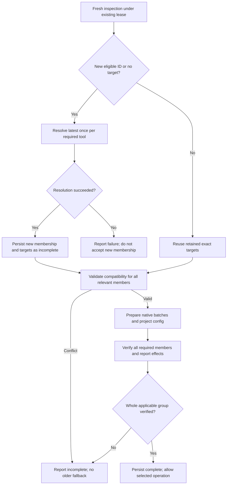
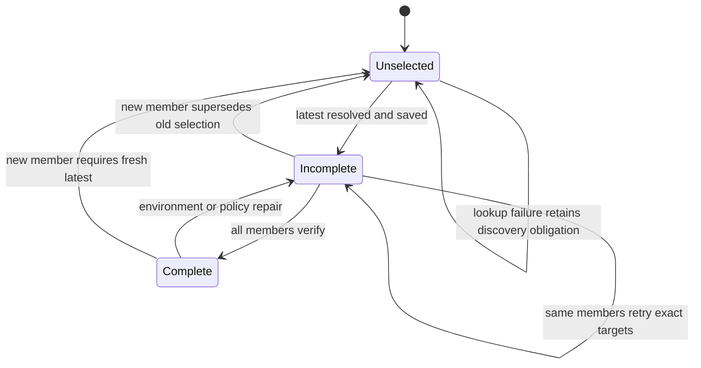

# Latest Tool Alignment on Project Discovery - Plan

## Goal Capsule

**Objective:** Adding a project gives it the latest managed tools and brings existing consumers of those tools to the same versions.

**Means:** Extend the existing discovery-driven preparation and exact-version persistence across lint, typecheck and testing (KTD1–KTD5).

**Authority:** The Product Contract owns behavior; technical decisions and units implement it. The user's latest-or-error decision takes precedence over older plans describing compatible-version fallback.

**Execution:** Plan only until implementation is authorized. Implement on a feature branch; verify Justomp-owned behavior under the repository testing pack. Publishing and merging remain the user's decisions.

**Stop conditions:** Report an inability to select/install the required latest targets; do not substitute older tools, upgrade application frameworks/runtimes, weaken checks or claim a partially aligned group is ready.

---

## Product Contract

### Summary

New project discovery selects current latest managed-tool targets and aligns existing projects that consume those tools. All preparation paths use the same distinction between a new discovery and a retry of an already selected target. Incompatibility produces an explicit failure.

### Problem Frame

JavaScript lint currently gives new projects retained older pins. Go lint installs latest for a new project but leaves older projects on their previous binaries. Typecheck and test preparation can hold a new project behind an indefinitely failing older preparation. These differences mean adding a project does not consistently produce the version alignment the user expects.

### Key Decisions

- **New project drives latest alignment.** Governs R1–R3. (session-settled: user-directed — chosen over fitting a new project to retained versions: existing consumers must follow the newly selected latest target.)
- **Latest or explicit incompatibility.** Governs R4. (session-settled: user-approved — chosen over selecting an older compatible toolset: retain latest and expose the conflict without changing application frameworks or runtimes.)
- **No separate update tool.** Governs R10. (session-settled: user-directed — chosen over another managed-tool update endpoint: dependency tools already exist; this work corrects automatic discovery.)

### Requirements

**Discovery and target selection**

- R1. First preparation and every newly eligible project ID trigger fresh latest selection for that managed tool family; retained targets must not constrain that selection.
- R2. Every existing live project consuming the selected tool receives the same exact target as the new project; tools not required by a project are not added merely for symmetry.
- R3. A new ID supersedes an incomplete previous selection at the next serialized preparation opportunity; retrying the same membership retains the exact selected targets.
- R4. Latest targets that violate runtime, framework, peer or native-tool compatibility fail explicitly with the affected project and constraint; there is no older-version fallback or automatic framework/runtime upgrade.
- R5. Ordinary sessions, unchanged-membership repairs and deletion-only changes do not refresh established tool versions. First use of an additional tool on an existing project resolves that missing tool without refreshing unrelated targets.

**Persistence, ownership and execution**

- R6. Persist successfully resolved exact targets before installation; a failed latest query must not accept new IDs as already prepared members.
- R7. After discovery, checks and native formatting cannot proceed on an obsolete or incomplete applicable group. Include live members whose target resolution failed when deciding completeness, and report partial effects honestly.
- R8. Typecheck owns a managed TypeScript target when one exists; lint must not restore an older compiler or choose a parser-compatible downgrade.
- R9. Read valid older state without treating a schema extension as corruption. Preserve its exact per-project targets and known membership on adoption; the next actual discovery replaces retained targets under R1–R2.
- R10. Keep public tool inputs, dependency operations, user configuration defaults, protection and runtime-management scope unchanged.
- R11. Test Justomp's selection, orchestration, persistence and readiness responsibilities, with pure cases in units and only distinct real boundaries in integration. (pack: testing, test-evidence-and-cost.md)

### Acceptance Examples

| ID | Starting state and event | Expected result | Covers |
|---|---|---|---|
| AE1 | A uses Ruff 1; B appears when latest is 2 | Both target 2; ready only after both verify | R1, R2, R7 |
| AE2 | A/B target 2; B installation fails; registry advances to 3; same IDs retry | Retry 2 without querying a new latest | R3, R5, R6 |
| AE3 | AE2 remains incomplete; C appears when latest is 3 | Next serialized pass selects 3 for A/B/C without requiring B to finish target 2 first | R1, R3 |
| AE4 | A retains ESLint 1; B appears; latest 2 cannot run on A's Node | Persist target 2, report A's incompatibility, do not fall back to 1 or upgrade Node | R4, R6, R7 |
| AE5 | Old Go state contains A at 1 and B at 2; extension restarts | Adopt retained map without a latest query or manufactured alignment claim; a later C discovery aligns all to then-latest | R5, R9 |
| AE6 | Latest lookup fails after B appears | B remains unadopted; next attempt queries latest again; old readiness does not bypass the new-member gate | R6, R7 |
| AE7 | Typecheck verifies newer TS after lint had installed an older fallback | Lint validates the new compiler and cannot resurrect its old pin on repair | R8 |
| AE8 | Last consumer is removed and that path later reappears | After observed removal, it is a new discovery; an unobserved remove/recreate of the same stable ID is not distinguishable | R1, R5 |

### Scope Boundaries

Applies to Ruff, ESLint and required plugins, golangci-lint, Pyright, TypeScript, pytest/pytest-cov and Vitest/its coverage companion. Unit and integration test tools share runner preparation.

Installed Go and Bun test runtimes remain externally managed. Bundled Prettier and its TOML plugin remain extension dependencies. Python and Go formatting reuse the corrected lint preparation. No new updater tool, config knob, periodic polling, dependency solver, runtime installer or general preparation framework is included.

No cross-family all-or-nothing transaction or rollback is added: existing queues, package-manager batches and partial-effects reporting remain sufficient. The work does not change how an ordinary dependency_update interacts with retained managed targets; that separate lifecycle is not necessary to correct discovery.

---

## Planning Contract

### Current Behavior Audit

| Flow | Existing behavior | Required change | Evidence |
|---|---|---|---|
| Ruff | New IDs select latest and align Python, including incomplete waves | Preserve behavior while sharing the discovery contract | `src/lint/prepare.ts` |
| ESLint/plugins | Existing pins constrain new members; resolver searches older compatible combinations | Fresh latest selection on new membership; compatibility validation after selection | `src/lint/javascript/resolve.ts` |
| golangci-lint | Only unknown projects resolve latest | Set the same new target for all Go projects | `src/lint/prepare.ts`, `src/lint/adapters/go.ts` |
| Pyright/TypeScript | Latest on new IDs only after prior wave completes | New membership supersedes incomplete selection | `src/typecheck/prepare.ts` |
| pytest/Vitest | Same completed-wave gate; installed runtime paths separate | Correct transition; preserve runtime paths and shared suite state | `src/testing/state.ts`, `src/testing/prepare.ts` |
| Lint/format readiness | Full alignment gate exists only for Python | Extend to JS/Go and keep format's Go gate consistent | `src/lint/coordinator.ts`, `src/format/service.ts` |
| Test readiness | Checks selected membership/completion, not full current group equality | Reject a stale group after discovery before reconciliation | `src/testing/service.ts` |

### Key Technical Decisions

- KTD1. **Use current inspection identities and existing leases.** Compare live family membership with membership whose targets were successfully resolved, under the current state/dependency domain locks. A path move changes project ID. Re-read structure after obtaining the lease; never start an overlapping installer to react faster. Implements R1, R3, R6.
- KTD2. **Persist targets per family with per-project tool subsets.** Extend lint state to represent Python, JavaScript and Go membership, target maps and completion. Reuse existing per-project receipts for policy and native readiness. A fresh resolution asserts one exact version for each common tool; differing subsets are allowed. This also permits lossless adoption of legacy per-project pins under R9 without a separate migration mode.
- KTD3. **Separate latest selection from compatibility validation.** Resolve one exact target per managed package for the discovery batch, then save targets before preflight/install. Known incompatibility does not cause repeated latest lookups on unchanged-membership retries. A registry/metadata failure that prevents selecting the target leaves membership unadopted. Implements R4, R6.
- KTD4. **Use publisher latest semantics and existing companion coupling.** npm tools use a valid stable `dist-tags.latest`, matching current TypeScript/Vitest behavior; PyPI tools keep newest stable non-yanked selection; golangci-lint uses the existing official stable-release lookup. `@vitest/coverage-v8` stays exactly matched to selected Vitest. Other required ESLint plugins select their own latest; existing ESLint-major, Next-major, engine and peer constraints become validation, never a reason to select older versions. No production version literals are added.
- KTD5. **Preserve one TypeScript authority.** A valid typecheck target is authoritative for lint's missing-compiler install. When none exists, lint selects latest TS as a provisional install target and validates it without fallback. Typecheck verification must invalidate both old lint receipts and any retained lint target capable of restoring an older TS version. Do not change compiler versions merely to make typed ESLint succeed. Implements R8.
- KTD6. **Adopt valid state conservatively.** Translate the old Python wave directly; derive JS/Go known members and target maps from valid receipts. Do not label historically divergent Go versions newly aligned. Typecheck/testing legacy pending IDs remain undiscovered relative to accepted membership and trigger R3. Prune removed members, including an empty runner group, so stale entries cannot hide a later discovery. Missing/corrupt state retains current explicit recovery behavior, which can require first preparation again. Implements R5, R6, R9.
- KTD7. **Keep extraction narrow.** A small pure membership transition helper can be shared by the three services if it eliminates duplicated policy; state persistence and native adapters stay with their modules. No general scheduler or registry framework. Unit tests use supplied states/metadata/adapters; real-file tests remain integration. (pack: testing, test-evidence-and-cost.md)

### High-Level Technical Design

The version target is latest at resolution time, not an assertion that a registry cannot publish a newer release while installation runs. One selected target is applied to the batch; do not independently resolve latest for every member.

The diagram's Unselected state is logical: keep the old persisted record until the replacement targets are available. Current live membership still prevents checks from treating that old record as ready.

### State and Compatibility Details

Use a versioned parser when changing lint's state representation, accepting the current schema explicitly rather than resetting it. Preserve recovery reporting and compare-and-swap writes. Imported target maps may differ because the previous Go behavior allowed it; equality against each imported project's accepted target preserves ordinary operation until the next real discovery establishes a shared target. No latest query is caused solely by installing this extension update.

A previously known project gaining an optional lint plugin follows R5: resolve latest only for newly required tools and align their consumers, while retaining established unrelated tools. Removing a plugin does not trigger a refresh. New project membership refreshes the required tool family even if its existing executable already works.

Check membership against inspected live projects, not only successfully constructed adapter targets. If one live project cannot resolve its package-manager context, report it and keep the group incomplete. Do not claim successful full alignment after silently omitting it.

A latest Next plugin incompatible with an older Next app now fails explicitly, even though the old resolver could choose an older major. Report selected tool, actual relevant runtime/framework/compiler version and violated constraint. This is the consequence of R4, not an invitation to migrate Next.

### Sequencing and Impact

U1 establishes transition and persisted-state behavior. U2 and U3 implement native target selection and service transitions. U4 closes execution gates and TypeScript ownership, then U5 updates public descriptions and proves the real boundary. Keep intermediate work on the feature branch until the complete path satisfies R7.

Existing native caches remain version-addressed; do not delete previously installed binaries or package downloads. Latest queries scale with distinct managed tools in a discovery batch, rather than project count or tool invocation count. Existing metadata/session caches must not pin a previous discovery's latest response indefinitely.

---

## Implementation Units

### U1. Persist discovery targets and distinguish new members from retries

**Goal:** Give all managed families the state transitions in R1, R3, R5, R6 and R9.

**Dependencies:** None.

**Files:** `src/lint/state.ts`, `src/lint/prepare.ts`, `src/typecheck/prepare.ts`, `src/testing/state.ts`, `src/testing/prepare.ts`; proposed focused helper `src/packaging/tool-membership.ts` only for the pure shared transition; new `tests/unit/lint/state.test.ts`, new `tests/unit/packaging/tool-membership.test.ts`, existing `tests/unit/testing/waves.test.ts`.

**Approach:** Implement KTD1, KTD2 and KTD6 with minimal changes to existing stores. Separate observed membership from successfully resolved membership. Carry complete exact targets through retries and prune departed IDs. Map legacy pending IDs into the next fresh selection instead of requiring the previous wave to complete.

**Execution note:** Start with supplied-state unit examples for discovery versus retry; these decisions do not need a repository fixture.

**Test scenarios:**

1. Covers AE1/AE3. First member, a new member after success, and a new member after failure all request fresh resolution.
2. Covers AE2. Reordered/duplicated identical membership retains exact targets; no latest request.
3. Covers AE6. Failed resolution does not adopt new IDs; retry still requests latest.
4. Covers AE5. Old lint state imports Python and JS/Go target maps without resetting valid receipts or querying latest.
5. Covers AE8. Deletion-only changes retain versions; removing the last consumer clears accepted membership; later reappearance is new.
6. Legacy typecheck/test pending IDs trigger fresh selection even while the saved wave is incomplete.
7. Invalid state uses existing recovery reporting; a supported old schema is not classified as corruption.

**Verification:** The same supplied membership scenarios yield the same discovery decision in lint, typecheck and managed test runners; store migration preserves exact targets.

### U2. Select latest ESLint and Go targets for every consumer

**Goal:** Correct the proven JS/Go mismatches under R1, R2, R4–R6.

**Dependencies:** U1.

**Files:** `src/lint/prepare.ts`, `src/lint/adapters/types.ts`, `src/lint/adapters/go.ts`, `src/lint/adapters/javascript.ts`, `src/lint/javascript/resolve.ts`, `src/lint/javascript/compatibility.ts`; `tests/unit/checks/version-selection.test.ts`, `tests/unit/lint/javascript-selection.test.ts`, `tests/unit/lint/javascript-compatibility.test.ts`, `tests/unit/checks/javascript-preparation.test.ts`.

**Approach:** Pass retained pins only for unchanged-membership repair. Replace JS compatibility search/backtracking with KTD3–KTD4 target selection plus preflight. Apply Go's newly resolved version to all live Go members. Keep exact install requests, native manager batches and verification mechanisms.

**Patterns to follow:** Ruff's fresh-resolution branch, TypeScript/Vitest npm latest lookup and existing exact-version adapter requests.

**Test scenarios:**

1. New JS member selects metadata's latest core/plugins for both old/new consumers despite old receipts; only required subsets are installed.
2. New Go member makes both old/new projects target one newly resolved official release; query count is independent of member count.
3. Covers AE4. Latest conflicts with Node, Next or peer constraints: return an explicit conflict, make no older selection and do not modify application constraints.
4. Invalid/missing npm latest, prerelease target and registry failure fail visibly; no semver-catalog fallback.
5. Ordinary repair performs no latest query for retained tools; adding an optional plugin resolves latest only for newly required tools and leaves unrelated targets unchanged under R5.
6. Fresh resolution ignores conflicting legacy old core pins; ordinary repair does not silently rewrite them.
7. Companion version selection preserves Vitest/coverage coupling; no upstream compatibility-rule catalogue is executed.

**Verification:** Supplied metadata proves selected versions, exact native requests, affected projects and no-fallback behavior without installations.

### U3. Make typecheck and runner discovery supersede incomplete selections

**Goal:** Fulfil R3 consistently for Pyright, TypeScript, pytest and Vitest.

**Dependencies:** U1.

**Files:** `src/typecheck/prepare.ts`, `src/testing/prepare.ts`, `src/testing/state.ts`; new `tests/unit/typecheck/discovery.test.ts`, new `tests/unit/testing/preparation.test.ts`, `tests/unit/testing/waves.test.ts`, `tests/unit/testing/native-tools.test.ts`.

**Approach:** Replace completion-gated new-member resolution with the accepted membership transition. Keep existing queues and exact-target save-before-install ordering. Leave installed Go/Bun runtime adapters outside managed upgrade selection. Use one runner state for unit/integration suites.

**Test scenarios:**

1. Covers AE3. An older project's persistent install failure does not prevent selection of current latest after another ID appears.
2. Covers AE2. No added ID means retry the same selected target even when registry latest changes.
3. A new ID observed during an active operation is processed on the next serialized pass without overlapping native writes.
4. Resolver failure preserves unadopted membership and partial prior effects; supersession does not erase actual completed changes from the current report.
5. Calling the other test suite does not create a new discovery or upgrade; runner identity changes count as joining the new runner family.
6. Go/Bun runtime receipts do not start a package-registry latest lookup.

**Verification:** Supplied adapter/state results prove the target passed to each member and unchanged retry behavior; real queue lifetime remains covered by existing integration tests.

### U4. Enforce readiness and preserve TypeScript ownership across entry points

**Goal:** Prevent checks/formatting from using stale targets and stop compiler pin resurrection under R7–R8.

**Dependencies:** U1, U2, U3.

**Files:** `src/lint/coordinator.ts`, `src/lint/prepare.ts`, `src/format/service.ts`, `src/typecheck/prepare.ts`, `src/typecheck/coordinator.ts`, `src/lint/javascript/resolve.ts`, `src/testing/service.ts`; new `tests/unit/lint/readiness.test.ts`, `tests/unit/format/readiness.test.ts`, `tests/unit/typecheck/readiness.test.ts`, `tests/unit/testing/service.test.ts`, new `tests/unit/typecheck/lint-ownership.test.ts`.

**Approach:** Use applicable family membership, saved target map, completion and current native verification at existing execution gates. Extend format's Go check alongside lint's JS/Go checks. Apply KTD5 at TypeScript verification/invalidation, including partial native success. Keep selected command results distinct from group preparation effects.

**Test scenarios:**

1. Old ready receipt plus newly inspected project rejects lint, native format or tests until the group is prepared.
2. One member fails or cannot resolve its target; another member's success does not produce group-ready status.
3. Selected receipt tools differ from the saved target: deny execution even if its ready boolean is true.
4. Covers AE7. New TS native verification removes every obsolete lint compiler target, including state imported from an earlier schema.
5. Lint without a typecheck target selects latest missing TS; incompatible parser fails without an older compiler fallback.
6. Partial TS install that really succeeded invalidates stale lint ownership; unsuccessful install does not falsely report a verified new compiler.
7. Unrelated ecosystems and projects that do not consume the tool do not join its alignment group.

**Verification:** Supplied state/native results prove operation callbacks are never invoked through an obsolete ready state, and lint repair cannot request an older TS target after typecheck ownership changes.

### U5. Prove the persisted discovery flow and update its descriptions

**Goal:** Demonstrate the real boundary and make docs accurately describe R1–R11.

**Dependencies:** U2, U3, U4.

**Files:** `tests/integration/lint/lifecycle.test.ts`, `tests/integration/typecheck/lifecycle.test.ts`, `tests/integration/testing/lifecycle.test.ts`, `docs/lint.md`, `docs/typecheck.md`, `docs/testing.md`, `docs/format.md`, `src/omp/lint-tools.ts`, `src/omp/format-tools.ts`.

**Approach:** Extend current real filesystem/coordinator fixtures with supplied adapters to prove discovery, durable exact targets, old/new member requests and restart behavior. Reuse installed native boundary evidence already present; add a new native case only if an adapter invocation contract actually changes and current evidence cannot prove it. Remove conflicting retained-new-member/pending-only assertions after naming their replacement units. Update tool descriptions that currently promise only Python alignment.

**Test scenarios:**

1. An existing two-project lint lifecycle proves JS/Go discovery publishes a common target, prepares old/new members and survives a fresh state load without another latest query.
2. One existing typecheck/test lifecycle proves incomplete old state plus a newly discovered ID publishes the replacement target; pure failure permutations remain in U1/U3 units.
3. Existing watcher/queue and package-manager boundaries continue to cover discovery scheduling, serialized mutations, cancellation and exact manifest/lock requests.
4. Native format's Go handoff reads the new accepted binary target; use current fixture setup if native resolution evidence needs extension.

**Verification:** Documentation matches implemented triggers and compatibility errors. Each integration assertion names its real boundary and avoids testing upstream linter/compiler rules. (pack: testing, test-evidence-and-cost.md)

---

## Verification Contract

Focused unit feedback covers changed selection/state/orchestration code. Existing integration lifecycles prove actual filesystem persistence and coordinator handoffs. Do not multiply package managers by managed tools or error permutations.

The full repository gates are `bun run check` and one `bun run test:integration` traversal; use the existing cost harness where appropriate rather than overlapping feature aliases. Preserve zero failures, skips and errors. Apply the warm budget and matching-baseline rules from `compound-packs/testing/test-evidence-and-cost.md`: at most 300 seconds and at least 60% reduction against its matching successful baseline. Cold caches are measured separately. Budget misses require a user decision, not weaker coverage.

Validate on macOS and Linux using the existing supported harnesses and environment notes. Selection decisions are OS-independent units; only existing native install/executable boundaries need platform runs. Record the exact tree/toolchain and cold/warm conditions; do not compare unlike runs or claim a platform passed without running it.

---

## Definition of Done

- New eligible projects and their existing same-tool consumers receive the latest discovery target across every managed family.
- Ordinary repair retains exact targets, while genuine new discovery can replace an incomplete selection.
- Incompatibility fails explicitly without older fallback or runtime/framework upgrades.
- Valid old state migrates without spurious discovery, and newly selected groups cannot execute through stale readiness.
- TypeScript ownership remains consistent between lint and typecheck.
- Unit evidence covers selection/error permutations; integration evidence covers only Justomp's real handoffs within the repository budget.
- Public descriptions match the implemented lifecycle; no public updater tool/config switch is added.
- Abandoned experiments and obsolete contradictory assertions are removed; production changes, tests and docs are reviewed together before the user chooses publication.
