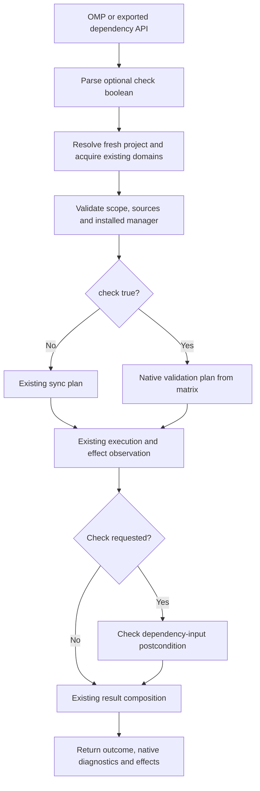

# Dependency sync validation for pre-commit - Plan

## Goal Capsule

**Objective:** Developers can explicitly check dependency consistency before committing across every package manager Justomp supports.

**Means:** Add an optional `check` input to `dependency_sync`, backed by native validation commands and frozen installations (KTD1–KTD4).

**Authority:** The Product Contract owns behavior; technical decisions and implementation units implement it. Allowing installation during validation does not remove check mode.

**Execution profile:** Extend the existing dependency service and adapters. This plan does not install a Git hook. Implementation, publishing and release are separate actions.

**Stop conditions:** Investigate a supported native command that cannot meet the check contract. Do not silently repair metadata, skip validation, or widen version support to claim success.

**Completion owner:** The implementer verifies the feature and reports its limitations; the user chooses subsequent hook work and publication.

---

## Product Contract

### Summary

`dependency_sync({ project_id, check: true })` checks dependency consistency using the selected project's package manager. The command may install dependencies when native validation includes installation. Omitting `check`, or passing `false`, preserves existing synchronization behavior.

### Problem Frame

The future pre-commit workflow needs an explicit dependency check. Package managers differ: some expose validation without materializing the environment, while others validate through a frozen installation. Prohibiting installation would require unnecessary custom validators or reject supported projects.

### Key Decisions

- **Keep check mode on the existing tool.** Governs R1, R9. (session-settled: user-directed — chosen over a separate tool or removing the parameter: callers must explicitly request checking.)
- **Allow native installation during checking.** Governs R2, R5. (session-settled: user-directed — chosen over a universal no-install requirement: native validation can include installation.)
- **Check consistency without automatically repairing it.** Governs R3, R4, R11. (session-settled: user-approved — chosen over updating the lock and treating that as a passing check.)

### Requirements

**API and manager coverage**

- R1. Sync accepts mandatory `project_id` and optional boolean `check`; omitted or false keeps the current behavior, and true selects validation.
- R2. Check supports the existing uv, npm, pnpm, Yarn Classic, modern Yarn, Bun and Go version families, including managers whose validation installs packages.
- R3. Check delegates consistency decisions to native locked/immutable validation; it never retries with an unlocked install, relock or upgrade to make an inconsistent project pass.
- R4. Go check evaluates the selected module's source/declaration/checksum consistency without applying proposed changes; ordinary Go sync remains a download operation.

**Effects and failures**

- R5. Check permits native network/cache access, installation and its normal script/build effects, plus existing inspection publication. It does not promise an unchanged environment or fully installed dependencies after success.
- R6. Only `outcome: success` passes the check; native failure, cancellation and `partial_change` remain failures with diagnostics.
- R7. Both modes preserve fresh selection, shared-domain serialization, path/source containment, installed-manager selection, redaction and cancellation.
- R8. Native workspace scope is retained and reported; a shared-lock check can cover sibling projects, while Go check targets one module.
- R11. Check cannot report success if observed dependency input files change during the call or their final state cannot be observed. Derived installation files may change; report effects without restoring or staging files.

**Evidence and handoff**

- R9. The exported dependency API and OMP tool expose the same check behavior; documentation explains how a future hook consumes the result without claiming a hook is installed.
- R10. Tests cover Justomp's option routing, native invocation and result/effect reporting at the cheapest sufficient boundary. (pack: testing, test-evidence-and-cost.md)

### Acceptance Examples

| Example | Given / action | Expected result | Covers |
| --- | --- | --- | --- |
| AE1 | Valid pnpm metadata, missing installed packages, check true | Frozen installation may create packages and the check can pass | R2, R5 |
| AE2 | A manifest requires a lock update, check true | Native validation fails without an unlocked repair retry | R3, R6 |
| AE3 | Valid Yarn Classic or modern Yarn metadata, check true | Native frozen/immutable install runs; missing dry-run support is not an error | R2 |
| AE4 | Tidy Go module, check true | Native diff check passes, regardless of whether cache downloads were needed | R4, R5 |
| AE5 | Go needs declaration/checksum changes, check true | The check fails and reports the native diff without applying it | R4, R6 |
| AE6 | Native installation fails or is cancelled | Existing non-success classification and available effects are returned | R6, R7 |
| AE7 | Project ID no longer exists | Existing target resolution rejects before native work | R7 |
| AE8 | Existing caller omits check, or supplies false | Existing sync command sequence and behavior are retained | R1 |
| AE9 | Native install exits zero but a lifecycle script changes a project manifest | Check is non-success and reports the changed input; nothing is rolled back | R11 |
| AE10 | Modern Yarn creates PnP installation files from valid metadata | Generated files are allowed and do not alone fail validation | R5, R11 |
| AE11 | Valid uv lock or supported npm/Bun lock, environment absent, check true | The selected native validation can succeed without creating a complete environment | R2, R5 |

### Scope Boundaries

In scope: the optional input, adapter command selection, check outcome enforcement, interface documentation and focused evidence.

Considered and not built:

- Custom lock parsers or resolvers: permitted native installation removes the reason to introduce them. Keep existing preflights, including Yarn Classic's selector checks.
- A global no-script, offline, no-write or no-install policy: R5 permits native effects. Use native lightweight checks where adequate, without emulating missing ones.
- A new tool, dependency CLI, config section or manager bootstrap: existing API and OMP registration suffice.
- Automatic rollback, staging, guard changes or OS isolation: the check reports state and failure; it does not undo installations or concurrent user edits.
- Dependency upgrades, toolchain changes, solver-rule audits and byte-for-byte canonical lock regeneration: these are outside R3's native consistency check.

### Deferred to Follow-Up Work

Actual pre-commit installation; ordering lint fixes, format, typecheck and dependency checks; affected-project selection; shared-lock deduplication; working-tree versus staged-snapshot policy; a CLI only if the chosen hook runner needs it.

---

## Planning Contract

### Repository Evidence

- `src/dependencies/schemas.ts` currently has a strict sync schema containing only `project_id`; request types are inferred from that schema.
- `src/dependencies/service.ts` already owns target refresh, domain queues, source validation, executable resolution, sequential native steps, metadata fingerprints, result composition and inspection publication.
- Existing Python/JS sync is already locked or immutable. Check mode need not use a different native command when that existing command satisfies R3.
- `src/dependencies/adapters/go.ts` currently downloads for sync; it does not validate tidiness.
- `src/dependencies/adapters/yarn-common.ts` checks lock presence for Yarn/Bun and Classic selectors before frozen installation. Its observed metadata includes `.pnp.cjs` and `.pnp.loader.mjs`, which are generated installation outputs.
- `src/omp/dependency-tools.ts` registers the shared schemas with `approval: exec`, forwards input to `executeDependency`, and maps non-success outcomes to `isError`.
- `src/dependencies/executable.ts` restricts manager families and disables automatic toolchain provisioning. This feature preserves those boundaries.

### Native Execution Matrix

These are adapter commands, not alternate contributor workflows. Existing scope, environment, lock-presence and source checks remain in place. Versions below identify repository fixtures, not new executions performed during planning.

| Manager | Fixture version / accepted family | Omitted or false | Check true | Expected environment effects |
| --- | --- | --- | --- | --- |
| uv | 0.11.6 / 0.11.x | Existing scoped `uv sync --locked` | `uv lock --check` | Resolution/cache access possible; no environment synchronization |
| npm | 11.12.1 / 11.x | Existing `npm ci` | `npm ci --dry-run --ignore-scripts --no-audit --no-fund` | Native planning/cache access; no full install promised |
| pnpm | 10.20.0 / 10.x | Existing frozen install | Existing `pnpm install --frozen-lockfile` | Installation and native script policy apply |
| Yarn Classic | 1.22.22 / 1.22.x | Existing selector preflight and frozen install | Same preflight and `yarn install --frozen-lockfile --non-interactive` | Installation and lifecycle scripts may run |
| modern Yarn | 4.12.0 / >=4.12, <5 | Existing immutable install | Existing `yarn install --immutable` | Fetch, linker/PnP and build effects may occur |
| Bun | 1.4.2 / 1.4.x | Existing frozen install | `bun install --frozen-lockfile --dry-run` | Native resolution/cache access; no full install promised |
| Go | 1.25.6 / 1.25.x | Existing `go mod download` | `go mod tidy -diff` | Module-cache downloads may occur |

### Research and Native Limits

uv documents `lock --check` as validating lock freshness. `sync --check` instead checks whether the installed environment matches, so it is not the chosen lock gate. Preserve workspace discovery and omit sync-only package-selection arguments on the lock command. [uv CLI reference](https://docs.astral.sh/uv/reference/cli/#uv-lock--check)

npm's versioned implementation validates the virtual lock tree against its ideal tree before the dry-run branch. Its top-level lifecycle scripts are gated by `ignoreScripts`, not that branch; hence check explicitly includes `--ignore-scripts`. Normal sync is unchanged. [npm 11.12.1 implementation](https://github.com/npm/cli/blob/v11.12.1/lib/commands/ci.js), [npm ci documentation](https://docs.npmjs.com/cli/v11/commands/npm-ci/)

pnpm 10's frozen installation rejects a missing or outdated lock. Classic Yarn documents frozen installation; modern Yarn's immutable flag forbids required lock changes while permitting installation. Do not add `--immutable-cache`: an empty cache is not an inconsistent project. [pnpm 10](https://pnpm.io/10.x/cli/install), [Yarn Classic](https://classic.yarnpkg.com/lang/en/docs/cli/install/), [modern Yarn](https://yarnpkg.com/cli/install)

Bun documents frozen dry-run validation, but native compatibility does not mean byte-identical regenerated locks. It may accept edits that preserve locked versions. Keep Justomp's existing lock-presence preflight: frozen mode alone can operate without a lock. Preserve support for both `bun.lock` and `bun.lockb`. [Bun install documentation](https://bun.com/docs/pm/cli/install)

Go's diff mode reports proposed module/checksum edits and exits nonzero when changes are needed. It may fetch modules while evaluating source and test imports. It does not run tests. `go.sum` is checksum metadata, not a lock, and may legitimately be absent. [Go module reference](https://go.dev/ref/mod#go-mod-tidy)

Living documentation can describe newer patches than repository fixtures. During implementation, reuse native fixture handoffs to verify the exact commands above, especially npm dry-run and Bun binary locks. Do not present this source review as a runtime test or broaden supported families without a separate decision.

### Key Technical Decisions

- KTD1. **Reuse the existing operation pipeline.** Add an optional boolean to the strict sync schema and branch on `request.check === true` inside adapters (R1, R7, R9). No second service or read-only inspection mode is needed because R5 permits publication and native effects.
- KTD2. **Run Go validation directly in check mode.** Select tidy-diff instead of download (R4). Download must not precede validation because it can complete checksums before the original state is checked. Preserve selected module cwd and existing workspace environment.
- KTD3. **Reuse outcome accounting and metadata observation.** For check only, a native failure or an R11 postcondition failure prevents success (R6). Preserve current conservative `partial_change` accounting, redacted output and native step results.
- KTD4. **Use the matrix's native checks.** Select native lightweight validation where available; reuse existing frozen installations elsewhere (R2, R3, R5). Never dynamically fall back to an unlocked command. If the pinned fixture contradicts documentation, investigate and revise the technical command before claiming support.
- KTD5. **Keep evidence proportional to the change.** Use supplied inputs/results for policy and outcome cases; reuse existing native lifecycles for changed command paths (R10). (pack: testing, test-evidence-and-cost.md)
- KTD6. **Distinguish dependency inputs from generated outputs.** Reuse the service's existing before/after fingerprints for R11. The input set comprises observed manifests, locks, manager configuration and Go module/workspace/checksum files; exclude `.pnp.cjs` and `.pnp.loader.mjs`. Classify observation failure as check failure. This is a file-state postcondition, not a parser, watcher or rollback mechanism.

### High-Level Technical Design

The mode/command matrix above defines option routing. The shared flow remains:

The service keeps its existing detailed ordering and queue retry behavior. Neither mode validates a separate Git index snapshot.

### Compatibility and Operational Limits

Check intent differs from normal sync even where the native command is identical. Success establishes the native consistency gate and R11, not an installed environment. Call ordinary sync when environment materialization is required.

Native managers define consistency differently; this feature does not implement an independent universal lock specification. Go check is stricter than ordinary Go sync: adding a requirement before importing it can fail tidiness. Only explicit check opts into that behavior.

Install-based checks may run scripts, alter environment files, need network access or fail due to installation errors. Those failures must remain visible. File observations cover listed dependency metadata and are not a security boundary against arbitrary script writes or external processes.

The change preserves existing scope and protection integration. Check keeps OMP's execution approval tier; naming a mode “check” must not lower approval to read-only.

---

## Implementation Units

### U4. Add check input and Python/JavaScript command selection

**Goal:** Expose optional check mode without changing existing callers.

**Requirements:** R1–R3, R5, R7, R8; KTD1, KTD4. **Dependencies:** None.

**Files:** `src/dependencies/schemas.ts`; `src/dependencies/adapters/uv.ts`; `src/dependencies/adapters/npm.ts`; `src/dependencies/adapters/yarn-common.ts`; `src/dependencies/adapters/pnpm.ts` only if labels require it; `tests/unit/dependencies/schemas.test.ts`; existing unit adapter tests under `tests/unit/dependencies/adapters/`.

**Approach:** Add the optional boolean using the schema's existing inferred request type. Implement the matrix while retaining current lock-presence, source, group and cwd handling. Reuse the shared Yarn/Bun frozen-plan helper and change only Bun's check-specific arguments. pnpm and both Yarn variants may reuse the normal command unchanged.

**Test scenarios:**

1. Covers AE8. Omitted and false select unchanged sync plans; true is accepted. Strings, null and unrelated fields are rejected, including check on non-sync operations.
2. Supplied adapter contexts select the matrix's exact native arguments and existing owner/member scope. uv check contains no sync-only `--package` flag.
3. Existing missing-lock and Classic selector preflights still apply in check mode; no command is scheduled to generate a missing lock.
4. Normal npm sync keeps its script policy; only its dry-run check adds the stated script/audit options.

**Patterns:** Existing strict Zod schemas, native step constructors, and adapter fixtures with supplied file content.

**Verification:** Both modes route as documented; no new manager version, dependency, public tool or config surface is introduced.

### U1. Add Go's explicit check path

**Goal:** Validate Go consistency only when requested.

**Requirements:** R1, R4–R8; KTD2. **Dependencies:** U4's schema.

**Files:** `src/dependencies/adapters/go.ts`; `tests/unit/dependencies/adapters/go.test.ts`.

**Approach:** Select one native step based on check mode. Preserve existing metadata paths, module cwd, workspace environment and affected-project scope. Add/remove/update plans stay unchanged.

**Test scenarios:**

1. Covers AE8. Omitted/false uses download alone.
2. Check true uses tidy-diff alone, without a prior download, applying a tidy diff, or an error-tolerant tidy flag.
3. Nested-module contexts retain their selected module cwd and the existing workspace policy.

**Verification:** A check can examine initial metadata without silently repairing it first.

### U5. Enforce the check result using existing metadata observations

**Goal:** Distinguish permitted installation outputs from changed dependency inputs.

**Requirements:** R5–R7, R11; KTD3, KTD6. **Dependencies:** U4, U1.

**Files:** `src/dependencies/service.ts`; `src/dependencies/changes.ts` if a small pure classification helper belongs there; `tests/unit/dependencies/outcomes.test.ts`; `tests/integration/dependencies/service.test.ts` for the existing filesystem boundary.

**Approach:** Evaluate the check postcondition after existing fingerprint collection and before outcome composition. Keep native failures alongside observation diagnostics; never replace a useful native failure with a generic message. Normal sync retains its current result semantics.

**Test scenarios:**

1. Covers AE9. Supplied zero native exit plus changed manifest/lock yields non-success and changed-path evidence.
2. Covers AE10. Supplied PnP-output changes alone allow success; include a member manifest plus PnP change to prove inputs still fail.
3. Supplied post-observation failure prevents a passing check. Native failure/cancellation remains visible even if observation also fails.
4. Covers AE6. Existing partial-effect classification remains non-success; do not add native installations to test result permutations.
5. Reuse one service filesystem fixture to show an input edit reaches the postcondition. Do not install a package manager merely to mutate a file in a test double.

**Verification:** Only the check path applies R11, and generated environment files do not create false failures.

### U2. Prove the native handoffs with existing fixtures

**Goal:** Establish the new check entry points without duplicating the full manager matrix.

**Requirements:** R2–R8, R10, R11. **Dependencies:** U4, U1, U5.

**Files:** Existing `tests/integration/dependencies/managers/{uv,npm,pnpm,bun,yarn-classic,yarn-modern,go}.native.test.ts`; shared `npm-pnpm-cases.ts`, `npm-pnpm-fixture.ts`, `yarn-bun-scenarios.ts`, and `yarn-bun-fixture.ts` in that directory.

**Approach:** Audit assertions first. Keep normal-sync coverage and reuse the same isolated native lifecycles for minimal check witnesses. pnpm/Yarn's identical command semantics are already exercised; use supplied unit cases for the boolean branch rather than new installs. Verify Bun text/binary lock paths within their existing fixtures.

**Test scenarios:**

1. Covers AE11. Existing uv/npm/Bun fixtures call the new check path on valid metadata and one native inconsistency. Assert Justomp's diagnostic handoff, not a catalogue of solver rules.
2. Covers AE1, AE3. Retain existing native frozen-install evidence for pnpm/Yarn and prove the check request maps to those commands. Reuse the modern Yarn PnP lifecycle for the generated-output allowance.
3. Covers AE4, AE5. A compact existing Go fixture passes when tidy and returns a diff for one controlled inconsistency; snapshots prove proposed changes were not applied.
4. Preserve normal Go download behavior with existing tests, including cold-cache checksum completion; do not force those sync fixtures to become tidy.
5. Preserve a nested module/workspace handoff. Pure stale-ID, cancellation/result and schema variations remain in units or existing supplied-boundary tests.

**Verification:** Record actual fixture versions and incremental setup cost. Confirm affected command paths on macOS and Linux without another copy of the complete suite.

### U3. Expose and document check mode through the existing interfaces

**Goal:** Agents and future hook callers can explicitly request validation and understand its effects.

**Requirements:** R1, R5, R6, R9; KTD1. **Dependencies:** U4, U1, U5; evidence from U2.

**Files:** `src/omp/dependency-tools.ts`; `docs/dependencies.md`; `README.md` where its existing tool summary requires it; `tests/integration/omp/dependencies.test.ts`.

**Approach:** Update tool descriptions and API examples with check's purpose, default, permitted installation and success mapping. Retain the shared schema, existing export and execution approval tier. Do not add a dependency CLI or hook.

**Test scenarios:**

1. OMP schema exposes the optional boolean and forwards true/false to the common service without coercion.
2. Supplied non-success results remain `isError: true`; successful install-based check is not rejected merely because it had environment effects.
3. The existing registration/session fixture proves wiring without repeating native manager installations.

**Verification:** Documentation explains that check need not install, may install, and never automatically repairs metadata to pass. It distinguishes working-tree checks from future staged-file policy.

---

## Verification Contract

- Use `bun run check` for typing, formatting, lint and unit tests. Develop with focused existing dependency and OMP tests.
- Traverse `bun run test:integration` once for the final full gate; feature aliases overlap and must not be concatenated into a duplicate suite.
- Verify changed native command paths on macOS and Linux, recording manager versions and any unavailable-platform limitation.
- Keep policy and result permutations in units; native integration proves Justomp's handoff rather than upstream solver guarantees. (pack: testing, test-evidence-and-cost.md)
- Record cold/warm setup costs separately. Apply the pack's warm 300-second complete-gate target and matching-baseline reduction requirement without inventing a baseline, adding workers or skipping tests.
- Planning does not run tests, install dependencies or establish new runtime evidence.

---

## Definition of Done

- R1–R11 are implemented through the shared API and OMP tool.
- Omitted/false check preserves existing sync; true selects every supported manager's documented check path.
- Native inconsistency, check input drift and observation failure cannot yield a passing check.
- Installation effects remain permitted and reported; no universal read-only promise is made.
- Focused and full verification results, actual supported-version evidence and costs are reported.
- No custom resolver, extra tool/config, hook installation, production experiment or abandoned fallback remains.
- The user receives the implementation result before separately authorized publication.
