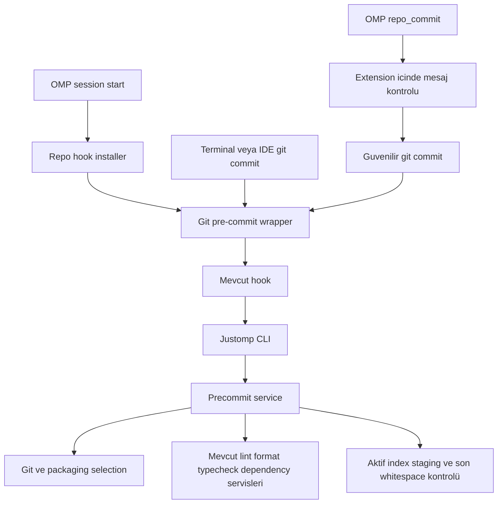
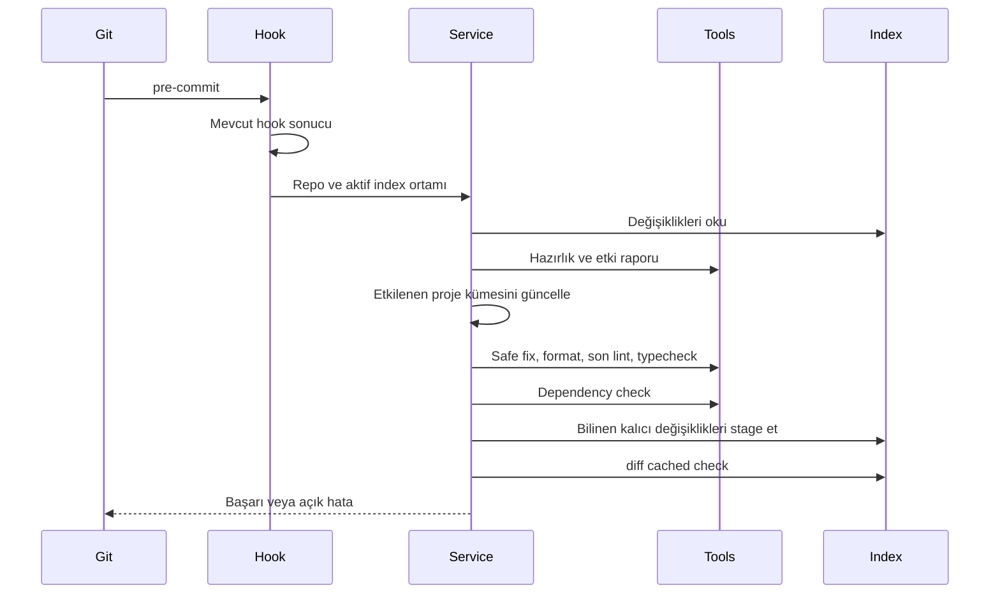
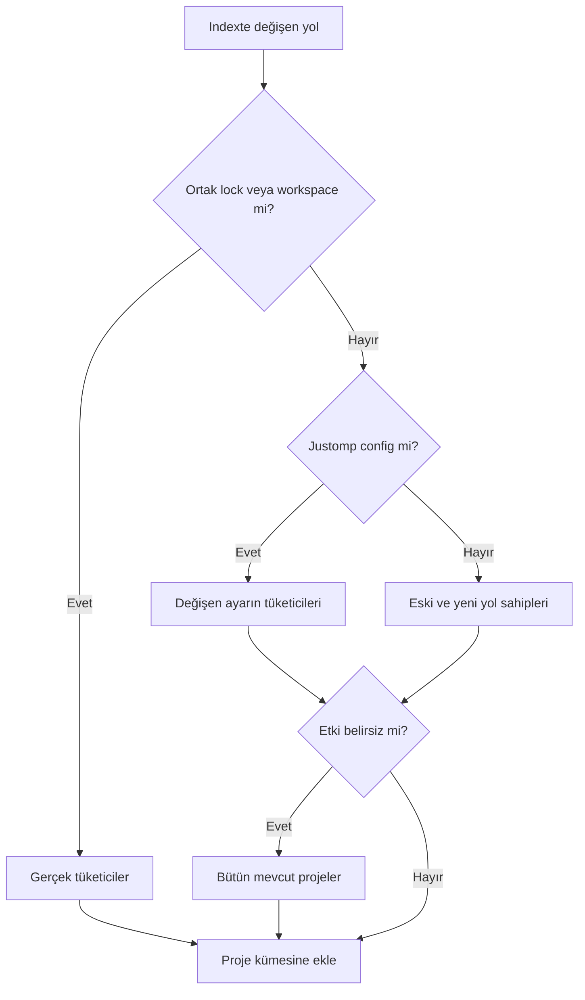
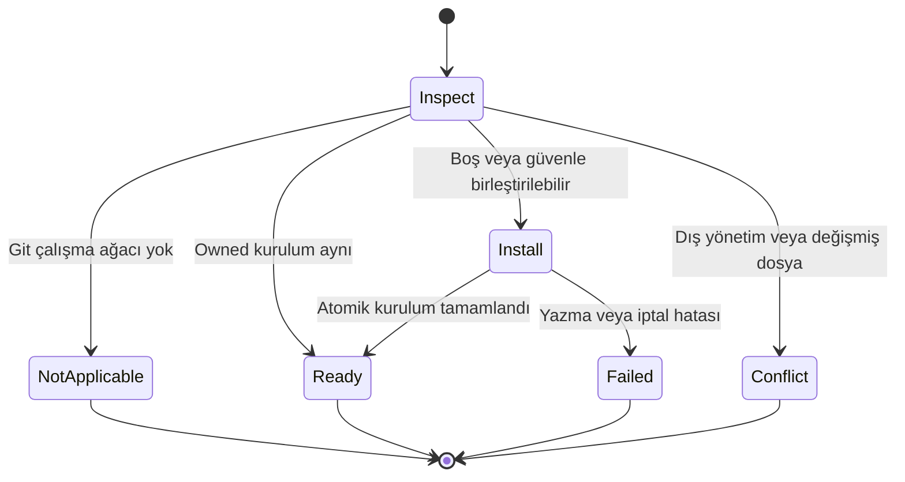

# Repository Pre-Commit - Plan

## Goal Capsule

- **Objective:** Justomp kullanan bir repoda commit, etkilenen projelerin otomatik düzeltmelerini içerir ve kalan lint, tip, bağımlılık tutarlılığı veya whitespace hatalarında durur.
- **Means:** Repo başına tek Git hook’u, OMP’den bağımsız CLI ve mevcut Justomp servisleri (KTD1–KTD5).
- **Authority:** Product Contract davranışı belirler; Planning Contract uygulama mekanizmasını belirler. Implementation Units bunları genişletmez.
- **Execution profile:** macOS ve Linux; mevcut Bun tabanlı paket. Bu belge yalnız planlamadır.
- **Stop conditions:** Kullanıcı implementasyonu ayrıca başlatır. Korunan dosyalar için genel bash izni veya OMP patch’i eklenmez.
- **Handoff:** Kullanıcı planı inceler ve implementasyonu ayrıca başlatır. Commit, push veya PR bu belgeyle yetkilendirilmez.

---

## Product Contract

### Summary

İlk uygun OMP oturumunda repoya tek bir pre-commit hook’u kurulur.
Hook, commit’in dosyalarından etkilenen projeleri bulur ve bu projelerin tamamında mevcut lint-fix, format, typecheck ve dependency kontrol servislerini çalıştırır.
Otomatik düzeltmeler commit’e eklenir; düzeltilmeyen hatalar commit’i durdurur.
Terminal ve IDE commit’leri OMP açık olmadan çalışır.
OMP içinde aynı Git hook akışını başlatan güvenilir `repo_commit` custom tool’u bulunur; tool önce mesajı extension içinde doğrular.

### Problem Frame

Justomp farklı ekosistemlerin araçlarını zaten seçiyor, hazırlıyor ve çalıştırıyor.
Git bu işlevleri şu an tek bir repo kontrolü olarak çağıramıyor.
Her proje için ayrı hook veya ikinci bir araç konfigürasyonu oluşturmak, monorepo seçimlerini ve mevcut servis davranışlarını tekrar etmek olur.

### Key Decisions

- **Repo başına tek hook.** Proje ayrımını Justomp yapar. Governs R1, R3–R5. (session-settled: user-approved — chosen over proje başına ayrı hook: aynı repo farklı ekosistemleri içerebilir.)
- **Etkilenen projenin tamamını düzelt ve kontrol et.** Governs R6–R7. (session-settled: user-directed — chosen over yalnız commit dosyalarını çalıştırmak: kullanıcı proje genelini seçti.)
- **Düzeltmeleri otomatik stage et.** Governs R8. (session-settled: user-approved — chosen over değişiklik oluşunca commit’i durdurmak: değişen dosyanın önceki unstaged içeriği de commit’e girebilir.)
- **Mevcut servisleri CLI’dan çağır.** Governs R2. (session-settled: user-approved — chosen over Git hook’undan agent tool çağrısı: Git kendi sürecinden çalışabilmeli.)
- **İlk oturumda otomatik kurulum.** Governs R1, R11. (session-settled: user-approved — chosen over elle hook kurulumu: tekrar eden oturumlarda kurulum çoğalmamalı.)
- **OMP için güvenilir commit tool’u.** Governs R15. (session-settled: user-approved — chosen over terminal/IDE ile sınırlamak: korumalı bash’in çocuk süreçleri yazma kısıtını miras alır; Git ve repo hook’ları custom tool yetkisiyle çalışır.)
- **Commit mesajını extension doğrular.** Governs R16–R17. (session-settled: user-directed — chosen over alt projelere doğrulayıcı dependency eklemek: tek JS/TS doğrulayıcı Justomp tarafından taşınır.)

### Requirements

**Installation and invocation**

- R1. Git çalışma ağacındaki ilk OMP session start, repo seviyesinde tek Justomp pre-commit girişini kurar; sonraki oturumlar kurulumu idempotent olarak doğrular.
- R2. Hook bağımsız bir CLI üzerinden mevcut servisleri çağırır; çalışmak için açık OMP oturumu, model veya agent tool dispatcher gerektirmez.

**Project selection**

- R3. Seçim commit’in aktif Git index’indeki değişikliklerden başlar ve güncel packaging structure içindeki `project_id` değerlerine bağlanır.
- R4. Ortak lock veya workspace bildirimi değişikliği, o girdiyi kullanan bütün mevcut projeleri kapsar.
- R5. `.justomp/config.json` değişikliğinde ilgili ayarları kullanan projeler kapsanır; etki kesin daraltılamıyorsa bütün mevcut projeler seçilir.
- R6. Lint-fix ve format, seçilen projenin mevcut kapsam kurallarına göre tamamında çalışır; komşu/nested projeler veya dependency klasörleri yanlışlıkla sahiplenilmez.

**Checks and changes**

- R7. Gate güvenli lint düzeltmesi, doğrudan formatlama, son lint/format kontrolü, typecheck, `dependency_sync(check:true)` ve son `git diff --cached --check` kontrolünü içerir.
- R8. Lint/formatın değiştirdiği uygun dosyaların tamamı aktif index’e eklenir; bu dosyalardaki önceden unstaged içerik de dahil olur ve yalnız düzeltme yapılması commit hatası sayılmaz.
- R9. Kalan gerçek kontrol hatası, iptal, eksik sonuç veya güvenilir biçimde gözlenemeyen işlem commit’i başarısız kılar; hata sırasında yapılan dosya değişiklikleri silinmez.
- R10. Bağımlılık kontrolü mevcut native check davranışını korur; gerekli kurulum yapılabilir, başarısız check sonrasında normal sync ile onarma denemesi yapılmaz.

**Compatibility and boundaries**

- R11. Mevcut hook davranışı korunur; güvenle birleştirilemeyen kurulum mevcut dosyalara dokunmadan açık hata ve entegrasyon komutu verir.
- R12. macOS ve Linux desteklenir; linked worktree, alt klasörden oturum açılışı ve aktif alternatif index doğru ele alınır.
- R13. Runtime pre-commit gate’ine unit veya integration test çalıştırma eklenmez.
- R14. Genel dosya koruması korunur; CLI’yı çağırmak tek başına sandbox içindeki sürece korunan dosya yazma yetkisi kazandırmış sayılmaz.

**Trusted commit and message validation**

- R15. `repo_commit` yalnız zorunlu `message` input’u alır, repo kökünü mevcut session dizininden çözer ve normal Git commit akışını extension’ın güvenilir süreç çalıştırıcısından başlatır.
- R16. Tool’a verilen mesaj Git süreci ve pre-commit kontrolleri başlamadan extension içindeki commitlint API’siyle doğrulanır; başarısızlık kural adları ve açıklamalarıyla döner.
- R17. Doğrulayıcı ve ihtiyaç duyduğu parser Justomp runtime dependency’sidir; alt projelere paket, commitlint config dosyası veya yeni commit-msg hook’u eklenmez.

### Execution Semantics for Review

Kontroller mevcut tool’lar gibi çalışma ağacındaki dosyalar üzerinde çalışır.
Index hangi projelerin etkilendiğini belirler; bu çalışma, commit ağacını geçici bir checkout’ta yeniden kurup test etmez.
R8 dışında kalan kısmi staging korunur; çalışma ağacının başarılı kontrolü index’teki bütün içeriklerin ayrıca kontrol edildiği anlamına gelmez.

Eksik araçların hazırlanması mevcut servis davranışını kullanır.
Yeni proje mevcut latest/eşitleme akışını tetikleyebilir; normal commit hazır araçları sırf yeniden çalıştı diye latest’a yükseltmez.
Hazırlık, başlangıçta seçilmeyen projelerin manifest veya lock dosyalarını da değiştirebilir.

Bu planın teknik önerisi, hazırlığın değiştirdiği commit’e ait kalıcı manifest, lock ve yönetilen config dosyalarını da R8’deki tam dosya staging yaklaşımıyla birlikte eklemektir (KTD4).
Böylece yeni manifest ile eski lock’un commit’e birlikte girmesi önlenir.
Bu öneri önceki lint/format kararından ayrı belirtilmiştir; kullanıcı incelemesinde kapsamı görülebilir olmalıdır.
Cache, kurulu dependency dizinleri ve hazırlık receipt’leri otomatik stage edilmez.

### Acceptance Examples

| ID | Covers | Girdi ve beklenen sonuç |
|---|---|---|
| AE1 | R3, R6 | `apps/api` kaynağı stage edilirse API’nin tamamı kontrol edilir; bağımsız `apps/web` seçilmez. |
| AE2 | R4 | Paylaşılan pnpm lock değişirse aynı gerçek lock’u kullanan bütün projeler seçilir; aynı isimli bağımsız lock etkilenmez. |
| AE3 | R5 | Yalnız Python lint ayarı değişirse Python projeleri seçilir; inspection kuralı değişirse proje evreni yeniden değerlendirilir. |
| AE4 | R8 | Kısmen stage edilmiş dosyayı formatter değiştirirse son dosyanın tamamı commit’e girer; dokunulmayan başka bir dosya stage edilmez. |
| AE5 | R7, R9 | İlk lint sonucu yalnız format bozukluğunu gösteriyorsa formatter çalışır; son kontroller geçerse commit devam eder. |
| AE6 | R7, R9 | Typecheck hatası veya başarısız lock kontrolü commit’i durdurur ve proje/araç çıktısı görünür olur. |
| AE7 | R11 | Önceden kurulu executable pre-commit bir kez çalışır; onun başarısız sonucu korunur. |
| AE8 | R1, R12 | `apps/api` içinden açılan oturum repoya tek hook kurar; tekrar açılış ikinci giriş oluşturmaz. |
| AE9 | R3, R12 | Git geçici index sağladığında hook o index’i okur ve değiştirir; sabit `.git/index` kullanmaz. |
| AE10 | R13 | Bütün kontroller geçse de hook unit/integration test servisi çağırmaz. |
| AE11 | R8–R9 | Formatter bir dosyayı düzeltip başka dosyada typecheck başarısız olursa güvenle gözlenen düzeltme stage edilir; kullanıcı tip hatasını düzeltip yeniden commit ettiğinde önceki düzeltme kaybolmaz. |
| AE12 | R15–R16 | Agent geçerli mesajla `repo_commit` çağırınca normal Git hook’u bir kez çalışır; başarılı commit hash’i döner. |
| AE13 | R16–R17 | Geçersiz veya boş mesaj Git başlamadan reddedilir; index, çalışma ağacı ve alt proje dependency’leri değişmez. |

### Scope Boundaries

Yeni linter, formatter, typechecker veya paket yöneticisi eklenmez; yeni agent yüzeyi R15’teki dar commit tool’u ile sınırlıdır.
Mevcut araçların native komutları hook modülünde yeniden yazılmaz.
Pre-push, CI kurulumu, release ve test gate’leri kapsam dışıdır.
Yeni bir commit-msg hook’u, interaktif commit mesajı sihirbazı, commit mesajını otomatik yeniden yazma, changelog/version üretimi, amend, push veya rastgele Git argümanları kapsam dışıdır.
Global hook yöneticisi, bütün hook event’lerini yeniden yönlendiren bir framework ve otomatik Git yükseltmesi yapılmaz.

**Considered and not built:** index-only checkout/stash akışı R8’in seçtiği çalışma biçimi için gerekli değildir; ileride yalnız commit ağacını doğrulama talebi gelirse ayrı değerlendirilir.
Genel distributed lock/daemon/broker eklenmez; KTD8 yalnız gözlenebilir çakışmalar için sınırı belirtir.
Yeni otomatik retry veya native check hatasını gizleyen fallback eklenmez.

---

## Planning Contract

### Key Technical Decisions

- KTD1. **Bağımsız `justomp-precommit` bin ve ortak servis.** `src/precommit/cli.ts`, `src/precommit/service.ts` üzerinden iş yürütür; OMP extension’ını import eden kök `src/index.ts` girişini yüklemez. CLI mevcut lint/typecheck bin’lerinin sinyal ve sonuç yaklaşımını izler. R2’yi gerçekleştirir. (session-settled: user-approved — chosen over agent tool dispatcher: Git OMP dışında çalışmalıdır.)
- KTD2. **Git bilgisi tek adaptörde toplanır.** Repo/worktree root, Git common directory, aktif index ve hook yolu Git’in kendi çözümlemesinden alınır. `GIT_INDEX_FILE` dahil Git ortamı korunur. Değişiklik listesi NUL ayrımlı okunur; rename’in eski/yeni yolu ve deletion ayrı işlenir. Git argümanları shell metni birleştirilerek üretilmez. R3, R12.
- KTD3. **Seçim saf fonksiyon, keşif güncel veri.** Mevcut `getPackagingStructure()` ve proje kapsamı yardımcıları kullanılır. Normal yollar segment sınırlarına göre en derin sahiplerle eşleştirilir; aynı dizindeki farklı ekosistem sahipleri kaybolmaz. Lock tüketicileri `resolveManagerScope`/gerçek lock directory bilgisiyle belirlenir. Silinen manifest, rename veya bilinmeyen ortak config etkisinde mevcut projelere genişlemek sessizce proje atlamaktan iyidir. Gitlinks içindeki projeler üst reponun proje evrenine alınmaz. R3–R6.
- KTD4. **Stage listesi işlem etkilerinden çıkarılır.** Lint’in repo-relative ve formatın project-relative yolları tek repo-relative biçime dönüştürülür. Yalnız gerçekten değişen dosyalar ve eşleşen hazırlık manifest/lock/config etkileri eklenir. Ignored dosyalar zorla eklenmez; symlink dışına çıkılmaz. Formatter’ın değiştirdiği ignore edilmeyen untracked dosya R8 kapsamındadır. Son gözlenen içerik ile stage öncesi içerik farklıysa başka yazımı sahiplenmek yerine işlem hata verir. Blanket `git add .` kullanılmaz. R8 ve Execution Semantics for Review.
- KTD5. **Hazırlık, düzeltme ve son doğrulama ayrı aşamalar.** Mevcut `fixLintTarget` fix sonrasında format check de yaptığından, fix aşaması ortak bir iç servis olarak ayrıştırılır; OMP’nin mevcut birleşik sonucunu değiştirmeden hook bu aşamayı kullanır. Formatter’dan sonra son lint/format kontrolü yapılır. Go’nun desteklenmeyen lint autofix durumu tek başına hata değildir; mevcut Go format ve lint kontrolleri çalışır. R6–R7, R9.
- KTD6. **Dependency kontrolü native doğrulama kapsamına göre tekilleştirilir.** Hazırlık tamamlandıktan sonra `executeDependency(..., "sync", { project_id, check: true })` çağrıları adaptörün gerçekten kontrol ettiği kapsama göre gruplanır; queue/write domain tekilleştirme anahtarı değildir. Go workspace içindeki her etkilenen modül ayrı `go mod tidy -diff` kontrolü alır. Diğer yöneticilerde bir workspace çağrısı ancak adaptör bütün ortak kapsamı doğruluyorsa üyelerin yerine geçer. Yalnız `outcome === "success"` geçer. Bu, hook başlamadan önceki lock’un tutarlı olduğunu ispatlama iddiası taşımaz; başarısız check’in ardından onarım yapılmaz. R10.
- KTD7. **Repo-owned hook’ta dar composition.** Resolved hook yolu repo metadata’sı veya repoya ait özel hook dizini içindeyse ve normal dosyaysa, orijinal hook içeriği/mode’u korunarak yan dosyaya alınır ve onun önüne Justomp wrapper konur. Önce orijinal executable hook, sonra gate çalışır. Symlink, dış/global hook dizini, başka araç tarafından yönetilen hook veya beklenmedik değişiklikte installer yazmaz; CLI bağlantısı için açık conflict döndürür. `core.hooksPath` değiştirilmez; diğer hook event’lerine dokunulmaz. R1, R11. Git 2.52.0 ile çalışmalıdır; 2.54 named-hook özelliği zorunlu değildir.
- KTD8. **Çakışmada gözlem ve açık hata; münhasır erişim iddiası yok.** Her aşamadan önce sahiplik/metadata girdileri yeniden doğrulanır; bilinen kendi etkileri sonraki beklenen durumu oluşturur. Açıklanamayan değişim, değişen sahiplik veya eksik effect gözlemi commit’i durdurur. Mevcut process-local queue ayrı OMP/CLI süreçlerini kilitlemez. Bu sürüm başka süreçlerin native in-place yazımlarını tümüyle önlediğini iddia etmez. Repo genelinde yeni kalıcı kilit veya eski PID kaydıyla commit’i süresiz engelleyen mekanizma eklenmez. R9, R14.
- KTD9. **Launcher kurulu runtime’ı kullanır.** Kurulum, doğrulanmış Bun executable ve kurulu CLI girişinin mutlak yollarını güvenli argümanlarla yazar; Bun `--no-install` ile extension dependency’sini commit sırasında indirmeye çalışmaz. Native uv/Go/Node/manager eksikse mevcut resolver hatası görünür. Silinmiş paket yolu başarı sayılmaz; yeniden OMP oturumunda owned launcher yenilenir. R2, R11–R12.
- KTD10. **Kurulum repo kökü, mevcut tool kapsamı session kökü olarak kalır.** Alt dizinden session start yalnız hook kurulumunda Git root’a yükselir; diğer OMP tool’larının `ctx.cwd` davranışını değiştirmez. Hook çalışırken root tekrar çözülür, kurulduğu worktree sabitlenmez. Session shutdown kurulumun izlenen işini iptal edip bekler. R1, R12.
- KTD11. **Git repo sınırı tüm servis çağrılarında korunur.** Gitlink dizinleri yalnız ilk seçimden çıkarılmaz; hook’a özel geçici inspection kapsamı discovery, hazırlık ve sonraki refresh çağrılarına taşınır. Bu kapsam kullanıcı config’ine flush edilmez ve normal OMP packaging snapshot’ının yerine yayınlanmaz. Böylece root genelinde hazırlık yapan mevcut servisler submodule projelerini tekrar keşfedip değiştiremez. Normal OMP çağrıları mevcut inspection davranışını korur. R3, R6, KTD3.
- KTD12. **Commit tool’u sabit Git işlemini çalıştırır.** Mesaj shell metnine veya Git argümanlarına eklenmez; ayrı mesaj dosyasından aktarılır. Input şeması `message` dışında alan kabul etmez. Tool kendi pre-commit pipeline’ını ayrıca çağırmaz; owned hook kurulumunu doğrulayıp normal Git commit başlatır. Mevcut staged seçim ve R8 etkileri korunur; başlangıçta `git add` yapılmaz. Git hook’ları güvenilir kod kabul edilir ve tool’un yazma yetkisini taşır; bu izin genel bash’e veya bir komut metni eşlemesine verilmez. OMP `approval: "exec"`, cancellation ve progress kalıpları izlenir. R14–R15. (session-settled: user-approved — chosen over sandbox’dan hook’a ayrı yetki aktarmak: dar custom tool Git ve hook sürecini doğrudan başlatır.)
- KTD13. **Commitlint programatik API, açık Justomp kuralları.** `@commitlint/lint` doğrudan çağrılır; Conventional Commits `!`/scope/body ayrımını destekleyen parser paketi Justomp içinde çözülür. Kullanıcı reponun cwd’sinden dinamik JS/TS commitlint config yüklenmez. Hazır `config-conventional` preset’inin tüm kuralları otomatik alınmaz: mevcut template’in başlık politikası başlangıç noktasıdır. R16–R17.

### Commit Message Policy

`src/config/commit/` altında defaults, model ve resolve bulunur; `.justomp/config.json` içindeki opsiyonel `commit` alanı buradan çözülür.
Mevcut config yaklaşımı korunur: hiçbir alan zorunlu değildir, eksikler defaultlardan attribute bazında flush edilir, yazılmış diziler defaultlarla birleştirilmez.
Normal session start config flush işlemini yapar; geçersiz mesaj reddi sırasında config dosyasına yazılmaz.

Başlangıç varsayılanları mevcut Python template politikasından alınır: başlık en fazla 72 karakter; type değerleri `feat`, `fix`, `docs`, `chore`, `ci`, `refactor`, `test`, `style`, `build`, `perf`, `revert`; type ve subject zorunlu; scope opsiyonel; breaking-change `!` destekli; başlığın sonunda nokta yok.
Body/footer desteklenir; subject büyük harf yasağı veya body/footer için yeni 100 karakter kuralı eklenmez.
Template’in `Merge `, `fixup! `, `squash! `, `amend! ` ve `Revert "` prefix istisnaları açık default verisi olarak taşınır.
Commitlint’in örtük ignore listesi kapatılır; yalnız açık politika istisnaları uygulanır ve boş mesaj her zaman reddedilir.
Bu, template regex’inin byte-for-byte yeniden implementasyonu değildir; native commitlint kurallarına çevrilen mesaj politikasıdır.

Doğrulanan şey tool’a verilen mesajdır.
Mevcut `prepare-commit-msg`/`commit-msg` hook’ları çalışmaya devam eder ve mesajı değiştirebilir; tool bunları devre dışı bırakmaz.
Terminal/IDE commit’lerine yeni mesaj kuralı uygulanmaz; onların mevcut commit-msg hook davranışı korunur.
Tool sonucu oluşan commit’in gerçek hash’ini ve mesajını raporlar, hook değiştirdiği mesajı ilk doğrulanan input ile aynıymış gibi göstermez.

### High-Level Technical Design

**Component boundaries — KTD1, KTD2, KTD10**



**Commit sequence — R7–R10, KTD4–KTD6**



**Selection decisions — KTD3**



**Installation lifecycle — KTD7, KTD9**



**Result contract — R9**

CLI sonucu `success`, `complete`, `cancelled`, seçilen proje/selection reason’ları, aşama sonuçları, değişen/stage edilen dosyalar ve hata çıktısını taşır.
Exit 0 yalnız tamamlanmış başarılı gate; exit 1 tamamlanmış kontrol başarısızlığı; exit 2 kurulum/altyapı/eksik sonuç içindir.
Hook stderr’de kısa proje/aşama özeti gösterir; yapılandırılmış çıktı tanı koymak için korunur.
İptal child-process cleanup tamamlanmadan başarıya dönüşmez.

### Pipeline Details

1. Mevcut hook başarıyla tamamlandıktan sonra aktif staged yollar okunur; mevcut hook’un stage ettiği içerik de seçime girer.
2. Güncel repo-root inspection ve shared policy ile proje kümesi hesaplanır. Hiç proje seçilmezse yalnız son whitespace kontrolü yapılır.
3. Seçilen servislerin normal hazırlığı bir kere yapılır; kalıcı setup etkilerinin sahipleri seçime eklenir. Beklenmedik proje/topoloji değişiminde sonsuz yeniden hazırlık döngüsü yerine açık hata verilir.
4. Her proje için fix aşaması, format ve son lint kontrolü çalışır. Native komut çalıştırma/iptal hataları format uyarısı gibi ertelenmez.
5. Typecheck mevcut `typecheckProject` davranışıyla gerekli yerel tip üretimini yapar. Sadece check-only CLI modu kullanılarak hazırlık gereksinimi atlanmaz.
6. Native dependency doğrulama kapsamları KTD6’ya göre kontrol edilir; metadata etkisi yeni tüketiciler yaratmışsa kontrol kümesi genişletilir.
7. Başarılı kontrollerde veya tamamlanmış bir kontrol başarısızlığında, KTD4’e göre tam gözlenmiş ve tekrar doğrulanmış effect’ler stage edilir. Bu işlem başarısız kontrolü başarıya çevirmez; yalnız sonraki denemede önceki otomatik düzeltmelerin kaybolmasını önler. İptal, eksik gözlem veya eşzamanlı değişiklik varsa yeni staging yapılmaz. `git diff --cached --check` son kontrol olarak çalışır; başarısız sonuçlar, mevcut staging ve dosya etkileri raporlanır.

### System-Wide Impact

`src/omp/extension.ts` yeni kurulum yan etkisi kazanır; mevcut lint/typecheck/test background preparation işlerinin bittiğini kurulum başarısından çıkarsamaz.
`src/lint/service.ts` içindeki fix aşaması ayrıştırılırken OMP tool sözleşmesi ve mevcut CLI check-only davranışı korunur.
Hook çalışma zamanı diğer projelerde araç eşitleme etkisi oluşturabilir; raporda ilk seçilen projeler ile hazırlık nedeniyle eklenenler ayrılır.
KTD12 Git ve mevcut repo hook’larını güvenilir commit tool’unun yetkisiyle çalıştırır; genel bash/write/edit sınırı değişmez.

### Output Structure

```text
src/precommit/
  cli.ts
  service.ts
  model.ts
  git.ts
  selection.ts
  staging.ts
  install.ts
tests/unit/precommit/
tests/integration/precommit/
docs/precommit.md
src/commit/
  service.ts
  message.ts
  model.ts
src/config/commit/
  defaults.ts
  model.ts
  resolve.ts
src/omp/commit-tools.ts
```

---

## Implementation Units

### U1. Git context and affected-project selection

**Goal:** Commit’in gerçek index’inden tekrar kullanılabilir bir proje seçimi üretmek.

**Requirements:** R3–R5, R12. **Dependencies:** Yok.

**Files:** `src/precommit/model.ts`, `src/precommit/git.ts`, `src/precommit/selection.ts`, `tests/unit/precommit/selection.test.ts`, `tests/unit/precommit/git-records.test.ts`, `tests/integration/precommit/index.test.ts`.

**Approach:** KTD2–KTD3’ü uygula; `src/inspect/model.ts`, `src/packaging/file-scope.ts` ve `src/dependencies/executable.ts` sahiplik bilgisini kullan. Silinen projeye artık komut çalıştırma; etkilenmiş kalan projeleri seç. Config karşılaştırmasında HEAD olmayan ilk commit’i ve bozuk eski JSON’u geniş seçim olarak ele al.

**Test scenarios:**

- Units: nested proje, aynı dizinde iki manifest, rename/deletion, custom pnpm lockDirectory, paylaşılan config ve belirsiz ownership beklenen proje kümesini verir.
- Units: boş proje seçimi hiçbir language servisi çağrılmasına yol açmaz.
- Integration: gerçek Git index’inde NUL yol ayrımı, boşluk/newline/pathspec benzeri isimler ve alternatif index doğru okunur; parser varyantları için yeni repo başlatılmaz.

**Verification:** AE1–AE3 ve AE9 sağlanır; seçim testleri paket yöneticisi veya compiler çalıştırmaz.

### U2. Shared pre-commit pipeline

**Goal:** Mevcut servisleri bir gate içinde doğru sırayla çalıştırmak.

**Requirements:** R2, R6–R7, R9–R10, R13. **Dependencies:** U1.

**Files:** `src/precommit/service.ts`, `src/lint/service.ts`, `src/omp/lint-tools.ts` gerektiği ölçüde, `src/packaging/get-structure.ts`, `src/lint/prepare.ts`, `src/format/service.ts`, `src/typecheck/prepare.ts`, `src/typecheck/service.ts`, `src/dependencies/service.ts`, `tests/unit/precommit/service.test.ts`, `tests/integration/precommit/scope.test.ts`, mevcut lint service unit testleri.

**Approach:** KTD5–KTD6’ya göre fix aşamasını ayır; bağımsız servisler için ortak dependency injection sınırını mevcut test kalıplarından al. Hazırlık raporlarını kaybetmeden ilk seçim ve ek etki projelerini birleştir. KTD8’in gözlem sınırını uygula; process-local lease’i tekrar sarıp deadlock oluşturma. KTD11’in invocation kapsamını servislerin yeniden keşif yollarına açıkça taşı; global registry veya kalıcı config değiştirerek kapsam taklit etme. İmza değiştirmeden önce tüm çağrı noktalarını çıkar.

**Test scenarios:**

- Units: format bozukluğu fix sonrası gate’i erken kesmez; final lint hatası keser.
- Units: Go fix unsupported sonucu format/lint çalışmasını engellemez.
- Units: setup başka projeyi etkilerse o proje kontrol kümesine eklenir; aynı native doğrulama kapsamı iki kere çalışmaz. Ortak `go.work` içindeki iki etkilenen Go modülü iki ayrı check alır.
- Units: dependency başarısızlığında normal sync çağrılmaz; eksik gözlem veya geç iptal başarı dönmez.
- Units: unit/integration test servisleri hiçbir yoldan çağrılmaz.
- Integration: bir gitlink altında manifest bulunduğunda gerçek discovery ve nested hazırlık yolları o projeyi atlar; submodule metadata’sı ile normal OMP snapshot’ı değişmez. Native araç kurmadan mevcut adapter fixture’larıyla bu sınır kanıtlanır.

**Verification:** Mevcut OMP lint sonuç şekli değişmez; AE5, AE6, AE10 sağlanır.

### U3. Effect staging and standalone CLI

**Goal:** Kullanıcının kabul ettiği tam dosya staging davranışını gerçek Git index’ine uygulamak.

**Requirements:** R2, R8–R10, R12. **Dependencies:** U2.

**Files:** `src/precommit/staging.ts`, `src/precommit/cli.ts`, `package.json`, `tests/unit/precommit/staging.test.ts`, `tests/unit/precommit/cli.test.ts`, `tests/integration/precommit/staging.test.ts`.

**Approach:** KTD1, KTD4 ve result contract’ı uygula. Staging öncesi dosya kimliğini/güncel içeriği karşılaştır; Git’in aktif index kilidi hatasını açıkça ilet. Tool çıktılarının farklı path tabanlarını normalize et. Hook’un kullandığı bin’i paket `files`/`bin` tanımına ekle.

**Test scenarios:**

- Units: yalnız changed effect’ler stage listesine girer; preparation manifest/lock eşleşmesi korunur; cache ve receipt dışarıda kalır.
- Units: yanlış proje dışı yol, gözlenemeyen değişiklik ve stage öncesi içerik değişimi hata verir.
- Integration: partially staged dosyanın formatter sonrası tamamı index’e girer; ilgisiz unstaged dosya değişmez (AE4).
- Integration: `git commit --only` ile oluşan geçici index ve normal index sonuçları gerçek commit ağacı üzerinden doğrulanır (AE9).
- Integration: final cached whitespace kontrolünün başarısızlığı commit’i durdurur; önceki otomatik staging ve dosyalar korunur.
- Integration: formatter düzeltmesinden sonra tamamlanmış typecheck hatası commit’i durdurur ama doğrulanmış düzeltmeyi stage eder; yalnız tip hatası düzeltilerek yapılan ikinci deneme önceki düzeltmeyi içerir (AE11).

**Verification:** Başarılı gate exit 0 verir; cancellation/process cleanup ve exit wiring mevcut CLI sınırlarıyla tutarlıdır.

### U4. Existing-hook preservation and installation

**Goal:** Otomatik kurulumu mevcut Git davranışını silmeden yapmak.

**Requirements:** R1–R2, R11–R12. **Dependencies:** U3.

**Files:** `src/precommit/install.ts`, `tests/unit/precommit/install.test.ts`, `tests/integration/precommit/install.test.ts`.

**Approach:** KTD7 ve KTD9’u uygula. Installer sahiplik işareti ve orijinal hook kaydı tutar; dışarıdan değişmiş wrapper’ı sessizce ezmez. Backup oluşturma ve wrapper yayınlama sırasını kesinti sonrası yeniden çalıştırılabilir kur. Orijinal hook’un executable biti, argv, stdin, cwd, Git ortamı ve exit sonucu korunur. Orijinal konumu üzerinden kaynak yükleyen hook’larda taşımaya uygunluk gösterilemiyorsa conflict raporla.

**Test scenarios:**

- Units: owned güncelleme, no-op, dış hook dizini, symlink ve beklenmeyen wrapper değişimi doğru kurulum sonucunu üretir.
- Integration: gerçek executable önceki hook marker yazar ve bir kere çalışır; nonzero sonucu gate’in başlamasını engeller (AE7).
- Integration: ikinci kurulum dosya/entry çoğaltmaz; diğer hook stage’leri değişmez.
- Integration: başarısız/kesilmiş yayın sonrası tekrar kurulum eski hook’u kaybetmez.

**Verification:** Repo dışındaki hook dosyaları ve `core.hooksPath` değişmez; otomatik kurulmamış durum başarı gibi gösterilmez.

### U5. OMP session wiring and supported entry boundary

**Goal:** İlk oturumda kurulumun repo kökünde yapılması ve kullanıcıya doğru durumun gösterilmesi.

**Requirements:** R1, R11–R12, R14. **Dependencies:** U4.

**Files:** `src/omp/extension.ts`, `tests/integration/omp/extension.test.ts`, `tests/integration/omp/installed-smoke.native.test.ts`, `docs/protection.md`.

**Approach:** KTD10’a göre installer’ı session lifecycle’a ekle. Git olmayan dizini normal not-applicable olarak bildir; bozuk config veya install failure’ı sessiz geçme. Korumalı bash içinde commit’in hook yazımları için uygun giriş olmadığını ve U7’deki `repo_commit` yolunu belgeleyip actionable hata ver; broker veya OMP patch’i ekleme.

**Test scenarios:**

- Host integration: nested cwd ve tekrarlanan session tek repo kurulumuna gider; mevcut tool scope değişmez (AE8).
- Host integration: shutdown kurulumu iptal eder ve pending iş bırakmaz.
- Installed smoke: mevcut paket kurulumu fixture’ı üzerinden CLI OMP host açmadan yüklenir; aynı test için ikinci native kurulum matrisi oluşturulmaz.
- Native protection witness U7 ile birlikte macOS/Linux’ta gerçek süreçle gösterilir; normal korunan dosya yazımı hâlâ engellenir.

**Verification:** Kurulum başarısı araçların background preparation işlerinin tamamlandığı şeklinde raporlanmaz.

### U7. Trusted commit tool and extension-owned message validation

**Goal:** Agent’ın geçerli commit mesajıyla aynı native hook akışını güvenilir custom tool üzerinden başlatması.

**Requirements:** R14–R17. **Dependencies:** U3–U5.

**Files:** `src/commit/{service,message,model}.ts`, `src/config/commit/{defaults,model,resolve}.ts`, `src/config/load.ts`, `src/omp/commit-tools.ts`, `src/omp/extension.ts`, `package.json`, `bun.lock`, `tests/unit/commit/`, `tests/unit/config/commit.test.ts`, `tests/integration/precommit/commit-tool.test.ts`, mevcut installed-package ve protection smoke testleri.

**Approach:**

1. KTD13 ve Commit Message Policy’yi extension runtime bağımlılıklarıyla kur; sürümleri implementasyonda mevcut Bun/TS uyumluluğunu doğrulayarak lock’a sabitle.
2. Mesajı Git başlamadan kontrol et. Config’i salt okuyarak çöz; doğrulayıcı exception veya invalid sonucu commit başlatamaz.
3. KTD12’ye göre tek normal Git commit çalıştır. Mesaj dosyasını `finally` içinde temizle; ilerleme, native hata çıktısı ve iptali mevcut process runner üzerinden taşı.
4. Sonucu `committed`, `commit_hash`, gerçek `message`, `validation`, native exit bilgisi ve dosya/index etkileriyle raporla. Commit oluştuğu doğrulanamıyorsa success veya otomatik retry üretme; iptal/transport hatasında gerçekleşmiş commit’i yokmuş gibi raporlama.

**Test scenarios:**

- Units: defaults flush ve explicit override, 72 karakter kuralının üretilen config’i, type listesi, açık prefix istisnaları ve örtük ignore kapatma Justomp verisi olarak doğrulanır.
- Units: supplied invalid/error/warning raporları doğru sonuca çevrilir; invalid mesaj Git/installer/formatter çağırmaz. Upstream commitlint kural kataloğu tekrar test edilmez.
- Units: mesajdaki shell karakterleri komuta dönüşmez; ilave tool alanları reddedilir; önceden staged olmayan dosyalar tool tarafından baştan eklenmez.
- Integration: bir gerçek commitlint API valid/invalid witness’i paketleme ve hata aktarımını kanıtlar; alt proje manifesti/dependency’si değişmez (AE13).
- Integration: gerçek Git hook’u bir kez çalışır ve başarılı tool sonucu oluşan commit hash’iyle eşleşir (AE12). Mevcut hook mesajı değiştirirse gerçek mesaj raporlanır.
- Native protection smoke: aynı fixture’da genel bash korunan yazıyı reddederken trusted commit hook’u yönetilen formatter yazımını tamamlar; macOS ve Linux ayrı kanıtlanır.

**Verification:** CLI/OMP ortak pre-commit gate’i korunur, ikinci pipeline çalışmaz; testlerin çoğu supplied boundary sonuçlarıyla unit seviyesindedir.

### U6. End-to-end proof and documentation

**Goal:** Gerçek Git hook akışını ve kullanıcıya görünen değişiklikleri doğrulamak.

**Requirements:** R1–R17. **Dependencies:** U1–U5, U7.

**Files:** `tests/integration/precommit/flow.test.ts`, mevcut installed smoke testi, `docs/precommit.md`, `README.md`, gerekirse test-cost rapor girdileri.

**Approach:** Bir küçük gerçek hook→CLI→ortak servis akışı kur; varyantları supplied collaborator sonuçlarıyla units’te tut. Mevcut native Ruff/ESLint/formatter/typecheck/manager testlerini tekrar etme. Hook kurulumu, çalışma ağacı kontrolü, tam dosya staging, setup etkileri, conflict çözümü, trusted commit sınırı ve mesaj politikasını belgeleyip gerçek örnek çıktı ekle.

**Test scenarios:**

- Integration: tek representative projede otomatik düzeltme, son kontrol ve commit oluşumu birlikte doğrulanır.
- Integration: aynı akışın sahip olunan kontrol hatası commit’i durdurur ve görünür proje/aşama hatası verir.
- macOS/Linux: küçük Git/hook/process suite aynı entrypoint ile çalışır; bir platformun sonucu diğerine kanıt sayılmaz.

**Verification:** Her yeni native testin sahip olunan sınırı ve setup maliyeti kaydedilir; abandoned-attempt kodu bırakılmaz.

---

## Verification Contract

Saf seçim, config etki eşlemesi, sıra, sonuç birleştirme ve hata varyasyonları unit testtir.
Git index, gerçek hook invocation, dosya yayınlama ve child-process iptali integration sınırıdır.
Üçüncü taraf lint/typecheck kurallarının doğru çalıştığını yeniden test etmek kapsam dışıdır. (pack: testing, test-evidence-and-cost.md)

Geliştirmede yalnız ilgili testler çalıştırılır.
Tam gate, `bun run check` ve `bun run test:integration` komutlarının birer başarılı geçişidir; feature alias’ları üst üste eklenmez.
Eklenen Git/hook testleri macOS ve Linux’ta doğrulanır.
Paket launcher davranışı pinli Bun 1.4.2 üzerinde mevcut installed smoke üzerinden kanıtlanır; rolling Bun dokümanı bu sürümün çalıştığının kanıtı değildir.

Warm toplam gate hedefi en fazla 300 saniye ve uygun başarılı tarihsel baseline’a göre en az %60 azalmadır.
Önceki dependency-sync çalışmasındaki 291.84 saniye/%58.2 kabulü tek ölçüm istisnasıdır; bu plan hedefi değiştirmez.
Hedef kaçarsa gerçek kalan maliyet raporlanır ve kullanıcı bütçe kararı alınır; test skip, tekrar deneme veya worker artırma ile sonuç gizlenmez. (pack: testing, test-evidence-and-cost.md)

---

## Definition of Done

- U1–U7’nin somut senaryoları ve R1–R17’nin kabul davranışları kanıtlanmış olmalı.
- CLI ile OMP aynı native servisleri kullanmalı; ikinci bir lint/format/dependency implementasyonu bulunmamalı.
- Gerçek index’e yalnız raporlanan değişiklikler eklenmeli; mevcut hook davranışı kaybolmamalı.
- Hata ve cancellation sonuçları dosya etkilerini saklamamalı; hiçbir incomplete işlem success olmamalı.
- macOS/Linux kanıtı ve tam gate maliyeti raporlanmalı.
- Prototip, kullanılmayan API veya terk edilmiş yaklaşım kodu final diff’te kalmamalı.
- Doküman, otomatik staging’in ve çalışma ağacı kontrolünün sınırlarını açıkça anlatmalı.
- Commit mesajı doğrulayıcısı yalnız Justomp dependency’si olmalı; alt projelere kurulum yapılmamalı ve geçersiz mesajda Git başlamamalı.

---

## Sources

- Mevcut lifecycle: `src/omp/extension.ts`; servisler: `src/lint/service.ts`, `src/format/service.ts`, `src/typecheck/service.ts`, `src/dependencies/service.ts`.
- Sahiplik ve domain’ler: `src/inspect/model.ts`, `src/packaging/file-scope.ts`, `src/dependencies/executable.ts`; process-local queue: `src/dependencies/queue.ts`.
- Koruma: `src/omp/protection.ts`, `src/protection/bash.ts`, `src/protection/sandbox.ts`, `src/protection/paths.ts`, `docs/protection.md`.
- [Git hooks](https://git-scm.com/docs/githooks): hook invocation, çalışma dizini ve başarısız exit davranışı.
- [Git config](https://git-scm.com/docs/git-config): `core.hooksPath` bütün hook’ların çözümlemesini etkiler.
- [Git commit](https://git-scm.com/docs/git-commit) ve [Git rev-parse](https://git-scm.com/docs/git-rev-parse): index/worktree ve Git path çözümleme.
- [Git diff](https://git-scm.com/docs/git-diff) ve [Git add](https://git-scm.com/docs/git-add): NUL ayrımlı path işleme, aktif index ve tam dosya staging.
- [Bun runtime](https://bun.sh/docs/runtime/autoimport): runtime auto-install kontrolü; kurulu entrypoint için `--no-install`.
- [Commitlint programmatic API](https://commitlint.js.org/api/lint) ve [rules](https://commitlint.js.org/reference/rules): string mesajın doğrudan doğrulanması ve yapılandırılmış hata sonuçları.
- [Conventional preset source](https://github.com/conventional-changelog/commitlint/blob/master/@commitlint/config-conventional/src/index.ts): hazır preset’in 100 karakter başlık/body ve subject-case kuralları vardır; mevcut template politikasına sessizce eklenmez.
