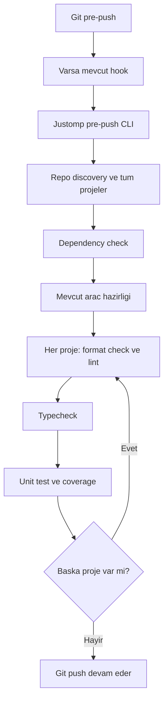

# Repository Pre-Push - Plan

## Goal Capsule

- **Objective:** Geliştirici push yaptığında repository kontrolleri otomatik çalışır; başarısız kontrol push'ı durdurur.
- **Means:** Repo seviyesinde Git pre-push hook'u, bağımsız Bun CLI ve mevcut Justomp servisleri (KTD1–KTD4).
- **Authority:** Product Contract davranışı, Planning Contract uygulama tercihlerini belirler.
- **Execution profile:** Mevcut Justomp repository'si; Python, JS/TS ve Go; macOS ve Linux.
- **Stop conditions:** Bu belge planlama çıktısıdır. Üretim kodu değişikliği, commit ve yayın ayrıca yetkilendirilir.

---

## Product Contract

### Summary

Pre-push, mevcut çalışma klasöründe repo genelinin lock tutarlılığı, format, lint, typecheck ve coverage'lı unit test kontrollerini çalıştırır.
Kontroller mevcut servisleri kullanır; başarısız veya tamamlanmamış sonuç push'ı durdurur.

### Problem Frame

Justomp bu kontrolleri ayrı servisler halinde sunuyor; mevcut pre-commit ise otomatik düzeltme yapıyor ve test çalıştırmıyor.
Geliştiricinin push öncesinde kontrol servislerini tek tek çağırması gerekiyor.
Python template'in repo genelinde çalışan pre-push yaklaşımı bu ihtiyacı karşılayan kapsam örneğidir.

### Key Decisions

- **Kontrol listesi:** R1–R3'ü yönetir. (session-settled: user-directed — chosen over yalnız unit veya entegrasyon eklenmiş gate: son seçim lock, format, lint, typecheck ve coverage'lı unit testtir.)
- **Sade çalışma ağacı yaklaşımı:** R4–R5'i yönetir. (session-settled: user-approved — chosen over ek Git kısıtları ve ayrı çalışma kopyası: Python template benzeri kontrol hook'u yeterlidir.)
- **Otomatik düzeltme yok:** R6'yı yönetir. (session-settled: user-approved — chosen over pre-commit düzeltme akışını yeniden çalıştırma: pre-push kontrol aşamasıdır.)

### Requirements

**Kontroller**

- R1. Keşfedilen Python, JS/TS ve Go projelerinde mevcut dependency sync check davranışıyla manifest/lock tutarlılığı kontrol edilir; bu kontrolün gerektirdiği kurulum engellenmez.
- R2. Her projenin mevcut kapsamıyla format kontrolü, lint ve typecheck çalışır; başka bir lint veya typecheck kural kümesi oluşturulmaz.
- R3. Her projenin tam unit test kapsamı çalışır ve mevcut ortak config'teki coverage politikası uygulanır; varsayılan açık ve minimum %70'tir, kullanıcının override'ı korunur.

**Kapsam ve sonuç**

- R4. Kontroller Git repository kökündeki mevcut çalışma ağacında, inspection kurallarıyla bulunan bütün projeler üzerinde çalışır; push edilen commit/ref üzerinden proje seçimi yapılmaz.
- R5. Hook dirty-tree kontrolü, HEAD eşleştirmesi, diff/base hesaplama veya geçici checkout eklemez; sonuç mevcut çalışma ağacının kontrolüdür, gönderilen commit'in izole doğrulaması değildir.
- R6. Hook lint-fix, formatlama, Git staging, commit, stash veya rollback çalıştırmaz; mevcut servislerin hazırlık ve rapor/cache üretme davranışları korunur.
- R7. Başarısız, iptal edilmiş veya tamamlanmamış kontrol nonzero sonuç verir; proje ve aşama bilgisiyle neden gösterilir.

**Kurulum ve uyumluluk**

- R8. İlk uygun OMP session start repo seviyesinde pre-push hook'unu kurar; tekrar açılış idempotent olur ve hook OMP açık olmadan terminal/IDE'den çalışır.
- R9. Mevcut pre-commit ve uyumlu mevcut pre-push davranışı korunur; güvenle birleştirilemeyen hook açık kurulum hatası verir ve üzerine yazılmaz.
- R10. macOS/Linux, nested session cwd ve linked worktree desteklenir; mevcut dosya koruması zayıflatılmaz.

### Scope Boundaries

Bu plan R1–R10 ile sınırlıdır.
Önceki tartışmadaki etkilenen proje grafiği, ilk push için base bulma, dirty-tree/HEAD kısıtları ve test sonrası Git drift engeli aktif gereksinim değildir; sade kapsam bunların yerini alır.

Entegrasyon testleri ve doküman build'i runtime pre-push'a eklenmez.
Yeni `repo_push` agent tool'u, yeni push yetkilendirme akışı, CI workflow'u ve release sistemi bu işin parçası değildir.
Hook komutları çalıştırır; başarılı kontrolden sonra push'ı Git sürdürür.
Git'in hook bypass mekanizmalarını kapatan bir güvenlik katmanı veya doğrulanmış commit sertifikası tasarlanmaz.

### Acceptance Examples

| ID | Covers | Beklenen davranış |
|---|---|---|
| AE1 | R1–R4 | Python API ve TS web bulunan repoda yalnız API dosyası değişse de iki projenin kontrolleri çalışır. |
| AE2 | R1, R7 | Manifest/lock tutarsızsa hazırlık lock'u düzeltmeden gate başarısız olur. |
| AE3 | R2, R6–R7 | Format bozukluğu push'ı durdurur; dosya otomatik formatlanmaz veya stage edilmez. |
| AE4 | R3, R7 | Unit testler geçse bile etkin coverage eşiği sağlanmazsa push durur. |
| AE5 | R5–R6 | Commit edilmemiş değişiklik tek başına ret sebebi değildir; çalışma ağacındaki içerik test edilir. |
| AE6 | R8–R9 | Mevcut executable pre-push önce bir kez çalışır; başarısızsa Justomp kontrolleri başlamaz. |
| AE7 | R7, R10 | Kontrol sırasında iptal alt süreçlere taşınır; tamamlanmamış sonuç başarı olarak sunulmaz. |

---

## Planning Contract

### Existing Evidence

- `src/precommit/install.ts`: repo-owned launcher, orijinal hook yedeği, sahiplik kaydı, idempotence ve çakışma davranışı zaten var.
- `src/precommit/git.ts` ve `src/packaging/invocation.ts`: Git kökü/worktree çözümleme ve gitlink kapsamını normal inspection state'ini değiştirmeden uygulama örneği var.
- `src/lint/service.ts`: `checkProjectLint` kaynak dosyaları için format kontrolü içerir; `src/lint/scope.ts` filtreleri TOML, JSON, Markdown ve diğer formatter dosyalarını kapsamaz. Tam format kontrolü için `src/format/scope.ts` ve `src/format/selection.ts` kapsamı kullanılmalıdır.
- `src/typecheck/service.ts`: check-only mod tip üretmez; mevcut prepare modu Next/local declaration hazırlığını korur.
- `src/testing/service.ts`: `testProject`, tam unit koşusu ve coverage sonucunu mevcut preparation akışıyla sağlar; internal `runTestTarget` hazırlanmış ortamı kullanabilir.
- `src/precommit/operations.ts`: dependency kontrolü ve servis sonuçlarını aktarma örneği var; pre-commit pipeline'ı fix/staging içerdiği için pre-push'tan bütünüyle çağrılmaz.

### Key Technical Decisions

- KTD1. **Ayrı küçük pre-push orchestration.** `src/prepush/` altında service, operations, model ve CLI bulunur. Hook içinde agent tool dispatcher kullanılmaz; mevcut domain servisleri doğrudan çağrılır. Pre-commit ile ortaklaştırma yalnız Git/installer yardımcısı seviyesinde kalır. Governs R1–R8.
- KTD2. **Lock kontrolü hazırlıktan önce.** Önce bütün projelerin R1 kontrolü tamamlanır; hata varsa hiçbir lint/typecheck/test hazırlığı başlatılmaz. Mevcut pre-commit dependency-scope anahtarı yaklaşımı yeniden kullanılır: uv/npm/yarn/bun ortak managerRoot bir kez, pnpm ve Go mevcut proje kapsamıyla ayrı kontrol edilir. Normal sync ile otomatik onarma fallback'i yoktur. Governs R1, R7.
- KTD3. **Mevcut hazırlık ve check yolları.** Lock aşamasından sonra config completion ve lint/typecheck/test araç hazırlığı repo başına bir kez yapılır. Ardından proje başına format kontrolü, check-only lint, gerekli tip üretimini koruyan typecheck ve tam unit test çalışır. Format kontrolü mevcut `collectFormatScope`, formatter seçimi ve `format.include/exclude` ayarlarını kullanır. Bunun için format servislerine internal, yazmayan bir check yolu eklenir: bundled dosyalarda mevcut `checkPrettier`, Python/Go dosyalarında native check/diff veya yazmadan üretilen çıktı karşılaştırması kullanılır. Yazıp geri alma uygulanmaz; yeni agent tool veya config eklenmez. Test isteği `test_files` içermez; mevcut timeout varsayılanı ve coverage çözümleyicisi kullanılır. Hazırlık raporları ve değişiklikleri sonuçta görünür kalır; yeni Git baseline/drift/staging mekanizması eklenmez. Governs R2–R7.
- KTD4. **İki hook için dar installer paylaşımı.** Mevcut installer'ın yalnız hook adı, launcher yolu ve sabit marker'ı parametrelenir; public `installPrecommit` davranışı korunur ve `installPrepush` eklenir. Pre-push'ın iki Git argümanı ve stdin'i orijinal hook'a aynen ulaşır. Justomp ref seçimi yapmadığından kalan stdin tüketilip atılır; ref parser, stdin replay deposu veya remote fetch gerekmez. CLI no-argument gate olarak çalışır. Governs R8–R10. [Git hook sözleşmesi](https://git-scm.com/docs/githooks#_pre_push).
- KTD5. **Basit sonuç ve sıra.** Projeler kararlı sırayla, kontroller sıralı çalışır; ilk başarısız/incomplete aşamada durulur. Sonuç mevcut kalıba göre success/complete/cancelled, proje listesi, aşama detayları ve errors içerir. CLI exit 0 başarı, 1 tamamlanmış kontrol hatası, 2 incomplete/altyapı hatasıdır. Hiç proje bulunmaması açık bir no-project sonucu olarak başarıdır; eksik inspection başarı sayılmaz. Governs R7.
- KTD6. **Git repository sınırı korunur.** R4 için staged dosya listesi değil tam inspection kullanılır. Pre-commit'in gitlink exclusion ve native workspace üyeliği kontrolleri yeniden kullanılır; submodule'u parent proje gibi hazırlamak yerine mevcut sınır korunur. Yeni Git değişiklik analizi yapılmaz. Governs R4, R10.

### High-Level Technical Design

KTD5 uyarınca her başarısız aşama akışı nonzero sonuçla sonlandırır.
Bu akış servis bağlantılarını ve çalışma sırasını gösterir; yeni kontrol motoru tanımlamaz.

### Assumptions and Limits

- Repo geneli seçim ve otomatik session kurulumu, sade Python template yaklaşımının mevcut Justomp mimarisine uygulanmasıdır.
- R6 tam filesystem salt-okunurluk iddiası değildir: native manager kurulumları, config projection, tip dosyaları, test çıktıları ve mevcut hazırlık manifest/lock güncellemeleri olabilir. Hook bunları otomatik stage etmez ve sırf dosya değişti diye yeni bir push engeli eklemez.
- OMP'nin korumalı bash'inden başlayan Git ve hook aynı sandbox sınırında kalır. Gerekli native yazımlar engellenirse mevcut hata görünür olur; terminal/IDE girişi desteklenir. Bu plan `repo_commit` yetkisini push'a genişletmez.
- Test bulunamaması, unsupported runner ve coverage kullanılamaması mevcut test servisinin başarısızlık kurallarını korur; hook'a özel skip/başarı istisnası eklenmez.

---

## Implementation Units

### U1. Repository check service

**Goal:** R1–R7 ve R10 için mevcut servisleri doğru sırayla çağıran küçük gate oluşturmak.

**Dependencies:** Yok.

**Files:** `src/prepush/model.ts`, `src/prepush/operations.ts`, `src/prepush/service.ts`, `src/format/check.ts`, gerekli `src/format/engines/` check yolları; gerektiği kadar `src/precommit/operations.ts`, `src/precommit/git.ts`, `src/precommit/workspace.ts`; `tests/unit/prepush/service.test.ts`, `tests/unit/prepush/operations.test.ts`, `tests/unit/format/check.test.ts`.

**Approach:**

1. KTD1/KTD6 ile Git kökü ve bütün proje kimliklerini çöz; domain servislerinin mevcut ownership kurallarını kullan.
2. KTD2/KTD3 sırasını boundary port'larıyla uygula; hazırlık sonucunu paylaş ve aynı setup'ı her projede yeniden başlatma.
3. KTD3 format check yolunda mevcut dosya seçimi ve format ayarlarını paylaş; formatter kapsamını lint dosya filtresine daraltma.
4. KTD5 sonucuna native hataları, hazırlık etkilerini ve coverage sonucunu kaybetmeden aktar.

**Patterns:** `src/precommit/pipeline.ts` boundary-port testi, `src/testing/prepare.ts`, `src/testing/service.ts`, `src/typecheck/service.ts`.

**Test scenarios:**

1. Covers AE1. Supplied çoklu proje listesinde bütün projelerin doğru servislere tam kapsamla gönderilmesi.
2. Covers AE2. Başarısız dependency sonucundan sonra hiçbir prepare/fix/format/test çağrılmaması; başarılı shared scope'un bir kez kontrol edilmesi.
3. Covers AE3–AE4. Supplied format, lint, typecheck, unit ve coverage başarısızlıklarının ayrı aşama/proje bilgisiyle push gate'ini durdurması; upstream kural katalogları çalıştırılmaz.
4. Covers AE5. Gate'in Git dirty/HEAD/diff bilgisi istememesi ve hiçbir staging/fix port'u taşımaması.
5. Eksik inspection, preparation failure ve iptal sonuçlarının success olmaması; no-project sonucunun açık gösterilmesi.
6. Format check seçiminin kaynak dışı TOML/JSON/Markdown dosyalarını ve kullanıcı include/exclude ayarlarını koruması; supplied engine sonuçlarının aktarılması ve yazan engine çağrılmaması. Upstream biçim kuralları yeniden test edilmez.
7. Normal hazırlanmış projelerde yeni latest sorgusu/eşitleme dalgasının zorlanmaması; mevcut preparation sözleşmesinin korunması.

**Verification:** Karar ve hata varyantları yalnız supplied sonuçlarla kanıtlanır; unit testlerde native tool kurulmaz. (pack: testing, test-evidence-and-cost.md)

### U2. Native hook, CLI and session installation

**Goal:** R8–R10 için Git'in çağırdığı bağımsız giriş kurmak ve mevcut hook davranışlarını korumak.

**Dependencies:** U1.

**Files:** `src/prepush/cli.ts`, `src/prepush/install.ts`, `src/precommit/install.ts`, sınırlı paylaşım için `src/git-hooks/install.ts`, `src/omp/extension.ts`, `package.json`; `tests/integration/prepush/install.test.ts`, `tests/integration/prepush/cli.test.ts`, mevcut `tests/integration/precommit/install.test.ts`, `tests/integration/omp/extension.test.ts`.

**Approach:**

1. KTD4'e göre installer'ı dar biçimde paylaş; eski pre-commit marker/record/backup uyumluluğunu koru.
2. `justomp-prepush` executable'ını paketle; CLI KTD5 sonuçlarını stdout JSON ve stderr aşama özetiyle verir, sinyali mevcut process runner'a taşır.
3. Session lifecycle'da iki hook'un kurulum sonuçlarını ayrı bildir; birinin conflict'i diğerinin sonucunu gizlemesin. Yeni agent tool veya global hook ayarı ekleme.

**Test scenarios:**

1. Covers AE6. Gerçek Git fixture'ında orijinal hook remote argümanlarını ve stdin byte'larını bir kez alır; nonzero sonucu Justomp aşamasını engeller.
2. Aynı fixture'da tekrar kurulum ready olur; pre-commit ve pre-push backup/ownership dosyaları birbirine karışmaz. Düzenlenmiş veya dışarıdan yönetilen hook overwrite edilmez.
3. Gerçek CLI git dışı dizinde açık hata verir; nested cwd repository köküne çözülür. Ref girdisi seçime dönüşmez ve CLI bir push çağrısında bir gate çalıştırır.
4. Session tekrar açılışı ve shutdown, mevcut installation lifecycle örneğiyle doğrulanır; OMP'nin tool listesine yeni push tool'u eklenmediği korunur.

**Verification:** Pre-commit'in mevcut installer ve commit-tool regresyonları geçer; yeni giriş standalone Bun ile yüklenir.

### U3. Native push proof and documentation

**Goal:** Gerçek hook → CLI → servis sınırını kanıtlamak ve sade çalışma ağacı davranışını belgelemek.

**Requirements:** R1–R10.

**Dependencies:** U1, U2.

**Files:** `tests/integration/prepush/flow.test.ts`, mevcut `tests/integration/precommit/native.test.ts` ile paylaşılabilen fixture, `tests/fixtures/typecheck/python/fixture.ts`, `tests/integration/omp/installed-smoke.native.test.ts`, `docs/prepush.md`, `docs/precommit.md`, `docs/protection.md`, `README.md`, `package.json`.

**Approach:**

1. Tek küçük Python projesi ve yerel bare Git remote ile gerçek native success/failure aktarımını kanıtla. Aynı hazırlığı kullan; her hata türü için ayrı ortam veya package-manager matrisi kurma.
2. Mevcut installed-package smoke içinde yeni CLI/bin ve doküman kaynağını doğrula.
3. README'deki eski “No Git hooks are installed” ifadesini düzelt; pre-commit düzeltme ile pre-push kontrol farkını, R5/R6 sınırını ve OMP sandbox davranışını açıkla.

**Test scenarios:**

1. Gerçek native gate başarılıyken yerel remote ref güncellenir; aynı fixture'da bir unit test başarısızken push nonzero döner ve remote ref değişmez.
2. Aynı hazırlanmış fixture’da format check, formatter kapsamındaki bir metadata dosyası için başarısız sonuç döndürür ve dosyanın byte içeriği değişmez; native bağlantı kanıtı kural matrisi kurmaz.
3. Covers AE7. Git/hook child-process iptali ve child cleanup mevcut cancellation fixture yaklaşımıyla kanıtlanır; yeni native kurulum gerektirmez.
4. Linked worktree çözümlemesi ve pre-push argv/stdin aktarımı küçük Git fixture'larıyla kanıtlanır; source/lock/coverage kural matrisi tekrarlanmaz.
5. Paketlenmiş CLI OMP session açılmadan yüklenir; çalışma için yalnız checkout'a ait tesadüfi importlara bağımlı değildir.

**Verification:** Native hook sınırları macOS ve Linux'ta doğrulanır. Yeni pahalı fixture'ın setup/run/cleanup süreleri ayrılır. (pack: testing, test-evidence-and-cost.md)

---

## Verification Contract

Geliştirmede yalnız ilgili tests/unit/prepush ve tests/integration/prepush senaryoları çalıştırılır.
Justomp'ın tam geliştirme gate'i `bun run check` ile `bun run test:integration` komutlarının birer başarılı geçişidir; örtüşen feature alias'ları birleştirilmez.
Bu, Justomp implementasyonunun doğrulamasıdır; kullanıcı reposundaki runtime pre-push'ın R1–R3 kapsamını genişletmez.

Yeni native kanıt bir manager/linter/typechecker/runner matrisi değildir.
Sıra, fail-fast, coverage sonuç aktarımı ve error varyantları unit; Git hook invocation, gerçek servis bağlantısı, kurulum yayınlama ve süreç iptali integration kapsamıdır. (pack: testing, test-evidence-and-cost.md)

Warm tam gate için mevcut 300 saniye ve eşleşen başarılı baseline'a göre %60 azalma hedefi raporlanır.
Önceki 307 saniyelik kabul bu çalışmaya otomatik taşınmaz; hedef kaçarsa kalan maliyet ve kullanıcı kararı görünür olur.
Test skip, worker artırma veya ölçümden pahalı test çıkarma ile hedef sağlanmış gösterilmez. (pack: testing, test-evidence-and-cost.md)

---

## Definition of Done

- R1–R10 ve U1–U3 davranışları kod ve testlerle karşılanır.
- Native hook hatası yerel remote'a push'ı gerçekten engeller; başarı remote ref'i ilerletir.
- Pre-commit düzeltme/staging davranışı değişmez; pre-push aynı pipeline'ı yanlışlıkla çağırmaz.
- macOS/Linux doğrulaması ve test maliyeti raporlanır.
- Doküman, çalışma ağacı kontrolünü gönderilen commit'in doğrulaması gibi sunmaz.
- Prototip, terk edilmiş helper ve kapsam dışı Git guard mekanizması final diff'te kalmaz.

---

## Sources

- `src/precommit/`, `src/omp/extension.ts`: mevcut hook kurulum ve lifecycle örnekleri.
- `src/lint/service.ts`, `src/typecheck/service.ts`, `src/testing/service.ts`, `src/testing/prepare.ts`, `src/dependencies/service.ts`: mevcut kontrol ve hazırlık sözleşmeleri.
- `docs/precommit.md`, `docs/protection.md`: hook ve sandbox sınırları.
- [Git pre-push documentation](https://git-scm.com/docs/githooks#_pre_push): argüman, stdin ve nonzero çıkış sözleşmesi.
