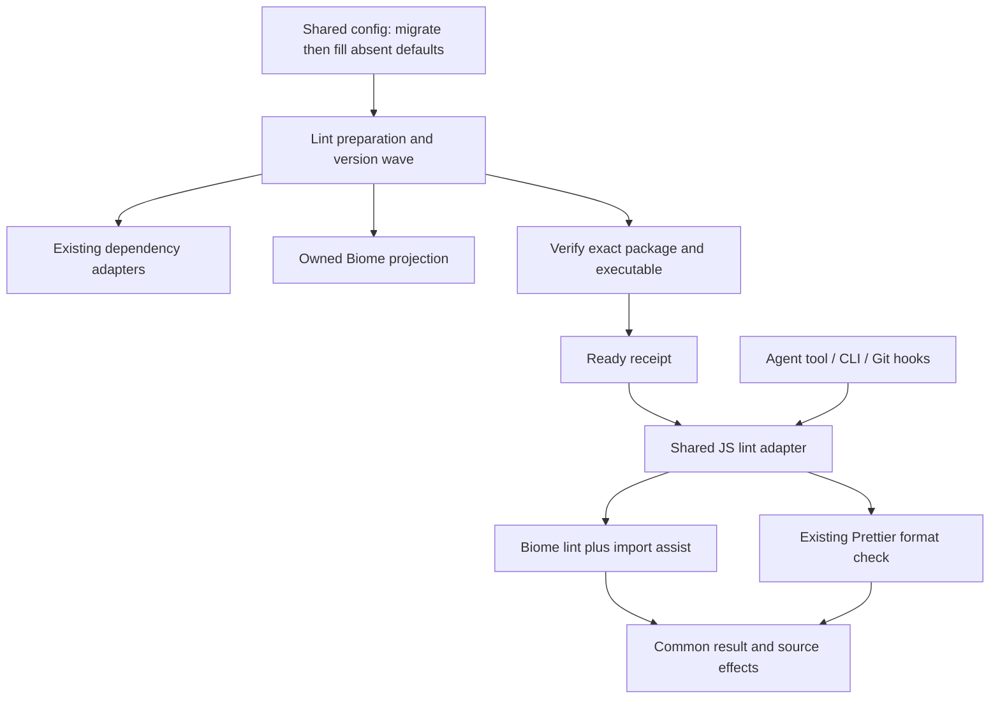
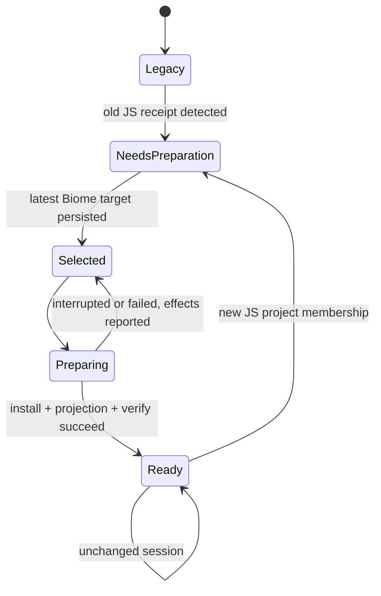

# Managed JavaScript Lint with Biome - Plan

## Goal Capsule

- Objective: Developers can lint and safely fix Justomp-managed JavaScript/TypeScript projects, including the current TypeScript 7 repository, without the typescript-eslint compiler API dependency.
- Means: Replace the managed ESLint engine with Biome (R1, KTD1).
- Authority: The user's explicit Biome replacement decision governs the engine choice; existing config, project ownership, safe-fix, preparation and reporting contracts remain in force.
- Execution profile: Plan only until implementation is authorized. Implement on a feature branch; publishing and merging remain user decisions.
- Stop conditions: A native limitation that prevents project isolation or safe-only writes is a blocker. Missing ESLint-equivalent rules are a documented policy difference, not a reason to reinstall ESLint or downgrade TypeScript.
- Completion owner: The implementer completes the verification contract and reports the remaining compatibility differences. CI and completing Justomp's own self-management are subsequent work.

---

## Product Contract

### Summary

All JavaScript and TypeScript projects managed by the extension use Biome for linting and safe fixes through the existing tools, CLI and Git hooks.
The transition covers existing configuration and preparation state as well as newly discovered projects.

### Problem Frame

Justomp currently installs ESLint and framework/type-analysis plugins into consumer projects.
The current repository uses TypeScript 7.0.2, while the selected typescript-eslint dependency supports TypeScript below 6.1.0.
Preparation rejects this combination before changing dependencies.
Justomp's own existing Biome-based check script does not prove that the extension uses Biome; those are separate execution paths today.

The user chose to replace the managed lint engine after discussing compiler independence and differences in rule coverage.
This removes the particular compiler API coupling; it does not promise support for every future TypeScript syntax feature or identical ESLint diagnostics.

### Key Decisions

- Biome replaces ESLint for managed JS/TS linting (session-settled: user-directed — chosen over retaining ESLint with a separate TypeScript 6 API installation: use a compiler-independent lint engine). Governs R1, R5.
- Keep the existing latest-and-align lifecycle (session-settled: user-directed — chosen over retaining old versions for newly discovered projects: new projects select latest and existing consumers align). Governs R4.
- Safe fixes only (session-settled: user-approved — chosen over unrestricted autofix: automatic edits must use the native tool's safe classification). Governs R3.

### Requirements

**Engine and public behavior**

- R1. Biome is the sole Justomp-managed lint engine for JavaScript, TypeScript, JSX and TSX projects, including React/Next.js projects. No ESLint fallback, dual-engine mode, compiler downgrade or lint-time TypeScript installation.
- R2. Keep `project_lint` input `{ project_id, fix? }` and the existing result envelope. CLI, session preparation, pre-commit and pre-push use the same service. Report `biome` and its actual selected version; format checks remain a separate reported stage.
- R3. Default lint execution does not change sources. `fix:true` applies safe lint fixes and the configured safe import-organizing assist, then performs the normal final checks. Preserve observed changed files, cancellation and partial-change reporting; never invoke unsafe fixes or silently promote their safety.
- R4. Install `@biomejs/biome` as an exact development dependency through the existing package-manager adapters. A newly discovered JS/TS project selects current stable latest and aligns all managed JS/TS projects to that version. Ordinary restarts reuse valid prepared state; interrupted attempts reuse their persisted selected version.
- R5. Ship an explicit strict Biome rule snapshot and a per-rule ESLint migration inventory. Preserve supported intent and documented settings where available; document differences and gaps rather than implementing replacement rules or claiming full parity.

**Configuration and migration**

- R6. `.justomp/config.json` remains the authority. New Biome settings live under `lint.javascript.biome`; every field remains optional. Flush only absent attributes, preserve supplied values and intentionally empty rule maps/arrays, and retain unrelated config fields.
- R7. Automatically migrate the shipped legacy ESLint policy and safely translatable custom settings. Explicit native Biome settings win over translated legacy values. If a customized legacy setting cannot be translated without guessing, preserve its original data and return an actionable configuration migration error identifying the path and required edit; do not treat the known gaps in the shipped default policy as such an error.
- R8. Old ESLint readiness must never satisfy Biome readiness. Retry partially completed migration without reinstalling ESLint or refreshing an already selected Biome version. Preserve Python/Go state and report metadata changes actually made.
- R9. Use a dedicated owned Biome projection with an explicit native config path. Preserve user-owned `biome.json`, `biome.jsonc`, `eslint.config.*` and scripts. Retire the old Justomp-generated ESLint projection only when its marker proves ownership. Do not remove dependency declarations on the assumption that a receipt proves who installed them.

**Boundaries and verification**

- R10. Existing selected-project file scope, child-project exclusions and repository containment govern both checks and writes. Generated Biome config joins the existing protected-path and internal-file rules, including before it exists.
- R11. Report source violations separately from setup/configuration/process failures. Malformed or truncated diagnostic output, cancellation, missing binaries, invalid config and incomplete traversal cannot produce a successful complete result.
- R12. Keep Prettier formatting, Python/Go tooling, typecheck, dependency manager selection and Git hook sequencing unchanged. Verify the migration on macOS and Linux using tests of Justomp's orchestration and boundaries, not catalogues of upstream Biome rule semantics.

### Acceptance Examples

- AE1. A TypeScript 7 project is prepared, receives Biome, and produces a normal lint result without typescript-eslint or a compiler-version peer check. Covers R1, R2, R4.
- AE2. Adding a second JS project selects latest Biome and aligns the existing project; reopening the same unchanged repository does not query latest again. Covers R4, R8.
- AE3. A repository with only the previously flushed default ESLint policy upgrades automatically. A user-modified rule with no sound mapping is preserved and named in a migration error instead of being silently discarded. Covers R6, R7.
- AE4. A safe fix affects only owned source files in the chosen project. Prettier formatting differences remain visible in the separate format check. Covers R3, R10, R12.
- AE5. An ancestor or sibling Biome config cannot weaken the managed check; a failed config load is incomplete rather than a passed lint result. Covers R9, R10, R11.

### Scope Boundaries

This plan changes the managed JS/TS lint engine and the integration points required by R1–R12.
It does not add a new agent tool, a linter selector, custom Biome plugins, automatic conversion of arbitrary executable ESLint configurations, or a dual TypeScript installation.
It does not remove user package declarations or rewrite user scripts merely because they mention ESLint: current receipts do not establish ownership.
No new sandbox or protection mechanism is needed; the existing path collector gains the new projection.

#### Deferred to Follow-Up Work

Completing self-management of the Justomp repository and designing its CI remain separate tasks.
Replacing Prettier as the formatter is outside this linter migration; the current formatting contract already works and has a different supported-file surface.

---

## Planning Contract

### Current Code and Patterns

| Responsibility | Existing implementation | Consequence |
| --- | --- | --- |
| Defaults and config | `src/config/lint/javascript/defaults.ts`, `src/config/lint/model.ts`, `src/config/lint/resolve.ts`, `src/config/load.ts` | Add native Biome data semantics and migration before the existing flush; avoid ESLint severity tuples in the new model. |
| Latest resolution and preparation | `src/lint/javascript/resolve.ts`, `src/lint/javascript/tools.ts`, `src/lint/prepare.ts`, `src/lint/state.ts` | Keep waves/leases, replace required package set, invalidate legacy readiness. |
| Native execution | `src/lint/adapters/javascript.ts`, `src/lint/javascript/native.ts` | Reuse package-manager-aware executable loading and process ownership. |
| Projection | `src/lint/projection.ts`, `src/lint/projections/javascript.ts`, `src/lint/files.ts` | Reuse compare-before-publish/ownership checks; add JSONC projection handling if needed. |
| Fix accounting | `src/lint/fix.ts`, `src/lint/service.ts`, `src/lint/result.ts` | Replace hard-coded engine/version lookup without changing public result meaning. |
| Shared consumers | `src/omp/lint-tools.ts`, `src/precommit/operations.ts`, `src/prepush/operations.ts`, `src/format/service.ts` | Switch engine through the common service, not separate hook implementations. |
| Scope and protection | `src/inspect/exclusions.ts`, `src/packaging/file-scope.ts`, `src/protection/paths.ts` | Keep generated files out of inspection loops and protected from general tools. |

### Key Technical Decisions

- KTD1. Keep the JavaScript adapter boundary and replace its implementation. The required native package set is exactly `@biomejs/biome`; the display/binary name is `biome`. Use an explicit mapping between those identities rather than indexing versions with the display name. Delete lint's dependency on `TypecheckStateStore`, TypeScript fallback installation, ESLint plugin selection and Next/plugin-major coupling. Governs R1, R2, R4.
- KTD2. Use native Biome rule groups/options as shared policy data. Recommended/domain auto-enablement stays disabled in the generated policy so installing a newer version does not silently expand the default rule set. Explicit framework-specific maps are applied only to matching React/Next targets; test overrides retain the existing test-file intent. Defaults are authored as a reviewed snapshot, not as a runtime translation of ESLint presets. Governs R5, R6.
- KTD3. Preserve import organization through Biome assists. Run the native `check` operation with formatter disabled, linter and assists enabled; only the selected organize-imports assist is enabled by default. The write variant adds safe `--write`, never `--unsafe`. This preserves import fixing while keeping Prettier the sole format engine. Reject user settings that upgrade an unsafe fix to safe for the write operation, following the existing Ruff safe-policy restriction. Specifically reject rule-level `fix: "safe"` in every active map/override, since it can promote native unsafe actions; absent, `none` and `unsafe` cannot widen native-safe execution. Read-only checking may still inspect such a policy. Governs R3, R12.
- KTD4. Generate `biome.justomp.jsonc` beside each project manifest, with a Justomp ownership comment and a schema version matching the selected engine. Pass the full config path explicitly and make it a standalone configuration; do not inherit user/ancestor config or enable a daemon. Explicitly scoped source arguments remain authoritative. Reject configuration options that redirect config discovery or permit foreign executable plugins rather than adding an unrequested plugin surface. Set Biome formatting off and disable VCS-derived narrowing; project selection belongs to Justomp. Governs R9, R10.
- KTD5. Implement pure legacy policy migration using a frozen copy of the previously shipped ESLint defaults plus a reviewed conversion table. Compare customized maps against their legacy baseline; known default gaps transition to the new baseline. Translate only supported option shapes and preserve explicit disablement. An explicit empty legacy rule map must not become the new default rule set. When `biome` already exists, honor supplied native fields and fill absent fields under R6; retain legacy data for reference but exclude it from active policy hashing. Never evaluate `eslint.config.*` or invoke an executable config migrator. Governs R6, R7.
- KTD6. Make engine migration explicit in the lint-state schema, preserving the existing legacy schema readers. Mark legacy JavaScript receipts/waves unprepared and clear their active old tool selection; keep other ecosystems intact. Persist the selected Biome wave before installation and only publish readiness after native verification and config publication. A retry keeps this wave's version. Retire owned legacy projections with compare-before-delete semantics after the new projection is successfully published. Unowned files are preserved and do not become active. Governs R8, R9.
- KTD7. Parse machine-readable Biome output in a dedicated adapter module with supplied-output unit fixtures. Normalize both `lint/...` and `assist/source/organizeImports` into the existing lint diagnostic category. Preserve native rule identity and path containment, convert locations only when reliable, and redact messages consistently. Exit code alone is insufficient: invalid configuration and process failures must remain incomplete. JSON reporter changes must fail visibly instead of treating missing fields as an empty successful report. Request uncapped native diagnostic enumeration (`--max-diagnostics=none`) while retaining the existing bounded process output; detect native skipped/truncated results and never mark them complete. Apply the same completion classifier to fix execution before the final read-only check. Governs R2, R11.
- KTD8. Reuse exact dev-dependency add/update and verification through all existing JS manager adapters. Ensure execution cannot inherit `BIOME_BINARY` or config-path overrides that substitute the selected binary/config. Check native optional-package availability and binary version; retain process-group cancellation through Biome's launcher child. Do not introduce a second installer or system-global Biome fallback. Governs R4, R11.

### Shared Policy Shape

`lint.javascript.biome` contains grouped native rule settings in `rules`, `typed_rules`, `test_rules`, `react_rules` and `next_rules`, plus `globals` and `organize_imports`.
These map names retain the current framework/test selection structure; each rule map uses Biome's group → rule → severity/options format, not ESLint identifiers or tuples.
Each supplied rule map is an atomic user value, including `{}`; only an absent map receives the corresponding default map.
`organize_imports` carries the native assist level/options; an explicit disabled value is honored.
The projection translates these fields into native `linter.rules`, ordered `overrides`, JavaScript globals and `assist.actions.source.organizeImports`.
Unknown unrelated fields remain stored for forward compatibility but are not blindly spread into executable native configuration.
This bounded shape avoids exposing arbitrary config inheritance/plugins while still allowing native rule options.

Base → typed → framework → test is the projection precedence, matching current intent.
If multiple legacy rules map to the same native setting with conflicting custom values, report that conflict under R7 rather than choosing insertion order.
ESLint global permission distinctions that Biome cannot represent are partial mappings; do not label read-only/writable equivalence as proven.

### High-Level Technical Design

### Migration and Policy Differences

The Appendix rule inventory determines the new baseline and identifies partial replacements.
An unavailable old default is not emulated, enabled as an unknown rule, or used to justify reinstalling ESLint.
TypeScript's strict typecheck continues separately; it is not advertised as a replacement for missing lint rules.

For R7, the config migration result contains the normalized policy and unresolved custom paths before any publication takes place.
On a migration error, no partial config rewrite is flushed.
The remedy names the legacy setting and directs the user to provide a Biome-native equivalent or explicitly remove that legacy customization.
Once native Biome policy is provided it is authoritative, so archived legacy keys cannot keep blocking preparation.

Existing ESLint packages may remain in manifests after migration because receipts lack install provenance.
They are neither executed nor managed by Justomp after this change.
Document this limitation and list the old package set for optional explicit dependency removal; do not remove TypeScript as a lint leftover.

### Assumptions

The requested migration is linter-only; formatter selection stays unchanged under R12.
The user chose Biome after being told that its rule coverage differs, so exact ESLint semantic parity is not an acceptance criterion.
The appendix records the actual policy change for review before implementation.

### Risks and Execution-Time Checks

| Risk | Required treatment |
| --- | --- |
| Native parser does not support a project syntax feature | Report the native error; no universal TS-version support promise and no fallback engine. |
| JSON output changes across patch versions | KTD7's classifier and one native flow must confirm the selected version's contract. |
| New default rule absent in selected Biome | Validate generated config against selected schema/native load; fail setup visibly, do not silently drop a configured rule. |
| Nested config or glob base affects file ownership | Native workspace witness must prove KTD4 with competing configs and a child project. |
| Package installation partially changes locks | Existing preparation change accounting and resumable selected wave remain authoritative. |
| Legacy user rule options lack equivalent semantics | R7 names the setting and preserves it; default-policy gaps remain documented and nonblocking. |

---

## Implementation Units

### U1. Define Biome policy and migrate shared configuration

**Goal:** Produce an authoritative native Biome policy for fresh and existing installations.
**Requirements:** R5–R7; AE3. **Dependencies:** None.
**Files:** Modify `src/config/lint/model.ts`, `src/config/lint/javascript/defaults.ts`, `src/config/lint/resolve.ts`, `src/config/load.ts`; add `src/config/lint/javascript/migrate.ts` and a narrowly scoped legacy defaults snapshot. Update `tests/unit/config/lint.test.ts`, `tests/unit/lint/javascript-policy.test.ts`, `tests/unit/config/format.test.ts` and `tests/unit/config/documentation.test.ts`.
**Approach:** Implement KTD2/KTD5 as pure transformations. Define rule-map atomicity explicitly at each user-keyed map; arrays are replacements, not concatenations. Add an optional settings field only where the Biome native schema calls for it; do not carry ESLint tuple validation forward. Keep format compatibility in `src/config/load.ts` intact.
**Test scenarios:**

1. Missing config flushes all new defaults; partially supplied native config fills absent fields and preserves supplied false/empty values.
2. The frozen shipped ESLint config migrates without a custom-setting error, including defaults whose new policy omits unsupported rules.
3. Exact custom mapping and explicit disabled rules produce the intended native values; unknown or unsupported custom options produce named migration errors without a write.
4. Existing native Biome maps win over conflicting legacy data; unrelated config and Prettier settings survive.
5. Repeated resolve/flush is idempotent; policy hashing depends on effective Biome data, not inactive legacy fields.

**Verification:** Data-level tests demonstrate configuration ownership and migration. No native linter is needed for the mapping permutations.

### U2. Replace managed package selection and readiness state

**Goal:** Prepare one exact Biome version across managed JS/TS projects without TypeScript coupling.
**Requirements:** R1, R4, R8; AE1, AE2. **Dependencies:** U1.
**Files:** `src/lint/javascript/tools.ts`, `src/lint/javascript/resolve.ts`, `src/lint/javascript/compatibility.ts`, `src/lint/adapters/javascript.ts`, `src/lint/state.ts`, `src/lint/prepare.ts`; tests `tests/unit/lint/javascript-selection.test.ts`, `javascript-compatibility.test.ts`, `state.test.ts`, `tests/unit/checks/javascript-preparation.test.ts`.
**Approach:** Implement KTD1/KTD6/KTD8 through existing waves and dependency adapter requests. Before removing helpers, inspect all callers. Filter old tool sets during state migration, not merely when displaying a report. Do not reset completed Python/Go preparation or TypeScript's separate typecheck state.
**Test scenarios:**

1. A new TS7 project requests only exact `@biomejs/biome` in the dev group for each supported manager; existing app TypeScript/Next versions are not changed.
2. New project membership resolves latest once per wave and aligns existing consumers; an unchanged session performs no latest refresh.
3. Legacy schema1/schema2 JS state cannot be reused as ready or cause ESLint reinstall; Python/Go receipts remain valid.
4. Partial native installation reports actual metadata effects and retries the same persisted version.
5. Conflicting declarations, missing native package, wrong executable version and cancellation are handled by supplied adapter/process results.

**Verification:** Existing adapter unit matrix proves request semantics without installing Biome separately for every manager.

### U3. Publish and protect isolated Biome configuration

**Goal:** Apply the shared policy to each selected project with existing ownership guarantees.
**Requirements:** R9, R10; AE5. **Dependencies:** U1, U2.
**Files:** `src/lint/projections/javascript.ts`, `src/lint/projection.ts`, `src/lint/files.ts`, `src/format/readiness.ts`, `src/inspect/exclusions.ts`, `src/protection/paths.ts`; tests `tests/unit/lint/javascript-projection.test.ts`, `projection.test.ts`, `scope.test.ts`, `tests/unit/protection/paths.test.ts`, `tests/integration/lint/projection.test.ts`.
**Approach:** Implement KTD4/KTD6. Project only the appropriate base, TypeScript, framework and test sections. Keep the existing Prettier projection. Ensure the JSONC semantic comparison accepts harmless formatting of the owned marker/config. Source traversal and generated-file exclusion must agree about the new path.
**Test scenarios:**

1. Each project receives isolated config with correct relative scope and framework/test overrides; plain JS projects do not acquire Next-specific checks.
2. Formatter and unrelated assists stay disabled; a supplied native policy cannot redirect config lookup or broaden the Justomp file arguments.
3. An existing unmanaged file at the managed projection path yields an ownership conflict; ordinary user Biome configs are preserved.
4. Real filesystem publication preserves compare-before-write semantics; owned old ESLint config retires only after successful replacement, while an unowned legacy file remains untouched.
5. The new projection is protected before creation and excluded from inspection/watch refresh loops; nested project source is not selected by its parent.

**Verification:** One focused filesystem migration flow proves publication/deletion. Pure rendered-data and path-policy branches stay unit tests.

### U4. Run checks and safe fixes with accurate Biome results

**Goal:** Replace the native diagnostic/fix handoff while preserving public service semantics.
**Requirements:** R2, R3, R10, R11, R12; AE4. **Dependencies:** U2, U3.
**Files:** `src/lint/adapters/javascript.ts`, `src/lint/javascript/native.ts`, `src/lint/fix.ts`, `src/lint/service.ts`, `src/lint/result.ts`; add `src/lint/javascript/result.ts`; retire `src/lint/javascript/formatter.cjs`. Tests `tests/unit/checks/lint-outcomes.test.ts`, `tests/unit/lint/fix.test.ts`, `fix-service.test.ts`, `result.test.ts`, `tool-cancellation.test.ts`.
**Approach:** Implement KTD3/KTD7. Use the existing managed process runner and selected package resolution. Keep the final check after safe writes and the independent Prettier result. Do not equate any exit1 with a successfully completed fix. Map native byte spans to source positions only when available and correct for non-ASCII source; missing location is preferable to a fabricated line.
**Test scenarios:**

1. Normal and fix argument vectors use explicit config/file scope, formatter off, import assist enabled and no unsafe write option.
2. Supplied successful, lint-violating and import-assist outputs produce correct diagnostic kind, rule, severity, version and repository/project paths.
3. Malformed JSON, unknown required report shape, config/load errors, cancellation and output truncation are incomplete failures, not empty success.
4. Safe-only override validation rejects unsafe promotion for `fix:true`; read-only behavior remains available.
5. Changed files and partial writes remain visible after a failed/cancelled fix; the final lint/format checks determine post-fix status.
6. Path escapes and inaccurate/unavailable source spans are not emitted as trusted project locations.

**Verification:** Supply process outputs and snapshots for permutations; reuse existing source observation/termination integration evidence where the runner is unchanged.

### U5. Reconnect all consumers and prove native boundaries

**Goal:** Show that agent, CLI and Git hook users reach the new engine and that supported native layouts work.
**Requirements:** R1–R4, R9–R12; AE1, AE4, AE5. **Dependencies:** U1–U4.
**Files:** `src/omp/lint-tools.ts`, relevant hard-coded labels in `src/lint/service.ts`, existing shared `src/precommit/operations.ts`, `src/prepush/operations.ts`, `src/format/service.ts`; tests `tests/integration/lint/javascript.native.test.ts`, `javascript-outcomes.native.test.ts`, `javascript-fixture.ts`, `tests/fixtures/lint/javascript/fixture.ts`, `versions.ts`, `tests/integration/omp/lint.test.ts`, `tests/unit/precommit/pipeline.test.ts`, `tests/unit/prepush/operations.test.ts`, `tests/unit/format/prepare-scope.test.ts`.
**Approach:** Replace ESLint expectations in existing lifecycles rather than adding a parallel suite. Keep node_modules, Yarn PnP and custom pnpm module/lock layouts as distinct boundaries. One native witness exercises diagnostic handoff and safe write/import assist with formatting disabled. Use TS7 in the normal JS fixture to prove there is no hidden compiler-peer dependency. Keep process ownership through the native wrapper on macOS and Linux.
**Test scenarios:**

1. Discover → install → project config → run → report succeeds and reports a tiny source violation through the package-local Biome binary.
2. Safe write changes the intended source/import order, leaves another project untouched and still reports a separate Prettier check.
3. A competing root/nested user Biome config does not replace the managed policy; PnP and custom pnpm layouts resolve the selected native package.
4. A cancelled native invocation reaps the launched process tree using existing cancellation evidence/harness; inherited binary overrides cannot substitute a different executable.
5. Existing agent schema, approval behavior and CLI/hook service routing remain intact. Pre-commit fixes and pre-push only checks; no second native install matrix through those entrypoints.

**Verification:** Retain concrete macOS and Linux evidence. Unsupported test hosts are reported as unavailable rather than counted as a pass.

### U6. Publish the new policy contract and remove obsolete engine code

**Goal:** Leave one coherent managed lint implementation and discoverable migration guidance.
**Requirements:** R1, R5, R7, R9, R12. **Dependencies:** U1–U5.
**Files:** `README.md`, `docs/lint.md`, `docs/lint-defaults.json`, `docs/protection.md`, relevant references in `docs/format.md`, `docs/precommit.md`, `docs/prepush.md`; update `tests/unit/config/documentation.test.ts` and packaged-resource checks that refer to the removed ESLint formatter.
**Approach:** Document new config, reported tool/version, default rule differences, custom-policy migration errors and non-removal of unowned dependencies. Remove unused ESLint/plugin/compiler compatibility helpers after caller inspection. Keep historical plans intact. Do not switch this repo's entire development workflow or install consumer config as a side effect of writing documentation.
**Test scenarios:**

1. Documented defaults match executable defaults and contain no active ESLint configuration.
2. Published resources/entrypoints no longer depend on the retired ESLint reporter file.
3. Search of active managed JS lint paths finds no ESLint execution, installation request or TypeScript fallback dependency; historical migration fixtures/docs may retain names.

**Verification:** Documentation consistency and existing packaging checks pass; no new native integration scenario is justified for wording changes.

---

## Verification Contract

Apply `compound-packs/testing/test-evidence-and-cost.md` (pack: testing) to all additions and removals.
Assert configuration as data; do not test Biome's rule semantics or TypeScript's language behavior.
Every removed ESLint case is classified as obsolete engine-specific behavior, upstream-only behavior, or Justomp behavior with a named replacement.
Reuse immutable downloads while isolating mutable fixture roots, manifests, locks, receipts and processes.

| Gate | Evidence |
| --- | --- |
| Focused units | U1–U4 configuration/migration/selection/report/fix scenarios using supplied boundary values. |
| Existing native lifecycles | U3/U5 real config publication and executable loading in node_modules, PnP and custom pnpm layouts. |
| macOS and Linux | Same managed Biome flow and existing protection/cancellation boundaries; no Windows scope. |
| `bun run check` | Existing repository type/format/lint/unit gate after implementation. |
| `bun run test:integration` | One complete traversal; do not concatenate overlapping feature aliases. |
| `bun run test:cost` | Can own the complete gate measurement rather than duplicating it; report warm/cold setup and cleanup separately. |

The testing pack's warm complete-gate target remains 300 seconds and at least 60% reduction against the matching historical baseline.
If retained owned evidence misses either target, report the measured residual and obtain the user's decision; earlier exceptions do not silently alter this target.
Planning does not run these gates or claim they passed.

---

## Definition of Done

- R1–R12 are implemented and supported by the named evidence.
- Fresh and previously managed JS/TS projects use Biome through all existing interfaces.
- TypeScript 7 remains available to the separate typecheck service; lint never installs an older compiler to satisfy ESLint.
- The default rule inventory records every old active rule's disposition and does not claim unsupported semantic equivalence.
- Public result behavior, safe writes, project isolation and partial failure reporting remain intact.
- Owned legacy config and obsolete engine implementation are removed; unowned files/declarations are preserved under R9.
- Documentation matches runtime configuration; no experimental migration code or abandoned alternatives remain.
- The user receives the validation results and any measured budget exception. Commit/push/merge actions follow the repository's authorization policy.

---

## Appendix

### Sources

- Existing shared lint implementation and tests named above; read on 2026-11-01.
- [Biome CLI](https://biomejs.dev/reference/cli/): check/write switches, explicit config path, reporter and error behavior.
- [Biome configuration](https://biomejs.dev/configuration/configure-biome/): root/nested config, extends, overrides and scope.
- [Biome import organization](https://biomejs.dev/assist/actions/organize-imports/javascript/): import/export assist distinct from lint rules.
- [Biome rule sources](https://biomejs.dev/linter/javascript/sources/): upstream rule correspondences; correspondence does not prove equivalent options.
- [Biome versus other tools](https://biomejs.dev/introduction/comparison-with-other-tools/): own type inference and limits of ESLint parity.
- [TypeScript support range of typescript-eslint](https://typescript-eslint.io/users/dependency-versions/): the current rejected compiler pairing.
- Locally installed Biome 2.6.3 `configuration_schema.json`: planning reference for native rule names/options; implementation selects latest per R4 rather than pinning this observed version.

### Rule Migration Inventory

The inventory below is a planning snapshot; it governs baseline intent together with KTD2 and R5.
Native rule identifiers and option availability must be revalidated against the selected exact Biome version during implementation.
No additional native test per row is required.

225 existing entries, including disabled overrides: 150 verified named counterparts, 41 partial mappings, 34 without a verified equivalent in the inspected schema. A counterpart is a mapping candidate, not a guarantee of identical semantics.

The most consequential gaps include unsafe argument/assignment/call/member-access checks, unbound methods and several Next-specific checks. The old ten-character TypeScript suppression explanation rule also has no direct equivalent.

For the new shipped baseline, enable mapped active checks at error level, including explicitly selected nursery checks; carry off entries only when they serve the applicable override. Partial mappings use native behavior and the documented option deltas, not fabricated equivalence. Use cognitive complexity limit 10 as an explicitly different metric from the old cyclomatic limit. Unsupported checks are omitted.

#### rules

| Existing rule | Biome counterpart | Classification | Notes |
|---|---|---|---|
| `constructor-super` | `correctness.noInvalidConstructorSuper` | Counterpart |  |
| `for-direction` | `correctness.useValidForDirection` | Counterpart |  |
| `getter-return` | `suspicious.useGetterReturn` | Counterpart |  |
| `no-async-promise-executor` | `suspicious.noAsyncPromiseExecutor` | Counterpart |  |
| `no-case-declarations` | `correctness.noSwitchDeclarations` | Counterpart |  |
| `no-class-assign` | `suspicious.noClassAssign` | Counterpart |  |
| `no-compare-neg-zero` | `suspicious.noCompareNegZero` | Counterpart |  |
| `no-cond-assign` | `suspicious.noAssignInExpressions` | Partial | Inspired mapping; semantics/options can differ. |
| `no-const-assign` | `correctness.noConstAssign` | Counterpart |  |
| `no-constant-binary-expression` | `suspicious.noConstantBinaryExpressions` | Counterpart |  |
| `no-constant-condition` | `correctness.noConstantCondition` | Counterpart |  |
| `no-control-regex` | `suspicious.noControlCharactersInRegex` | Counterpart |  |
| `no-debugger` | `suspicious.noDebugger` | Counterpart |  |
| `no-delete-var` | `performance.noDelete` | Partial | Broader than only deletion of variables. |
| `no-dupe-args` | `suspicious.noDuplicateParameters` | Counterpart |  |
| `no-dupe-class-members` | `suspicious.noDuplicateClassMembers` | Counterpart |  |
| `no-dupe-else-if` | `suspicious.noDuplicateElseIf` | Counterpart |  |
| `no-dupe-keys` | `suspicious.noDuplicateObjectKeys` | Counterpart |  |
| `no-duplicate-case` | `suspicious.noDuplicateCase` | Counterpart |  |
| `no-empty` | `suspicious.noEmptyBlockStatements` | Counterpart |  |
| `no-empty-character-class` | `correctness.noEmptyCharacterClassInRegex` | Counterpart |  |
| `no-empty-pattern` | `correctness.noEmptyPattern` | Counterpart |  |
| `no-empty-static-block` | `suspicious.noEmptyBlockStatements` | Counterpart |  |
| `no-ex-assign` | `suspicious.noCatchAssign` | Counterpart |  |
| `no-extra-boolean-cast` | `complexity.noExtraBooleanCast` | Counterpart |  |
| `no-fallthrough` | `suspicious.noFallthroughSwitchClause` | Counterpart |  |
| `no-func-assign` | `suspicious.noFunctionAssign` | Counterpart |  |
| `no-global-assign` | `suspicious.noGlobalAssign` | Counterpart |  |
| `no-import-assign` | `suspicious.noImportAssign` | Counterpart |  |
| `no-invalid-regexp` | `—` | Unavailable | No verified native equivalent; do not invent compatibility. |
| `no-irregular-whitespace` | `suspicious.noIrregularWhitespace` | Counterpart |  |
| `no-loss-of-precision` | `correctness.noPrecisionLoss` | Counterpart |  |
| `no-misleading-character-class` | `suspicious.noMisleadingCharacterClass` | Counterpart |  |
| `no-new-native-nonconstructor` | `correctness.noInvalidBuiltinInstantiation` | Counterpart |  |
| `no-nonoctal-decimal-escape` | `correctness.noNonoctalDecimalEscape` | Counterpart |  |
| `no-obj-calls` | `correctness.noGlobalObjectCalls` | Counterpart |  |
| `no-octal` | `nursery.noOctal` | Counterpart |  |
| `no-prototype-builtins` | `suspicious.noPrototypeBuiltins` | Counterpart |  |
| `no-redeclare` | `suspicious.noRedeclare` | Counterpart |  |
| `no-regex-spaces` | `complexity.noAdjacentSpacesInRegex` | Counterpart |  |
| `no-self-assign` | `correctness.noSelfAssign` | Counterpart |  |
| `no-setter-return` | `correctness.noSetterReturn` | Counterpart |  |
| `no-shadow-restricted-names` | `suspicious.noShadowRestrictedNames` | Counterpart |  |
| `no-sparse-arrays` | `suspicious.noSparseArray` | Counterpart |  |
| `no-this-before-super` | `correctness.noUnreachableSuper` | Counterpart |  |
| `no-undef` | `correctness.noUndeclaredVariables` | Counterpart |  |
| `no-unexpected-multiline` | `—` | Unavailable | No verified native equivalent; do not invent compatibility. |
| `no-unreachable` | `correctness.noUnreachable` | Counterpart |  |
| `no-unsafe-finally` | `correctness.noUnsafeFinally` | Counterpart |  |
| `no-unsafe-negation` | `suspicious.noUnsafeNegation` | Counterpart |  |
| `no-unsafe-optional-chaining` | `correctness.noUnsafeOptionalChaining` | Counterpart |  |
| `no-unused-labels` | `correctness.noUnusedLabels` | Counterpart |  |
| `no-unused-private-class-members` | `correctness.noUnusedPrivateClassMembers` | Partial | Inspired mapping; semantics/options can differ. |
| `no-unused-vars` | `correctness.noUnusedVariables + correctness.noUnusedImports + correctness.noUnusedFunctionParameters` | Partial | Split checks: variables alone does not preserve imports/parameters coverage. |
| `no-useless-backreference` | `suspicious.noUselessRegexBackrefs` | Counterpart |  |
| `no-useless-catch` | `complexity.noUselessCatch` | Counterpart |  |
| `no-useless-escape` | `complexity.noUselessEscapeInRegex + suspicious.noUselessEscapeInString` | Partial | Split regex/string checks; verify remaining template cases. |
| `no-with` | `suspicious.noWith` | Counterpart |  |
| `require-yield` | `correctness.useYield` | Counterpart |  |
| `use-isnan` | `correctness.useIsNan` | Counterpart |  |
| `valid-typeof` | `correctness.useValidTypeof` | Counterpart |  |
| `eqeqeq` | `suspicious.noDoubleEquals` | Counterpart | Set ignoreNull:false to preserve always policy. |
| `curly` | `style.useBlockStatements` | Counterpart |  |
| `no-console` | `suspicious.noConsole` | Counterpart | allow:[warn,error] supported; test_rules overrides off. |
| `complexity` | `complexity.noExcessiveCognitiveComplexity` | Partial | Cognitive, not cyclomatic; maxAllowedComplexity 10 is a new metric, not equal severity. |
| `no-duplicate-imports` | `assist/source/organizeImports` | Partial | Merges imports and reexports as an assist, not identical duplicate-import diagnostics. |
| `simple-import-sort/imports` | `assist/source/organizeImports` | Partial | Different default ordering/groups; preserve bare import ordering by default. |
| `simple-import-sort/exports` | `assist/source/organizeImports` | Partial | Organizes exports too, different ordering semantics. |

#### typed_rules

| Existing rule | Biome counterpart | Classification | Notes |
|---|---|---|---|
| `constructor-super` | `correctness.noInvalidConstructorSuper` | Counterpart (off) | Legacy disabled entry; preserve intentional TS/test override where applicable.  |
| `getter-return` | `suspicious.useGetterReturn` | Counterpart (off) | Legacy disabled entry; preserve intentional TS/test override where applicable.  |
| `no-class-assign` | `suspicious.noClassAssign` | Counterpart (off) | Legacy disabled entry; preserve intentional TS/test override where applicable.  |
| `no-const-assign` | `correctness.noConstAssign` | Counterpart (off) | Legacy disabled entry; preserve intentional TS/test override where applicable.  |
| `no-dupe-args` | `suspicious.noDuplicateParameters` | Counterpart (off) | Legacy disabled entry; preserve intentional TS/test override where applicable.  |
| `no-dupe-class-members` | `suspicious.noDuplicateClassMembers` | Counterpart (off) | Legacy disabled entry; preserve intentional TS/test override where applicable.  |
| `no-dupe-keys` | `suspicious.noDuplicateObjectKeys` | Counterpart (off) | Legacy disabled entry; preserve intentional TS/test override where applicable.  |
| `no-func-assign` | `suspicious.noFunctionAssign` | Counterpart (off) | Legacy disabled entry; preserve intentional TS/test override where applicable.  |
| `no-import-assign` | `suspicious.noImportAssign` | Counterpart (off) | Legacy disabled entry; preserve intentional TS/test override where applicable.  |
| `no-new-native-nonconstructor` | `correctness.noInvalidBuiltinInstantiation` | Counterpart (off) | Legacy disabled entry; preserve intentional TS/test override where applicable.  |
| `no-new-symbol` | `correctness.noInvalidBuiltinInstantiation` | Partial (off) | Legacy disabled entry; preserve intentional TS/test override where applicable. Inspired mapping; semantics/options can differ. |
| `no-obj-calls` | `correctness.noGlobalObjectCalls` | Counterpart (off) | Legacy disabled entry; preserve intentional TS/test override where applicable.  |
| `no-redeclare` | `suspicious.noRedeclare` | Counterpart (off) | Legacy disabled entry; preserve intentional TS/test override where applicable.  |
| `no-setter-return` | `correctness.noSetterReturn` | Counterpart (off) | Legacy disabled entry; preserve intentional TS/test override where applicable.  |
| `no-this-before-super` | `correctness.noUnreachableSuper` | Counterpart (off) | Legacy disabled entry; preserve intentional TS/test override where applicable.  |
| `no-undef` | `correctness.noUndeclaredVariables` | Counterpart (off) | Legacy disabled entry; preserve intentional TS/test override where applicable.  |
| `no-unreachable` | `correctness.noUnreachable` | Counterpart (off) | Legacy disabled entry; preserve intentional TS/test override where applicable.  |
| `no-unsafe-negation` | `suspicious.noUnsafeNegation` | Counterpart (off) | Legacy disabled entry; preserve intentional TS/test override where applicable.  |
| `no-var` | `suspicious.noVar` | Counterpart |  |
| `no-with` | `suspicious.noWith` | Counterpart (off) | Legacy disabled entry; preserve intentional TS/test override where applicable.  |
| `prefer-const` | `style.useConst` | Counterpart |  |
| `prefer-rest-params` | `complexity.noArguments` | Counterpart |  |
| `prefer-spread` | `style.useSpreadOverApply` | Counterpart |  |
| `@typescript-eslint/await-thenable` | `nursery.useAwaitThenable` | Partial | Independent type inference; not TS compiler semantics. |
| `@typescript-eslint/ban-ts-comment` | `suspicious.noTsIgnore` | Partial | Does not preserve minimumDescriptionLength=10 for @ts-expect-error etc. |
| `no-array-constructor` | `style.useArrayLiterals` | Counterpart (off) | Legacy disabled entry; preserve intentional TS/test override where applicable.  |
| `@typescript-eslint/no-array-constructor` | `style.useArrayLiterals` | Counterpart |  |
| `@typescript-eslint/no-array-delete` | `performance.noDelete` | Partial | Broader: rejects delete use, not only array deletion. |
| `@typescript-eslint/no-base-to-string` | `nursery.noBaseToString` | Partial | Type/inference or option parity not guaranteed; explicit native rule supported. |
| `@typescript-eslint/no-confusing-void-expression` | `—` | Unavailable | No verified native equivalent; do not invent compatibility. |
| `@typescript-eslint/no-deprecated` | `suspicious.noDeprecatedImports` | Partial | Inspired mapping; semantics/options can differ. |
| `@typescript-eslint/no-duplicate-enum-values` | `suspicious.noDuplicateEnumValues` | Counterpart |  |
| `@typescript-eslint/no-duplicate-type-constituents` | `—` | Unavailable | No verified native equivalent; do not invent compatibility. |
| `@typescript-eslint/no-dynamic-delete` | `performance.noDelete` | Partial | Broader: rejects delete use, not only dynamic properties. |
| `@typescript-eslint/no-empty-object-type` | `complexity.noBannedTypes` | Partial | Inspired mapping; semantics/options can differ. |
| `@typescript-eslint/no-explicit-any` | `suspicious.noExplicitAny` | Counterpart |  |
| `@typescript-eslint/no-extra-non-null-assertion` | `suspicious.noExtraNonNullAssertion` | Counterpart |  |
| `@typescript-eslint/no-extraneous-class` | `complexity.noStaticOnlyClass` | Counterpart |  |
| `@typescript-eslint/no-floating-promises` | `nursery.noFloatingPromises` | Partial | Type/inference or option parity not guaranteed; explicit native rule supported. |
| `@typescript-eslint/no-for-in-array` | `suspicious.noForIn` | Partial | Inspired mapping; semantics/options can differ. |
| `no-implied-eval` | `nursery.noImpliedEval` | Counterpart (off) | Legacy disabled entry; preserve intentional TS/test override where applicable.  |
| `@typescript-eslint/no-implied-eval` | `nursery.noImpliedEval` | Counterpart |  |
| `@typescript-eslint/no-invalid-void-type` | `suspicious.noConfusingVoidType` | Counterpart |  |
| `@typescript-eslint/no-meaningless-void-operator` | `nursery.noMeaninglessVoidOperator` | Counterpart |  |
| `@typescript-eslint/no-misused-new` | `suspicious.noMisleadingInstantiator` | Counterpart |  |
| `@typescript-eslint/no-misused-promises` | `nursery.noMisusedPromises` | Partial | Type/inference or option parity not guaranteed; explicit native rule supported. |
| `@typescript-eslint/no-misused-spread` | `—` | Unavailable | No verified native equivalent; do not invent compatibility. |
| `@typescript-eslint/no-mixed-enums` | `style.useConsistentEnumValueType` | Counterpart |  |
| `@typescript-eslint/no-namespace` | `style.noNamespace` | Counterpart |  |
| `@typescript-eslint/no-non-null-asserted-nullish-coalescing` | `—` | Unavailable | No verified native equivalent; do not invent compatibility. |
| `@typescript-eslint/no-non-null-asserted-optional-chain` | `suspicious.noNonNullAssertedOptionalChain` | Counterpart |  |
| `@typescript-eslint/no-non-null-assertion` | `style.noNonNullAssertion` | Counterpart |  |
| `@typescript-eslint/no-redundant-type-constituents` | `—` | Unavailable | No verified native equivalent; do not invent compatibility. |
| `@typescript-eslint/no-require-imports` | `style.noCommonJs` | Counterpart |  |
| `@typescript-eslint/no-this-alias` | `complexity.noUselessThisAlias` | Partial | Inspired mapping; semantics/options can differ. |
| `@typescript-eslint/no-unnecessary-boolean-literal-compare` | `—` | Unavailable | No verified native equivalent; do not invent compatibility. |
| `@typescript-eslint/no-unnecessary-condition` | `suspicious.noUnnecessaryConditions` | Partial | Inspired mapping; semantics/options can differ. |
| `@typescript-eslint/no-unnecessary-template-expression` | `complexity.noUnnecessaryTemplateExpression` | Partial | Inspired mapping; semantics/options can differ. |
| `@typescript-eslint/no-unnecessary-type-arguments` | `—` | Unavailable | No verified native equivalent; do not invent compatibility. |
| `@typescript-eslint/no-unnecessary-type-assertion` | `—` | Unavailable | No verified native equivalent; do not invent compatibility. |
| `@typescript-eslint/no-unnecessary-type-constraint` | `complexity.noUselessTypeConstraint` | Counterpart |  |
| `@typescript-eslint/no-unnecessary-type-conversion` | `nursery.noUselessTypeConversion` | Counterpart |  |
| `@typescript-eslint/no-unnecessary-type-parameters` | `—` | Unavailable | No verified native equivalent; do not invent compatibility. |
| `@typescript-eslint/no-unsafe-argument` | `—` | Unavailable | No verified native equivalent; do not invent compatibility. |
| `@typescript-eslint/no-unsafe-assignment` | `—` | Unavailable | No verified native equivalent; do not invent compatibility. |
| `@typescript-eslint/no-unsafe-call` | `—` | Unavailable | No verified native equivalent; do not invent compatibility. |
| `@typescript-eslint/no-unsafe-declaration-merging` | `suspicious.noUnsafeDeclarationMerging` | Counterpart |  |
| `@typescript-eslint/no-unsafe-enum-comparison` | `—` | Unavailable | No verified native equivalent; do not invent compatibility. |
| `@typescript-eslint/no-unsafe-function-type` | `complexity.noBannedTypes` | Partial | Inspired mapping; semantics/options can differ. |
| `@typescript-eslint/no-unsafe-member-access` | `—` | Unavailable | No verified native equivalent; do not invent compatibility. |
| `@typescript-eslint/no-unsafe-return` | `nursery.noUnsafeReturn` | Partial | Type/inference or option parity not guaranteed; explicit native rule supported. |
| `@typescript-eslint/no-unsafe-unary-minus` | `nursery.noUnsafeUnaryMinus` | Partial | Type/inference or option parity not guaranteed; explicit native rule supported. |
| `no-unused-expressions` | `suspicious.noUnusedExpressions` | Counterpart (off) | Legacy disabled entry; preserve intentional TS/test override where applicable.  |
| `@typescript-eslint/no-unused-expressions` | `suspicious.noUnusedExpressions` | Partial | Core equivalent, not a verified TS-eslint option-equivalent. |
| `no-unused-vars` | `correctness.noUnusedVariables + correctness.noUnusedImports + correctness.noUnusedFunctionParameters` | Partial (off) | Legacy disabled entry; preserve intentional TS/test override where applicable. Split checks: variables alone does not preserve imports/parameters coverage. |
| `@typescript-eslint/no-unused-vars` | `correctness.noUnusedVariables + correctness.noUnusedImports + correctness.noUnusedFunctionParameters` | Partial | Split checks; underscore/argument conventions differ. |
| `no-useless-constructor` | `complexity.noUselessConstructor` | Counterpart (off) | Legacy disabled entry; preserve intentional TS/test override where applicable.  |
| `@typescript-eslint/no-useless-constructor` | `complexity.noUselessConstructor` | Counterpart |  |
| `@typescript-eslint/no-wrapper-object-types` | `complexity.noBannedTypes` | Partial | Inspired mapping; semantics/options can differ. |
| `no-throw-literal` | `style.useThrowOnlyError` | Partial (off) | Legacy disabled entry; preserve intentional TS/test override where applicable. Inspired mapping; semantics/options can differ. |
| `@typescript-eslint/only-throw-error` | `style.useThrowOnlyError` | Partial | Inspired mapping; semantics/options can differ. |
| `@typescript-eslint/prefer-as-const` | `style.useAsConstAssertion` | Counterpart |  |
| `@typescript-eslint/prefer-literal-enum-member` | `style.useLiteralEnumMembers` | Counterpart |  |
| `@typescript-eslint/prefer-namespace-keyword` | `suspicious.useNamespaceKeyword` | Counterpart |  |
| `prefer-promise-reject-errors` | `nursery.usePromiseRejectErrors` | Counterpart (off) | Legacy disabled entry; preserve intentional TS/test override where applicable.  |
| `@typescript-eslint/prefer-promise-reject-errors` | `nursery.usePromiseRejectErrors` | Partial | Type/inference or option parity not guaranteed; explicit native rule supported. |
| `@typescript-eslint/prefer-reduce-type-parameter` | `style.useReduceTypeParameter` | Partial | Inspired mapping; semantics/options can differ. |
| `@typescript-eslint/prefer-return-this-type` | `—` | Unavailable | No verified native equivalent; do not invent compatibility. |
| `@typescript-eslint/related-getter-setter-pairs` | `—` | Unavailable | No verified native equivalent; do not invent compatibility. |
| `require-await` | `suspicious.useAwait` | Counterpart (off) | Legacy disabled entry; preserve intentional TS/test override where applicable.  |
| `@typescript-eslint/require-await` | `suspicious.useAwait` | Partial | Type/inference or option parity not guaranteed; explicit native rule supported. |
| `@typescript-eslint/restrict-plus-operands` | `nursery.noUnsafePlusOperands` | Partial | No options in installed schema; five explicit legacy allow flags cannot be translated literally. |
| `@typescript-eslint/restrict-template-expressions` | `—` | Unavailable | No verified native equivalent; do not invent compatibility. |
| `no-return-await` | `—` | Unavailable (off) | Legacy disabled entry; preserve intentional TS/test override where applicable. No verified native equivalent; do not invent compatibility. |
| `@typescript-eslint/return-await` | `—` | Unavailable | No verified native equivalent; do not invent compatibility. |
| `@typescript-eslint/triple-slash-reference` | `—` | Unavailable | No verified native equivalent; do not invent compatibility. |
| `@typescript-eslint/unbound-method` | `—` | Unavailable | No verified native equivalent; do not invent compatibility. |
| `@typescript-eslint/unified-signatures` | `style.useUnifiedTypeSignatures` | Counterpart |  |
| `@typescript-eslint/use-unknown-in-catch-callback-variable` | `—` | Unavailable | No verified native equivalent; do not invent compatibility. |
| `@typescript-eslint/consistent-type-imports` | `style.useImportType` | Partial | style:inlineType exists; semantics follow Biome rather than TS compiler. |

#### test_rules

| Existing rule | Biome counterpart | Classification | Notes |
|---|---|---|---|
| `no-console` | `suspicious.noConsole` | Counterpart (off) | Legacy disabled entry; preserve intentional TS/test override where applicable. allow:[warn,error] supported; test_rules overrides off. |

#### react_rules

| Existing rule | Biome counterpart | Classification | Notes |
|---|---|---|---|
| `react-hooks/rules-of-hooks` | `correctness.useHookAtTopLevel` | Counterpart |  |
| `react-hooks/exhaustive-deps` | `correctness.useExhaustiveDependencies` | Counterpart |  |
| `jsx-a11y/alt-text` | `a11y.useAltText` | Counterpart |  |
| `jsx-a11y/anchor-has-content` | `a11y.useAnchorContent` | Counterpart |  |
| `jsx-a11y/anchor-is-valid` | `a11y.useValidAnchor` | Counterpart |  |
| `jsx-a11y/aria-activedescendant-has-tabindex` | `a11y.useAriaActivedescendantWithTabindex` | Counterpart |  |
| `jsx-a11y/aria-props` | `a11y.useValidAriaProps` | Counterpart |  |
| `jsx-a11y/aria-proptypes` | `a11y.useValidAriaValues` | Counterpart |  |
| `jsx-a11y/aria-role` | `a11y.useValidAriaRole` | Counterpart |  |
| `jsx-a11y/aria-unsupported-elements` | `a11y.noAriaUnsupportedElements` | Counterpart |  |
| `jsx-a11y/autocomplete-valid` | `a11y.useValidAutocomplete` | Counterpart |  |
| `jsx-a11y/click-events-have-key-events` | `a11y.useKeyWithClickEvents` | Counterpart |  |
| `jsx-a11y/control-has-associated-label` | `nursery.useControlLabel` | Partial (off) | Legacy rule is disabled, including its options-bearing tuple; keep the mapped check disabled. |
| `jsx-a11y/heading-has-content` | `a11y.useHeadingContent` | Counterpart |  |
| `jsx-a11y/html-has-lang` | `a11y.useHtmlLang` | Counterpart |  |
| `jsx-a11y/iframe-has-title` | `a11y.useIframeTitle` | Counterpart |  |
| `jsx-a11y/img-redundant-alt` | `a11y.noRedundantAlt` | Counterpart |  |
| `jsx-a11y/interactive-supports-focus` | `a11y.useFocusableInteractive` | Partial | Installed schema has no tabbable option; cannot preserve custom role list. |
| `jsx-a11y/label-has-for` | `a11y.noLabelWithoutControl` | Partial (off) | Legacy disabled entry; preserve intentional TS/test override where applicable. Inspired mapping; semantics/options can differ. |
| `jsx-a11y/label-has-associated-control` | `a11y.noLabelWithoutControl` | Counterpart |  |
| `jsx-a11y/media-has-caption` | `a11y.useMediaCaption` | Counterpart |  |
| `jsx-a11y/mouse-events-have-key-events` | `a11y.useKeyWithMouseEvents` | Counterpart |  |
| `jsx-a11y/no-access-key` | `a11y.noAccessKey` | Counterpart |  |
| `jsx-a11y/no-autofocus` | `a11y.noAutofocus` | Counterpart |  |
| `jsx-a11y/no-distracting-elements` | `a11y.noDistractingElements` | Counterpart |  |
| `jsx-a11y/no-interactive-element-to-noninteractive-role` | `a11y.noInteractiveElementToNoninteractiveRole` | Counterpart |  |
| `jsx-a11y/no-noninteractive-element-interactions` | `a11y.noNoninteractiveElementInteractions` | Partial | Installed schema has no options; legacy body/iframe/img event exceptions cannot be translated literally. |
| `jsx-a11y/no-noninteractive-element-to-interactive-role` | `a11y.noNoninteractiveElementToInteractiveRole` | Counterpart |  |
| `jsx-a11y/no-noninteractive-tabindex` | `a11y.noNoninteractiveTabindex` | Counterpart |  |
| `jsx-a11y/no-redundant-roles` | `a11y.noRedundantRoles` | Counterpart |  |
| `jsx-a11y/no-static-element-interactions` | `a11y.noStaticElementInteractions` | Counterpart |  |
| `jsx-a11y/role-has-required-aria-props` | `a11y.useAriaPropsForRole` | Counterpart |  |
| `jsx-a11y/role-supports-aria-props` | `a11y.useAriaPropsSupportedByRole` | Counterpart |  |
| `jsx-a11y/scope` | `a11y.noHeaderScope` | Counterpart |  |
| `jsx-a11y/tabindex-no-positive` | `a11y.noPositiveTabindex` | Counterpart |  |

#### next_rules

| Existing rule | Biome counterpart | Classification | Notes |
|---|---|---|---|
| `@next/next/google-font-display` | `suspicious.useGoogleFontDisplay` | Counterpart |  |
| `@next/next/google-font-preconnect` | `performance.useGoogleFontPreconnect` | Counterpart |  |
| `@next/next/next-script-for-ga` | `—` | Unavailable | No verified native equivalent; do not invent compatibility. |
| `@next/next/no-async-client-component` | `correctness.noNextAsyncClientComponent` | Counterpart |  |
| `@next/next/no-before-interactive-script-outside-document` | `correctness.noBeforeInteractiveScriptOutsideDocument` | Counterpart |  |
| `@next/next/no-css-tags` | `—` | Unavailable | No verified native equivalent; do not invent compatibility. |
| `@next/next/no-head-element` | `style.noHeadElement` | Counterpart |  |
| `@next/next/no-html-link-for-pages` | `—` | Unavailable | No verified native equivalent; do not invent compatibility. |
| `@next/next/no-img-element` | `performance.noImgElement` | Counterpart |  |
| `@next/next/no-page-custom-font` | `—` | Unavailable | No verified native equivalent; do not invent compatibility. |
| `@next/next/no-styled-jsx-in-document` | `—` | Unavailable | No verified native equivalent; do not invent compatibility. |
| `@next/next/no-sync-scripts` | `performance.noSyncScripts` | Counterpart |  |
| `@next/next/no-title-in-document-head` | `—` | Unavailable | No verified native equivalent; do not invent compatibility. |
| `@next/next/no-typos` | `—` | Unavailable | No verified native equivalent; do not invent compatibility. |
| `@next/next/no-unwanted-polyfillio` | `performance.noUnwantedPolyfillio` | Counterpart |  |
| `@next/next/inline-script-id` | `correctness.useInlineScriptId` | Counterpart |  |
| `@next/next/no-assign-module-variable` | `—` | Unavailable | No verified native equivalent; do not invent compatibility. |
| `@next/next/no-document-import-in-page` | `suspicious.noDocumentImportInPage` | Counterpart |  |
| `@next/next/no-duplicate-head` | `—` | Unavailable | No verified native equivalent; do not invent compatibility. |
| `@next/next/no-head-import-in-document` | `suspicious.noHeadImportInDocument` | Counterpart |  |
| `@next/next/no-script-component-in-head` | `—` | Unavailable | No verified native equivalent; do not invent compatibility. |

### Important Option Deltas

- `noDoubleEquals.options.ignoreNull=false`; `noConsole.options.allow=["warn","error"]`; `useImportType.options.style="inlineType"`.
- `noExcessiveCognitiveComplexity.options.maxAllowedComplexity=10` changes the complexity metric.
- `noTsIgnore` does not enforce the previous description-length requirement.
- `organizeImports` has its own import/export ordering; do not claim identical simple-import-sort output.
- Prefer an explicit native default when a legacy default option has no equivalent, documenting the difference; customized untranslatable options follow R7.
