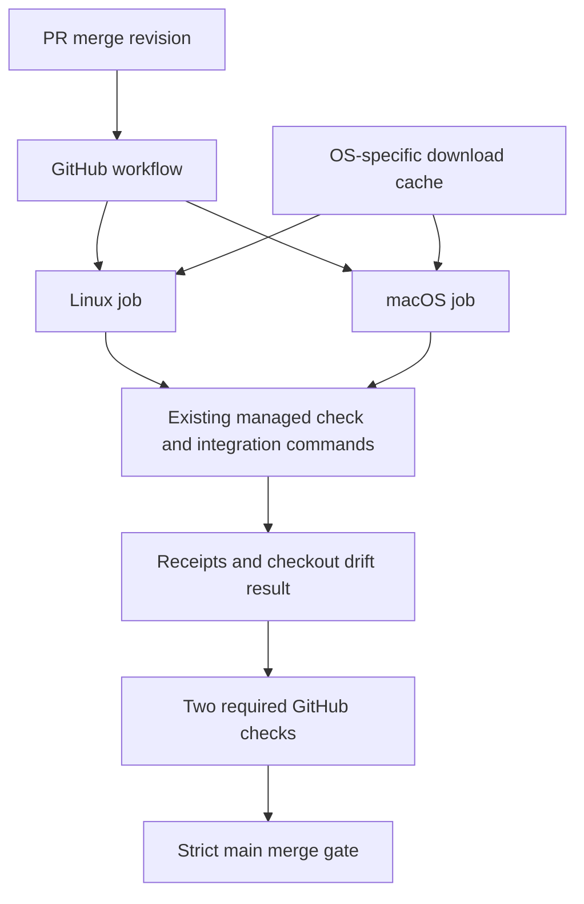
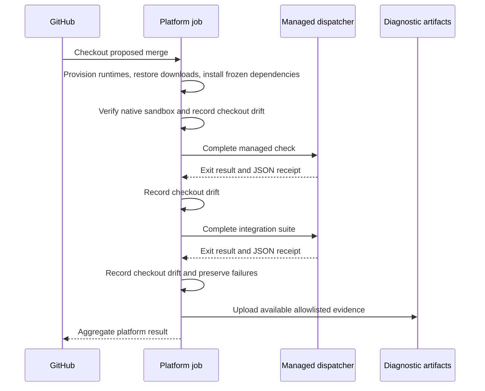
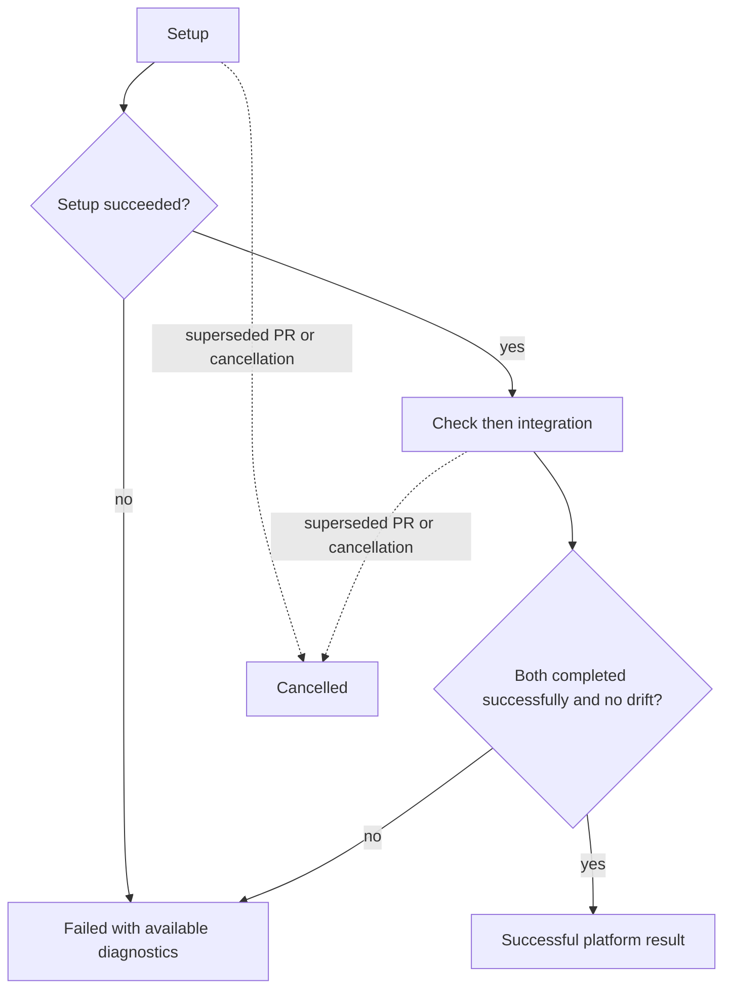

# Justomp Repository GitHub CI - Plan

## Goal Capsule

- **Objective:** Maintainers can merge Justomp changes only after the proposed merge has passed the repository's complete validation on Linux and macOS.
- **Means:** A PR-only GitHub Actions matrix and strict required checks on `main` (KTD1, KTD8).
- **Authority:** User-settled requirements govern behavior; KTDs govern implementation within those requirements; implementation units override neither. Follow `AGENTS.md` and the testing pack for development and publication.
- **Execution profile:** Infrastructure implementation with narrow repository helpers where needed; retain existing managed service entrypoints and test scope.
- **Stop conditions:** Do not weaken checks, skip native tests, replace latest preparation, or manufacture managed readiness to obtain green results. Report an evidenced runner incompatibility before expanding product scope.
- **Delivery:** The implementing agent prepares and verifies the local change. Publishing, remote repository creation and repository administration require the user's authorization. U5 cannot finish until the intended GitHub repository is reachable; U1–U4 can proceed locally.

---

## Product Contract

### Summary

Add Justomp's own GitHub CI using the same managed checks contributors run locally.
Each PR receives complete Linux and macOS results, with both required before merging into `main`.
Retain normal latest-tool preparation and make any resulting checkout changes visible failures.

### Problem Frame

Justomp now manages its own development checks, but the repository has no workflow to enforce them for PRs.
Local passing results do not establish that the complete native suite works on both hosted operating systems.
A fresh checkout also lacks managed readiness state, so check preparation can change the dependencies being validated.

### Key Decisions

- **Full validation on both platforms.** Governs R1, R2. (session-settled: user-directed — chosen over a macOS subset: both supported operating systems must be verified on every PR.)
- **PR verification is the merge gate.** Governs R3, R5. (session-settled: user-approved — chosen over repeating the full suite after merge: merge-result validation plus an up-to-date branch requirement supplies the gate.)
- **Replace obsolete runs, preserve both current results.** Governs R4. (session-settled: user-approved — chosen over keeping stale runs or cancelling the other platform on failure: save work without losing current platform evidence.)
- **Cache downloads without skipping verification.** Governs R6. (session-settled: user-approved — chosen over always downloading everything: reduce setup cost while keeping complete checks.)
- **Keep latest preparation and reject checkout drift.** Governs R7. (session-settled: user-directed — chosen over a new locked-only CI preparation mode: dependency changes must be committed to the PR.)

### Requirements

**Validation and scheduling**

- R1. Every PR runs complete validation on Linux and macOS, including documentation-only and Dependabot PRs; no platform-specific test subset or silent native-test skip is allowed.
- R2. Each platform runs `bun run check` and `bun run check:integration`; preserve lock consistency, format check, lint, strict typing, unit tests with the configured minimum 70% coverage, and all integration tests without an integration coverage threshold.
- R3. Automatic validation runs for PRs, with no duplicate full workflow triggered by a push to `main` after merge.
- R4. A newer commit cancels obsolete runs of its own PR, while a failure on one platform does not cancel the other platform's current run.
- R5. Merging into `main` requires both successful platform checks, an up-to-date PR branch, and a PR-based route rather than ordinary direct pushes.

**Preparation and evidence**

- R6. Cache hits may reduce download work but never replace dependency installation, managed preparation, checks or tests. (pack: testing, test-evidence-and-cost.md)
- R7. Preserve existing latest-tool resolution; any tracked-file change or unexpected nonignored untracked file produced by installation, preparation or validation fails CI and identifies the changed paths, without resetting the checkout or committing automatically.
- R8. Check failures, incomplete execution and cancellation cannot count as successful validation; preserve available command results and useful diagnostics without exposing credentials or whole temporary working trees.
- R9. CI runs without OMP model credentials, production secrets, elevated PR tokens or changes to Justomp's user-facing tools and configuration defaults.

### Acceptance Examples

| ID | Situation | Expected result | Covers |
| --- | --- | --- | --- |
| AE1 | A clean PR has passing managed and integration checks on both platforms | Both required results succeed | R1, R2, R5 |
| AE2 | Linux fails while macOS is still running | Linux remains failed; macOS finishes its own validation | R4, R8 |
| AE3 | Another commit is pushed to the same PR | The old run is cancelled; the new merge revision receives both checks | R3, R4 |
| AE4 | Preparation resolves a newer Biome and changes the manifest/lock, while all tests pass | The job fails and identifies metadata drift; the contributor updates and commits the files before retrying | R7 |
| AE5 | Download cache is missing or unavailable to a fork | Setup downloads normally and executes the same checks | R6, R9 |
| AE6 | `main` advances after a PR's checks passed | The PR must be updated and checked again before merge | R5 |
| AE7 | A native sandbox prerequisite is missing | Setup fails with the prerequisite identified; native tests are not silently skipped | R1, R8 |
| AE8 | A test creates ignored coverage/cache output | That output alone does not constitute checkout drift | R7 |

### Scope Boundaries

This change owns the Justomp repository workflow, its necessary provisioning/reporting helpers, contributor documentation and authorized activation of required checks.
It does not generate CI for extension users, introduce a new tool-preparation mode, install local Git hooks on CI, add Windows, deploy packages, or add scheduled/main cache-warming workflows.
Existing test runner versions, manager fixture variants, lifecycle-script behavior and test limits are not changed just to pass CI.

### External Activation Dependency

The local remote is `https://github.com/justmumu/justomp.git`, but the authenticated `justmumu` account could not resolve it during planning.
This does not establish whether it is absent or inaccessible.
Before U5, verify repository access, Actions availability, administration rights and support for required checks under the repository's visibility and GitHub plan.
Creating a repository, changing visibility or purchasing a plan is not authorized by this document.

---

## Planning Contract

### Key Technical Decisions

- KTD1. **One PR workflow, two stable job identities.** Implement `.github/workflows/ci.yml` with ordinary `pull_request` events and default synthetic merge checkout. Use explicit `ubuntu-24.04` x64 and `macos-15` ARM64 lanes named `Linux` and `macOS` under workflow `Justomp CI`. Avoid branch/path/draft exemptions; include opened, synchronize, reopened and base-edit handling so retargeting is validated. Use PR-number plus workflow concurrency and matrix `fail-fast: false` (R1, R3–R5). Exact required-check contexts must be observed on GitHub rather than guessed from display labels. [GitHub PR events](https://docs.github.com/en/actions/reference/workflows-and-actions/events-that-trigger-workflows), [runner labels](https://docs.github.com/en/actions/reference/runners/github-hosted-runners).
- KTD2. **Existing managed commands own validation.** Install root dependencies with `bun install --frozen-lockfile`, then use the R2 commands with supported `--report` outputs. Do not run `setup`, duplicate `check:unit`, concatenate overlapping feature aliases, or run `test:cost` as another full suite. Native prerequisites are explicit in the environment table below. `scripts/development/services.ts`, `src/prepush/pipeline.ts` and `scripts/test-cost-gate.ts` are the existing patterns. (pack: testing, test-evidence-and-cost.md)
- KTD3. **Checkout cleanliness is an additional CI result.** Capture the clean checkout before installation, then check staged, unstaged and nonignored untracked changes after installation and each validation command. Record any observed drift even if a later command restores it; preserve it as failure alongside the original command outcome. Ignore normal Git-ignored outputs, but do not ignore tracked files that match ignore rules. Use NUL-safe Git output and report path/status lists rather than arbitrary file contents. This realizes R7 without modifying the managed preparation system. (session-settled: user-directed — chosen over locked-only preparation or cached readiness: latest changes must enter the reviewed PR.)
- KTD4. **A narrow CI helper handles owned bookkeeping only.** Add repository code under `scripts/ci/` only for reusable launcher setup, command receipts and drift/failure bookkeeping that would otherwise become repeated or fragile shell. Keep GitHub scheduling, action setup and cache wiring in YAML; reuse the development dispatcher rather than importing a second quality pipeline. No plugin API or production-service behavior changes are needed (R2, R7–R9).
- KTD5. **Cache immutable download material.** Use explicit OS/architecture/runtime/manager/lock/fixture-input keys and restore prefixes that retain compatibility boundaries. Cache verified archives and package download stores; exclude installed environments, `.justomp` readiness, fixture trees, reports and Go build results. Preserve fixture-local overrides that intentionally isolate fake registries and caches. Set one cache owner per path and disable overlapping setup-action caches. PR caches are scoped to the PR merge ref; this design does not promise shared warm caches across unrelated PRs (R6). [Cache scope](https://docs.github.com/en/actions/reference/workflows-and-actions/dependency-caching). (pack: testing, test-evidence-and-cost.md)
- KTD6. **Restrict the workflow's privileges and action sources.** Use `contents: read`, no injected repository secrets, checkout `persist-credentials: false`, and maintained actions pinned to verified full release commit SHAs with release comments. Resolve these SHAs during implementation from the upstream action repositories. Do not interpolate PR-controlled text into shell commands or use `pull_request_target`/privileged `workflow_run` to execute PR code (R9). [GitHub secure use](https://docs.github.com/en/actions/reference/security/secure-use).
- KTD7. **Persist small receipts outside source discovery.** Put exact command logs, managed JSON receipts, timing/version metadata and drift path lists in a dedicated directory under `RUNNER_TEMP`; upload that allowlist with platform/run-attempt names and seven-day retention. Collect on success/failure after setup where possible, without requiring a cancelled run to finish uploading. Missing reports after setup failure must not mask the original error. Do not promise raw JUnit/LCOV uploads: the current test service removes those temporary files in `finally` (R8; `src/testing/service.ts`, `src/testing/artifacts.ts`). [Artifact behavior](https://github.com/actions/upload-artifact).
- KTD8. **Activate repository rules after observing real checks.** Require the two observed GitHub Actions check contexts and strict up-to-date checking on `main`, require PRs and prevent routine direct-push/bypass routes, preserving unrelated existing protections. This is remote administration, separate from YAML and subject to explicit user authorization. Access or billing limitations block activation, not local authoring (R5). [Branch protection](https://docs.github.com/en/repositories/configuring-branches-and-merges-in-your-repository/managing-protected-branches/about-protected-branches).
- KTD9. **Timeouts bound resource use; measurements establish performance.** Start with a 45-minute job ceiling and the already-supported integration input `--timeout-seconds 1800`; the default integration deadline is otherwise 300 seconds. Keep `check` and fixture-level deadlines unchanged. Record cold/warm setup and validation times separately; the local approximately 280-second warm baseline is not a hosted-runner SLA. Do not alter the testing pack's 300-second local budget or its accepted baseline. A timeout remains a failure, not permission to skip tests (R1, R8; `src/testing/request.ts`, `scripts/test-cost-gate.ts`).

### Native Environment

These values come from `tests/fixtures/dependencies/manager-versions.json`, the native fixture helpers and documented local runtime evidence.
Read fixture pins from their existing owner where practical; do not create a competing global version catalogue.
Pin CI-only runtime selections explicitly, verify OS/architecture assets and record resolved versions.

| Component | Initial selection | Provisioning requirement |
| --- | --- | --- |
| Bun | 1.4.2 | Match `package.json` packageManager and fixture pin |
| Node | 26.0.0 | Needed by manager launchers and native typecheck fixtures |
| npm | 11.12.1 | Install explicitly; do not rely on Node's bundled npm |
| pnpm | 10.20.0 | Disposable install prefix; set `JUSTOMP_PNPM_BINARY` and expose pnpm on PATH |
| Yarn Classic | 1.22.22 | Separate launcher; `JUSTOMP_YARN_CLASSIC_BINARY` |
| Yarn Modern | 4.12.0 | Dependency/lint launcher; `JUSTOMP_YARN_MODERN_BINARY` |
| Yarn Modern typecheck | 4.18.1 | Distinct launcher; `JUSTOMP_TYPECHECK_YARN_MODERN_BINARY` |
| uv | 0.11.6 | Fixture-required version |
| Python | 3.13.13 | Working `python3`; fixtures disable automatic Python downloads |
| Go | 1.25.6 | Native fixtures prohibit implicit toolchain fallback |
| Linux sandbox | bubblewrap >=0.8 | `bwrap` on PATH and actual required user namespaces supported |
| macOS sandbox | `/usr/bin/sandbox-exec` | Executable and real protection preflight succeeds |
| Utilities | Git, Bash, tar, Python zipfile | Required by real process/local registry fixtures |

Install launchers outside the checkout under `RUNNER_TEMP`, using the existing `--ignore-scripts` bootstrap pattern from `docs/dependencies.md`; do not change lifecycle behavior inside tests.
Run launcher version diagnostics from a neutral directory because some managers reject the root project's foreign `packageManager`.

On Linux, explicitly install bubblewrap and check the actual namespace/mount behavior used by `src/protection/sandbox.ts`.
If Ubuntu's AppArmor setting blocks it, a documented adjustment confined to the ephemeral hosted runner may enable unprivileged user namespaces; do not disable Justomp's protection or fall back to unsandboxed execution.
The [official Codex action](https://github.com/openai/codex-action/blob/main/action.yml) documents this runner-specific issue.
On macOS, image availability alone is not proof that `sandbox-exec` works; require the same real capability evidence.

The suite itself installs Biome, Ruff, Pyright, TypeScript, Next fixtures and test runners.
Keep the intentional differences between root and fixture versions.
pytest/Vitest fixtures currently resolve latest, so CI depends on public registry availability even when the root install is frozen.
The golangci-lint fixture uses the official 2.15.0 OS/architecture archive with checksum verification; cache verified bytes through the existing `JUSTOMP_GOLANGCI_ARCHIVE` facility if useful.
Network access is needed for public registries/releases and fixture-local loopback servers; no database services or OMP model call is required.

### High-Level Technical Design

These sketches describe responsibilities and flow, not exact module interfaces.

After successful setup, run integration even if the managed check failed, preserving both outcomes and the overall failure.
Do not use `continue-on-error` to make a required lane pass; use explicit step-result handling and noncancelled conditions.
Respect the existing check pipeline's own short-circuit behavior within that command.
Fatal setup failures cannot yield meaningful test results, so they stop validation for that platform while the other platform continues (R4, R8).

### Risks and Considered Alternatives

- Latest-tool publication can make a previously passing PR fail R7. This is the chosen behavior, not a reason to freeze tool resolution or refresh manifests inside CI and report success.
- Hosted cold downloads may exceed fixture-specific 60/120-second limits even with KTD9's outer deadline. Verify real cold runs; a proven fixture/harness defect needs a bounded follow-up decision rather than hidden retry-until-green or limit changes.
- Linux x64 full native execution is new evidence for this repository; earlier local Linux proof was not the full hosted matrix. Treat first hosted results as acceptance evidence, not a formality.
- Cache misses and denied fork cache saves affect cost, not correctness. No main cache-warmer, ready-state cache, new container platform or custom cache service is justified for this scope.
- A custom test orchestrator, extra manager/compiler matrix and tests of GitHub's own scheduler would duplicate established behavior; the narrow helper in KTD4 handles only Justomp-owned bookkeeping. (pack: testing, test-evidence-and-cost.md)

---

## Implementation Units

### U1. Provision the native environment

- **Goal:** Both hosted lanes have the runtimes, launchers and sandbox capabilities required by the existing complete suite.
- **Requirements:** R1, R2, R6, R9; KTD2, KTD4–KTD6.
- **Files:** `.github/workflows/ci.yml` setup/cache portions; a small helper under `scripts/ci/` if needed; existing fixture version sources and `docs/dependencies.md` as patterns; focused helper tests under `tests/unit/ci/` when behavior warrants them.
- **Approach:** Resolve maintained action release SHAs, implement the environment table, use neutral launcher prefixes and explicit cache paths, and retain real sandbox preflights. Derive fixture-owned versions rather than changing them.
- **Test scenarios:** Missing or wrong launcher version fails setup; typecheck Yarn remains distinct from dependency Yarn; platform archive selection matches OS/architecture; a missing sandbox capability is a visible failure. Unit-test owned mappings/diagnostics with supplied process responses; the hosted suite supplies real platform proof.
- **Verification:** Static workflow validation plus recorded runtime versions and successful native capability checks on both actual runners in U5. Do not create a native tool matrix solely to retest version parsing.

### U2. Preserve command results and checkout fidelity

- **Goal:** CI cannot pass after a failed command, incomplete receipt or observed metadata change.
- **Requirements:** R2, R7, R8; KTD2–KTD4, KTD7, KTD9.
- **Files:** Narrow helper modules under `scripts/ci/`; `tests/unit/ci/`; at most one small Git/process handoff fixture under `tests/integration/ci/` if unit-level proof cannot establish the boundary.
- **Approach:** Reuse supported dispatcher CLI forms and result contracts. Capture exit codes, JSON receipts and elapsed time, and inspect Git state at KTD3 boundaries. Keep logs/reports under `RUNNER_TEMP` and preserve cancellation. The helper may not change service preparation semantics.
- **Test scenarios:** Successful command plus changed manifest fails; failed command plus clean tree stays failed; a missing/malformed/incomplete receipt cannot turn green; staged changes and unusual filenames are detected; ignored cache output does not fail; early drift remains failed after later cleanup; setup failure preserves its diagnostic cause.
- **Verification:** Focused unit tests exercise status aggregation and supplied Git records. If needed, a tiny disposable Git repository demonstrates tracked/staged/untracked handling once with stub child commands, without downloading package managers or rerunning the full native suite.

### U3. Wire the PR matrix and diagnostics

- **Goal:** Every intended PR event produces the two complete, independently observable validation results.
- **Requirements:** R1–R4, R6, R8, R9; KTD1, KTD5–KTD7, KTD9; depends on U1–U2.
- **Files:** `.github/workflows/ci.yml`.
- **Approach:** Connect checkout, provisioning, frozen install, managed commands, per-boundary drift checks and allowlisted artifacts. Implement same-PR cancellation and independent platform failures. Keep integration reachable after a check failure when setup succeeded and the run is not cancelled.
- **Test scenarios:** Check failure leaves the lane failed while collecting integration evidence; setup failure does not run unusable test commands; reports remain collectable after a test failure; a later same-PR run replaces only its predecessor; unrelated PRs and the other platform remain independent.
- **Verification:** Validate YAML and action inputs with a maintained workflow validator, then inspect hosted results in U5. No unit test should mirror YAML keys or simulate GitHub's scheduler.

### U4. Document contributor and operator behavior

- **Goal:** Contributors can reproduce failures and understand which updates must be committed.
- **Requirements:** R2, R5–R8; KTD2, KTD3, KTD5, KTD7–KTD9; depends on U1–U3.
- **Files:** `README.md`, a focused `docs/ci.md`, and links from existing development documentation where appropriate.
- **Approach:** Document exact managed commands, native environment setup, artifact contents, latest/drift failure resolution, platform check names, timeout versus performance measurement, and the PR-only cache limitation. Include the remote activation checklist and separate local readiness from live enforcement.
- **Test expectation:** No new behavioral tests for prose; verify links, command forms and environment names against the implementation.
- **Verification:** Documentation describes the actual workflow and includes no implied deployment, hosted timing guarantee or raw-report artifact that the service deletes.

### U5. Validate hosted execution and activate the merge gate

- **Goal:** Demonstrate real passing Linux/macOS runs and enforce their results on `main`.
- **Requirements:** R1–R9; KTD8; depends on U1–U4 and the External Activation Dependency.
- **Files:** No new product API; workflow/docs corrections if hosted evidence warrants them; GitHub repository settings after authorization.
- **Approach:** Once access and publication are authorized, open the implementation PR and collect both complete cold results. Observe an eligible same-PR cache restore and superseded-run cancellation during ordinary subsequent updates or an authorized validation run. Record actual check contexts, then configure strict required checks with no routine bypass.
- **Test scenarios:** Both OS lanes pass the current proposed merge; a failed lane blocks merge; an out-of-date branch cannot merge; same-PR cancellation and cache misses preserve R4/R6; no post-merge duplicate workflow appears. Use actual GitHub behavior rather than writing tests of the platform.
- **Verification:** Preserve run URLs, revisions, image/architecture, tool versions, result counts, coverage, drift status, setup/check/integration times and rule read-back. A permission limitation leaves U5 explicitly incomplete; local files alone do not establish CI enforcement.

---

## Verification Contract

Use the smallest proof that exercises Justomp's responsibility; do not add upstream formatter/compiler/manager rule tests. (pack: testing, test-evidence-and-cost.md)

| Evidence | Execution | Required interpretation |
| --- | --- | --- |
| Owned CI helper decisions | Focused `tests/unit/ci/` tests through the repo's established Bun test workflow | Failure/receipt/drift logic is covered without real registry installs |
| Git/process boundary, if needed | One disposable repo with stub commands | Real Git state and child exit propagation, not a second native tool matrix |
| Workflow syntax/actions | Maintained action/YAML validator and verified release SHAs | Structural errors caught before publishing |
| Root dependencies | `bun install --frozen-lockfile` | Installation respects the committed root lock; later preparation remains subject to R7 |
| Managed gate, each OS | `bun run check --report <runner-temp receipt>` | Existing complete gate succeeds, including configured unit coverage |
| Integration, each OS | `bun run check:integration --report <runner-temp receipt> --timeout-seconds 1800` | Complete suite succeeds, no hidden native skip or integration coverage requirement |
| Fidelity | KTD3 observations | No tracked or unexpected untracked changes were observed |
| Hosted operation | U5 real runs and rule read-back | Both current check identities are required with strict freshness |

Do not add a third complete `test:cost` execution or repeat a passing local hook gate solely for a PR.
The first hosted measurements establish a platform-specific baseline; report provisioning and validation separately and do not replace the existing local cost baseline automatically.
For a genuine failure, inspect the allowlisted artifact when available; do not manufacture expensive failing PRs merely to exercise GitHub artifact upload.
If a hosted failure reveals an implementation bug, fix its owned cause and run focused regression proof before the necessary full rerun.

---

## Definition of Done

- U1 supplies the documented native environment without silently falling back or skipping a platform.
- U2 preserves unsuccessful outcomes and enforces R7, with focused proof of its owned behavior.
- U3 runs the R2 commands once per platform and implements the settled scheduling/cache decisions.
- U4 accurately documents reproduction, evidence, latest updates and operation.
- U5 has passing current Linux/macOS run evidence and verified strict required-check settings; otherwise report the exact external blocker and do not claim live enforcement complete.
- Existing coverage, test classification and fixture behavior remain intact; remove abandoned experiments and temporary debug files from the proposed change.
- No push, PR creation, repository creation or remote-policy change is performed without the authorization required by the repository's contribution policy.

---

## Appendix

### Repository Evidence

- `scripts/development.ts` and `scripts/development/services.ts`: managed command dispatch, persistent JSON reports and setup/hook distinction.
- `src/prepush/operations.ts`, `src/prepush/pipeline.ts`, `src/prepush/service.ts`: dependency validation, fresh preparation and lack of a final Git-cleanliness assertion.
- `src/lint/prepare.ts`, `src/lint/javascript/resolve.ts`, `src/typecheck/prepare.ts`: missing-state latest resolution.
- `src/testing/request.ts`, `src/testing/service.ts`, `src/testing/artifacts.ts`: test deadlines and temporary raw report lifecycle.
- `tests/fixtures/dependencies/manager-versions.json`, `tests/fixtures/typecheck/javascript/fixture.ts`: distinct native manager pins.
- `tests/integration/testing/native-fixture.ts`, `tests/integration/omp/installed-smoke.native.test.ts`: real setup/download requirements and existing fixture deadlines.
- `src/protection/sandbox.ts`, `tests/integration/protection/bash-sandbox.native.test.ts`: actual platform protection requirements.
- `scripts/test-cost-environment.ts`, `scripts/test-cost-analysis.ts`, `scripts/test-cost-gate.ts`: neutral version probes, cache isolation patterns and supported gate arguments.
- `compound-packs/testing/test-evidence-and-cost.md`: test ownership, immutable cache boundary and cost discipline.

### Official References

- [GitHub workflow syntax](https://docs.github.com/en/actions/reference/workflows-and-actions/workflow-syntax): matrix failure behavior, concurrency and permissions.
- [Required-check troubleshooting](https://docs.github.com/en/pull-requests/how-tos/merge-and-close-pull-requests/troubleshooting-required-status-checks): skipped checks and latest-revision enforcement.
- [Branch protection API and eligibility](https://docs.github.com/en/rest/branches/branch-protection): administrative access and visibility/plan constraints.
- [Dependabot Actions restrictions](https://docs.github.com/en/code-security/reference/supply-chain-security/dependabot-on-actions): secret/token constraints.
- [macOS 15 ARM64 runner inventory](https://github.com/actions/runner-images/blob/main/images/macos/macos-15-arm64-Readme.md): image context, not a substitute for native preflight.
