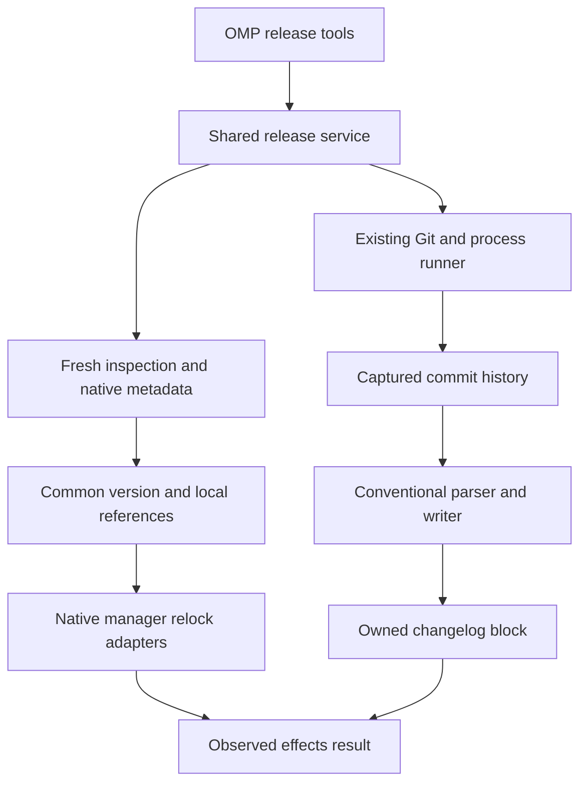
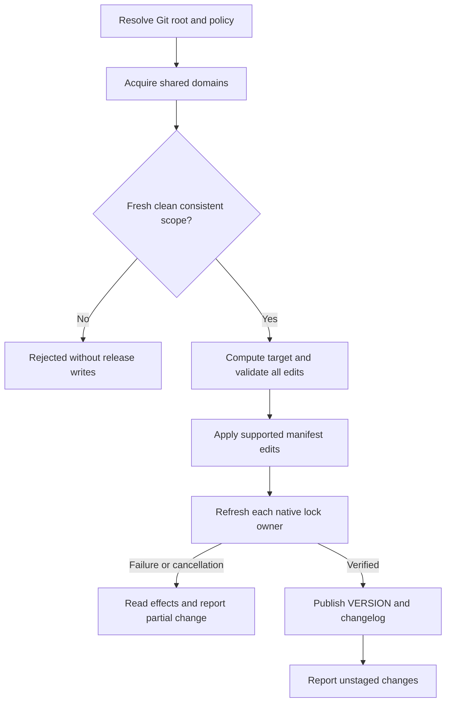
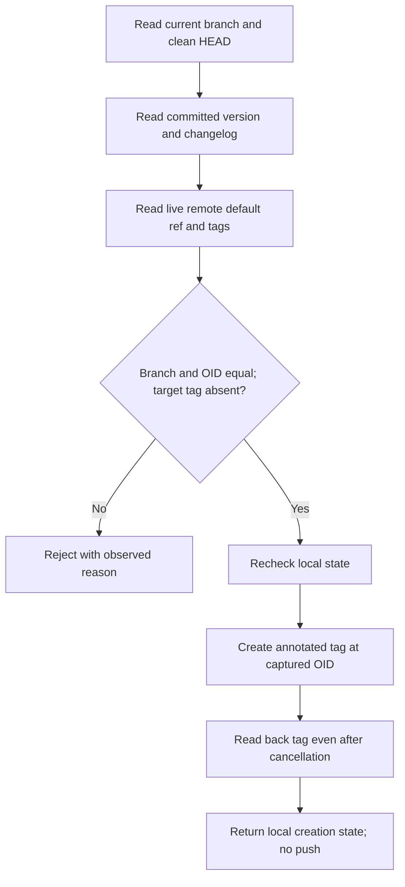

# Repository Release Tools - Plan

## Goal Capsule

**Objective:** Justomp kullanan bir repository, commit geçmişinden release notlarını hazırlayabilsin, bütün sürümlü projelerini ortak bir sürüme taşıyabilsin ve gözden geçirilmiş sürümü yerel Git tag'iyle işaretleyebilsin.

**Means:** Üç küçük OMP aracı, OMP'den bağımsız ortak release servisi, mevcut Git/process altyapısı ve ekosisteme özgü metadata/lock adaptörleri (KTD1–KTD9).

**Authority:** Product Contract davranışı, Planning Contract teknik mekanizmayı belirler. Implementation Units bunları değiştirmez. Repository geliştirme ve yayınlama kuralları için `AGENTS.md` geçerlidir.

**Execution profile:** Deep plan; tek feature branch ve tek PR içinde sekiz bağımlı uygulama birimi. Ürün implementasyonu bu planın kullanıcı incelemesinden sonra başlar. Uygulayan agent geliştirme ve doğrulamayı tamamlar; commit, PR, merge ve yayın adımları mevcut kullanıcı yetkilendirmesine tabidir.

**Stop conditions:** Desteklenen davranışın native araçta sağlanamadığı anlaşılırsa bunu sessiz fallback ile değiştirme. Sürüm uyuşmazlığı, desteklenmeyen version provider veya belirsiz yerel dependency sahipliği için aşağıdaki hata sözleşmesini uygula. Yeni yayın otomasyonu, OMP patch'i veya test bütçesi istisnası gerekiyorsa kapsam kararı al.

---

## Product Contract

### Summary

`repo_changelog` commitlerden changelog üretir. `repo_bump` açık sürüm artışı seçimini uygulayıp ortak sürümü, ilgili manifest/lock dosyalarını ve release notlarını hazırlar. `repo_release_tag` temiz ve güncel varsayılan branch üzerinde yerel annotated tag oluşturur. Release hazırlığı ile commit ve yayın ayrı kalır.

### Problem Frame

Justomp dependency, lint, format, typecheck, test ve Git hook akışlarını yönetiyor; sürüm yükseltme ve release hazırlığı için ortak bir servis sunmuyor. Python template'teki release script'i bu ihtiyacı tek ekosistem için karşılıyor, fakat onun otomatik commit davranışı burada istenmiyor. Çok projeli repository'de farklı araçların sürüm ve lock dosyalarını bağımsız değiştirmesi tutarsız bir release hazırlayabilir.

### Key Decisions

- **Repository tek ortak sürüm kullanır.** Governs R1, R4. (session-settled: user-directed — chosen over independent project versions: release repository düzeyinde yönetilecek.)
- **Artış açıkça seçilir.** Governs R2. (session-settled: user-directed — chosen over automatic increment selection: patch/minor/major kararını çağıran verir.)
- **Bump dosyaları hazırlar; commit ayrıdır.** Governs R3. (session-settled: user-directed — chosen over bump auto-commit: diff incelemesi ve mevcut repo_commit ayrı adım kalır.)
- **Bütün Conventional Commit türleri görünür.** Governs R7. (session-settled: user-directed — chosen over feature/fix-only notes: dokümantasyon, bakım ve CI değişiklikleri de release geçmişine girer.)
- **Farklı başlangıç sürümleri kendiliğinden birleştirilmez.** Governs R4. (session-settled: user-directed — chosen over selecting the largest version: ortak başlangıç değerini kullanıcı belirler.)
- **Bump temiz çalışma ağacı ister.** Governs R3. (session-settled: user-approved — chosen over including uncommitted work: changelog yalnız commit edilmiş geçmişi anlatır.)
- **Tag varsayılan branch üzerinde oluşturulur.** Governs R9. (session-settled: user-approved — chosen over tagging a feature branch: incelenip birleştirilmiş sürüm işaretlenir.)
- **Yayın tag push ile başlar.** Governs R10. (session-settled: user-directed — chosen over publishing on merge: merge yayın onayı değildir.)

### Requirements

**Repository scope and versions**

- R1. Üç araç Git working tree kökünü kullanır; agent `project_id`, ecosystem veya paket yöneticisi seçmez. Güncel inspection kapsamındaki projeler sonuçta görünür.
- R2. `repo_bump` yalnız zorunlu `increment: patch | minor | major` inputunu kabul eder. Ortak sürüm canonical stable `X.Y.Z` biçimindedir; auto, exact target ve prerelease seçenekleri yoktur.
- R3. Bump başlamadan index, tracked çalışma dosyaları ve ignore edilmeyen untracked dosyalar temiz olmalıdır. Başarı yalnız dosya değişiklikleri hazırlar; stage, commit, tag veya push yapmaz.
- R4. Mevcut sürümlü katılımcılar ve varsa repository sürüm kaydı uyuşmazsa bump hiçbir release dosyasını değiştirmeden bütün çelişkileri gösterir. İlk ortak değer bulunamıyorsa kullanıcıdan açık başlangıç değeri ister; en büyük sürümü veya uydurma bir başlangıç sürümünü seçmez.
- R5. Desteklenen statik JS/TS ve Python proje sürümleri birlikte güncellenir; native lock güncellemesi gerçek lock sahibi başına bir kez yapılır. Harici dependency'ler yükseltilmez; yerel sürüm referansları KTD5 kapsamındadır.
- R6. Sürümsüz workspace container'ları sürüm alanı eklenmeden raporlanır. Go repository sürümü/tag ile temsil edilir; `go.mod` içindeki Go toolchain/language sürümü değiştirilmez. Desteklenmeyen Python dinamik sürüm kaynağı veya native manager preflight'ta açık hata verir.

**Changelog**

- R7. Bütün Conventional Commit türleri kategorilere ayrılır; breaking-change notları görünür. Gerçek merge commit'leri atlanır, merge ile gelen normal commit'ler kaybolmaz. Conventional olmayan eski mesajlar sessizce atılmaz: sonuçta sayıları ve kimlikleri raporlanır.
- R8. `repo_changelog` input almadan commit geçmişinden kendi yönettiği Unreleased içeriğini günceller. `repo_bump` aynı üreticiyi doğrudan kullanarak hedef sürüm bölümünü oluşturur; önce repo_changelog çağırmak zorunlu değildir. Elle yazılmış notlar ve geçmiş release bölümleri korunur.

**Tag and effects**

- R9. `repo_release_tag` input almadan temiz, detached olmayan ve canlı remote kontrolünde güncel olduğu doğrulanan varsayılan branch'in HEAD'ine annotated `vX.Y.Z` tag'i koyar. Committed ortak sürüm ve eşleşen changelog bölümü doğrulanır; mevcut tag değiştirilmez.
- R10. Bu araçlar remote'a push yapmaz, PR açmaz, merge veya GitHub/npm yayını yapmaz. GitHub Release + npm workflow'u daha sonra yalnız tag push tetikleyicisiyle tasarlanacaktır.
- R11. Hata ve iptalde gerçek dosya/tag etkileri raporlanır; kısmen değişmiş repository başarılı gösterilmez. Otomatik reset, stash veya geniş rollback uygulanmaz.
- R12. Config alanları zorunlu değildir; eksik alanlar mevcut attribute bazlı default flush davranışıyla doldurulur, verilmiş değerler korunur. Release işlemi kendi preflight'ında config flush veya latest-tool hazırlığı başlatmaz.
- R13. Release bağımlılıkları yalnız Justomp paketine eklenir. OMP araçları aynı ortak servise bağlanır; genel write/edit/bash koruması gevşetilmez ve OMP kaynak kodu değiştirilmez.

### Tool Contract

| Araç | Input | Dosya/ref etkisi | Sonuçta önemli alanlar |
| --- | --- | --- | --- |
| `repo_changelog` | Boş nesne | Yönetilen Unreleased bloğu | Git root, base/end commit, bölüm yolu, dahil/atlanmış commit bilgisi, changed files |
| `repo_bump` | `increment` | Katılımcı manifestler, gerekli lock'lar, sürüm kaydı ve changelog | Önceki/hedef sürüm, katılımcılar, native adımlar, changed files, partial effects |
| `repo_release_tag` | Boş nesne | Yalnız yeni yerel annotated tag | Sürüm, tag adı, hedef commit, oluşturulma kesinliği, remote/default branch kontrolü |

Her wrapper strict input doğrulaması yapar; ek key'ler reddedilir. Yazma yapan üç araç da mevcut `approval: exec` sözleşmesini kullanır. Genel bir komut, Git argümanı veya dosya içeriği inputu açılmaz.

### Key Flows

- F1. Normal release hazırlığı: kod değişikliklerini commit et → temiz ağaçta repo_bump → diff incelemesi → ayrı repo_commit → mevcut PR/merge süreci → güncel varsayılan branch → repo_release_tag. R2–R5, R8–R10'u sıralar; bump için yeni bir feature-branch-only runtime kuralı eklemez.
- F2. Sadece changelog: repo_changelog → Unreleased değişikliğini incele. Sonradan bump yapılacaksa bu değişiklik önce commit edilmeli veya kullanıcı tarafından kaldırılmalıdır; R3 için gizli dirty-file istisnası yoktur.
- F3. Native işlem hatası: R11 sonucunu oku → kalan dosya değişikliklerini incele ve düzelt/geri al → temiz ortak başlangıcı oluştur → yeniden çağır. Yeni recovery tool'u yoktur.

### Acceptance Examples

| ID | Covers | Given / When / Then |
| --- | --- | --- |
| AE1 | R1–R5 | API ve web 1.2.3, temiz tree: minor bump ikisini 1.3.0 yapar, tek ortak kaydı ve release notlarını hazırlar; index ve HEAD değişmez. |
| AE2 | R4 | API 1.2.3 ve web 0.9.0: bump iki yolu/sürümü raporlar, manifest/lock/changelog yazmaz. |
| AE3 | R7 | Bir PR'da feat, docs ve ci commit'leri normal merge ile birleşmiş: üçü birer kez görünür, merge mesajı görünmez. |
| AE4 | R8 | Changelog'da insanın yazdığı Unreleased notu ve eski release bölümleri var: tekrar üretim yalnız Justomp bloğunu değiştirir. |
| AE5 | R9 | Yerel main, live remote default HEAD ile aynı: doğrulanan sürüme annotated tag oluşturulur; remote tag listesi değişmez. |
| AE6 | R9, R11 | Tag yaratılırken çağrı iptal edilmiş: readback tag'in oluştuğunu gösteriyorsa sonuç bunu söyler, yeniden denemeye körlemesine yönlendirmez. |
| AE7 | R4, R6 | Yalnız Go projesi var, VERSION ve önceki release tag'i yok: başlangıç sürümü seçilmesi ve commit edilmesi istenir; go.mod değiştirilmez. |
| AE8 | R5, R11 | İkinci lock sahibi refresh sırasında hata verir: ilk yapılan değişiklikler yollarıyla raporlanır; işlem partial_change olur ve otomatik commit/tag oluşmaz. |

### Scope Boundaries

**Bu sürümün açık sınırları:** Python tarafı uv ile yönetilen statik `[project].version` metadata'sını kapsar. `dynamic = ["version"]`, Poetry-only sürüm metadata'sı ve keyfî source-code version provider'ları otomatik dönüştürülmez. Go desteği repository release hazırlığıdır; alt modülleri paket registry'sinden tüketilebilir hale getiren prefix tag'leri, `/v2` import-path geçişleri veya Go bağımlılık sürümleri otomatik değiştirilmez.

**Düşünüldü, eklenmedi:** Genel transaction/rollback altyapısı yerine mevcut partial-effect raporlama modeli kullanılır; kullanıcı diff'i görmeden commit yapılmaz. Otomatik fetch/pull, branch değiştirme, tag overwrite, cross-process lock daemon'u ve keyfî release script'i yoktur. Mevcut process-local koordinasyonun ötesinde eşzamanlı harici Git/editor süreçlerini durdurma garantisi verilmez; gözlemlenen drift hata olarak bildirilir.

#### Deferred to Follow-Up Work

- Tag push ile GitHub Release ve npm yayın workflow'u, npm kimlik/provenance ayarları ve yayımlanacak paket içeriğinin son kontrolü.
- Go modül yayını veya Python backend sürüm sağlayıcıları, bu kullanım gerçekten talep edilirse kendi açık sözleşmeleriyle ele alınır.
- Release CLI'si için ayrı ürün talebi; bu plan OMP wrapper ve doğrudan kullanılabilir servis export'unu sağlar.

---

## Planning Contract

### Existing Behavior and Integration Points

`src/config/load.ts` defaultta salt okunur, yalnız `flush: true` ile eksik attribute'ları yazar. `getPackagingStructure` güncel process-local inspection sağlar ve `publish: false` ile snapshot dosyasına yazmadan kullanılabilir. Project modelinde sürüm bilgisi yoktur; release metadata'sı native manifestlerden ayrıca okunacaktır.

`src/dependencies/service.ts` native işlemleri manager scope domain'lerinde çalıştırır ve hata sonrası `partial_change` ile metadata farklarını raporlar. `dependency_sync` frozen/locked davranır; sürüm değiştirdikten sonra relock yapmak için uygun giriş değildir. `src/dependencies/queue.ts` process-local ve non-reentrant'tır.

`src/commit/service.ts` Git root'u çözer, mevcut commit domain'ini alır ve iptal sonrası Git state'ini yeniden okur. `src/precommit/git.ts` worktree Git dizini ile ortak Git dizinini ayırır. Release bunları kullanır; yeni bir genel Git katmanı kurmaz.

### Key Technical Decisions

- KTD1. **Shared service, thin host wrappers.** Release domain'i `src/release/` altında yaşar; OMP registration yalnız schema, session lifetime ve sonuç sunumunu yapar. Mevcut `withRoot`/`track` ve `runProcess` kullanılır. Git komutlarını changelog kütüphanesine devretmek mevcut cancellation ve output sınırlamalarını kaybettirir; bu nedenle tarihçe ve ref yönetimi Justomp'ta kalır. Governs R1, R11, R13.
- KTD2. **Tracked VERSION is the common version record.** Varsayılan yol repository-relative `VERSION` olur; içerik canonical X.Y.Z ve son newline'dır. Dosya yoksa bütün statik katılımcılar tek değerde anlaşıyorsa o değer başlangıçtır; hiç statik değer yoksa ulaşılabilir en yüksek stable repo tag'i kullanılır. Hiçbiri yoksa `initial-version-required` döner; kullanıcı VERSION'a seçtiği değeri yazıp commit eder. VERSION mevcutsa katılımcı değerleriyle eşit olmalıdır. İlk başarılı bump dosyayı oluşturur; startup oluşturmaz. Eski release tag'inin sürümü mevcut değerden büyükse çelişki olarak durulur. Bu, policy config'ine mutable version default'u eklemekten kaçınır. Governs R2, R4, R6.
- KTD3. **Small optional release config.** `src/config/release/{defaults,model,resolve}.ts` altında `release.version_file = "VERSION"`, `release.changelog_file = "CHANGELOG.md"`, `release.remote = "origin"`, `release.history_start = null` defaultları tanımlanır. Mevcut load/flush aggregator'a bağlanır. Paths aynı dosyayı, `.git`'i, config'i, manifest/lock dosyalarını veya repository dışını hedefleyemez; mevcut symlink/regular-file kontrolleri kullanılır. Config okunurken değerler doğrulanır, invalid değer defaulta çevrilmez. Governs R12.
- KTD4. **Classify before mutating.** Git root içinde, gitlink/submodule ve ayrı nested Git repository'leri kapsam dışı tutarak taze inspection alınır. `packagingInvocation` ve mevcut workspace-boundary kontrolü yeniden kullanılır. Sürümlü private JS paketleri de katılımcıdır; sürümsüz container'lar, Go ve tooling-only Python dosyaları ayrı raporlanır. Static Python veya JS'te canonical olmayan sürüm, dynamic provider, unresolved workspace veya değişecek katılımcının unsupported manager'ı bütün preflight'ı durdurur. Versionless olmak dynamic metadata'yı gizlemek için kullanılamaz. Governs R1, R4–R6.
- KTD5. **Only proven local version references can change.** Inspection ilişkileri tek başına yeterli değildir: native workspace/lock çözümünden aynı repo içindeki katılımcıya yöneldiği kanıtlanmalıdır. Aynı paket adı yeterli kanıt değildir. Aşağıdaki tablo local constraint davranışını belirler. Belirsiz local bağ veya yeniden yazılamayan, yeni sürümü dışlayan constraint preflight'ta dosya/alanla reddedilir. Registry/git kaynakları yön değiştirmez; harici sürümler korunur. Governs R5.
- KTD6. **Native relock, no lifecycle release commands.** Önce bütün metadata değişiklikleri hazırlanır, ardından lock sahibi başına native refresh yapılır. JS native version lifecycle'ı yerine dar JSON version edit'i kullanılır; Python native uv version ile frozen metadata güncellemesi yapılır. Install/version lifecycle script'leri çalıştırılmaz. Refresh için mevcut manager executable, env ve path çözümü kullanılır; dependency_sync'in sözleşmesi değiştirilmez. Native matrix aşağıdadır. Governs R3, R5, R11.
- KTD7. **Own the history range, reuse parser/writer.** `semver`, `conventional-commits-parser` ve `conventional-changelog-writer` doğrudan Justomp dependencies olur; mevcut conventional-commits preset'i kullanılır. Tam release lifecycle framework'ü eklenmez. Komut argv'si ve Git output completeness mevcut runner tarafından yönetilir; kütüphaneler yalnız parse/render/arithmetic yapar. Güncel public API'lerle uyumlu sürümler implementation'da lock'lanır; transitive import veya OMP internal import yapılmaz. Governs R2, R7, R13.
- KTD8. **Preserve human changelog ownership.** Justomp generated içerik açık başlangıç/bitiş marker'larıyla sınırlandırılır. Standalone işlem yalnız Unreleased içindeki bu bloğu yeniler. Bump, yeni sürüm bölümünü ekleyip kendi Unreleased bloğunu tüketir; insanın Unreleased notlarını otomatik release'e taşımaz ve bunu sonuçta belirtir. Eski release bölümleri değiştirilmez. İlk kullanımdaki markersız içerik korunur; duplicate/bozuk marker veya aynı hedef release başlığı varsa preflight reddeder. Governs R8.
- KTD9. **Live default-branch check, local tag mutation.** Remote adı R12 config'inden alınır; Git'in live symbolic HEAD/ref cevabı branch adı ve commit OID için otoritedir. Yerel branch ismi ve HEAD OID ikisi de eşleşmelidir; stale remote-tracking ref veya tahmini main fallback'i kullanılmaz. Tag yaratılmadan tekrar local HEAD/branch/clean state doğrulanır; tag captured OID'ye bağlanır. Uzak repository sonradan değişebilir; bu bir gözlem anı doğrulamasıdır. Governs R9.
- KTD10. **Bound effects with existing coordination.** Bump, tüm manager write domain'leri, worktree commit domain'i ve Git common-directory release domain'inin birleşimini tek seferde alır. Domain alındıktan sonra scope/HEAD/config/clean state yeniden okunur; domain seti değişmişse mevcut dependency desenindeki gibi serbest bırakıp yeniden çözer. Aynı domain'i tekrar alan public dependency servisi içerden çağrılmaz. Native işlem sonrasında VERSION ve changelog en son yayımlanır; başarısız adım sonrası yeni native adıma geçilmez. Partial etkiler uncancelled readback ile toplanır; process dışı atomiklik iddia edilmez. Governs R3–R5, R11.
- KTD11. **Protection and package boundaries remain narrow.** Yapılandırılmış VERSION yolu mevcut protected-path modeline eklenir; trusted bump servisi bu dosyayı yazabilir. Changelog'daki insan notları normal düzenlenebilir kalır. Yeni write-file veya sandbox exception API'si eklenmez. Release servisleri package export'undan ulaşılabilir, release dokümanı package files listesine eklenir. Governs R13.

### Version and Local Reference Rules

| Metadata / constraint | Davranış |
| --- | --- |
| JS `version` ve static Python `[project].version` | Bütün katılımcılara aynı yeni X.Y.Z yazılır; ilgisiz alan ve yorumlar korunur. |
| Local `workspace:*`, `workspace:^`, `workspace:~`, file/link/path mapping | Kaynak aynı kalır; içinde sabit sürüm yoksa değiştirilmez. |
| Kanıtlanmış local JS exact / caret / tilde ve numeric workspace karşılığı | Yeni sürümü zaten kabul ediyorsa korunur; etmiyorsa aynı exact/caret/tilde biçiminde hedef sürüme taşınır. |
| Kanıtlanmış local Python `==X.Y.Z` veya `~=X.Y.Z` | Yeni sürüm için uyumsuzsa aynı operator ile hedefe taşınır; extras/marker/source alanları korunur. |
| Karma range, alias/catalog veya peer compatibility ifadesi | Sahipliği ve yeni sürümü kabul ettiği kanıtlanabiliyorsa korunur; otomatik daha geniş uyumluluk iddiası üretilmez. Karar verilemiyorsa veya hedef dışlanıyorsa açık preflight hatası. |
| Registry dependency, Git ref, Python backend dynamic version, Go require/module path | İlk ikisi release bump nedeniyle yeniden yazılmaz; dynamic provider R6 ile reddedilir; Go native metadata R6 sınırında korunur. |

JS range üyeliğinde semver API kullanılır. Python'da yerel statik constraint desteği tabloda belirtilen sınırlı biçimlerle sınırlıdır; genel PEP 440 solver yazılmaz. Native refresh sonrası local identity ve target version yeniden doğrulanır: eski registry paketine sessiz düşüş başarı olamaz.

### Native Lock Refresh Matrix

| Manager | Metadata / lock yaklaşımı | Ortam etkisi ve sınır |
| --- | --- | --- |
| npm | Version/range edit'lerinden sonra lock owner'da package-lock-only install; scripts/audit/fund kapalı | node_modules kurulumu beklenmez; npm-shrinkwrap önceliği korunur. |
| pnpm | Lockfile-only install, frozen kapalı, scripts kapalı | Shared/custom lock owner mevcut resolver'dan gelir; desteklenmeyen lock düzenleri mevcut hata davranışını korur. |
| Bun | Lockfile-only install, scripts kapalı | Sırf bump için binary/text lock migration'ı yapılmaz; kullanılan sürüm/format lane'i native fixture ile kanıtlanır. |
| Yarn modern | update-lockfile install mode; bu invocation için immutable install kapalı | Linking yapılmaz; kullanıcı yarnrc'si değiştirilmez. Native step env override mevcut runner üzerinden verilir. |
| Yarn classic | Normal install, scripts kapalı ve non-interactive | Native lock-only modu olmadığı için dependency kurulumu olabilir; sonuç bunu saklamaz. |
| uv | Seçili static projelerde exact version + frozen, sonra workspace başına bir native lock | Version adımlarında sync/relock ertelenir; runtime/environment kurulumu hedef değildir. |
| Go | Own-version veya release kaynaklı relock yok | Repository VERSION/tag değişir; Go module publication yapılmış sayılmaz. |

Hiçbir lane upgrade bayrağı kullanmaz. Native lock refresh gereken metadata dışındaki değişiklikleri raporlar; beklenmeyen metadata scope/identity değişimi başarısız sonuçtur. Lock binary içeriği elle patch edilmez.

### History and Rendering Rules

1. İşlem başında immutable end commit OID yakalanır. `vX.Y.Z` biçiminde, bu commit'ten ulaşılabilen stable repository tag'leri içinden SemVer olarak en yüksek olan baseline seçilir; başka branch'teki tag başlangıç olmaz.
2. Baseline varsa range onun commit'inden exclusive başlar ve captured HEAD'de biter. `history_start` yalnız ilk release için alt sınırdır; varsa ancestor olması gerekir ve o commit dahil edilir. İkisi de yoksa ulaşılabilir tam geçmiş kullanılır.
3. Shallow repository veya eksik Git object / kesilmiş native output ile tam geçmiş üretildiği iddia edilmez; preflight açıklayıcı hata verir. Araç auto-fetch yapmaz. Yerel tag envanteri esas alınır; doküman remote release tag'lerinin checkout'a getirilmesi sorumluluğunu açıklar.
4. Traversal bütün reachable nonmerge commit'leri içerir; first-parent kullanılmaz. OID başına tek entry vardır. Type/scope/body/breaking notes mevcut preset parser'ından gelir.
5. Preset 10.4.1'deki type visibility varsayılanlarına güvenilmez: standart ve history'de görülen custom türlerin tümü görünür yapılandırılır. Revert çiftlerinin writer tarafından gizlenmesi kapatılır. Otomatik version recommendation/splitting kapatılır; R2 karar verir.
6. Kategori sırası sabit, custom kategoriler alfabetik, kategori içi sıra captured Git verisiyle deterministiktir. Render'a version/date/base/end context açık verilir; Unreleased üretimi sırf gün değişti diye diff oluşturmaz. Yeni release tarihi invocation başında bir kez UTC tarihinden alınır.
7. Git remote URL'sinden link üretilecekse yalnız credential'sız normalize edilmiş host/repo bilgisi kullanılır; local/file remote'da plain commit OID yeterlidir. Author e-postaları changelog'a yazılmaz.

### Tag Validation and Result Semantics

Tag preflight R9'a ek olarak VERSION'ın tracked olduğunu, katılımcı sürümleriyle eşleştiğini ve changelog'da bu sürümün tek, dolu managed release bölümünün bulunduğunu doğrular. Target version önceki repository release sürümünden büyük olmalıdır. Boş commit aralığı için üretilen açık “No changes” girdisi geçerli bir bölümdür; bozuk marker yapısı veya belirsiz duplicate başlık kabul edilmez. Bu kontrol notların insan tarafından hiç düzenlenmediğini kanıtlamaz.

Local veya seçili remote'da hedef tag varsa işlem `tag-already-exists` ile durur ve bulabildiği hedefi raporlar; force/delete/repoint yoktur. Remote erişilemiyorsa, symbolic default HEAD yoksa veya local checkout farklıysa actionable diagnostic döner. Git kullanıcısının mevcut tagger identity ayarı kullanılır; ad/e-posta otomatik oluşturulmaz veya değiştirilmez. Annotated tag'in metadata'sı kimliği içerir; noreply tercihinin repository Git config'inde korunması dokümante edilir.

Servis sonuçları `success`, `rejected`, `failed`, `cancelled` ve `partial_change` ayrımını taşımalıdır. Changed paths, native step exit/cancel bilgisi, affected projects, baseline/target ve diagnostics agent'ın tekrar deneme kararına yeterli olmalıdır. Tag sonucu ayrıca `created: true | false | null` ve observed target OID içerir; null readback'in kesin sonuç veremediğini belirtir. “İptal edildi” ile “hiçbir şey olmadı” eş anlamlı değildir.

### High-Level Technical Design

**Component and data boundaries (KTD1, KTD4, KTD7):**

**Bump protocol and lifecycle (R3–R5, R11; KTD10):**

**Tag decision protocol (R9; KTD9):**

Tool Contract tablosu API yüzeyini, Native Lock Refresh Matrix ekosistem varyantlarını tanımlar. Diagramlar bunları genişletmez.

### Alternatives and Limits

Tam release framework'ü kullanmak commit/push/workflow sahipliğini yeniden tanımlamayı gerektirirdi; parser/writer bileşenleri mevcut Justomp servislerine daha dar oturur. Her native manager'ın version komutunu kullanmak ise Git lifecycle ve script davranışlarını farklılaştırır; ortak edit + native relock seçimi bu farkı sınırlar. Bunlar mevcut kaynaklardan seçilebildiği için ayrıca yürütülebilir prototype/bake-off gerekmiyor.

Sürüm uyuşmazlığını otomatik maksimuma taşımak R4'e aykırıdır. Rollback yapılmaması R11 kapsamında bilinçlidir; bütün native environment etkilerini transaction gibi geri alma garantisi verilmez. Tag kontrolü GitHub branch protection/CI durumunu sorgulamaz; repository'nin mevcut merge süreci bunları yönetir.

### Sources and Research

- Local: `src/config/load.ts`, `src/config/commit/`, `src/packaging/get-structure.ts`, `src/inspect/readers/manifest.ts`, `src/inspect/relationships.ts`.
- Native mutation and Git boundaries: `src/dependencies/service.ts`, `src/dependencies/executable.ts`, `src/dependencies/adapters/`, `src/dependencies/queue.ts`, `src/commit/service.ts`, `src/precommit/git.ts`, `src/precommit/workspace.ts`, `src/protection/paths.ts`.
- [Conventional parser API](https://conventional-changelog.js.org/commits-parser/api/), [writer API](https://conventional-changelog.js.org/changelog-writer/api/) ve [preset options](https://conventional-changelog.js.org/presets/conventional-commits/options/) KTD7 ve history visibility kararlarını belirler; eski `hidden: false` örneklerine güvenilmez.
- [node-semver](https://github.com/npm/node-semver) stable sürüm doğrulama/artışını sağlar; Python sürümlerine coercion uygulanmaz.
- [uv version CLI](https://docs.astral.sh/uv/reference/cli/#uv-version), [Python dynamic metadata](https://packaging.python.org/en/latest/specifications/pyproject-toml/#dynamic), [uv locking](https://docs.astral.sh/uv/concepts/projects/sync/) KTD4/KTD6'nın Python sınırını belirler.
- [npm install](https://docs.npmjs.com/cli/v11/commands/npm-install/), [pnpm install](https://pnpm.io/cli/install), [Bun install](https://bun.com/docs/pm/cli/install), [Yarn install](https://yarnpkg.com/cli/install), [Yarn classic install](https://classic.yarnpkg.com/lang/en/docs/cli/install/) native matrix'in kaynağıdır. Docs'taki güncel sürüm ile repo/runtime lane'i farklıysa implementation fixture'ı kullanılan lane'i doğrular.
- [Go version-to-commit mapping](https://go.dev/ref/mod#vcs-version) repository tag'i ile nested module yayınının aynı şey olmadığını belirler.
- [Git ls-remote](https://git-scm.com/docs/git-ls-remote), [Git status](https://git-scm.com/docs/git-status), [Git tag](https://git-scm.com/docs/git-tag), [revision traversal](https://git-scm.com/docs/git-rev-list) KTD9 ve history seçimine dayanak olur.
- Installed OMP 18.13.3 `src/tools/gh.ts` PR/search/Actions işlerini destekler, bump/tag/release operasyonu sunmaz. `src/commit/changelog/` staged diff üzerinden modelle Unreleased notu üretir. Bunlar bu deterministic release servisi yerine kullanılmaz; agent sonradan mevcut [GitHub capability](https://omp.sh/docs/github) ile PR/CI işlerini yapabilir.

---

## Implementation Units

### U1. Release policy and shared contract

**Goal:** R1–R2, R11–R13 için ortak tipler, strict input ve config resolution sözleşmesini oluşturmak.

**Dependencies:** Yok.

**Files:** Yeni `src/config/release/defaults.ts`, `model.ts`, `resolve.ts`; yeni `src/release/model.ts`, `schemas.ts`; değişen `src/config/load.ts`; test `tests/unit/config/release.test.ts`, `tests/unit/release/request.test.ts` ve mevcut `tests/integration/config.test.ts`.

**Approach:** KTD3'ü mevcut config/commit desenine bağla. Defaults flush ile release action'larını ayır; partial config, boş nesne ve unknown-key preservation mevcut politikayı izlesin. Servis result şekilleri mevcut dependency/commit sonuçlarıyla aynı terimleri kullansın.

**Test scenarios:**

- Eksik release alanı defaulta çözülür; verilmiş path/remote/history_start korunur.
- Yanlış tip, path çakışması ve increment dışındaki key'ler reddedilir.
- Mevcut config integration akışına attribute flush/preserve kanıtı eklenir; bütün default kombinasyonları unit'te kalır.

**Verification:** Read-only load dosya yazmaz; startup flush yalnız eksikleri ekler. Buradaki unit'ler schema/policy'yi kanıtlar, filesystem atomikliğini tekrar taklit etmez.

### U2. Repository inventory and common-version planning

**Goal:** R1, R4, R6 için bütün katılımcılar görülmeden hiçbir release edit'i başlamamasını sağlamak.

**Dependencies:** U1.

**Files:** Yeni `src/release/repository.ts`, `version.ts`, `participants.ts`, `references.ts`; mevcut `src/precommit/workspace.ts` helper kullanımı; test `tests/unit/release/version.test.ts`, `participants.test.ts`, `references.test.ts`, `tests/integration/release/scope.test.ts`.

**Approach:** KTD2/KTD4/KTD5'i uygulayan saf planlayıcıya native manifest ve scope evidence ver. Git root, gitlinks ve nested Git boundary kapsamını caller'dan al. Değişecek alanlar ve native lock owner'lar hesaplandıktan sonra conflict listesi tek sonuçta dönebilsin.

**Test scenarios:**

- Covers AE1, AE2, AE7: ortak baseline, çelişkili statik sürümler ve Go-only ilk başlangıç.
- VERSION/native/tag çelişkileri, versionless container, dynamic Python ve unsupported participant doğru sınıflandırılır.
- Kanıtlı local exact/caret/tilde dönüşür; aynı adlı registry paketi değişmez; uyumsuz complex/peer constraint preflight'ta durur.
- Tek küçük filesystem fixture symlink/root/submodule containment'ı kanıtlar; sürüm permütasyonları gerçek repo oluşturmaz.

**Verification:** Planlama saf girdilerle bütün edit setini üretir veya writesız hata verir. Sınır integration'ı gerçek path güvenliğini kanıtlar; native solver doğruluğunu test etmez.

### U3. Deterministic history and changelog generation

**Goal:** R7–R8 için aynı captured geçmişten kayıpsız ve tekrar üretilebilir generated notlar oluşturmak.

**Dependencies:** U1.

**Files:** Yeni `src/release/history.ts`, `changelog.ts`, `publication.ts`; değişen `package.json`, `bun.lock`; test `tests/unit/release/history.test.ts`, `changelog.test.ts`, `tests/integration/release/changelog.test.ts`.

**Approach:** KTD7/KTD8'e göre parser/writer bağımlılıklarını doğrudan declare et. Saf history selection ile native history acquisition'ı ayır. Compare-before-publish ve mevcut regular-file desenini kullan; changelog path/marker çatışmasını yazmadan bul.

**Test scenarios:**

- Covers AE3: normal merge ile gelen feat/docs/ci görünür; merge node'u tek başına entry olmaz.
- Supplied commit records üzerinden custom tür, breaking note, revert görünürlüğü, conventional olmayan mesaj ve sabit sıra seçenekleri doğrulanır.
- Covers AE4: marker bloğu idempotent güncellenir; manual/released içerik byte olarak korunur; bozuk/duplicate marker reddedilir.
- Bir küçük gerçek Git fixture argv/range/parser/writer bağlantısını kanıtlar; bütün parser/semver gramerleri tekrar test edilmez.

**Verification:** Native truncation veya shallow history başarıya dönüşmez. Changelog standalone çağrısı sürüm, index ve Git refs değiştirmez.

### U4. Native release metadata and relock adapters

**Goal:** R5 için desteklenen manager'larda own-version değişikliği ile lock yenilemesini bağlamak.

**Dependencies:** U2.

**Files:** Yeni `src/release/adapters/{types,javascript,python,lock-refresh}.ts`; gereken dar reusable helper extraction için `src/dependencies/executable.ts` ve ilgili mevcut adapter dosyaları; test `tests/unit/release/adapters.test.ts` ve mevcut `tests/integration/dependencies/managers/{npm,pnpm,bun,uv,yarn-classic,yarn-modern}.native.test.ts` lifecycle'ları.

**Approach:** Native matrix'i manager-version-aware planlara çevir. Shared lock owner'ı tekilleştir; execution'ı dışarıdan verilmiş existing runner üzerinden yap. Dependency sync semantiğini değiştirme. JSON/TOML edit'i yalnız planlanmış alanları kapsasın, native postcondition identity kontrolü eski registry fallback'ini yakalasın.

**Test scenarios:**

- Command plan'ı doğru owner/cwd/env, scripts-off ve upgrade olmayan argv üretir.
- Workspace üyeleri bir lock refresh paylaşır; npm shrinkwrap ve mevcut pnpm path çözümü doğru owner'ı seçer.
- Her distinct native manager lifecycle'ına bir küçük own-version/relock adımı eklenir; mümkünse mevcut local package/archive setup'ı yeniden kullanılır.
- Native başarısızlık, cancel/truncation ve yanlış local resolution sonuçları supplied responses ile unit'te sınanır.

**Verification:** Her manager için yeni native handoff çalışır; başka ekosistem tool kurulum matrisi eklenmez. Exact fixture path'leri mevcut test seam'lerine göre implementation'da doğrulanır; ayrı pahalı suite kurmak varsayılan değildir. (pack: testing, test-evidence-and-cost.md)

### U5. Bump orchestration and observed effects

**Goal:** R3–R5, R8, R11 için metadata/lock/changelog hazırlığını tek açık işlem olarak tamamlamak.

**Dependencies:** U2, U3, U4.

**Files:** Yeni `src/release/bump.ts`, `effects.ts`, `coordination.ts`; gerekirse mevcut dependency scope helper'larının dar export'u; test `tests/unit/release/bump.test.ts`, `outcome.test.ts`, `tests/integration/release/bump.test.ts`.

**Approach:** KTD10'un domain ve freshness sırasını uygula. Bütün validation/diff planı native editlerden önce tamamlanır. VERSION ve release changelog'u native doğrulamadan sonra yayımlanır. Sonuç gözlemleri başarısız/cancelled signal'dan bağımsız tamamlanır; yeni otomatik recovery mekanizması kurulmaz.

**Test scenarios:**

- Covers AE1: başarılı plan yalnız expected metadata'yı değiştirir; stage/commit/tag çağrısı yoktur.
- Dirty index/worktree/untracked, scope değişimi ve çelişkili version kararları supplied observations ile writesız reddedilir.
- Covers AE8: ilk owner başarılı, ikincisi failed/cancelled; üçüncü çağrılmaz, gerçek changes partial olarak döner.
- Promise-only queue planı unit'te; tek gerçek filesystem/process sınırı publication ve cancel sonrası readback'in dosya etkilerini kanıtlar.

**Verification:** Temiz başarı tutarlı ortak sürüm ve raporlanmış diff üretir; partial state başarı olamaz. F1'in bir sonraki adımı ayrı repo_commit olarak kalır.

### U6. Reviewed local release tag

**Goal:** R9/R11 için doğru commit'e yerel annotated tag oluşturmak ve gerçek sonucu bildirmek.

**Dependencies:** U2, U3, U5'in ortak Git/effects helper'ları.

**Files:** Yeni `src/release/tag.ts`; test `tests/unit/release/tag.test.ts`, `tests/integration/release/tag.test.ts`.

**Approach:** KTD9'u mevcut gitContext/commonDirectory ile uygula. Remote query'de symbolic HEAD ve hedef tag'leri oku; stale tracking refs kullanma. Committed metadata'yı validate et; create/ref readback sonucunu error/cancel signal'dan ayır.

**Test scenarios:**

- Covers AE5: local bare remote ile clean current default branch tag'i doğru OID'ye bağlar; annotation okunur ve remote'da tag oluşmaz.
- Aynı native lifecycle'da ikinci çağrı mevcut tag'i korur; stale local tracking ref live remote kararını değiştirmez.
- Detached/wrong/ahead/behind/offline/missing default head, version/changelog uyumsuzluğu supplied Git records ile unit'te kanıtlanır.
- Covers AE6: create process hatalı veya iptal olsa bile observed tag true/false/unknown doğru sunulur.

**Verification:** Push veya force yoktur. Yerel bare remote fixture gerçek Git/ref bağlantısını kanıtlar; GitHub hesabı veya Actions çalıştırması gerekmez.

### U7. OMP registration, exports and protected version record

**Goal:** R1/R11/R13 için üç aracı session yaşam döngüsüne bağlamak ve yönetilen sürüm dosyasını korumak.

**Dependencies:** U3, U5, U6.

**Files:** Yeni `src/omp/release-tools.ts`, `src/release/index.ts`; değişen `src/omp/extension.ts`, `src/protection/paths.ts`, `package.json`; test `tests/unit/omp/release-tools.test.ts`, mevcut protection path testleri ve `tests/integration/omp/installed-smoke.native.test.ts`.

**Approach:** Mevcut commit-tool wrapper ve installed export desenini izle. `withRoot` callback içinde gerçek Git root çözümünü koru. VERSION protection config'le seçilen yolu kapsasın; generic write tool veya shell escape açılmasın. Bu özellik session_start'ta release işlemi çalıştırmaz.

**Test scenarios:**

- Strict schemas, exec approval, cancellation forwarding ve isError/details servis sonucu ile eşleşir.
- Child-directory session çağrısı repository genelindeki servise gider; kapanış mevcut track davranışını izler.
- VERSION genel write/edit/bash protected path setindedir; custom bump mevcut trusted route üzerinden çalışır.
- Mevcut package smoke'a yeni export/resource kontrolü eklenir; alt seviyedeki native manager matrisi OMP'de tekrarlanmaz.

**Verification:** Kurulu Justomp paketi üç tool'u yükler; consumer projeye release dependency eklenmez ve OMP'siz servis import'u mümkündür.

### U8. Documentation and complete verification

**Goal:** F1–F3'ü kullanıcıya açık anlatmak ve implementasyonu mevcut kalite kapısından geçirmek.

**Dependencies:** U1–U7.

**Files:** Yeni `docs/release.md`; değişen `README.md`, ilgili tool/protection dokümanları, package files allowlist'i; gerekirse bu reponun `.justomp/config.json` dosyasına generated default flush sonucu. Yayın workflow'u dosyası bu birime dahil değildir.

**Approach:** Tool input/result örnekleri, common baseline, manual changelog ownership, partial changes, static Python/Go sınırları ve tagger noreply ayarını belgele. OMP builtin GitHub'ın PR/CI için yararlı olduğunu, release servisi yerine geçmediğini belirt. Test raporu native setup ve tam gate süresini ayırsın.

**Test scenarios:** Yeni davranış testi bu dokümantasyon biriminde çoğaltılmaz; U1–U7'nin kanıtları ve mevcut installed-package smoke kullanılır.

**Verification:** Aşağıdaki gate ve Definition of Done sağlanır; public GitHub/npm yayını başlatılmaz.

---

## Verification Contract

Önce `compound-packs/testing/test-evidence-and-cost.md` uygulanır. Sürüm seçimi, range rewrite, marker parse, hata sınıflaması ve command construction unit testlerinin sorumluluğudur. Git, filesystem, process, native relock ve installed-package sınırları için küçük gerçek akışlar tutulur; upstream SemVer/Git/solver/Conventional Commit gramer kataloğu test edilmez. (pack: testing, test-evidence-and-cost.md)

| Kanıt | Kapsam / mevcut giriş | Beklenen sonuç |
| --- | --- | --- |
| Focused units | Yeni release/config/OMP unit dosyaları; mevcut Bun test altyapısı | Happy/error kararları native tool kurmadan kanıtlanır. |
| Focused integrations | Managed `bun scripts/development.ts integration` girişinin `--test-file` seçimi | Yalnız değişen native sınırlar ve yeni Git lifecycle'ı geliştirme sırasında çalıştırılır. |
| Managed gate | `bun run check` | Lock, format, lint, strict typecheck, unit ve mevcut %70 coverage eşiği geçer. |
| Full integration lane | `bun run check:integration` | Tek traversal; atlanan veya gizlenmiş başarısız kanıt yoktur. |
| Cost measurement | Mevcut `bun run test:cost` | Check + bütün integrations birer kez; feature alias'ları birleştirerek duplicate koşu yapılmaz. |
| Platform proof | Mevcut Linux/macOS tam CI workflow'u | Git/process/path/native-manager davranışı iki desteklenen platformda geçer. |

Passing hook gate yeni failure veya değişiklik yokken tekrar çalıştırılmaz. Tam gate warm süre hedefi 300 saniyedir; güncel aynı-command/toolchain baseline ile kıyas yapılır. Önceki kullanıcı kabulüyle yeni baseline seçildiğinden, eski 19 dakikalık farklı gate'e karşı %60 azaltma şartı bu feature'a yeniden hedef olarak getirilmez. Pack'teki tarihsel şart farklı koşula dayanıyorsa karşılaştırmanın geçersizliği raporda açıklanır; eşik veya coverage kendiliğinden düşürülmez. Yeni pahalı test için owned-flow gerekçesi ve setup/cleanup maliyeti raporlanır. 300 saniye aşılırsa kalıcı budget istisnası varsayılmaz; kullanıcıya mevcut ölçüm sunulur.

Bu plan hazırlanırken testler çalıştırılmaz. Dependency flag/API uyumluluğu native fixture'larla implementation'da doğrulanır; desteklenmeyen bir lane ortaya çıkarsa sessiz fallback yapılmaz.

---

## Definition of Done

- R1–R13 uygulanmış ve ilgili unit/native kanıtlarıyla eşleştirilmiş olmalı; U1–U8 verification sonuçları kayıtlı olmalı.
- Bump bütün katılımcılar için aynı hedefi hazırlamalı; başarısız preflight yazmamalı ve native partial failure gerçek dosya etkilerini göstermeli.
- Changelog bütün commit türlerini görünür tutmalı, merge constituent commit'lerini kaybetmemeli ve insan notlarını korumalı.
- Tag yalnız doğrulanan current default branch commit'inde oluşmalı; overwrite veya push olmamalı.
- Genel dosya koruması ve mevcut hook davranışı korunmalı; VERSION protection ve trusted release yolu doğrulanmalı.
- Release bağımlılıkları yalnız Justomp package/lock içinde bulunmalı; npm publish hazırlığı bu feature'a karışmamalı.
- Managed quality gate ve gerekli native kanıtlar geçmeli; Linux/macOS CI sonucu yayın yetkisi geldikten sonra doğrulanmalı. Yerel başarı hosted CI başarısı diye sunulmamalı.
- Test maliyeti ve kalan gerçek platform/native sınırlamaları raporlanmalı; unit'e uygun senaryolar için yeni install matrisi oluşmamalı.
- Abandoned deneme kodu, kullanılmayan helper ve duplicate testler diff'ten kaldırılmalı; public dokümanlar tool davranışıyla uyuşmalı.
