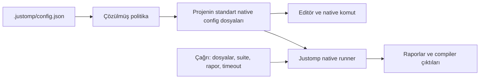
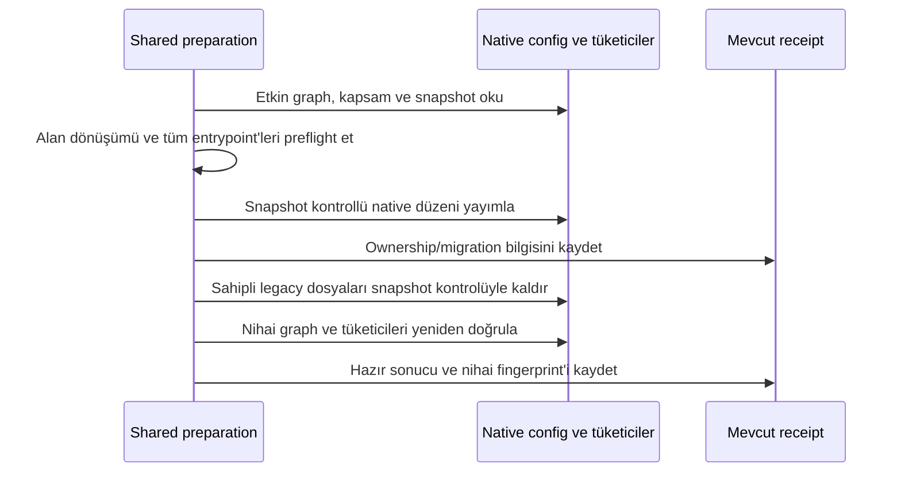

# Standard Tool Configurations - Plan

## Goal Capsule

**Objective:** Justomp ile yönetilen projelerde araçlar ve editörler ortak ayarları kendi standart config dosyalarında bulabilsin; kullanıcı ikinci bir Justomp config düzeniyle uğraşmasın.

**Means:** Merkezi politika native dosyalara uygulanır; çalıştırmaya özgü parametreler CLI/API üzerinden aktarılır. Gerekli TypeScript projelerinde gerçek kontrol/build ayrımı kurulur (KTD1, KTD9–KTD12).

**Authority:** Kullanıcı kararları ve Product Contract davranışı belirler. Planning Contract yöntemi belirler; birimler bu sözleşmeleri değiştirmez. Geliştirme kuralları `AGENTS.md` dosyasındadır.

**Execution profile:** Dokuz birim, tek feature branch ve tek PR. Planı onaylamak yayın onayı değildir. Uygulayıcı kod, test ve dokümanları tamamlar; yayın kullanıcı kararıyla yapılır.

**Stop conditions:** Bir native config'in anlamını kaybetmeden düzenlemek mümkün değilse o dosya ve tüketici gösterilir. Kapsam daraltma, gizli config kopyasına dönüş, TypeScript sürümünü düşürme veya kararlaştırılmamış compiler API değişimiyle devam edilmez.

## Product Contract

### Summary

`.justomp/config.json` politika kaynağı kalır. Extension lint, format, typecheck ve test ayarlarını araçların standart config dosyalarına uygular. Mevcut dosyaların Justomp tarafından yönetilmeyen proje ayarları korunur. Özel adlı kalıcı config'ler ve test/typecheck sırasında üretilen alternatif config kopyaları kaldırılır.

### Problem Frame

Mevcut akış Biome, Prettier, Pyright, TypeScript ve Go lint için ayrı Justomp config'leri üretiyor. Test akışları da çalıştırma dizinlerinde alternatif coverage, Vitest ve Bun config'leri oluşturuyor. Native araçların ve editörlerin gördüğü ayarlar, Justomp'ın kullandığı dosyalardan ayrılıyor. TypeScript kopyaları ayrıca kaynak/test kapsamı ve declaration graph değişikliklerini gizliyor.

### Key Decisions

- **Standart config kullanımı bütün araçları kapsar.** Governs R1, R4, R14. (session-settled: user-directed — chosen over yalnız Biome/Prettier dosyalarını değiştirmek: kullanıcı TypeScript dahil bu tür bütün config'lerin kapsanmasını istedi.)
- **Merkezi politika esas kalır.** Governs R2, R5, R6. (session-settled: user-directed — chosen over native dosyaları ayrı politika kaynağı yapmak: extension standart dosyaları `.justomp/config.json` üzerinden güncelleyecek.)
- **Gereken TypeScript projelerinde native build/kontrol yapısı düzenlenebilir.** Governs R13. (session-settled: user-directed — chosen over mevcut build yapısını her koşulda aynen bırakmak: kaynak ve testleri kontrol ederken uygulama build'ini korumak için gerçek standart config ayrımı ve ilgili build komutu değişiklikleri onaylandı.)

### Requirements

#### Standart dosyalar ve otorite

- R1. Yönetilen lint, format, typecheck ve test politikası ilgili projenin standart native config dosyalarında bulunur; mevcut uygun dosya kullanılabiliyorsa rakip dosya oluşturulmaz.
- R2. Yönetilen değerler çözülmüş `.justomp/config.json` politikasından gelir; native config'ten merkezi config'e otomatik geri aktarım yapılmaz.
- R3. Mevcut strict kurallar, safe-fix sınırları, format seçenekleri, kaynak/test kapsamı ve sonuç raporlama davranışı korunur.
- R14. Aynı politikayı taşıyan alternatif config, başka adla veya geçici/gizli dizinde yeniden üretilmez; invocation parametresi ile gerçek compiler çıktısı bu yasaktan ayrılır.

#### Mevcut dosyalar ve geçiş

- R4. Yalnız Justomp sahipliği doğrulanmış eski config'ler başarılı geçişten sonra kaldırılır; kullanıcı dosyaları isim benzerliğiyle silinmez.
- R5. Mevcut native dosyanın yönetilen alanları merkezi politikaya göre güncellenir; ilgisiz alanlar korunur. Güvenli düzenlenemeyen syntax veya belirsiz etkin config, dosya yoluyla açıklanan çakışma olur.
- R6. Tekrar hazırlık semantik olarak güncel native dosyaları yeniden yazmaz; eski yönetilen seçeneklerin merkezi politikadan kaldırılması da doğru yansıtılır.
- R7. Kısmi başarısızlık yapılan değişiklikleri raporlar ve hazır sonucu vermez; yeniden hazırlık sahiplik ve güncellik kontrolleriyle devam eder.
- R8. Yalnız config migration nedeniyle latest sorgusu, kurulum veya ortak sürüm dalgası başlatılmaz; yeni proje/eksik araç davranışı korunur.

#### Çalışma yolları ve proje sınırları

- R9. Yeni native hedefler ve gerekli mevcut config graph yolları, mevcut OMP write/edit ve bash korumasına alınır; güvenilir Justomp işlemleri bunları güncelleyebilir.
- R10. CLI, OMP ve Git hook'ları aynı hazırlık/çalıştırma katmanını kullanır; salt-okunur check migration yapmaz.
- R11. Her proje kendi native config'lerini kullanır; parent proje child projenin ayarını veya kaynak kapsamını sahiplenmez.
- R12. Justomp reposu da geçer; `.private/**`, repo-only `skipLibCheck` ve %70 unit coverage korunur. Mevcut tracked proje config'leri geçiş gerekçesiyle ignore edilmez.
- R13. TypeScript'in bütün mevcut kaynak/test kapsamı, Next tip üretimi ve yerel dependency declaration akışı korunur; gereken native config/build ayrımı uygulamanın çıktı yollarını ve runtime build davranışını değiştirmez.
- R15. State, lock/manifest, rapor, cache, declaration çıktıları ve işlem verisi sırf Justomp tarafından yazıldığı için config kopyası sayılmaz.
- R16. Test dosyası seçimi, unit/integration seçimi veya rapor yolu her çağrıda standart config'i değiştirip geri alma işlemi doğurmaz.
- R17. Hazırlık ve check güncelliği gerçekten kullanılan native config'leri ve ilgili inheritance graph'ını kapsar; yalnız araç sürümü kontrol edilerek hazır sonucu verilmez.

### Acceptance Examples

| ID | Başlangıç / işlem | Beklenen sonuç |
| --- | --- | --- |
| AE1 | Yeni JS projesini hazırla | Biome/Prettier standart dosyaları oluşur; typecheck/test için de envanterdeki standart yollar kullanılır. Covers R1–R3. |
| AE2 | Kurulu araçları ve sahipli legacy config'leri olan projeyi hazırla | Yeni native düzen yayımlanır, eski kopyalar kaldırılır; gereksiz kurulum yapılmaz. Covers R4, R8. |
| AE3 | Aynı politika ile hazırlığı tekrarla | Dosya byte'ları/mtime ve native kurulum sayısı değişmez. Covers R6, R8. |
| AE4 | Var olan native config'te eski strict ayarı ve özel module/alias ayarı vardır | Yönetilen strict alanı güncellenir; module/alias korunur. Covers R2, R5. |
| AE5 | Etkin config güvenli biçimde düzenlenemeyen dinamik bir expression'dır | Yol ve neden raporlanır; dosya ezilmez, gizli wrapper config oluşturulmaz. Covers R5, R14. |
| AE6 | Root ile apps/web ayrı projelerdir | Her birinin kapsamı ve config graph'ı korunur. Covers R1, R11. |
| AE7 | Native dosya yayımlandıktan sonra receipt yazılamaz | Yapılan etki raporlanır; hazır sonucu verilmez; tekrar hazırlık mevcut native veriyi değerlendirir. Covers R7. |
| AE8 | Legacy dosya silinmeden dışarıdan değiştirilir | Snapshot uyuşmazlığı nedeniyle silinmez. Covers R4, R7. |
| AE9 | Genel agent aracı henüz olmayan canonical dosyaya yazar | Koruma engeller; güvenilir hazırlık aynı dosyayı oluşturabilir. Covers R9. |
| AE10 | Salt-okunur check taşınmamış projede çalışır | Hazırlık gereksinimi döner; dosya değiştirilmez. Covers R10. |
| AE11 | TS projesinde rootDir=src, testler tests/, declaration çıktısı dist/ | Native kontrol/build ayrımı yapılır; testler kontrol edilir, build'in üretim çıktıları aynı yerde kalır. Covers R13. |
| AE12 | Önce tüm unit suite, sonra tek dosya, sonra integration suite çalışır | Kapsam ve coverage sözleşmeleri korunur; native config çağrılar arasında değiştirilmez, alternatif config yaratılmaz. Covers R3, R14, R16. |
| AE13 | Native Vitest config'i veya tsconfig leaf'i değişir | Eski receipt hazır sayılmaz; etkin dosya güncellik hesabına girer. Covers R17. |

### Scope Boundaries

Kapsam bütün native araç config üreticileri, hazırlık/readiness, tüketiciler, migration, koruma ve gerekli native build bağlantılarıdır. Bu bir dosya adı arama/değiştirme işi değildir.

- Yeni public tool/input veya config yönetim komutu eklenmez; mevcut hazırlık yolları kullanılır.
- Genel dosya transaction sistemi, watcher değişimi, OMP launcher/SDK değişimi ve yeni sandbox tasarımı eklenmez.
- Dinamik JS/TS config'leri planlama veya statik migration için çalıştırılmaz. Test çalıştırırken zaten kullanılan native config loader'ın kullanıcı setup'ını yüklemesi korunur.
- Native komutların her managed invocation ile aynı rapor, timeout veya suite seçimini kendiliğinden yapması beklenmez. Kalıcı politika standart dosyada; işlem parametreleri çağrıda olur.
- Consumer repoların `.gitignore` dosyaları topluca değiştirilmez. Kullanıcıya ait tracked config'leri üretilmiş dosya gibi ignore etmek veya silmek kapsam dışıdır.
- Daha sonra yeni bir config üreticisi eklenirse R1/R14 geçerlidir; yalnız bilinen suffix listesini temizlemek tamamlanma sayılmaz.

## Planning Contract

### Tam çıktı envanteri

| Mevcut çıktı / üretici | Hedef ve işlem |
| --- | --- |
| `biome.justomp.jsonc` — `src/lint/projection.ts` | Mevcut etkin standart Biome config'ini güncelle; yoksa `biome.json`. JSON/JSONC formatını koru. |
| `prettier.justomp.json` — aynı üretici | Mevcut statik standart config'i güncelle; yoksa `.prettierrc.json`. Etkin embedded manifest alanını rakip dosyayla gölgeleme. |
| `golangci.justomp.yml` — aynı üretici | Mevcut standart golangci config'ini güncelle; yoksa `.golangci.yml`. |
| Ruff `[tool.ruff]` — `src/lint/projections/python.ts` | Zaten standart `pyproject.toml`; mevcut alan bazlı politika davranışını koru, alternatif etkin Ruff config'lerini denetle. |
| `pyright.justomp.json` — `src/typecheck/projections/python.ts` | Var olan `pyrightconfig.json`; yoksa mevcut `pyproject.toml` içindeki `[tool.pyright]`. Native precedence'e uy. |
| `tsconfig.justomp.<index>.json` — `src/typecheck/projections/javascript.ts` | Mevcut `tsconfig.json`/`jsconfig.json` ve gerçek native config graph'ı; gerekli kaynak/test/build ayrımı KTD10'dadır. |
| `tsconfig.justomp.declarations.<hash>.json` — `javascript/prepare-types.ts` | Gerçek native build config'leri ve declaration-only CLI; reference'lar native build graph'ına bağlanır. |
| `justomp-declaration-inputs-*/tsconfig.json` — `javascript/read-session.ts` | Geçici config üretimi kalkar; normalize edilmiş native graph üzerinden `--showConfig`/`--listFilesOnly`. |
| `.justomp/test_runs/run-*/coverage.ini` — `testing/python/config.ts` | Normalde `pyproject.toml` `[tool.coverage.*]`; etkin mevcut standart coverage config'i varsa onu kullan. Çağrıya özgü veri CLI/public API'de. |
| `.justomp/test_runs/run-*/vitest.config.mjs` — `testing/javascript/vitest.ts` | Gerçek native Vitest/Vite config'i; yoksa standart `vitest.config.ts`. Çağrı parametreleri paketlenmiş runner'dan Vitest API'ye. |
| `.justomp/test_runs/run-*/bunfig.toml` — `testing/javascript/bun.ts` | Projenin gerçek `bunfig.toml`; varsa mevcut explicit integration config'i de kendi kullanım alanında korunur. Kopya üretilmez. |
| Pytest native setup — `testing/python/managed_pytest.py` | Mevcut pytest config keşfi ve kullanıcı fixture/setup davranışı korunur; yeni pytest wrapper config'i oluşturulmaz. |
| Geçici Go `go.work` — `src/lint/go/environment.ts` | Politika projeksiyonu değil: native aracın `go.work.sum` yazısını izole eden workspace kopyası. Relative path rebasing ve cleanup korunur; merkezi lint/test ayarı buraya taşınmaz. |
| Bun `coverage-preload.ts`, Go `go-files.json`/`go-constraints.json` | Çalıştırma kodu/verisi; kalabilir. Bun helper mümkünse paketlenmiş sabit kod + çağrı verisi kullanır; ikinci politika dosyasına dönüşmez. |
| `.justomp/*_state.json`, `packaging_structure.json`, hook `*.justomp.json` receipt'leri | İç durum/sahiplik kaydı; native araç ayarları değildir, adları değiştirilmez. |
| JUnit/LCOV/coverage JSON, `.d.ts`, Next route tipleri, cache, manifest/lock | Sonuç, compiler ürünü veya paket metadata'sı; mevcut işlevleri korunur. |
| Sahipli `eslint.justomp.config.mjs` | Mevcut legacy temizliği korunur; yeni ESLint yolu eklenmez. |

Bu tablo üretici çağrı yerlerinden doğrulanır. Uygulama sonunda config yazan bütün production yolları yeniden taranır; normal adlı fakat geçici dizinde üretilen alternatif config'ler de R14 kapsamındadır.

### Key Technical Decisions

- KTD1. Native config seçimi araçların gerçek precedence'ine göre yapılır; yeni dosya yalnız uygun etkin native config olmadığında oluşturulur. Strict JSON dosyaya yorum veya tanınmayan ownership alanı eklenmez. Governs R1, R5. [Biome configuration](https://biomejs.dev/configuration/configure-biome/), [Prettier configuration](https://prettier.io/docs/configuration), [golangci configuration](https://golangci-lint.run/docs/configuration/file/).
- KTD2. Yönetilen alanlar ve migration sürümü mevcut ilgili lint/typecheck/test receipt'inde opsiyonel metadata olarak tutulur. Eski receipt'ler tools/waves/membership kaybetmeden okunur. Metadata keyfi bir dosya yoluna yazma/silme yetkisi vermez. Governs R6–R8, R17.
- KTD3. Native dosyalarda sahiplik alan/section düzeyindedir. Her adaptör yönetilen alan kümesini ve korunacak proje bağlamını açıkça tanımlar; önceki receipt, artık kullanılmayan yönetilen alanları kaldırmak için kullanılır. Receipt kaybında bilinmeyen alanlar topluca silinmez; güvenli dönüşüm çıkarılamıyorsa R5 uygulanır.
- KTD4. Etkin config envanteri mevcut proje dosya kapsamını, native precedence'i ve gerçek extends/reference graph'ını kullanır. Sadece farklı basename görmek çatışma değildir; birbiriyle uyumlu native graph korunur, belirsiz/rakip politika sessizce seçilmez. Child/dependency sınırları korunur. Governs R5, R11, R17.
- KTD5. Hazırlık hedef batch için önce config dönüşümünü ve tüketicileri preflight eder. Ardından snapshot kontrollü native yayınlama, ownership kaydı, sahipli legacy temizliği ve son readiness doğrulaması yapılır. Önceki etkiler geri alınmış gibi raporlanmaz; mevcut lease/atomik dosya helper'ları kullanılır. Governs R4, R7, R8, R10.
- KTD6. Araç çağrıları seçilen gerçek native config'i açıkça kullanabilir; bu, standart keşifle çelişen ikinci config üretmez. Prettier'in mevcut direct-options API akışı korunabilir, fakat yayımlanan native politika aynı çözülmüş değerleri taşır. Governs R1–R3.
- KTD7. Koruma envanteri seçilmiş native config'leri ve oluşturulacak default hedefleri kapsar; eski yollar migration desteği boyunca korunur. Mevcut bütün-dosya koruma modeli kullanılır, yeni alan bazlı sandbox tasarlanmaz. Governs R9.
- KTD8. Dönüşüm, seçim, hata kombinasyonları ve argv kararları unit; gerçek dosya yayınlama ve native handoff mevcut entegrasyon fixture'larında kanıtlanır. Paket yöneticisi × config/migration matrisi kurulmaz. (pack: testing, test-evidence-and-cost.md)
- KTD9. Python'da Ruff, Pyright, pytest ve coverage ayarları etkin native dosyada yalnız kendi alanlarını değiştirir. Pyright import yolları/extends/execution environments korunur; seçilen interpreter CLI'da kalır, makineye özgü absolute venv yolu native config'e basılmaz. Governs R2, R3, R5. [Pyright configuration](https://github.com/microsoft/pyright/blob/main/docs/configuration.md).
- KTD10. TS standart graph'ı kontrol ve build için gerçek bir proje sözleşmesine dönüştürülür; yalnız adları değişmiş Justomp overlay'leri kullanılmaz. Yeterli mevcut graph korunur, gerekli projelerde kontrol/IDE girişi ile üretim build girişi ayrılır. Governs R13. (session-settled: user-directed — chosen over build yapısını hiç değiştirmemek: bütün kaynak/test kapsamı korunurken gerekli standart config ve build komutu düzenlemeleri onaylandı.) Ayrıntı aşağıdadır.
- KTD11. Test preparation kalıcı native politikayı uzlaştırır; test yürütme seçili dosya, suite, coverage etkinliği ve rapor hedeflerini CLI/API üzerinden verir. Kalıcı config'e run directory veya tek çağrının dosya listesi yazılmaz. Governs R14, R16. Ayrıntı aşağıdadır.
- KTD12. Go'nun geçici workspace izolasyonu, Bun coverage import helper'ı ve sonuç dizinleri korunur. Bunlar invocation mekanizmasıdır; bu istisna test/typecheck alternatif config'lerini saklamak için kullanılamaz. Governs R14, R15.

### Native dosyaların düzenlenmesi

JSON/JSONC, TOML ve YAML dönüşümleri parse edilen alanları hedefler. Mevcut statement/snapshot helper'ları yeniden kullanılır; mevcut yorumlar ve ilgisiz alanlar mümkün olduğunca byte düzeyinde korunur. Yeni bir genel config framework'ü kurulmaz. Mevcut araçlar güvenli JSONC alan düzenlemesi sağlamıyorsa dar bir parser/edit bağımlılığı Justomp tarafında değerlendirilir; consumer projeye migration kütüphanesi kurulmaz.

Her adaptör bir alan sahiplik tablosu taşır. Örneğin TypeScript strict seçenekleri Justomp'a, `module`, `paths`, `jsx` ve üretim output bağlamı projeye aittir. Native `extends` altındaki leaf override'ları merkezi politikayı etkisiz bırakamaz. Proje dışında veya dependency paketindeki config düzenlenmez; gerekli değerler proje-local native leaf'te ifade edilir.

JS/TS ile yazılmış Prettier/Vitest config'leri JSON'a çevrilmez veya eval edilip yeniden serileştirilmez. Statik object ve güvenli `defineConfig` biçimleri AST alan düzenlemesiyle desteklenir; imports, plugin/function değerleri ve yorumlar korunur. Dinamik factory/spread/conditional yapısında yönetilen alanın etkin değeri güvenle belirlenemiyorsa R5 uygulanır. Bu hata bir wrapper config ile gizlenmez. Native çalıştırma sırasında gerçek config'in yüklenmesi mevcut runner sözleşmesidir.

Politika alanı kaldırıldığında önceki receipt sahiplik kümesi dikkate alınır. Sahipsiz eski Justomp dosyası otomatik silinmez. Standart config'in bütün içeriği için eski marker şartı aranmaz; marker yalnız legacy dosya silme kanıtıdır.

### TypeScript native graph geçişi

1. Mevcut `tsconfig`/`jsconfig` entrypoint'lerini, effective seçenekleri, kaynak/test üyeliğini, reference'ları, package build script'lerini ve Next'in seçtiği `typescript.tsconfigPath` değerini tek read snapshot'ında çıkar.
2. Mevcut native graph zaten bütün kontrol kapsamını ve build ayrımını temsil ediyorsa topology değiştirme. Ortak strict alanları ilgili proje-local leaf'lere uygula.
3. `rootDir: src` ve dışarıdaki testler gibi çakışmalarda gerçek standart ayrım kur. Kontrol/IDE girişi bütün sahip olunan kaynak/test dosyalarını kapsar; gerekirse `tsconfig.build.json` yalnız üretim kaynaklarını ve önceki output seçeneklerini taşır. Birden çok farklı native bağlamı tek tsconfig'e düzleştirme; mevcut solution/source/test yapısını koru.
4. Build script'leri, native reference hedefleri ve framework config entrypoint'leri aynı migration planında doğru girişe bağlanır. Karmaşık shell script'i veya dinamik framework seçimi güvenle çözülemiyorsa ilgili dosya/komutla R5 hatası verilir; uygulamanın build komutu tahmin edilmez.
5. Editör/check için strict, checkJs ve merkezi dışlamalar native graph'a yazılır. `--noEmit`, raporlama ve işlem iptali kontrol çağrısındadır. Üretim build'ine körlemesine `noEmit`, repo-root `rootDir` veya `composite:false` basılmaz.
6. Declaration üretimi native build graph'ını dependency sırasıyla kullanır. Gerekli reference hedefleri declaration üretilebilir olur; normal build ile declaration-only çalıştırmanın output yolları aynı sözleşmeden çıkarılır. `.d.ts` ve varsa native build cache çıktıları raporlanır; özel declaration config'i üretilmez.
7. `JavascriptConfigRead.programFiles` uygun native giriş üzerinden input/import closure okur; geçici `tsconfig.json` yaratmaz. Üretim include/exclude davranışı build girişinde korunur. Kontrol girişi mevcut Justomp kaynak/test üyeliğini ve merkezi typecheck dışlamalarını kullanır; build config'indeki `exclude: ["tests"]` testleri kontrolden düşürmez.
8. Next `typegen`, gerçek framework config/entrypoint'iyle devam eder. `next-env.d.ts`, route tipleri ve custom distDir desteği korunur; tam uygulama build'i typecheck hazırlığına eklenmez.

İlk uygulama kanıtı mevcut source/test + reference + Next fixture'larında bu graph'ın çalıştığını göstermelidir. Bunlar native CLI bağlantı kanıtlarıdır; TypeScript kurallarının test kataloğu değildir. Kurulu TypeScript 7.0.2 paketi klasik `createProgram` API'sini dışa açmıyor; bu plan `typescript/unstable/*` API'sine geçiş veya compiler fork'u içermez. [TS project references](https://www.typescriptlang.org/docs/handbook/project-references.html), [TS config](https://www.typescriptlang.org/docs/handbook/tsconfig-json.html).

### Test native config ve invocation ayrımı

| Runner | Kalıcı native politika | Çağrıya özgü mekanizma |
| --- | --- | --- |
| Python/pytest | Mevcut pytest setup'ı; standart coverage config'inde kaynak politikası ve namespace davranışı | Mevcut packaged Python runner; pytest argümanları, `--no-cov`/rapor seçenekleri, gerekirse coverage'ın public API'sinde exact include/source ve data yolu |
| Vitest | Etkin Vitest/Vite config'inde dayanıklı managed alanlar; aliases/plugins/setup korunur | Paketlenmiş runner proje-local `vitest/node` public API'sini kullanır; exact glob listeleri, suite, report, coverage ve no-watch override'ları bellekte verilir |
| Bun | Gerçek bunfig'de statik test ayarları; kullanıcı preloads ve runtime/install alanları korunur | Exact dosyalar, CLI coverage/report/preload seçenekleri; mevcut import-all-source helper'ı ve Justomp coverage hesabı |
| Go | Yeni test config'i yok; mevcut go.mod/go.work | Mevcut native flags, inventory verisi ve coverage profile |

Bun için kalıcı `test.coverage` kapalı tutulur; managed tam unit çağrısı merkezi coverage kararıyla `--coverage` ekler. Böylece targeted/integration çağrısında doğrulanmamış bir `--no-coverage` flag'i veya dosyayı değiştirip geri alma gerekmez. Merkezi coverage eşiği ve açık/kapalı tercih `.justomp/config.json` içindedir; native raporlama ayarları standart config'e yansır, suite'e bağlı etkinlik invocation'da uygulanır. Çıplak `bun test` çağrısının otomatik olarak managed unit coverage gate'ini çalıştırdığı iddia edilmez.

Vitest runner mevcut manager-aware process yolunu kullanır; Yarn PnP ve proje-local sürüm çözümleme korunur. API imzası kurulu native paketin public tiplerinden alınır. CLI substring filtreleri exact dosya seçiminin yerine geçirilmez. Mevcut explicit integration config'leri gerçek kullanıcı setup'ıdır, yalnız farklı ada sahip oldukları için kaldırılmaz.

Python exact source inventory, hiç import edilmeyen namespace kaynakları ve rapor accounting korunur. `--cov=<dir>` kullanmanın tek başına mevcut bütün sözleşmeyi karşıladığı varsayılmaz. Public coverage API gerektiğinde mevcut Python runner üzerinden kullanılır; pytest-cov private internals'ına bağlanılmaz. [Coverage config/API](https://coverage.readthedocs.io/en/latest/api_coverage.html), [pytest-cov config](https://pytest-cov.readthedocs.io/en/latest/config.html), [Vitest API](https://vitest.dev/guide/advanced/), [Bun test config](https://bun.com/docs/test/configuration).

### High-Level Technical Design

| Durum | İşlem | Hata davranışı |
| --- | --- | --- |
| Etkin native dosya eksik | Standart default hedefi planla | Yol güvenli değilse yazma |
| Native yapı mevcut ve düzenlenebilir | Yönetilen alanları uzlaştır | Parse/semantic belirsizlikte dosyayı koru |
| Native yayınlama kısmen tamam | Kalan etkileri raporla | Hazır değil; sonraki hazırlık yeni snapshot okur |
| Receipt yazıldı, legacy duruyor | Sahiplik ve snapshot ile temizle | Değişmiş legacy dosyayı silme |
| Native graph güncel | Kurulumdan bağımsız readiness doğrula | Değişen input varsa stale sonucu |

### Riskler ve sistem etkisi

- Native config'ler artık uygulamanın da kullandığı gerçek dosyalardır. Config/build script/reference geçişi birlikte planlanmazsa build yanlış girişten çalışabilir; KTD10 preflight bütün bağlı tüketicileri kapsar.
- Kalıcı native dosyaya invocation rapor yolu yazılması her testte dirty tree yaratır; R16 bunun önüne geçer. Mevcut precommit/prepush yan etki raporlaması korunur.
- Yeni config'lerin `.justomp` iç state'iyle karıştırılması koruma veya ignore boşluğu yaratır. KTD7 ve R12 gerçek proje config'lerini ayrı ele alır.
- Native dynamic config'lerde statik edit sınırlıdır. Desteklenemeyen bir expression açık adoption çakışmasıdır; veri kaybı veya sessiz fallback değildir.
- Geçiş global transaction değildir. TS graph geçişi ortada kesilirse receipt hazır sayılmaz; mevcut native ve tüketici dosya etkileri sonuçta tek tek görünür.

## Implementation Units

### U1. Native config modeli ve alan sahipliği

**Goal:** Standart hedef seçimi, alan yönetimi ve mevcut receipt uyumluluğunu tanımlamak.

**Requirements:** R1, R2, R5–R8, R17; KTD1–KTD3. **Dependencies:** Yok.

**Files:** `src/lint/state.ts`, `src/typecheck/state.ts`, `src/testing/state.ts`, ilgili projection modelleri; yalnız ortak ihtiyaç için dar native-config yardımcıları. Testler: `tests/unit/lint/state.test.ts`, `tests/unit/typecheck/javascript-projection.test.ts`, `tests/unit/testing/preparation.test.ts` ve gerekirse yeni pure dönüşüm testleri.

**Approach:**

1. Config rolü, seçilmiş native yol, yönetilen alan kümesi ve migration sürümünü mevcut state'e opsiyonel ekle.
2. Eski state parse'ını tools/waves silmeden koru; metadata bozuksa ilgili config hazırlığını stale yap.
3. Semantik equality ve alan kaldırma kararını dosya I/O'sundan ayır; ownership metadata'sını path yetkisi olarak kullanma.

**Test scenarios:**

- Eski receipt metadata olmadan okunur, araç sürümleri kaybolmaz.
- Policy alanı eklenir/değişir/kaldırılır; ilgisiz alan korunur.
- Semantik eşit config yeniden yazılmaz; bozuk ownership metadata keyfi yol yetkisi üretmez.

**Test seam:** Veri/karar unit testleri; filesystem yayınlama U3'tedir.

**Verification:** Yeni state modeli ve dönüşüm kararları eski kurulumun config-only geçişini destekler.

### U2. Native seçim ve JS lint/format dosyaları

**Goal:** Biome/Prettier standart dosyalarını etkin native precedence ile yönetmek.

**Requirements:** R1–R3, R5, R11; KTD1, KTD3, KTD4, KTD6. **Dependencies:** U1.

**Files:** `src/lint/projection.ts`, `src/lint/projections/javascript.ts`, `src/lint/scope.ts`, `src/format/readiness.ts`; dar native selection/edit yardımcıları. Testler: `tests/unit/lint/javascript-projection.test.ts`, `tests/unit/format/readiness.test.ts`, mevcut `tests/integration/lint/projection.test.ts`.

**Approach:**

1. Standart Biome/Prettier adlarını ve embedded Prettier ayarını precedence'e göre çöz; root/child kapsamını kullan.
2. Mevcut dosyaya policy-owned alanları uygula; yeni strict JSON çıktıda marker kullanma.
3. JS/TS config için güvenli statik edit yüzeyini sınırla; desteklenmeyen dynamic biçimde yol ve neden döndür.
4. Prettier API ve Biome explicit config çağrısını gerçek native hedefle eşleştir.

**Test scenarios:**

- Covers AE1/AE4. Yeni dosya oluşturma ve mevcut alanları koruyarak güncelleme.
- Covers AE5. Belirsiz native config ve dynamic factory durur; değerlendirme/wrapper oluşmaz.
- Covers AE6. Child config parent'e ait sayılmaz; saklı standart basename'ler bulunur.

**Test seam:** Seçim/edit kombinasyonları supplied veride unit; bir gerçek filesystem örneği path/pruning bağlantısını kanıtlar.

**Verification:** Native dosya seçimi ve merkezi değerler deterministiktir; JS lint/format davranışı korunur.

### U7. Python ve Go standart lint/typecheck ayarları

**Goal:** Pyright ve Go lint kopyalarını kaldırmak, mevcut Ruff standart akışını ortak kurala bağlamak.

**Requirements:** R1–R6, R11; KTD9. **Dependencies:** U1.

**Files:** `src/lint/projection.ts`, `src/lint/projections/python.ts`, `src/lint/projections/go.ts`, `src/typecheck/projections/python.ts`, `src/typecheck/adapters/python.ts`, Go lint/format adaptörleri. Testler: `tests/unit/typecheck/python-projection.test.ts`, ilgili lint projection unit'leri; mevcut Python/Go native fixture'ları.

**Approach:**

1. Pyright native precedence ve kalıcı proje-relative bağlamını koruyarak yönetilen diagnostics/scope alanlarını uygula.
2. `.golangci.yml` veya mevcut standart config'e geç; lint/fmt aynı seçilmiş native dosyayı kullansın.
3. Ruff'ın pyproject alan güncellemesini koru; etkin alternatif Ruff ayarı merkezi politikayı gölgeleyemesin.
4. Go workspace izolasyonunu native lint config migration'dan ayrı tut.

**Test scenarios:**

- Pyright extends ve execution environment import bağlamı korunur; leaf diagnostics merkezi politikaya uyar.
- Pyproject'in dependency/build ve diğer tool tabloları değişmez.
- Go check/fix/format argv gerçek native config'i kullanır; readonly workspace akışı korunur.

**Test seam:** Policy/path mapping unit; native config kabulü mevcut dil lifecycle'ında tek handoff.

**Verification:** `pyright.justomp.json` ve `golangci.justomp.yml` aktif üreticileri kalkar; Ruff standart yolda kalır.

### U8. TypeScript kontrol/build graph geçişi

**Goal:** TypeScript'in bütün özel ve geçici config kopyalarını gerçek native graph ile değiştirmek.

**Requirements:** R1–R7, R11, R13, R14, R17; KTD10. **Dependencies:** U1.

**Files:** `src/typecheck/projections/javascript.ts`, `src/typecheck/javascript/config-graph.ts`, `read-session.ts`, `prepare-types.ts`, `src/typecheck/adapters/javascript.ts`, `freshness.ts`, declaration state modelleri. Testler: `tests/unit/typecheck/config-graph.test.ts`, `javascript-projection.test.ts`, `read-session.test.ts`, `generated-types.test.ts`; mevcut `javascript.native.test.ts`, `references.native.test.ts`, `next.native.test.ts`.

**Approach:**

1. KTD10 dönüşümünü native graph ve tüketici değişikliklerinden oluşan tek plan olarak ifade et.
2. Mevcut yeterli graph'ı koru; gerekli standart build ayrımında build script/reference/Next entrypoint bağlantılarını güncelle.
3. Shared strict policy ile invocation emit seçeneklerini ayır; native CLI kullanmayı sürdür.
4. Declaration output tahmini ve doğrulamayı gerçek build config graph'ına bağla; özel config mapping'lerini state'ten çıkar.
5. Read-session temp config yazımını kaldır; final native snapshot'la freshness hesapla.

**Execution note:** Önce mevcut source/test ve reference fixture'ında R13'ün korunabildiğini kanıtla; uyumsuzlukta özel config fallback'i ekleme.

**Test scenarios:**

- Covers AE11. src-root build ve dış testler doğru native girişlere ayrılır; eski output yolları korunur.
- Native build config'inde `exclude: ["tests"]` olsa da kontrol girişi testleri içerir; merkezi `.private/**` dışlaması geçerliliğini korur.
- Zaten yeterli solution/test graph'ında gereksiz dosya veya build komutu değişikliği olmaz.
- Local reference zinciri declaration üretir; input değişimi stale olur, başarısız üretim ready sayılmaz.
- Next custom config/distDir ve route types aynı native hazırlık akışında kullanılır.
- Covers AE13. Leaf/extends değişikliği fingerprint'i değiştirir; read-session hiçbir temp config yazmaz.

**Test seam:** Graph dönüşümü ve failure kombinasyonları unit; native CLI/reference/Next bağlantısı mevcut üç farklı boundary fixture'ında korunur.

**Verification:** Kaynak/test kapsamı ve build çıktısı korunur; check/declaration/read-session yollarında alternatif config üretilmez.

### U9. Test config'lerini standart dosyalara taşıma

**Goal:** Python, Vitest ve Bun per-run config kopyalarını kaldırmak.

**Requirements:** R1–R3, R5, R14, R16, R17; KTD9, KTD11, KTD12. **Dependencies:** U1.

**Files:** `src/testing/python/config.ts`, `adapter.ts`, `managed_pytest.py`, `src/testing/javascript/config.ts`, `vitest.ts`, `bun.ts`, `src/testing/prepare.ts`, `service.ts`, `targets.ts`; paketlenmiş Vitest invocation runner. Testler: `tests/unit/testing/python.test.ts`, `vitest.test.ts`, `bun.test.ts`, `preparation.test.ts`, `service.test.ts`; mevcut üç runner native fixture'ı.

**Approach:**

1. Kalıcı test config projection'ını preparation'a ekle; receipt/freshness seçilen native config'i kapsasın.
2. Python coverage.ini üretimini kaldır; native config ve gerektiğinde mevcut Python runner içindeki public API seçeneklerini kullan.
3. Vitest wrapper config yerine manager-aware packaged API runner kullan; native kullanıcı config'ini normal yükle, işlem parametrelerini bellekte uygula.
4. Bun gerçek config'ini yönet; coverage/preload/report parametrelerini KTD11 ayrımıyla aktar.
5. Unit/integration native setup ve exact-selection sözleşmelerini koru; rapor dizinleri ve cleanup devam etsin.

**Test scenarios:**

- Covers AE12. Unit/targeted/integration geçişinde native config byte'ları değişmez; alternatif config yazılmaz.
- Native setup/preload/plugin/alias korunur; retry/watch/selection gibi managed çağrı seçenekleri doğru aktarılır.
- Python unimported source coverage, Bun import-all helper ve Vitest exact escaped filename davranışları mevcut handoff'ta korunur.
- Covers AE13. Auto-discovered Vitest/Vite ve explicit integration config değişimleri stale sayılır.
- API runner argv/resolve/PnP hata kombinasyonları unit; gerekiyorsa tek PnP native handoff eklenir.

**Test seam:** Mapping/accounting/error kararları unit; native runner yükleme ve gerçek config consumption entegrasyon. Upstream coverage matematiği test edilmez.

**Verification:** Per-run coverage.ini/vitest.config.mjs/bunfig.toml üretilmez; kapsam, coverage ve hata raporları korunur.

### U3. Shared preparation ve tekrar çalıştırılabilir migration

**Goal:** Bütün native geçişleri mevcut hazırlık ve lease sınırları içinde tamamlamak.

**Requirements:** R4, R6–R8, R10, R17; KTD2, KTD5. **Dependencies:** U2, U7, U8, U9.

**Files:** lint/typecheck/testing prepare/coordinator/state/projection katmanları, `src/lint/files.ts`, ortak preparation girişleri. Testler: mevcut `tests/unit/checks/javascript-preparation.test.ts`, ilgili preparation unit'leri, `tests/integration/lint/projection.test.ts`, typecheck/testing lifecycle testleri.

**Approach:**

1. Config-only stale ile native tool stale ayrımını tüm hazırlıklarda koru.
2. KTD5 sırasını native config + gerekli build tüketicisi değişikliklerine uygula.
3. Legacy marker/snapshot doğrulamasıyla yalnız sahipli dosyaları kaldır; geçişten kalan partial etkileri raporla.
4. Native config drift ve final fingerprint'i doğrula; kendi yazısını dış drift sayan döngü oluşturma.

**Test scenarios:**

- Covers AE2/AE3. Migration ve tekrar hazırlıkta kurulum/latest çağrısı yok.
- Covers AE7/AE8. Save hatası ve değişmiş legacy snapshot doğru partial sonuç verir.
- Covers AE10. Check-only stale config'i yazmaz.
- Native config/build entrypoint yayınlaması yarıda kalırsa ready=false; tekrar hazırlık gerçek dosyalardan devam eder.

**Test seam:** Orchestration/hatalar mocked state/adapter ile unit; atomik yayınlama ve snapshot sınırı mevcut filesystem entegrasyonunda.

**Verification:** Migration config-only çalışır, tekrar edilebilir ve etkilerini doğru raporlar.

### U4. Tüketiciler, kapsam ve koruma

**Goal:** Bütün girişlerin standart dosyaları kullanmasını ve korumasını sağlamak.

**Requirements:** R9–R11, R14, R17; KTD4, KTD6, KTD7. **Dependencies:** U3.

**Files:** `src/protection/paths.ts`, `src/omp/protection.ts`, `src/inspect/exclusions.ts`, `src/format/selection.ts`, `src/lint/scope.ts`, ilgili CLI/OMP/hook bağlantıları. Testler: `tests/unit/protection/paths.test.ts`, kapsam unit'leri, mevcut `tests/integration/omp/protection.test.ts`.

**Approach:**

1. Native seçilmiş ve henüz oluşturulmamış default config yollarını protection'a ekle; inherited dış dependency dosyalarına yazma yetkisi verme.
2. Özel dosya adı dışlamalarını gerçek generated çıktı/native proje dosyası ayrımına göre güncelle.
3. CLI/OMP/hook çağrılarının aynı native readiness ve config seçimini kullandığını doğrula.

**Test scenarios:**

- Covers AE9. Absent default hedef ve seçilmiş native leaf korunur; güvenilir preparation yazabilir.
- Child proje config'i yanlış parent kapsamına girmez.
- OMP genel write reddi ve trusted preparation akışı mevcut fixture'da korunur.

**Test seam:** Yol/argv kararları unit; host wrapper sınırı mevcut integration. Dosya başına yeni sandbox testi kurulmaz.

**Verification:** Standart config'e geçiş koruma boşluğu veya public yüzey ayrışması doğurmaz.

### U5. Native handoff ve migration kanıtı

**Goal:** Standart config'lerin gerçek araçlarca yüklendiğini ve kopya düzeninin kalktığını kanıtlamak.

**Requirements:** R1–R17; KTD8. **Dependencies:** U4.

**Files:** U2/U7/U8/U9'da adı geçen mevcut native/lifecycle testleri, `tests/fixtures/typecheck/`, ilgili testing fixture yardımcıları.

**Approach:**

1. Mevcut native lifecycle'ları yeni standart config'lerle çalışacak şekilde güncelle; tekrar kurulum matrisi ekleme.
2. Biome/Prettier native discovery, Pyright/Go gerçek config kabulü, TS native graph, Vitest API ve Bun/Python invocation sınırlarını kendi fixture'larında koru.
3. Kaldırılan her assertion için Justomp sorumluluğunu ve replacement unit/boundary kanıtını belirt.
4. Artifact envanterini doğrula: policy config kopyası yok; rapor/state/compiler çıktısı doğru sınıflanmış.

**Test scenarios:**

- Native araç doğru standart dosyayı yükler; bir başarılı ve gerektiğinde bir hatalı diagnostic witness yeterlidir.
- Migration sonrasında ikinci hazırlık no-op; unit/integration çağrıları kalıcı config değiştirmez.
- Normal build entrypoint'i eski output sözleşmesini korur; typecheck hâlâ testleri içerir.

**Test seam:** Sadece gerçek native/FS/process bağlantısı; upstream kural katalogları ve çoğaltılmış manager matrisi yok.

**Verification:** Bütün üretici kategorileri kapsanır; yeni native sınırların ölçülmüş maliyeti raporlanır.

### U6. Justomp reposu ve dokümanlar

**Goal:** Kendi repomuzu ve kullanım rehberlerini aynı native düzene geçirmek.

**Requirements:** R12, R15; KTD5, KTD8. **Dependencies:** U5.

**Files:** `.gitignore`, `.justomp/config.json`, gerekirse repo native config/build entrypoint'leri, `AGENTS.md`, `docs/lint.md`, `docs/typecheck.md`, `docs/testing.md`, `docs/format.md`, `docs/protection.md`, `docs/ci.md`; `README.md` eski anlatım varsa.

**Approach:**

1. Bu repoyu mevcut preparation yoluyla geçir; gerekli generated-only ignore ve dar format dışlamalarını güncelle.
2. Tracked native proje ayarlarını ignore etme; AGENTS'taki generated config anlatımını gerçek yeni ayrımla uyumlu yap.
3. Merkezi otoriteyi, native config alan yönetimini, TS native build ayrımını ve invocation parametrelerini anlat.
4. Legacy adların aktif üretici/tüketicilerde kalmadığını kontrol et; migration ve tarihsel test referansları açıklanmış kalabilir.

**Test expectation:** Ek unit test yok; U1–U5 ve mevcut managed gate davranış kanıtıdır.

**Verification:** Repo config'i ve dokümanlar aynı düzeni anlatır; diff yalnız amaçlanan kapsamı içerir.

## Verification Contract

Planlama sırasında test veya prototip çalıştırılmaz. Uygulamada `AGENTS.md` ve testing pack uygulanır.

| Kanıt | Yüzey | Kabul |
| --- | --- | --- |
| Pure seçim, config edit, graph, state, error | `bun scripts/development.ts test --test-file <exact>` | U1–U4/U7–U9 kararları supplied verilerle sınanır |
| Filesystem/host/native sınır | `bun scripts/development.ts integration --test-file <exact>` | Mevcut fixture'lar kullanılır; yeni kurulum matrisi yok |
| Rutin kalite | Git hook'ları ve mevcut `bun run check` | Lock, format, lint, strict typecheck, unit coverage geçer; geçerli hook kanıtı tekrarlanmaz |
| Tam maliyet | `bun run test:cost` | Check + tek integration traversal; aynı toolchain/concurrency ile ölçüm |
| Platform | Linux/macOS CI | Her iki platformdaki native publication/protection kanıtı korunur; yalnız macOS sonucu Linux başarısı diye sunulmaz |

Maliyet hedefi warm tam gate için 300 saniye ve karşılaştırılabilir başarılı baseline varsa %60 azalma koşuludur. Uygun baseline yoksa kıyas yapılamadığı yazılır. Önceki çalışmanın süre istisnası bu değişikliğe otomatik taşınmaz. Hedef aşılırsa ölçüm ve maliyet sunulur; test silme, skip/retry veya worker artırımıyla gizlenmez. (pack: testing, test-evidence-and-cost.md)

Native API/flag uyumu kurulu paket tipleri ve mevcut handoff fixture'ıyla uygulamada doğrulanır. Plan araştırması runtime kanıtı sayılmaz. Beklenmedik sınırlama R3/R13/R14'ü ihlal eden fallback'e yetki vermez.

## Definition of Done

- U1: Alan sahipliği ve eski receipt uyumluluğu kurulum state'ini kaybetmeden çalışır.
- U2/U7: JS, Python ve Go native config seçimi/güncellemesi gerçek standart dosyalardadır.
- U8: TS kaynak/test/build graph'ı native dosyalarda görünür; bütün overlay ve read-session config üretimi kaldırılmıştır.
- U9: Test akışları per-run config kopyası üretmez; suite/coverage/selection mevcut sözleşmeyi korur.
- U3: Migration, tekrar hazırlık ve partial-effect raporlaması kanıtlanır; config-only işlem latest dalgası başlatmaz.
- U4: Native yollar korunur; CLI, OMP ve hook davranışı aynı katmandan gelir.
- U5: Yeni native sınırlar mevcut fixture'larda kanıtlanır; gereksiz integration çoğalması yoktur.
- U6: Justomp'ın native dosyaları, ignore politikası ve dokümanları tutarlıdır.
- R1–R17 ve AE1–AE13 ilgili kanıtlarla karşılanır; çalıştırılmamış platform kontrolleri açıkça belirtilir.
- Legacy adlar yalnız migration/koruma ve geçmiş uyumluluk kanıtlarında kalır; ad değiştirerek veya gizli dizine taşıyarak ikinci config düzeni korunmaz.
- Deneme API köprüleri, geçici bypass, terk edilmiş refactor ve kapsam dışı tool/dependency değişikliği diff'te kalmaz.
- Sonuç davranış değişikliğini, doğrulama kapsamını ve maliyet ölçümünü belirtir. Push/PR/merge kullanıcı onayıyla ayrı ilerler.
