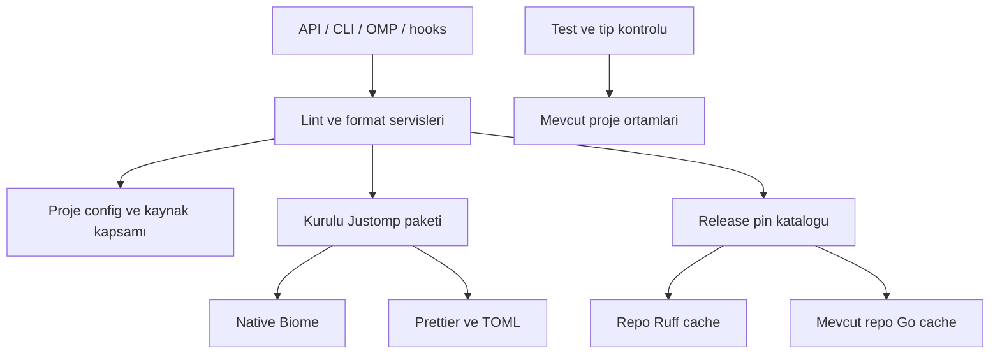

# Justomp-Owned Lint and Format Toolchain - Plan

## Goal Capsule

Geliştirici, desteklenen Python, JavaScript/TypeScript ve Go projelerinde ortak Justomp politikasıyla lint ve format çalıştırabilmeli; bunun için projeye lint/format paketi eklemek zorunda kalmamalıdır.

**Means:** Araç sahipliği KTD1–KTD3 ile Justomp’a taşınır.

**Authority:** Ürün davranışında R-ID gereksinimleri, teknik yöntemde bunlarla sınırlı KTD kararları geçerlidir; unit’ler bu sözleşmeleri değiştirmez.

**Stop conditions:** Sözleşme çatışması veya veri kaybı riski çözülmeden ilerlenmez. Gerekli runtime eksikliği ilgili değişmeyen serviste açık hata olarak raporlanır; kontroller atlanmaz.

Çalışma, mevcut `refactor` dalından tek PR olarak yürütülür. Bu plan uygulama, commit, push veya yayınlama izni değildir.

---

## Product Contract

### Summary

Değişiklik lint/format araçlarının kurulumu, sürüm seçimi, executable çözümlemesi ve readiness bağını kapsar. Ruff ve Biome artık hedef projenin bağımlılık ortamından çalıştırılmaz; mevcut Go ve Prettier sahiplikleri aynı modele bağlanır.

Test runner ve typecheck bağımlılıklarının sahipliği değişmez. Merkezi lint/format, bütün Justomp işlemlerinin dil runtime’larından veya proje bağımlılıklarından bağımsız olduğu anlamına gelmez.

### Problem Frame

Python lint hazırlığı bugün Ruff’ı uv üzerinden proje geliştirme bağımlılığı olarak hazırlıyor. JavaScript hazırlığı Biome için proje manifesti, lock ve kurulu paket durumunu kullanıyor.

Bu yaklaşım ortak lint politikasının araçlarını uygulamanın bağımlılık yaşam döngüsüne bağlıyor. Formatter da Ruff için aynı hazırlanmış proje ortamına bağımlı.

Go executable’ı zaten repository altında Justomp’a ait; Prettier ve TOML eklentisi Justomp runtime bağımlılıkları. Refactor bu mevcut ayrımları kullanır, yeni bir araç platformu kurmaz.

### Requirements

#### Ownership and Provisioning

R1. Desteklenen projelerde lint/format executable seçimi ve sürüm sahipliği Justomp’a ait olmalıdır; hedef projedeki veya PATH üzerindeki Ruff/Biome seçimi etkilememelidir.

R2. Lint/format araç hazırlığı hedef projelerin bağımlılık deklarasyonlarını, dependency gruplarını, `packageManager` alanını, scriptlerini veya lock dosyalarını değiştirmemelidir. Native config uzlaştırmasının sahip olunan alanları değiştirmesi bu yasağın dışında kalır.

R3. Ruff/Biome içeren eski bağımlılıkların kökeni bilinmiyorsa deklarasyonlar ve lock kayıtları korunmalıdır. Merkezi çalıştırma bu bağımlılıkların sürümüne veya varlığına bağlı olmamalıdır.

#### Behavioral Compatibility

R4. Mevcut Ruff, Biome, Prettier, golangci-lint, gofumpt/goimports davranışları; lint kuralları, kaynak seçimi, native config dosyaları ve sahip olunmayan ayarlarla yorumların korunması sürmelidir.

R5. API/CLI/OMP adları, action ve sonuç şemaları, onay davranışları, hook sıralaması ve durable değişikliklerin staging davranışı korunmalıdır. Hata ve effect raporları gerçek merkezi araç kaynağını yansıtmalıdır.

R6. Test runner ve typecheck sahipliği, gerekli paket kurulumları, sürüm politikaları ve özellikleri değişmemelidir. Bunların ihtiyaç duyduğu runtime, manager ve CI hazırlıkları kaldırılmamalıdır.

#### Lifecycle and Runtime Boundaries

R7. Hazırlık; geçerli araç, güncel politika, native config sahipliği ve proje üyeliği doğrulamasından sonra readiness yayımlamalıdır. Check-only hazırlık yapmamalı; stale durumda açıkça başarısız olmalıdır.

R8. İzole Python lint/format yolu Python veya uv gerektirmemeli; izole JavaScript lint yolu Node veya proje-local Biome gerektirmemelidir. Go lint/format için uyumlu Go ve uygulama bağımlılıkları gereksinimi korunmalıdır.

R9. Kurulu Justomp paketi checkout’tan ve hedef projenin paket yerleşiminden bağımsız çalışmalıdır. Platform kapsamı mevcut Darwin/Linux x64/arm64 sınırında kalmalı; yeni Windows veya musl desteği vaat edilmemelidir.

#### Evidence and Repository Policy

R10. `.private/**` dışlamaları, repository `skipLibCheck` istisnası, ortak kurallar ve %70 unit coverage eşiği korunmalıdır.

R11. Justomp’a ait kararlar uygun unit sınırında, gerçek executable/config/publication/package sınırları integration testlerinde kanıtlanmalıdır. Mevcut test maliyet kuralı uygulanmalı; başarısız veya ölçülemeyen hedef gizlenmemelidir. (pack: testing, test-evidence-and-cost.md)

R12. Kullanım, migration, runtime sınırları ve bakım belgeleri yeni sahipliği açıklamalı; yayın yalnızca kullanıcının o yayın için verdiği onayla yapılmalıdır.

### Key Decisions

- **Lint/format araçlarını Justomp sahiplenir.** Governs R1, R2, R7, R9.
  (session-settled: user-directed — chosen over project dependency mutation: ortak araçların uygulama bağımlılıklarına eklenmesi yerine Justomp sahipliği seçildi.)

- **Test runner sahipliği taşınmaz.** Governs R6, R8.
  (session-settled: user-directed — chosen over centralizing test runners: modül ve eklenti çözümleme karmaşıklığı nedeniyle proje bağlamındaki mevcut sahiplik korundu.)

- **Cutover mevcut ürün sözleşmesini korur.** Governs R3, R4, R5, R6, R10.
  Kapsam onayı mevcut lint kurallarını, config dosyalarını, OMP/CLI/hook semantiğini ve typecheck sahipliğini korur.

### Scope Boundaries

**Dahil:** araç katalog kimliği, Ruff native kurulum sahipliği, kurulu paketten Biome çözümlemesi, lint/format readiness entegrasyonu, eski state geçişi, fixture dönüşümü, paket/CI kanıtı ve belgeler.

**Hariç:** yeni lint motoru, kural değişikliği, test runner merkezileştirmesi, typecheck yeniden tasarımı, public proje-başına araç sürümü ayarı veya bağımlılık temizleme API’si.

Global kurulum/güncelleme, repository’ler arası cache/daemon, zamanlanmış retry, otomatik GC ve eski executable’a fallback eklenmez.

Native config değişikliği bağımlılık mutasyonuyla karıştırılmaz: `pyproject.toml` içindeki yönetilen Ruff alanları veya mevcut sahiplik kapsamında embedded Prettier ayarları uzlaştırılabilir.

Tam OMP başlangıcı ve hook’lar R6 kapsamındaki servisleri de hazırlayabilir. R2 ve R8, bu servislerin meşru bağımlılık ve runtime ihtiyaçlarını ortadan kaldırmaz.

### Acceptance Examples

| ID | Girdi ve işlem | Beklenen sonuç |
|---|---|---|
| AE1 | Python/uv olmayan ortamda, Ruff bağımlılığı olmayan Python projesine izole lint/format hazırlığı | Justomp Ruff’ı çalışır; dependency grupları ve lock değişmez; yönetilen native config değişebilir. |
| AE2 | Node ve child Biome olmadan JS projesine izole lint | Kurulu Justomp paketinin native Biome executable’ı kullanılır. |
| AE3 | Child/global Ruff veya Biome farklı sürümde; eski receipt mevcut | Merkezi sürüm seçilir; eski dependency deklarasyonları korunur; eski executable çalıştırılmaz. |
| AE4 | Araç sağlıklı, native config veya politika stale | Config/readiness uzlaştırılır; sağlıklı executable yeniden kurulmaz. |
| AE5 | Hazır projede check-only | İndirme ve config yazımı yapılmaz; manifestler ve lock dosyaları byte-identical kalır. |
| AE6 | Checkout dışında production paket kurulumu | JS lint, Python lint/format ve bundled format gerçek executable’larla çalışır. |
| AE7 | Hook veya tam OMP başlangıcı | Mevcut servis sırası/onayları korunur; test/typecheck gerekirse kendi ortamını hazırlar; araç cache’i stage edilmez. |

---

## Planning Contract

### Key Technical Decisions

KTD1. **Merkezi sahiplik repository ve kurulu paket sınırlarında uygulanır.** Ruff repository kökündeki `.justomp/tools/ruff/<version>/<platform>/ruff` altında tutulur. Go’nun mevcut `.justomp/tools/golangci-lint/<version>/<platform>/` yerleşimi korunur. Biome ve Prettier kurulu Justomp paketinden gelir; repository dışı ortak cache kurulmaz.

KTD2. **Sürüm seçimi release-pinned olur.** İndirilen araçların küçük kaynak kataloğu Ruff `0.17.3` ve golangci-lint `2.15.0` pinlerini taşır. Runtime npm sürümlerinin tek otoritesi `package.json` olur: Biome `2.6.5`, Prettier `3.9.10`, TOML eklentisi `2.0.6`. Mevcut Biome girdisi U3 adapter cutover’ıyla aynı değişiklikte devDependencies’den dependencies’e taşınır; npm pinleri ikinci katalogda kopyalanmaz.

Bu seçim, proje keşfinin remote latest sonucuyla araç değiştirmesini engeller ve mevcut belgelenmiş baseline’ı kullanır. Araç güncellemesi bilinçli bir Justomp release değişikliğidir; Python/Pyright/TypeScript/pytest/Vitest sürüm politikası bu karardan etkilenmez.

KTD3. **Native edinme ve çözümleme iki dar sınırda kalır.** Ruff, resmi release archive ve SHA-256 kaynağından edinilir. `src/lint/go/install.ts` içindeki sınırlı indirme, checksum, tek archive entry çıkarma ve atomic publish yaklaşımının yalnız gerçekten ortak kısmı önerilen `src/lint/tool-install.ts` içine alınır.

Executable sürümü publish öncesinde ve live readiness sırasında doğrulanır. Mevcut repository installation/state lease’leri kullanılır; ek kalıcı lock, provider registry veya kurulum framework’ü kurulmaz.

Biome, Justomp modül konumundan resmi paketin platform optional dependency’sine çözülür ve doğrudan native executable çalıştırılır. Node wrapper, child `node_modules`, PnP çözümlemesi, PATH ve eski binary fallback’i kullanılmaz; yönlendiren mevcut `BIOME_*` değişkenleri temizlenir.

Darwin/Linux x64/arm64 eşlemesi resmi paket seçimiyle uyumlu olur; Linux libc ayrımı mümkün olduğunca mevcut Bun/process metadata’sından alınır. Eksik optional dependency actionable hata üretir. Paket executable’ı kurulu paket sınırında güvenilirdir; hedef repository `safePath` kuralı kaynak/config yazımlarına uygulanmaya devam eder.

KTD4. **Readiness merkezi kimliğe bağlanır; native config sahipliği ayrı tutulur.** Proje receipt’i güncel provider/katalog kimliği, seçilen sürümler, politika ve native config sahipliğiyle doğrulanır. Mevcut cohort/wave üyelik invariant’ı korunur; lint’in latest çözümlemesi ve proje dev-add/update/inventory readiness bağı kaldırılır.

Merkezi kimliği olmayan geçerli legacy receipt not-ready olur; `native_configs`, sağlıklı executable’lar ve paylaşılan state gereksiz yere sıfırlanmaz. Config sahipliği hatası araç kurulumunu geçersiz kılmaz.

KTD5. **Legacy dependency temizliği otomatik değildir.** Mevcut receipt sürümü/politikası dependency kökeninin kanıtı sayılmaz. İstenirse kullanıcı onayıyla mevcut dependency araçlarından bir defalık kaldırma yapılır ve lock tutarlılığı bu işlemde korunur; normal lint/format cutover’ı bunu yapmaz.

KTD6. **Paylaşılan helper’lar tüketicilerine göre korunur.** `lintManagerContext`, `src/lint/javascript/native.ts` içindeki `localTool`, `nodeRun`, `installedPackages` ve kullanılan compatibility rutinleri typecheck/testing için kalır. Yalnız Ruff/Biome sahipliği değişimiyle gerçekten ölü kalan yollar kaldırılır.

KTD7. **Mevcut native projection semantiği korunur.** JavaScript projection zaten versioned public Biome schema URL’si üretir; yalnız merkezi seçilen sürümle beslenir. Config dosyası veya schema-path migration’ı tasarlanmaz. Kaynak/workspace/PnP/custom-pnpm metadata’sı discovery için kalır; yalnız lint executable bulmak amacıyla manager çalıştırılmaz.

KTD8. **Kanıt mevcut test ve maliyet altyapısına eklenir.** Karar varyasyonları unit, gerçek dosya/process/native/package sınırları integration olur. Narrow edilen her Justomp-owned testin replacement kanıtı adlandırılır; manager dependency install/lock kanıtları başka servislerin altında korunur.

KTD9. **Uygulama tek PR’da tamamlanır.** U1–U6 mevcut `refactor` dalında aynı cutover’a aittir. Kontrat çatışması, veri kaybı riski veya değişmeyen servis için gerekli runtime eksikliği halinde yürütme durur; hata atlama shim’i eklenmez. Her unit kendi kaynak ve etkilenen test güncellemelerini birlikte içerir ve sonraki unit’in eklenmemiş sözleşmesine dayanmaz.
U1 readiness kimliğinin veri-modeli temelini ekler; U2/U3 kendi tüketicilerini atomik geçirir, U4 kalan ortak entegrasyonu tamamlar.
Biome dependency promotion U3’te yapılır; eski adapter registry dev deklarasyonu gerektirdiği için daha önce taşınmaz.
Yerel doğrulama sonrası yayın R12’ye tabidir.

### High-Level Technical Design



```mermaid
sequenceDiagram
  participant Caller as Cagiran
  participant Service as Lint / format
  participant Tools as Justomp araclari
  participant Config as Native config ve receipt
  alt Hazirlik yetkili yol
    Caller->>Service: Hazirla
    Service->>Tools: Sabit kimligi ve binary surumunu dogrula
    opt Indirilen arac eksik veya bozuk
      Service->>Tools: Checksum dogrula ve atomik yayinla
    end
    Service->>Config: Sahip olunan alanlari uzlastir
    Service->>Config: Kimlik / politika / uyelik hazirligini kaydet
  else Check-only
    Caller->>Service: Kontrol et
    Service->>Config: Receipt / politika / uyelik dogrula
    Service->>Tools: Mutasyon yapmadan binary dogrula
    Note over Service,Config: Stale veya eksik durumda acik hata; repair yok
  end
  Service->>Tools: Hedef cwd ve acik config ile calistir
  Tools-->>Caller: Diagnostic / sonuc / gercek effect
```

Yeni üyede KTD4 üyelik doğrulaması, eski receipt’te KTD4 geçişi uygulanır.
Config-only repair sağlıklı binary’yi korur; iptal ve eşzamanlı değişiklikler mevcut lease/publication sınırlarında ele alınır.

### System-Wide Impact and Risks

- `src/lint/state.ts`, lint dışında typecheck tarafından da tüketilir; toplu state reseti R6’yı ihlal eder.
- Justomp’un kendi `package.json`/`bun.lock` değişikliği KTD2’nin açık sahiplik alanıdır; child dependency değişikliğiyle karıştırılmaz.
- Paket optional dependency çözümlemesi checkout’ta bulunabilirken kurulu pakette başarısız olabilir; U5 bu farkı gerçek production kurulumuyla sınar.
- Config değişikliği ile dependency değişikliğini aynı dosyanın byte farkından ayırmak gerekir; hazırlık testleri alan sahipliğini, warm check-only tam dosya değişmezliğini sınar.
- Sahte runtime bağımsızlığı iddiası üretmemek için izole lint/format kanıtı OMP başlangıcından ve hook kanıtından ayrılır.
- Eşzamanlı stale-state testlerinde fixture watcher’larının durumu kendiliğinden onarması engellenir; assertion gevşetilmez.
- Platform mapping unit kapsamı gerçek native çalıştırma kanıtının yerine geçmez; CI dışındaki kombinasyonların runtime sınırı raporda belirtilir.

### Research Basis

- Mevcut sahiplik sınırları: `src/lint/adapters/python.ts`, `src/lint/adapters/javascript.ts`, `src/lint/adapters/go.ts`.
- Kurulum/publication örneği: `src/lint/go/install.ts`; config ve readiness örnekleri: `src/lint/prepare.ts`, `src/lint/coordinator.ts`, `src/lint/state.ts`.
- Formatter tüketimi: `src/format/service.ts`, `src/format/engines/python.ts`, `src/format/engines/go.ts`, `src/format/engines/prettier.ts`.
- Ruff’ın standalone dağıtımı: [resmi kurulum belgesi](https://docs.astral.sh/ruff/installation/); pin ve archive/checksum kaynakları: [0.17.3 release](https://github.com/astral-sh/ruff/releases/tag/0.17.3).
- Node gerektirmeyen Biome native çalıştırma: [resmi kurulum belgesi](https://biomejs.dev/installation/install-biome/); platform paketleri için mevcut `node_modules/@biomejs/biome/package.json` metadata’sı.
- Yöntem: `CODING_STANDARDS.md`, `AGENTS.md`, `compound-packs/testing/test-evidence-and-cost.md`.
- Bun çözümlemesi ve yeni packaged runtime davranışı henüz uygulanmış veya çalıştırılarak doğrulanmış değildir; U5 kabul kanıtıdır.

---

## Implementation Units

### U1. Central Tool Catalog and Acquisition Primitives

**Goal:** Mevcut execution yollarını değiştirmeden ortak araç edinme ve readiness kimliği temelini oluşturmak.

**Requirements:** R1, R6, R7, R9, R11. **Dependencies:** Yok.

**Files**
- Mevcut: `src/lint/go/install.ts`, `src/lint/go/environment.ts`, `src/lint/adapters/go.ts`, `src/lint/versions.ts`, `src/lint/state.ts`.
- Önerilen yeni: `src/lint/toolchain.ts`, `src/lint/tool-install.ts`.
- Testler: `tests/unit/lint/go-platform.test.ts`, `tests/unit/lint/state.test.ts`, `tests/integration/lint/go.native.test.ts`.
- Önerilen yeni testler: `tests/unit/lint/toolchain.test.ts`, `tests/integration/lint/tool-install.test.ts`.

**Approach**
1. KTD2 için indirilen araç katalogunu tanımla; npm pinleri için kurulu paket metadata’sını otorite olarak kullan.
2. Henüz adapter’a bağlamadan Justomp-relative native Biome çözümleme sınırını ekle.
3. KTD3’teki iki installer’ın gerçekten ortak publication parçasını çıkar; Go artifact/path/compatibility kararlarını yerinde bırak.
4. KTD4 kimliğinin receipt parsing temelini ekle; yeni kontrolü yalnız cutover yapılmış tüketiciler kullansın.
5. Mevcut Go execution ve kimliksiz Python/JS receipt davranışı bu unit’te çalışmaya devam etsin; KTD9 gereği package promotion burada yapılmaz.

**Patterns:** Mevcut Go binary publication ve state parsing sınırları; KTD1–KTD4.

**Test scenarios**
1. Desteklenen veya desteklenmeyen platform metadata’sı → artifact seçimi → resmi hedef veya açık unsupported-platform hatası.
2. Kimliksiz mevcut receipt → yeni parsing → mevcut tüketici davranışı ve native sahiplik bilgisi korunur.
3. Yeni kimlikli receipt → parse/serialize → kimlik ve sahiplik verisi kayıpsız korunur.
4. Checksum/sürüm hatası veya iptal → gerçek publication sınırı → yarım runnable hedef oluşmaz; varsa sağlıklı eski executable korunur.
5. Mevcut Go hazırlığı → ortak primitive → mevcut path, runtime uyumluluğu ve native diagnostic handoff korunur.

**Verification:** Saf seçim/state kararları unit’lerde; gerçek publication ve Go çalıştırması integration’da kanıtlanır.
Yeni dosya-sistemi testi gerçek atomik publication sınırını yakalar, upstream linter kurallarını veya indirme hızını sınamaz.

### U2. Ruff Native Ownership and Formatter Cutover

**Goal:** Python lint ve formatın aynı Justomp-owned Ruff executable’ını kullanmasını sağlamak.

**Requirements:** R1–R4, R7, R8, R11. **Dependencies:** U1.

**Files**
- Mevcut: `src/lint/adapters/python.ts`, `src/lint/projections/python.ts`, `src/format/engines/python.ts`, `src/format/service.ts`, `src/format/python-scope.ts`.
- Önerilen yeni: `src/lint/ruff-install.ts`.
- Dar readiness entegrasyonu: `src/lint/state.ts`, `src/lint/prepare.ts`, `src/lint/coordinator.ts` ve `tests/unit/lint/state.test.ts`.
- Testler: `tests/integration/lint/python.native.test.ts`, `tests/integration/lint/python-fixture.ts`, `tests/integration/format/engines.native.test.ts`, `tests/unit/format/engines.test.ts`, `tests/unit/format/python-scope.test.ts`.
- Fixture: `tests/fixtures/lint/python/fixture.ts`.
- Önerilen yeni test: `tests/unit/lint/ruff-install.test.ts`.

**Approach**
1. Resmi Ruff archive, checksum ve tek executable entry eşlemelerini KTD3 primitive’ine bağla.
2. Python lint adapter’ındaki Ruff dev dependency hazırlığını ve uv/venv temelli executable doğrulamasını merkezi kurulumla değiştir.
3. Formatter’ın Ruff yolunu aynı merkezi kimlikten çöz; cwd, kaynak kapsamı, argümanlar ve sonuç yorumlamasını koru.
4. Ruff’a özel artık kullanılmayan `pythonBinary` yolu ve çağrılarını kaldır; diğer Python servislerine dokunma.
5. Ruff geçişiyle birlikte Python receipt kimliği üretimini ve lint/format tüketicilerini U1 temeline bağla; U4’te henüz yazılmamış davranışa dayanma.
6. Fixture’ları Python/uv gerektirmeyen izole lint/format akışına geçir; config değişikliklerini dependency snapshot’larından ayır.

**Patterns:** KTD1, KTD3, KTD5, KTD7; mevcut Python projection ve formatter process sonuç sınırı.

**Test scenarios**
1. Python/uv ve `.venv` olmayan proje → izole prepare, lint ve format → merkezi Ruff gerçek çalışır; dependency grupları ve lock değişmez.
2. Farklı sürümlü legacy Ruff deklarasyonu → hazırlık ve execution → deklarasyon korunur, merkezi sürüm kullanılır.
3. Sağlıklı binary ve bozuk yönetilen config → repair → yalnız config/readiness düzelir; executable yeniden kurulmaz.
4. Minimal geçerli/hatalı kaynak → native lint → mevcut diagnostics ve exit/result eşlemesi korunur.
5. Kapsam dışı Python dosyası → format → mevcut kaynak seçimi korunur; upstream kural kataloğu eklenmez.
6. Kimliksiz Python receipt → merkezi hazırlık ve lint/format → sahiplik korunarak güncel kimlik yayımlanır ve her iki tüketici aynı kararı verir.

**Verification:** AE1, AE3 ve AE4 için native handoff kanıtını tut; artifact eşlemesi ve sonuç varyasyonlarını unit seviyesinde doğrula.

### U3. Biome Installed-Package Binary Cutover

**Goal:** JavaScript adapter geçişini Justomp runtime dependency promotion’ıyla atomik tamamlamak.

**Requirements:** R1–R5, R8, R9, R11. **Dependencies:** U1.

**Files**
- Mevcut: `package.json`, `bun.lock`, `src/lint/adapters/javascript.ts`, `src/lint/javascript/native.ts`, `src/lint/javascript/resolve.ts`, `src/lint/javascript/tools.ts`, `src/lint/javascript/compatibility.ts`, `src/lint/projections/javascript.ts`.
- U1’de eklenen: `src/lint/toolchain.ts`.
- Dar readiness entegrasyonu: `src/lint/state.ts`, `src/lint/prepare.ts`, `src/lint/coordinator.ts`, `src/format/service.ts`, `tests/unit/lint/state.test.ts`.
- Testler: `tests/unit/lint/javascript-selection.test.ts`, `tests/unit/lint/javascript-compatibility.test.ts`, `tests/unit/lint/javascript-projection.test.ts`, `tests/integration/lint/javascript.native.test.ts`, `tests/integration/lint/javascript-outcomes.native.test.ts`.
- Fixture’lar: `tests/integration/lint/javascript-fixture.ts`, `tests/fixtures/lint/javascript/fixture.ts`, `tests/fixtures/lint/javascript/versions.ts`.

**Approach**
1. KTD3’e göre Justomp-relative native optional dependency çözümlemesini ekle; Node wrapper’ı çalıştırma.
2. Adapter’daki Biome dev-add/update, child inventory ve child compatibility readiness yolunu merkezi doğrulamayla değiştir.
3. Metadata temelli project/workspace kaynak seçimini koru; lint executable bulmak için manager çağrısını kaldır.
4. Ortam yönlendirmelerini temizleyerek mevcut process wrapper, cancellation ve sonuç sınıflandırmasını kullan.
5. Projection’a merkezi Biome sürümünü ver; mevcut public schema URL biçimini ve native config sahipliğini koru.
6. KTD6 tüketicilerini koruyarak yalnız lint-specific dead code’u çıkar.
7. Aynı değişiklikte Biome’u Justomp runtime dependencies’e taşı, Justomp lock dosyasını güncelle ve JS receipt/ready tüketicilerini U1 temeline bağla; KTD9 sıralamasını koru.

**Patterns:** KTD3, KTD6, KTD7; mevcut JavaScript selection, projection ve result bileşenleri.

**Test scenarios**
1. Child `node_modules` ve Node olmayan JS projesi → izole lint → Justomp native Biome çalışır.
2. PATH, child paket veya yönlendirme değişkeni farklı Biome gösteriyor → lint → yalnız kurulu Justomp seçimi kullanılır.
3. Native optional dependency eksik → prepare/check → actionable hata; child install ve fallback yok.
4. PnP/custom-pnpm/workspace metadata’sı → proje seçimi ve native handoff → doğru hedef/cwd; manager’dan binary arama yok.
5. Merkezi sürüm ve mevcut config → projection → versioned public schema URL korunur, sahip olunmayan alanlar kalır.
6. Justomp manifestindeki runtime Biome deklarasyonu → yeni adapter hazırlığı → eski registry-dev hatası oluşmaz.
7. Kimliksiz JS receipt → merkezi hazırlık ve kontrol → native sahiplik korunarak güncel kimlik yayımlanır.

**Verification:** AE2–AE3; saf seçim/hata varyasyonları unit, gerçek native çözümleme ve config handoff’u integration sınırında kanıtlanır.

### U4. Readiness Migration and Shared Consumers

**Goal:** U2/U3’ün çalışan kimlik entegrasyonunu ortak lifecycle ve kalan legacy/paylaşılan tüketicilerde tamamlamak.

**Requirements:** R3–R7, R10, R11. **Dependencies:** U1, U2, U3.

**Files**
- Mevcut: `src/lint/state.ts`, `src/lint/prepare.ts`, `src/lint/coordinator.ts`, `src/lint/runtime.ts`, `src/lint/versions.ts`, `src/format/readiness.ts`, `src/format/service.ts`.
- Paylaşılan tüketiciler: `src/typecheck/prepare.ts`, `src/typecheck/coordinator.ts`, `src/typecheck/javascript/native.ts`, `src/typecheck/javascript/prepare-types.ts`, `src/testing/native-tools.ts`.
- Testler: `tests/unit/lint/state.test.ts`, `tests/unit/format/readiness.test.ts`, `tests/unit/typecheck/readiness.test.ts`, `tests/unit/typecheck/javascript-readiness.test.ts`, `tests/integration/lint/lifecycle.test.ts`, `tests/integration/lint/concurrency.test.ts`.
- Regresyon kanıtı: `tests/integration/typecheck/lifecycle.test.ts`, `tests/integration/testing/lifecycle.test.ts`.

**Approach**
1. U2/U3’te bağlanmış tüketicileri ortak cohort lifecycle’ında birleştir; Go dahil kalan lint sürüm seçimini KTD2’ye geçir.
2. Bütün tüketiciler hazır olduğunda kalan kimliksiz receipt geçişini KTD4’e göre tamamla; ilk kimlik alanı veya ilk Ruff/Biome readiness kontrolünü bu unit’e erteleme.
3. Cohort membership invariant’ını koruyup lint’in latest/project-package readiness dallarını kaldır.
4. Config repair ile tool repair kararlarını ayır; policy-only değişiklikte sağlıklı executable’ı tut.
5. KTD6 helper tüketicilerini güncelle veya değişmeden bırak; typecheck/testing kurulum ve wave sözleşmesini koru.
6. Mevcut lease, stale-state ve cancellation davranışlarını yeni araç kimliğiyle birleştir.

**Patterns:** KTD4–KTD6; `CODING_STANDARDS.md` config/install ayrımı ve mevcut state publication.

**Test scenarios**
1. `native_configs` içeren legacy receipt → load/prepare → sahiplik korunur, yeni kimlik doğrulanmadan ready olmaz.
2. Aynı binary, değişmiş politika → preparation → config yenilenir; download yapılmaz.
3. Yeni workspace üyesi → preparation → mevcut araç tekrar kullanılır; eksik üye tamamlanmadan cohort hazır sayılmaz.
4. Stale receipt veya binary replacement → check-only → mutation olmadan başarısızlık; warm geçerli durumda manifest/lock byte-identical.
5. Eşzamanlı prepare/format/hook ve iptal → gerçek lifecycle → yarım state/publication yok; mevcut conflict davranışı korunur.
6. Typecheck/testing mevcut hazırlığı → shared helper tüketimi → proje-local araçlar ve mevcut sonuç/effect sözleşmesi çalışır.

**Verification:** AE4–AE5; watcher’lı stale-state fixture’larında yarış gizlenmez. Paylaşılan tüketici regresyonları tam gate’in parçasıdır.

### U5. Public Flows, Installed Runtime and Fixture Evidence

**Goal:** Cutover’ı API/CLI/OMP/hook ve gerçek kurulu paket sınırlarında kanıtlamak; test matrisini sahip olunan davranışa göre dönüştürmek.

**Requirements:** R2, R5, R6, R8–R11. **Dependencies:** U2, U3, U4.

**Files**
- Public akışlar: `src/lint/cli.ts`, `src/format/index.ts`, `src/omp/format-tools.ts`, `src/precommit/operations.ts`, `src/precommit/pipeline.ts`, `src/prepush/operations.ts`, `src/prepush/pipeline.ts`.
- Testler: `tests/integration/lint/cli.native.test.ts`, `tests/integration/omp/lint.test.ts`, `tests/integration/omp/format.test.ts`, `tests/integration/omp/installed-smoke.native.test.ts`.
- Hook testleri: `tests/integration/precommit/native.test.ts`, `tests/integration/precommit/staging.test.ts`, `tests/integration/precommit/cancellation.test.ts`, `tests/integration/prepush/flow.test.ts`, `tests/integration/prepush/cancellation.test.ts`.
- Fixture/gate: `tests/integration/lint/provisioning.test.ts`, `tests/integration/lint/fixture.ts`, `.github/workflows/ci.yml`, `scripts/ci/setup.ts`, `scripts/ci/environment.ts`, `scripts/ci/evidence.ts`, `scripts/test-cost.ts`.

**Approach**
1. Public yüzeylerde yalnız merkezi araç provenance/effect uyarlaması gerekiyorsa değiştir; gereksiz API kod değişikliği yapma.
2. Installed smoke’u production dependency kurulumundan gerçek JS lint, Python lint/format ve bundled formatter çalıştıracak şekilde genişlet.
3. Kurulum, hedef proje ve checkout konumlarını ayır; runtime bağımsızlığı kanıtını izole API/CLI yolunda üret.
4. Hook stage kanıtında durable kaynak/config değişikliklerini araç/cache/receipt değişikliklerinden ayır.
5. Lint provisioning manager matrisini daraltmadan önce her kaldırılan davranışın replacement unit/native handoff testini kaydet.
6. Dependency manager install/lock kanıtlarını ve typecheck/testing native fixture’larını koru; CI runtime hazırlığını kaldırma.
7. Yeni pahalı fixture’ların setup/cleanup maliyetini mevcut ölçüm akışına dahil et; platform kanıtını mevcut CI job’larına yerleştir.

**Patterns:** KTD8–KTD9; mevcut installed smoke, hook staging, CI drift ve cost report yapıları.

**Test scenarios**
1. Checkout dışında production kurulumu → installed API/CLI üzerinden gerçek lint/format → devDependencies veya child paketlere yaslanmadan başarı.
2. Installed package + ayrı Python projesi, Python/uv erişimi yok → izole Ruff akışı → gerçek diagnostic/format sonucu.
3. Mevcut OMP host kayıt/onay akışı → merkezi lint/format çağrısı → adlar, action/result ve onay semantiği korunur.
4. Hook kaynak/config değiştiriyor → staging → yalnız mevcut durable reported paths stage edilir; `.justomp/tools` dahil olmaz.
5. Hook iptali veya native hata → pipeline → mevcut failure/cancellation davranışı; devam etme shim’i yok.
6. Ubuntu x64 ve macOS arm64 → gerçek artifact/package çalıştırması → desteklenen CI sınırında başarı; diğer mapping’ler yalnız unit kanıtı olarak raporlanır.

**Verification:** AE6–AE7 ve R11’in replacement/cost kanıtı; yalnız host registration başarıları installed runtime kanıtı sayılmaz.

### U6. Documentation and Repository Conventions

**Goal:** Yeni sahipliği ve değişmeyen sınırları kullanıcı ve bakım belgelerine geçirmek.

**Requirements:** R3, R6, R8–R12. **Dependencies:** U1–U5.

**Files**
- `README.md`, `docs/lint.md`, `docs/lint-migration.md`, `docs/format.md`, `docs/precommit.md`, `docs/prepush.md`, `docs/typecheck.md`, `docs/testing.md`, `docs/ci.md`, `CHANGELOG.md`, `AGENTS.md`, `CODING_STANDARDS.md`.
- Yeni belge veya test dosyası planlanmaz; convention dosyaları yalnız gerçekten değişen kuralları yansıtacaksa düzenlenir.

**Approach**
1. KTD1–KTD3 araç sahipliği, release pin otoritesi, cache konumu ve platform sınırını mevcut belgelere işle.
2. KTD5 legacy dependency davranışını ve kullanıcı onaylı mevcut dependency araçlarıyla isteğe bağlı temizliği açıkla.
3. R2’nin native config istisnasını; R8’in izole yol ile tam startup/hook ayrımını belirt.
4. Typecheck/testing ve Go runtime gereksinimlerini ilgili mevcut belgelere tutarlı biçimde yansıt.
5. Changelog’u gerçek davranış değişimiyle sınırla; ölçülmemiş hız veya yeni platform desteği iddiası ekleme.
6. Repository convention güncellemelerinde mevcut kuralları kopyalama; KTD8 ve U5 kanıtına dayanan değişikliği ilgili tek yerde tut.

**Patterns:** R12; mevcut belge yerleşimi ve `CODING_STANDARDS.md` bakım ilkesi.

**Test expectation:** none — yalnız belge değişikliği; yeni wording/source-text testi eklenmez. Kullanım ve migration açıklamaları U5’in gerçek native/installed-package kanıtlarıyla karşılaştırılır.

**Verification:** Yeni runtime testi yok; belge doğruluğu U5 sonuçları ve Verification Contract raporuyla karşılaştırılır.

---

## Verification Contract

### Execution Profile

Bu bölüm uygulama aşamasının doğrulama sözleşmesidir; plan hazırlanırken hiçbir test, build, formatter veya install çalıştırılmamıştır.

U1–U6 tek PR’ın parçalarıdır. Yerel acceptance kanıtı ve mevcut CI tamamlanmadan cutover tamamlandı sayılmaz; commit/push/yayın yetkisi KTD9 ve R12’ye göre ayrıdır.

Unit içindeki senaryolar test yazımını yönlendirir; bağımsız ajanların örtüşen tam gate’ler çalıştırması planlanmaz. Hedefli geliştirme kontrolleri ile tek tamamlanmış gate birbirinden ayrılır.

### Existing Commands and Expected Evidence

| Komut | Kullanım | Beklenen kanıt |
|---|---|---|
| `bun install --frozen-lockfile` | Uygulama doğrulaması için locked repository kurulumu | Runtime Biome dahil committed dependency/lock tutarlılığı. |
| `bun run setup` | Mevcut managed hazırlık | Merkezi lint araçları ve değişmeyen servislerin gerekli hazırlığı. |
| `bun run check:unit` | Hedefli geliştirme lane’i | Karar/readiness/projection testleri ve korunmuş coverage sözleşmesi. |
| `bun run test:lint` | Gerektiğinde odaklı lint integration geliştirmesi | U1–U4 native handoff ve lifecycle kanıtı. |
| `bun run check` | Mevcut managed validation bileşeni | Lock, format, lint, typecheck ve unit coverage. |
| `bun run check:integration` | Mevcut integration bileşeni | Kurulu paket, native araç, hook ve paylaşılan tüketici akışları. |
| `bun run test:cost` | Karşılaştırılabilir tam ölçümlü gate | Check ve tüm integration testlerinin tek traversal’ı; mevcut cost raporu. |

Son tam yerel gate için `bun run test:cost` kullanılır; önüne aynı coverage’ı tekrarlayan alias zinciri eklenmez. Değişiklik veya çözülmemiş hata yoksa geçen tam gate tekrar edilmez.

CI mevcut `check` ve tek integration traversal ayrımını koruyabilir; aynı job’a ayrıca örtüşen cost gate eklenmez.

### Evidence Ownership

- **U1:** katalog/platform seçim unit’leri; checksum, executable doğrulama ve atomic publication integration kanıtı.
- **U2:** Python/uv’siz izole native lint/format; dependency alanı/lock korunması ve minimal diagnostics.
- **U3:** Justomp-relative native Biome çözümleme; Node/child bağımsızlığı, yönlendirme ve missing optional dependency davranışı.
- **U4:** legacy sahiplik korunması, warm check-only değişmezliği, cohort/concurrency ve typecheck/testing regresyonları.
- **U5:** gerçek production installed-package çalışma, public sözleşmeler, hook staging/cancellation ve iki CI platformu.
- **U6:** yalnız U5’te üretilmiş sonuçlarla uyumlu belge ve changelog açıklaması.

### Fixture Replacement and Cost Reporting

Her daraltılan test için eski sorumluluk, replacement unit yolu ve gerekiyorsa tutulan native handoff yolu raporlanır. Upstream-only davranışlar için sahte replacement üretilmez.

Manager install/lock coverage’ı lint araç matrisiyle çoğaltılmaz; mevcut dependency testlerinin sahip olduğu gerçek manager kanıtları korunur. Mutable manifest, lock, receipt ve process’ler fixture’lar arasında paylaşılmaz.

Maliyet politikası `compound-packs/testing/test-evidence-and-cost.md` tarafından sahiplenilir: karşılaştırılabilir başarılı baseline, aynı toolchain/concurrency, cold/warm ayrımı ve setup/cleanup dahil ölçüm gerekir.

Mevcut warm gate hedefi en fazla 300 saniye ve eşleşen başarılı baseline’a göre en az %60 azalmadır. Bu refactor’a yeni performans ürünü kapsamı eklenmez; hedef sağlanamaz veya karşılaştırma yapılamazsa kalan maliyet ve eksik kanıt açıkça raporlanır.

Skip, retry, worker artışı veya coverage zayıflatmasıyla sonuç iyileştirilmez. Yeni pahalı native senaryoların gerçek setup/cleanup maliyeti uygulamada ölçülür; bu planda süre tahmini yoktur.

Yerel raporlar mevcut `.private/test-cost/` altında kalır ve publish/staging kapsamına alınmaz. Platform raporu gerçek native çalıştırma ile yalnız mapping unit kanıtını ayırır.

---

## Definition of Done

- R1–R12 ve AE1–AE7 için belirtilen kanıtlar üretilmiş; uygulanmamış veya ölçülmemiş sonuç başarı diye sunulmamış.
- Ruff/Biome çağrıları merkezi sahipliğe geçmiş; child dependency hazırlığı ve eski executable fallback’i kalmamış.
- Legacy dependency deklarasyonları ile native config sahipliği korunmuş; Justomp’un kendi package/lock promotion’ı tamamlanmış.
- Bütün lint/format readiness tüketicileri güncel kimliği kullanıyor; paylaşılan typecheck/testing helper ve kurulum sözleşmeleri korunmuş.
- Production kurulu paket gerçek JS/Python işlemlerini gerçekleştirmiş; CI ve platform sınırlamaları kanıtla raporlanmış.
- Hook, API/CLI/OMP, staging ve cancellation sözleşmeleri korunmuş.
- `.private/**`, `skipLibCheck` istisnası, ortak kurallar ve %70 coverage eşiği korunmuş.
- Fixture replacement kaydı, tam gate/cost raporu, docs ve changelog aynı PR kapsamına tamamlanmış.
- Geçici scaffolding ve artık kullanılmayan lint-specific yollar kaldırılmış; kapsam dışı cleanup veya yetkisiz yayın yapılmamış.